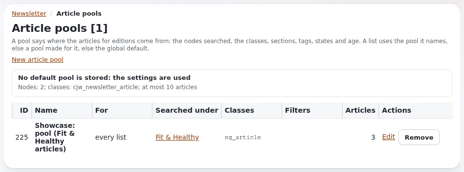

# Lektion 2.4: Wiederkehrende Versände, Artikel-Pools und Freigabe

Viele Newsletter erscheinen in einem festen Rhythmus, oft mit den neuesten Artikeln der Website, und manche
Organisationen wollen, dass eine zweite Person jede Nummer freigibt. CJW Newsletter 4.2 hat dafür drei redaktionelle
Werkzeuge: wiederkehrende Versände, Artikel-Pools und die Freigabe von Ausgaben. Diese Lektion zeigt, was jedes davon
leistet und wann man es einsetzt.

> **Hinweis**
> Ein wiederkehrender Versand sendet von selbst, wenn Cron läuft. Auf der Schulungsinstallation schreibt jeder
> Transport Dateien (Lektion 1.2), und jeder Abonnent liegt unter `example.invalid`; trotzdem stellen Sie neue
> wiederkehrende Versände im Kurs auf **pausiert**.

## Auf einen Blick

| | |
|---|---|
| Kurs | [Newsletter mit CJW Newsletter](../README.md) |
| Modul | [Modul 2: Systeme, Listen und Ausgaben](README.md) |
| Dauer | 45 Minuten (20 Präsentation, 25 Übung) |
| Niveau | Fortgeschrittene |
| Zielgruppe | Redakteure, die Nummern planen, Administratoren, die Freigaben einrichten |
| Voraussetzungen | [Lektion 2.3](eine-ausgabe-schreiben.md): Die Person hat eine Liste mit zwei Ausgaben |

## Lernziele

Nach dieser Lektion können die Teilnehmenden:

- die zwei Modi eines wiederkehrenden Versands („neueste“ und „kopieren“) erklären und sagen, wann welcher passt;
- das Formular **Neuer wiederkehrender Versand** ausfüllen und pausiert speichern;
- erklären, was ein Artikel-Pool einem wiederkehrenden Versand und der Artikelauswahl liefert;
- den Ablauf der Freigabe von der Anfrage bis zur Entscheidung im Collaboration-Posteingang beschreiben.

## Hinweise für Trainer

### So präsentieren Sie es

Quelle: die redaktionelle Anleitung der Erweiterung (`extension/cjw_newsletter/doc/editorial.md`, verlinkt von der
[Funktionsseite](../../../../funktionen/6.0/erweiterungen/cjw_newsletter.md#die-funktionen-von-420)).

1. **Wiederkehrende Versände** (8 Minuten). Öffnen Sie **Wiederkehrende Versände** im Block **Redaktion** des
   Dashboards. Ein wiederkehrender Versand gehört zu einer Liste und läuft an gewählten Wochentagen, wöchentlich an
   einem Wochentag oder monatlich an einem Tag. Zwei Modi: *Die neueste noch nicht versendete Ausgabe der Liste
   versenden* oder *Eine Vorlage-Ausgabe kopieren und die Kopie versenden*, optional gefüllt aus dem Artikel-Pool mit
   dem, was seit dem letzten Versand veröffentlicht wurde. Mit *Den Lauf überspringen, wenn es nichts Neues gibt*
   geht in einer ruhigen Woche nichts hinaus. Läufe, die Cron verpasst hat, werden nicht nachgeholt.
2. **Artikel-Pools** (4 Minuten). **Artikel-Pools** legt fest, welche Klassen und Filter Artikel liefern. Ist kein
   Pool gespeichert, gelten die Einstellungen `[ArticlePoolSettings]`. Es werden nur Inhalte genommen, die der
   anonyme Benutzer lesen darf, denn ein Newsletter ist öffentlich.
3. **Freigabe** (6 Minuten). Wird pro Liste eingeschaltet (**Freigabe:** auf der Seite der Liste). Das
   Versandformular verweigert dann eine Version der Ausgabe, die nicht freigegeben ist. Der Redakteur fragt auf der
   Freigabeseite an; die Anfrage erscheint im **Collaboration-Posteingang** der Freigebenden, die mit einem
   **Kommentar** auf **Freigeben** oder **Ablehnen** klicken. Niemand gibt die eigene Anfrage frei, es sei denn, die
   Einstellungen erlauben es, und eine neue Version braucht eine neue Freigabe.
4. **Berechtigungen** (2 Minuten). Die Seiten brauchen die Richtlinienfunktion `newsletter/editorial`; Entscheiden
   braucht `newsletter/approve`.

### Häufige Fragen

**Welche Zeitzone verwendet ein wiederkehrender Versand?** Seine eigene, sonst `[ScheduleSettings] DefaultTimezone`,
sonst die von PHP.

**Was passiert am 31. in einem kurzen Monat?** Ein monatlicher Lauf an einem Tag, den der Monat nicht hat, läuft an
dessen letztem Tag.

**Wer sind die Freigebenden?** Die Benutzer und Benutzergruppen, die in `[ApprovalSettings]` genannt sind;
standardmäßig die Gruppe mit der ID 12 (die Administratoren einer Standardinstallation). Prüfen Sie die Einstellungen
Ihrer Installation.

**Kann ich einen wiederkehrenden Versand testen, ohne zu senden?** Die Liste **Wiederkehrende Versände** hat
**Probieren**, das ihn als Probelauf ausführt. Lesen Sie in der redaktionellen Anleitung nach, was er meldet, bevor
Sie ihn im Kurs einsetzen.

### Stolperfallen

- **Einen Zeitplan aktiv speichern.** Auf einer gemeinsam genutzten Schulungswebsite sendet ein aktiver Zeitplan
  beim nächsten Cron-Lauf. Wählen Sie **pausiert** vor **Speichern**.
- **Freigabe auf einer Liste im Einsatz.** Das Einschalten der Freigabe blockiert wartende Versände. Tun Sie es auf
  der eigenen Liste der Person.
- **Selbstfreigabe.** Wer anfragt und dann die eigene Anfrage freigeben will, wird abgewiesen; bilden Sie Paare.

## Praktische Übung

Verwenden Sie die Schulungsinstallation (alle Transporte schreiben Dateien, Abonnenten unter `example.invalid`).
Arbeiten Sie in Paaren, A und B.

1. Öffnen Sie **Newsletter**, suchen Sie den Block **Redaktion** auf dem Dashboard und klicken Sie auf
   **Wiederkehrende Versände**.
2. Lesen Sie die vorhandenen Zeilen: **Was**, **Wann**, **Läufe**. Klicken Sie nicht auf **Jetzt ausführen** oder
   **Probieren**.
3. Klicken Sie auf **Neuer wiederkehrender Versand** (im Block **Redaktion** des Dashboards).
4. **Liste**: Ihre Liste `Weekly tips <name>`. Wählen Sie **Eine Vorlage-Ausgabe kopieren und die Kopie versenden**
   und als **Vorlage-Ausgabe** Ihre `Tips for week 1`.
5. Haken Sie **Den Lauf überspringen, wenn es nichts Neues gibt (wird protokolliert)** an. Lassen Sie **Bedingung**
   auf **Keine**.
6. Wählen Sie **Wöchentlich am** und einen Wochentag, eine **Uhrzeit**, und lassen Sie **Zeitzone** auf dem
   Standardwert.
7. Wählen Sie **pausiert** und klicken Sie auf **Speichern**.
8. Öffnen Sie **Artikel-Pools** und lesen Sie die Spalten **Für**, **Klassen** und **Filter** der aufgeführten Pools.
9. Vorführung durch den Trainer (auf der eigenen Liste des Trainers mit eingeschalteter Freigabe): Öffnen Sie die
   Freigabeseite einer Ausgabe, zeigen Sie **Ihre Entscheidung**, **Kommentar**, **Freigeben** und **Ablehnen** sowie
   den **Verlauf**.
10. Paararbeit: A erklärt B den Ablauf der Freigabe in vier Schritten; B erklärt A die zwei Modi eines
    wiederkehrenden Versands.

## Erwartetes Ergebnis

- Der wiederkehrende Versand jeder Person steht unter **Wiederkehrende Versände**, pausiert, mit dem gewählten
  Wochentag und der gewählten Uhrzeit.
- Es wurde nichts gesendet: keine neue Zeile unter **Letzte Sendungen** auf dem Dashboard.
- Jedes Paar kann den Ablauf der Freigabe und die zwei Modi des Zeitplans erklären.
- Der Trainer prüft die Liste **Wiederkehrende Versände** auf Zeitpläne, die nicht pausiert sind, und pausiert sie.

## Quiz

1. Welche zwei Modi hat ein wiederkehrender Versand?
2. Ein monatlicher Versand ist auf den Tag 31 gesetzt. Wann läuft er im April?
   A. 1. Mai B. 30. April C. er wird übersprungen D. 31. März
3. Welche Richtlinienfunktion wird gebraucht, um eine Ausgabe freizugeben?
4. Richtig oder falsch: Eine Freigabe gilt für jede spätere Version der Ausgabe.
5. Warum nimmt ein Artikel-Pool nur Inhalte, die der anonyme Benutzer lesen darf?

Antworten

1. Die neueste noch nicht versendete Ausgabe der Liste versenden oder eine Vorlage-Ausgabe kopieren und die Kopie
   versenden (redaktionelle Anleitung, verlinkt von der [Funktionsseite](../../../../funktionen/6.0/erweiterungen/cjw_newsletter.md#die-funktionen-von-420)).
2. **B.** Ein Tag jenseits des Monatsendes bedeutet dessen letzten Tag (redaktionelle Anleitung).
3. `newsletter/approve` (redaktionelle Anleitung; siehe auch [Rollen und Richtlinien](../../../../anleitungen/rollen-und-richtlinien.md)).
4. **Falsch.** Die Freigabe gilt pro Version; eine neue Version braucht ihre eigene Freigabe.
5. Ein Newsletter ist öffentlich; er darf keine Inhalte tragen, die Besucher auf der Website nicht lesen könnten.

## Weiterführende Informationen

- [cjw_newsletter: Newsletter in der Administration](../../../../funktionen/6.0/erweiterungen/cjw_newsletter.md#die-funktionen-von-420):
  die Bereiche aus 4.2 und ihre Anleitungen.
- [Rollen und Richtlinien](../../../../anleitungen/rollen-und-richtlinien.md): `newsletter/editorial` und
  `newsletter/approve` gewähren.
- [Cronjobs](../../../../anleitungen/cronjobs.md): Wiederkehrende Versände laufen mit dem Warteschlangen-Teil von Cron.

## Verwandte Seiten

- [Modul 2: Systeme, Listen und Ausgaben](README.md)
- [Newsletter mit CJW Newsletter: Kursüberblick](../README.md)
- [Trainer: hier beginnen](../../trainer-hier-beginnen.md)
- [Freie Dokumentation](../../../freie-dokumentation.md): Diese Seite darf unter der GNU FDL 1.3 frei kopiert, übersetzt und verbessert werden.

<!-- exp-partner-block:start -->
**Werden Sie Exponential-Partner.** Partner teilen ihre Informationen, stellen Mittel bereit, geben Beiträge zurück
und entwickeln die Produkte mit uns, und so wächst Exponential. Eine Partner-Website und ein Dashboard sind für Mitte
2027 geplant: Werden Sie noch heute Partner, damit wir schneller wachsen und neue Funktionen früher liefern. Beginnen
Sie mit [Partner: hier beginnen](../../../partner/partner-hier-beginnen.md) und
[Wie Sie sich bewerben](../../../partner/wie-sie-sich-bewerben.md).
<!-- exp-partner-block:end -->
