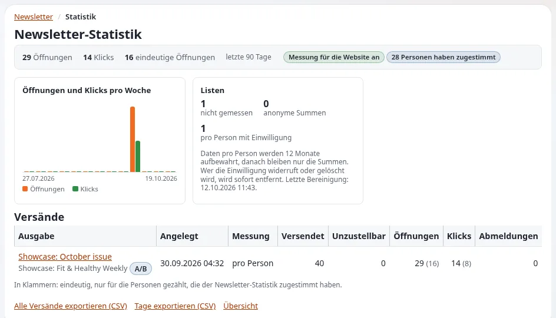

# Lektion 4.4: Einen Versand abbrechen, das Archiv und Statistiken

Fehler passieren: die falsche Ausgabe, die falsche Liste, ein Tippfehler im Betreff. Wenn die Warteschlange einen
Versand noch nicht verarbeitet hat, kann er abgebrochen werden. Nach einem Versand zeigt das Archiv genau, was
hinausgegangen ist, und die Statistiken zeigen, was damit passiert ist, innerhalb der Grenzen, die der Datenschutz
setzt. Diese Lektion behandelt alle drei.

> **Hinweis**
> Diese Lektion plant einen Versand, um ihn abzubrechen. Alle Transporte schreiben Dateien, und alle Abonnenten liegen
> unter `example.invalid` (Lektion 1.2). Tracking bleibt im Kurs aus.

## Auf einen Blick

| | |
|---|---|
| Kurs | [Newsletter mit CJW Newsletter](../README.md) |
| Modul | [Modul 4: Versand](README.md) |
| Dauer | 45 Minuten (20 Präsentation, 25 Übung) |
| Niveau | Fortgeschrittene |
| Zielgruppe | Redakteure und Administratoren |
| Voraussetzungen | [Lektion 4.2](eine-ausgabe-planen-und-versenden.md): mindestens ein beendeter Versand |

## Lernziele

Nach dieser Lektion können die Teilnehmenden:

- einen geplanten Versand mit **Newsletter-Versendeprozess abbrechen** abbrechen, bevor die Warteschlange ihn
  verarbeitet;
- erklären, warum ein Abbruch bereits gesendete Mails nicht zurückholen kann;
- einen vergangenen Versand im Archiv und unter **Letzte Sendungen** auf dem Dashboard finden;
- die drei Tracking-Modi erklären und warum das Zählen pro Person eine Einwilligung braucht;
- die Berichtsseite eines Versands lesen.

## Hinweise für Trainer

### So präsentieren Sie es

Quellen: [Wenn etwas schiefgeht](../../../ersteller/website-ersteller/newsletter-versenden.md#wenn-etwas-schiefgeht),
die Statistik-Anleitung der Erweiterung (verlinkt von der [Funktionsseite](../../../../funktionen/6.0/erweiterungen/cjw_newsletter.md#die-funktionen-von-420))
und [E-Mail-Einstellungen](../../../../funktionen/6.0/e-mail-einstellungen.md).

1. **Abbrechen** (5 Minuten). Bei einer Ausgabe mit einem nicht beendeten Versand bietet **Newsletter
   Verarbeitungsinformation** den Abbruch an. Die Seite `newsletter/send_abort` zeigt die Statistiken des Versands
   und fragt, ob Sie den Versendeprozess wirklich abbrechen wollen. Bereits gesendete Mails bleiben gesendet; der Rest
   wird nicht gesendet.
2. **Das Archiv** (4 Minuten). Jeder Versand wird mit der Version und dem Skin aufbewahrt, mit denen er gerendert
   wurde. `newsletter/archive` zeigt eine gesendete Ausgabe; die Seite der Ausgabe zeigt **Statistiken** (**Anzahl
   E-Mails**, **Gesendete E-Mails**, **Geöffnete E-Mails**, **Nichtversendete E-Mails**, **E-Mails-Rückläufer**).
3. **Tracking und Einwilligung** (7 Minuten). Drei Modi: aus (der Standard), anonyme Summen und pro Person mit
   Einwilligung. Pro Person wird nichts gezählt ohne die Einwilligung der Person in der Kategorie
   „Newsletter-Statistik“ der E-Mail-Einstellungen, die standardmäßig aus ist. Der Schalter der Website
   `[TrackingSettings] Tracking` ist bei Auslieferung ausgeschaltet: Dann wird überhaupt nichts gezählt. Testversände
   und SMS-Versände werden nie getrackt.
4. **Der Bericht** (4 Minuten). **Gesamte Statistik** auf dem Dashboard führt zu den Berichten. Ein Bericht zeigt
   Öffnungen und Klicks im Zeitverlauf, Klicks pro Link, einen A/B-Test des Betreffs, falls es einen gab, und
   CSV-Exporte.

### Häufige Fragen

**Kann ich einen halb erledigten Versand abbrechen?** Ja; die restlichen Mails werden nicht gesendet. Die bereits
gesendeten lassen sich nicht zurückholen.

**Warum gibt es bei unseren Schulungsversänden keine Öffnungen?** Tracking ist aus, und auf der Schulungsinstallation
öffnet niemand die Dateien in einem Mailprogramm, das mit der Website verbunden ist.

**Was ist ein A/B-Test des Betreffs?** Ein Versand mit zwei Betreffzeilen, jede an eine Stichprobe der Liste; nach
einer Wartezeit geht der Betreff mit der besseren Öffnungs- oder Klickrate an den Rest. Er braucht Tracking.

**Wie lange werden Zeilen pro Person aufbewahrt?** Das Dashboard einer Installation mit 4.2 nennt die Aufbewahrungsdauer
(zum Beispiel zwölf Monate, danach nur noch Summen). Prüfen Sie Ihre.

### Stolperfallen

- **Vor dem Abbrechen Jetzt senden drücken.** Vereinbaren Sie, dass während dieser Übung niemand die Warteschlange
  startet.
- **Statistiken aus Dateien erwarten.** Datei-Transporte erzeugen keine Öffnungen oder Klicks; zeigen Sie einen
  Bericht von einer vorbereiteten Installation, wenn Sie Zahlen zeigen wollen.
- **Redakteuren Tracking versprechen.** Tracking ist eine Datenschutzentscheidung der Organisation, nicht des
  Redakteurs.

## Praktische Übung

Verwenden Sie die Schulungsinstallation. Während der Schritte 1 bis 6 drückt niemand **Jetzt senden**. Ersetzen Sie
`<name>` durch Ihren Vornamen.

1. Kopieren Sie Ihre Ausgabe `Tips for week 1` (**Kopieren**) und benennen Sie die Kopie in `Tips for week 3` um.
2. Klicken Sie bei der Kopie auf **Newsletter versenden**, wählen Sie eine Versandzeit zehn Minuten in der Zukunft,
   Messung **Aus**, und klicken Sie auf **Newsletter versenden**; bestätigen Sie.
3. Lesen Sie auf der Seite der Ausgabe **Newsletter Verarbeitungsinformation**: Der Versand wartet.
4. Verwenden Sie den dort angebotenen Abbruch. Lesen Sie auf der Seite die Statistiken und die Frage und klicken Sie
   dann auf **Newsletter-Versendeprozess abbrechen**.
5. Laden Sie die Seite der Ausgabe neu und lesen Sie den **Status des Cronjobs**.
6. Prüfen Sie den Postausgang: keine neuen Dateien für `Tips for week 3`.

   ```bash
   ls -lt var/log/mail | head -5
   ```

7. Suchen Sie auf dem Dashboard Ihre Versände unter **Letzte Sendungen** und vergleichen Sie ihren **Status**.
8. Öffnen Sie die Ausgabe `Tips for week 2` aus Lektion 4.2 und lesen Sie ihre **Statistiken**.
9. Klicken Sie auf dem Dashboard auf **Gesamte Statistik** und öffnen Sie den Bericht eines Versands (den vorbereiteten
   Versand des Trainers, wenn Ihrer kein Tracking hat). Lesen Sie **Öffnungen und Klicks im Zeitverlauf** und **Klicks
   pro Link**.
10. Diskutieren Sie in Paaren: Würde Ihre Organisation Tracking einschalten, und in welchem Modus?

## Erwartetes Ergebnis

- Der Versand von `Tips for week 3` ist abgebrochen; für ihn wurde keine Mail-Datei geschrieben.
- **Letzte Sendungen** zeigt einen beendeten Versand (`Tips for week 2`) und einen abgebrochenen Versand.
- Die Teilnehmenden können die drei Tracking-Modi erklären und warum für das Zählen pro Person eine Einwilligung
  nötig ist.
- Der Trainer prüft **Letzte Sendungen** auf dem Dashboard am Beamer.



## Quiz

1. Wann kann ein Versand noch vollständig abgebrochen werden?
2. Was macht ein Abbruch mit bereits gesendeten Mails?
   A. holt sie zurück B. nichts; sie bleiben gesendet C. markiert sie als Bounce D. löscht sie aus dem Archiv
3. Was ist der Standard-Tracking-Modus einer Liste?
4. Was muss eine Person getan haben, bevor ihre Öffnungen pro Person gezählt werden?
5. Welche Versände werden nie getrackt?

<details>
<summary>Antworten</summary>

1. Bevor die Warteschlange ihn verarbeitet ([Wenn etwas schiefgeht](../../../ersteller/website-ersteller/newsletter-versenden.md#wenn-etwas-schiefgeht)).
2. **B.** Ein Newsletter lässt sich nicht zurückholen ([Newsletter sicher versenden](../../../ersteller/website-ersteller/newsletter-versenden.md)).
3. Aus (Statistik-Anleitung, verlinkt von der [Funktionsseite](../../../../funktionen/6.0/erweiterungen/cjw_newsletter.md#die-funktionen-von-420)).
4. Die Kategorie „Newsletter-Statistik“ der E-Mail-Einstellungen eingeschaltet haben (Statistik-Anleitung;
   [E-Mail-Einstellungen](../../../../funktionen/6.0/e-mail-einstellungen.md)).
5. Testversände und SMS-Versände (Statistik-Anleitung).

</details>

## Weiterführende Informationen

- [Newsletter sicher versenden](../../../ersteller/website-ersteller/newsletter-versenden.md#wenn-etwas-schiefgeht):
  was zu tun ist, wenn etwas schiefgeht.
- [E-Mail-Einstellungen](../../../../funktionen/6.0/e-mail-einstellungen.md): Kategorien und Einwilligung.
- [cjw_newsletter: Newsletter in der Administration](../../../../funktionen/6.0/erweiterungen/cjw_newsletter.md#die-funktionen-von-420):
  die Statistik-Anleitung.

## Verwandte Seiten

- [Modul 4: Versand](README.md)
- [Newsletter mit CJW Newsletter: Kursüberblick](../README.md)
- [Trainer: hier beginnen](../../trainer-hier-beginnen.md)
- [Freie Dokumentation](../../../freie-dokumentation.md): Diese Seite darf unter der GNU FDL 1.3 frei kopiert, übersetzt und verbessert werden.

<!-- exp-partner-block:start -->
**Werden Sie Exponential-Partner.** Partner teilen ihre Informationen, stellen Mittel bereit, geben Beiträge zurück
und entwickeln die Produkte mit uns, und so wächst Exponential. Eine Partner-Website und ein Dashboard sind für Mitte
2027 geplant: Werden Sie noch heute Partner, damit wir schneller wachsen und neue Funktionen früher liefern. Beginnen
Sie mit [Partner: hier beginnen](../../../partner/partner-hier-beginnen.md) und
[Wie Sie sich bewerben](../../../partner/wie-sie-sich-bewerben.md).
<!-- exp-partner-block:end -->
