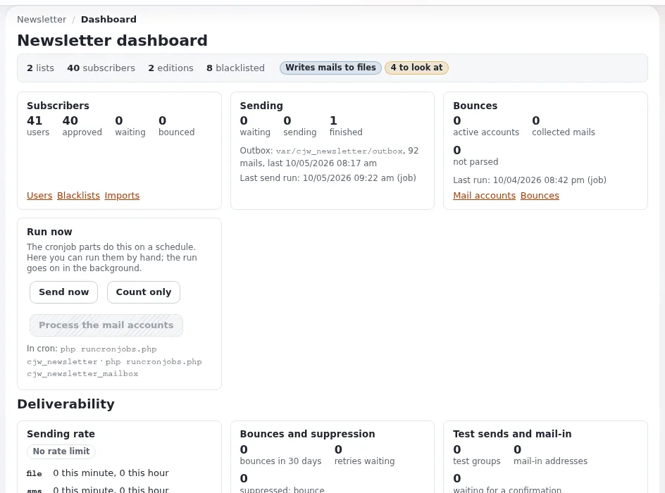

# Lektion 4.3: Cronjobs und Konsolenbefehle

Redakteure drücken Knöpfe; Administratoren sorgen dafür, dass die Arbeit dahinter läuft. Die Arbeit des Newsletters
erledigen Cronjob-Teile und Konsolenbefehle, die denselben Code ausführen. In dieser Lektion arbeiten Administratoren
eine Warteschlange von Hand ab, immer zuerst mit einem Probelauf, und richten die Crontab ein, die eine echte
Installation braucht.

> **Hinweis**
> Der Warteschlangenbefehl sendet alles Fällige über `TransportMethodCronjob`. Führen Sie ihn nur auf der
> Schulungsinstallation aus, nachdem Sie geprüft haben, dass die Methode `file` ist und jeder Abonnent unter
> `example.invalid` liegt (Lektion 1.2).

## Auf einen Blick

| | |
|---|---|
| Kurs | [Newsletter mit CJW Newsletter](../README.md) |
| Modul | [Modul 4: Versand](README.md) |
| Dauer | 45 Minuten (20 Präsentation, 25 Übung) |
| Niveau | Fortgeschrittene |
| Zielgruppe | Administratoren |
| Voraussetzungen | [Lektion 4.2](eine-ausgabe-planen-und-versenden.md); Shell-Zugang zur eigenen Schulungsinstallation |

## Lernziele

Nach dieser Lektion können die Teilnehmenden:

- die vier Cronjob-Teile des Newsletters nennen und sagen, was jeder tut;
- `ext:cjw_newsletter:queue` mit `--dry-run` und dann echt ausführen und seine Ausgabe lesen;
- die Sperren der Läufe erklären und was „Another queue run is active.“ bedeutet;
- Crontab-Zeilen für die Newsletter-Teile und den Bounce-Teil schreiben;
- herausfinden, wann jeder Teil zuletzt gelaufen ist.

## Hinweise für Trainer

### So präsentieren Sie es

Quellen: [Cronjob-Teile](../../../../spezifikationen/6.0/cjw_newsletter.md#cronjob-teile),
[Konsolenbefehle](../../../../spezifikationen/6.0/cjw_newsletter.md#konsolenbefehle),
[10.5 Newsletter](../../../../installation/10-nach-der-installation.md#105-benachrichtigungen-und-newsletter) und
[Cronjobs](../../../../anleitungen/cronjobs.md).

1. **Die Teile** (5 Minuten):

   | Teil | Was er tut |
   |---|---|
   | `cjw_newsletter` | Legt die Warteschlange an und sendet dann (beide Teile unten) |
   | `cjw_newsletter_mailqueue_create` | Bestätigt wartende Benutzer, weckt fällige Versände, baut die Warteschlange auf |
   | `cjw_newsletter_mailqueue_process` | Sendet die Mails, die in der Warteschlange warten |
   | `cjw_newsletter_mailbox` | Liest die Bounce-Mailkonten; nicht Teil von `cjw_newsletter` |

2. **Die Befehle** (5 Minuten). `ext:cjw_newsletter:queue` (`--dry-run`, `--create-only`, `--send-only`),
   `mailbox`, `import`, `repair` und `status`, jeweils mit `--help`. Exit-Code 0 bedeutet Erfolg, 1 einen Fehler oder
   einen anderen Lauf, der die Sperre hält. Die Cron-Teile, die Befehle und die Dashboard-Knöpfe rufen alle denselben
   Runner auf.
3. **Sperren** (3 Minuten). Jede Art von Lauf nimmt eine Dateisperre, sodass sich zwei Warteschlangenläufe nie
   überschneiden, egal wer sie startet. Ein zweiter Lauf zur selben Zeit gibt `Another queue run is active.` aus und
   endet mit 1.
4. **Letzte Läufe** (2 Minuten). Zeitpunkt, Benutzer (`cron`, `console`, `job`) und Summen des letzten Laufs jeder Art
   werden gespeichert und auf dem Dashboard und von `status` angezeigt.
5. **Die Crontab** (5 Minuten). Alle zehn Minuten für `cjw_newsletter`, stündlich für `cjw_newsletter_mailbox`, wie
   in [10.5](../../../../installation/10-nach-der-installation.md#105-benachrichtigungen-und-newsletter). Der mit `-s` angegebene
   Siteaccess muss der sein, mit dem die Listen rendern.

### Häufige Fragen

**Warum `php bin/php/console` und nicht `./console`?** Beide starten dieselbe Konsole; die Dokumentation verwendet
beide Formen. Nehmen Sie die, die Ihre Installation hat.

**Als root ausführen?** Skripte verweigern die Ausführung als root, außer `--allow-root-user` ist angegeben. Führen Sie
sie als Benutzer des Webservers aus, damit die Dateien, die sie schreiben, den richtigen Eigentümer haben.

**Schreibt ein Probelauf ein Audit-Ereignis?** Nein. Ein echter Lauf schreibt ein Ereignis pro Lauf, wenn das Audit
eingeschaltet ist ([Audit-Ereignisse](../../../../spezifikationen/6.0/cjw_newsletter.md#audit-ereignisse)).

**Was macht `repair`?** Es entfernt Abonnements entfernter Benutzer und Mails, die nie gesendet werden können; führen
Sie es zuerst mit `--dry-run` aus.

### Stolperfallen

- **Die Warteschlange als root abarbeiten** hinterlässt Dateien in `var/`, die root gehören und die der Webserver
  später nicht beschreiben kann.
- **Der falsche Siteaccess in der Crontab** rendert Links für die falsche Website.
- **Den Mailbox-Teil vergessen.** Bounces werden nie gelesen; das Dashboard meldet es (Modul 5).
- **Ein echter Transport auf einer Testinstallation.** Lesen Sie vor einem echten Lauf immer die Transportzeile von
  `status`.

## Praktische Übung

Verwenden Sie Ihre eigene Schulungsinstallation, in ihrem Wurzelverzeichnis, als Benutzer des Webservers (oder fügen
Sie `--allow-root-user` hinzu, wenn Ihr Trainer es Ihnen sagt). Ersetzen Sie `<name>` durch Ihren Vornamen.

1. Prüfen Sie den Transport und den Postausgang:

   ```bash
   php bin/php/console ext:cjw_newsletter:status
   ```

2. Planen Sie in der Administration Ihre Ausgabe `Tips for week 1` mit **Newsletter versenden** wie in Lektion 4.2
   (Messung **Aus**). Drücken Sie nicht **Jetzt senden**.
3. Führen Sie den Probelauf aus und lesen Sie, was er tun würde:

   ```bash
   php bin/php/console ext:cjw_newsletter:queue --dry-run
   ```

4. Arbeiten Sie die Warteschlange echt ab und lesen Sie die zwei Zusammenfassungszeilen:

   ```bash
   php bin/php/console ext:cjw_newsletter:queue
   ```

5. Führen Sie `status` erneut aus und suchen Sie den letzten Lauf der Warteschlange, seinen Benutzer und seine Summen.
6. Führen Sie dieselbe Arbeit über den Cron-Runner aus, um zu sehen, dass nichts übrig ist:

   ```bash
   php runcronjobs.php cjw_newsletter
   ```

7. Lesen Sie die Hilfe des Reparaturbefehls und führen Sie ihn als Probelauf aus:

   ```bash
   php bin/php/console ext:cjw_newsletter:repair --help
   php bin/php/console ext:cjw_newsletter:repair --dry-run
   ```

8. Schreiben Sie (installieren Sie nicht) die Crontab-Zeilen für den Pfad und den öffentlichen Siteaccess Ihrer
   Installation, nach [10.5](../../../../installation/10-nach-der-installation.md#105-benachrichtigungen-und-newsletter).

## Erwartetes Ergebnis

- Der Probelauf hat den Versand und die Zahl der Einträge gemeldet, die er anlegen würde, und nichts geändert.
- Der echte Lauf hat die Warteschlangenzeile (Versände und angelegte Einträge) und die Versandzeile (gesendete Mails,
  fehlgeschlagene, beendete Versände) ausgegeben; der Postausgang enthält die neuen Dateien, alle unter
  `example.invalid`.
- `status` zeigt den letzten Warteschlangenlauf durch `console`.
- Jede Person hat zwei Crontab-Zeilen mit ihrem Pfad und Siteaccess.
- Der Trainer prüft die Terminalausgabe und die Crontab-Zeilen einer Person.



## Quiz

1. Welcher Cronjob-Teil ist im Teil `cjw_newsletter` nicht enthalten?
2. Was ändert `ext:cjw_newsletter:queue --dry-run`?
   A. es legt nur die Warteschlange an B. nichts C. es sendet an Testadressen D. es leert den Postausgang
3. Ein Warteschlangenlauf gibt `Another queue run is active.` aus und endet mit 1. Was ist passiert?
4. Warum sollte die Warteschlange nicht als root laufen?
5. Welcher Befehl gibt aus, was das Dashboard zeigt?

<details>
<summary>Antworten</summary>

1. `cjw_newsletter_mailbox` ([Cronjob-Teile](../../../../spezifikationen/6.0/cjw_newsletter.md#cronjob-teile)).
2. **B.** Ein Probelauf zeigt, was ein Lauf tun würde, und ändert nichts ([Spezifikation](../../../../spezifikationen/6.0/cjw_newsletter.md#beispiel-einen-newsletter-aus-der-shell-versenden-und-das-ergebnis-ansehen)).
3. Ein anderer Lauf derselben Art hielt die Sperre ([Spezifikation](../../../../spezifikationen/6.0/cjw_newsletter.md#cronjob-teile)).
4. Dateien, die er in `var/` schreibt, würden root gehören, und auch der Benutzer des Webservers muss sie schreiben
   können ([10.5](../../../../installation/10-nach-der-installation.md#105-benachrichtigungen-und-newsletter)).
5. `ext:cjw_newsletter:status` ([Konsolenbefehle](../../../../spezifikationen/6.0/cjw_newsletter.md#konsolenbefehle)).

</details>

## Weiterführende Informationen

- [Spezifikation: die Erweiterung cjw_newsletter](../../../../spezifikationen/6.0/cjw_newsletter.md#konsolenbefehle):
  jeder Befehl und jede Option.
- [Cronjobs](../../../../anleitungen/cronjobs.md): wie `runcronjobs.php` und Teile funktionieren.
- [10.3 Cronjobs](../../../../installation/10-nach-der-installation.md#103-cronjobs): eine vollständige Crontab.

## Verwandte Seiten

- [Modul 4: Versand](README.md)
- [Newsletter mit CJW Newsletter: Kursübersicht](../README.md)
- [Trainer: hier beginnen](../../../../../eng-us/help/trainers/trainers-start-here.md)
- [Freie Dokumentation](../../../freie-dokumentation.md): Diese Seite darf unter der GNU FDL 1.3 frei kopiert, übersetzt und verbessert werden.

<!-- exp-partner-block:start -->
**Werden Sie Exponential-Partner.** Partner teilen ihre Informationen, stellen Mittel bereit, geben Beiträge
zurück und entwickeln die Produkte gemeinsam mit uns weiter, und so wächst Exponential. Eine Partner-Website und
ein Partner-Dashboard sind für Mitte 2027 geplant: Werden Sie noch heute Partner, damit wir schneller wachsen und
neue Funktionen früher bereitstellen können. Beginnen Sie mit [Partner: hier beginnen](../../../partner/partner-hier-beginnen.md) und
[Wie Sie sich bewerben](../../../partner/wie-sie-sich-bewerben.md).
<!-- exp-partner-block:end -->
