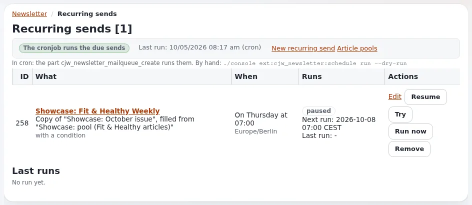

# Lektion 4.2: Eine Ausgabe planen und versenden

Auf diesen Moment hat der Kurs hingearbeitet. Die Teilnehmenden senden ihre Ausgabe an ihre Testabonnenten: Sie
wählen, wann sie hinausgeht und in welchem Skin, bestätigen und beobachten dann, wie die Warteschlange aus einer
Ausgabe eine Mail pro Abonnent macht. Auf der Schulungsinstallation ist jede dieser Mails eine Datei.

> **Hinweis**
> In dieser Lektion wird gesendet. Das ist nur sicher, weil jeder Transport der Schulungsinstallation Dateien schreibt
> und jeder Abonnent eine Adresse unter `example.invalid` hat (Lektion 1.2, in Schritt 1 erneut geprüft). Führen Sie
> diese Übung nie auf einer Installation aus, bei der Sie nicht beides geprüft haben.

## Auf einen Blick

| | |
|---|---|
| Kurs | [Newsletter mit CJW Newsletter](../README.md) |
| Modul | [Modul 4: Versand](README.md) |
| Dauer | 60 Minuten (20 Präsentation, 40 Übung) |
| Niveau | Fortgeschrittene |
| Zielgruppe | Redakteure, die versenden, Administratoren, die sie unterstützen |
| Voraussetzungen | [Lektion 4.1](vorschauen-und-testversand.md): eine getestete Ausgabe; Abonnenten aus Modul 3 |

## Lernziele

Nach dieser Lektion können die Teilnehmenden:

- die Versandseite einer Ausgabe öffnen und Versandzeit, Skin und Tracking des Versands ausfüllen;
- einen Versand bestätigen und erklären, was danach geschieht (Warteschlange, Verarbeitung, Archiv);
- den Fortschritt in **Newsletter Verarbeitungsinformation** und unter **Letzte Sendungen** auf dem Dashboard
  verfolgen;
- eine Mail-Datei pro bestätigtem oder angenommenem Abonnenten finden und keine für die anderen.

## Hinweise für Trainer

### So präsentieren Sie es

Quellen: [Wie ein Versand abläuft](../../../ersteller/website-ersteller/newsletter-versenden.md#wie-ein-versand-abläuft),
[Vor jedem Versand](../../../ersteller/website-ersteller/newsletter-versenden.md#vor-jedem-versand) und das
[Beispiel in der Spezifikation](../../../../spezifikationen/6.0/cjw_newsletter.md#beispiel-einen-newsletter-aus-der-shell-versenden-und-das-ergebnis-ansehen).

1. **Die Checkliste** (4 Minuten). Lesen Sie [Vor jedem Versand](../../../ersteller/website-ersteller/newsletter-versenden.md#vor-jedem-versand)
   laut vor: Test geprüft, Betreff und Absender richtig, Links funktionieren, Bilder haben Alternativtexte, die
   richtige Liste, ein guter Zeitpunkt. Ein Versand lässt sich nicht zurückholen.
2. **Die Versandseite** (6 Minuten). **Newsletter versenden** bei der Ausgabe öffnet die Seite `Newsletter verschicken
   - <title>`. **Jahr**, **Monat**, **Tag**, **Stunde**, **Minute** legen fest, wann der Versand beginnen darf.
   **Layout dieses Versands** bietet die Skins an, die die Liste erlaubt. **Messung dieses Versands** (*Wie in der
   Liste eingestellt*, *Aus*, *Anonyme Summen*, *Pro Person mit Einwilligung*) bleibt in diesem Kurs auf *Aus*.
   **A/B-Test des Betreffs** wird in Lektion 4.4 gezeigt. Die Seite verlinkt außerdem **Vorschau der Layouts** und
   **Vorschau als Abonnent**.
3. **Was danach geschieht** (5 Minuten). Der Versand wird angelegt und die Ausgabe einmal im Skin des Versands
   gerendert. Wenn ihre Zeit gekommen ist, legt `cjw_newsletter_mailqueue_create` pro empfangendem Abonnenten einen
   Eintrag in der Warteschlange an, und `cjw_newsletter_mailqueue_process` sendet sie über `TransportMethodCronjob`.
   Auf dem Dashboard erledigt **Jetzt senden** dieselbe Arbeit im Hintergrund. Danach wird die Ausgabe archiviert.
4. **Wer empfängt** (5 Minuten). Nur bestätigte und angenommene Abonnenten. Wartende, entfernte, gebouncte und
   gesperrte bekommen nichts. Lassen Sie den Raum vor dem Lauf die Zahl der Dateien vorhersagen.

### Häufige Fragen

**Kann ich die Ausgabe ändern, nachdem ich auf Newsletter versenden gedrückt habe?** Der Versand behält die Version,
die in diesem Moment gerendert wurde. Brechen Sie den Versand ab (Lektion 4.4) und senden Sie erneut, wenn der Inhalt
falsch war.

**Warum passiert nach dem Bestätigen nichts?** Cron ist noch nicht gelaufen. Im Kurs drückt der Trainer **Jetzt
senden** oder arbeitet die Warteschlange ab (Lektion 4.3).

**Was, wenn die Liste eine Freigabe verlangt?** Das Versandformular verweigert eine Version der Ausgabe, die nicht
freigegeben ist (Lektion 2.4).

**Wie lange dauert eine große Liste?** Das hängt vom Transport und den Versandraten ab (Lektion 5.3). Eine
Schulungsliste mit sechs Personen dauert Sekunden.

### Stolperfallen

- **Teilnehmende drücken Jetzt senden.** Vereinbaren Sie, dass nur der Trainer die Warteschlange startet, sobald alle
  ihren Versand bestätigt haben.
- **Zeit in der Vergangenheit oder Zukunft.** Eine Versandzeit in der Zukunft wartet; die Teilnehmenden glauben, es
  sei fehlgeschlagen. Behalten Sie für die Übung die Standardzeit.
- **Dateien falsch zählen.** Bestätigungs- und Testdateien aus früheren Lektionen liegen im selben Ordner. Verwenden
  Sie die Zeitstempel.

## Praktische Übung

Verwenden Sie die Schulungsinstallation. Ersetzen Sie `<name>` durch Ihren Vornamen.

1. Öffnen Sie **INI Einstellungen** und prüfen Sie, dass `TransportMethodCronjob` `file` lautet. Prüfen Sie, dass
   jeder Abonnent Ihrer Liste unter `example.invalid` liegt.
2. Schreiben Sie auf, wer empfangen sollte: Aus Modul 3 hat Ihre Liste Anna (entfernt), Ben (angenommen), Carla,
   Dora, Emil (gesperrt), Fay. Sagen Sie die Zahl der Mails voraus.
3. Öffnen Sie Ihre Ausgabe `Tips for week 2` und klicken Sie auf **Newsletter versenden**.
4. Lassen Sie auf *Newsletter verschicken* **Jahr**, **Monat**, **Tag**, **Stunde** und **Minute** wie angeboten.
5. **Layout dieses Versands**: Behalten Sie den Skin der Liste. **Messung dieses Versands**: Wählen Sie **Aus**.
   Lassen Sie **A/B-Test des Betreffs** ohne Haken.
6. Klicken Sie auf **Newsletter versenden** und bestätigen Sie die Frage, ob Sie den Newsletter wirklich verschicken
   wollen.
7. Lesen Sie auf der Seite der Ausgabe **Newsletter Verarbeitungsinformation** und **Status des Cronjobs**.
8. Warten Sie auf den Trainer: Der Trainer drückt **Jetzt senden** auf dem Dashboard einmal für den ganzen Kurs.
9. Laden Sie die Seite der Ausgabe neu und lesen Sie **Statistiken**: **Anzahl E-Mails**, **Gesendete E-Mails**,
   **Nichtversendete E-Mails**.
10. Listen Sie den Postausgang auf und zählen Sie die Dateien Ihres Versands:

    ```bash
    ls -lt var/log/mail | head -15
    ```

11. Vergleichen Sie mit Ihrer Vorhersage aus Schritt 2.

## Erwartetes Ergebnis

- Der Versand von `Tips for week 2` ist beendet; **Gesendete E-Mails** entspricht der Zahl der bestätigten und
  angenommenen Abonnenten.
- Der Postausgang enthält eine `.eml`-Datei pro empfangendem Abonnenten, alle unter `example.invalid`; keine für Anna
  oder Emil.
- **Letzte Sendungen** auf dem Dashboard zeigt den Versand mit **Status**, **E-Mails** und **Fehlgeschlagen**.
- Der Trainer prüft das, indem er die Zahlen des Dashboards mit den Vorhersagen zweier Personen vergleicht.



## Quiz

1. Welche Abonnenten erhalten einen Versand?
2. Welche Transportmethode befördert die Ausgaben eines Versands?
   A. `TransportMethodDirectly` B. `TransportMethodPreview` C. `TransportMethodCronjob` D. `Transport` des Kernels
3. Sie haben den Versand bestätigt, aber es wurde nichts gesendet. Was ist der wahrscheinlichste Grund?
4. Was lässt Sie **Layout dieses Versands** wählen?
5. Nennen Sie drei Punkte der Checkliste vor jedem Versand.

<details>
<summary>Antworten</summary>

1. Bestätigte und angenommene Abonnenten ([Status](../../../ersteller/website-ersteller/newsletter-listen-und-abonnements.md#status)).
2. **C.** ([Newsletter sicher versenden](../../../ersteller/website-ersteller/newsletter-versenden.md#die-transporte)).
3. Die Warteschlange ist noch nicht gelaufen: Cron oder **Jetzt senden** auf dem Dashboard ([Wie ein Versand abläuft](../../../ersteller/website-ersteller/newsletter-versenden.md#wie-ein-versand-abläuft)).
4. Einen der Skins, die die Liste erlaubt; ein Versand in einem anderen Skin wird darin erneut gerendert
   (Rendering-Anleitung, verlinkt von der [Funktionsseite](../../../../funktionen/6.0/erweiterungen/cjw_newsletter.md#die-funktionen-von-420)).
5. Drei beliebige aus [Vor jedem Versand](../../../ersteller/website-ersteller/newsletter-versenden.md#vor-jedem-versand).

</details>

## Weiterführende Informationen

- [Newsletter sicher versenden](../../../ersteller/website-ersteller/newsletter-versenden.md): die Transporte, wie ein
  Versand abläuft, die Checkliste.
- [Spezifikation: die Erweiterung cjw_newsletter](../../../../spezifikationen/6.0/cjw_newsletter.md#beispiel-einen-newsletter-aus-der-shell-versenden-und-das-ergebnis-ansehen):
  ein Versand, in der Shell verfolgt.
- [cjw_newsletter: Newsletter in der Administration](../../../../funktionen/6.0/erweiterungen/cjw_newsletter.md): die
  Bestandteile des Versands.

## Verwandte Seiten

- [Modul 4: Versand](README.md)
- [Newsletter mit CJW Newsletter: Kursüberblick](../README.md)
- [Trainer: hier beginnen](../../trainer-hier-beginnen.md)
- [Freie Dokumentation](../../../freie-dokumentation.md): Diese Seite darf unter der GNU FDL 1.3 frei kopiert, übersetzt und verbessert werden.

<!-- exp-partner-block:start -->
**Werden Sie Exponential-Partner.** Partner teilen ihre Informationen, stellen Mittel bereit, geben Beiträge zurück
und entwickeln die Produkte mit uns, und so wächst Exponential. Eine Partner-Website und ein Dashboard sind für Mitte
2027 geplant: Werden Sie noch heute Partner, damit wir schneller wachsen und neue Funktionen früher liefern. Beginnen
Sie mit [Partner: hier beginnen](../../../partner/partner-hier-beginnen.md) und
[Wie Sie sich bewerben](../../../partner/wie-sie-sich-bewerben.md).
<!-- exp-partner-block:end -->
