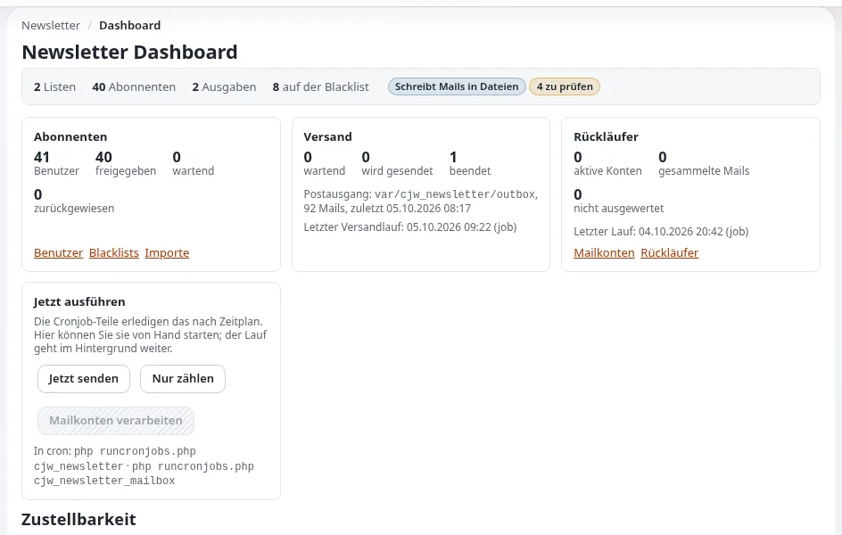

# Lektion 5.2: Mail-Transporte und Livegang

Auf der Schulungsinstallation ist jede Mail eine Datei, und das bleibt so. Auf einer echten Website kommt der Tag, an
dem der Newsletter echte Postfächer erreichen muss. Diese Lektion zeigt, wie dieser Umstieg Schritt für Schritt
geplant und vollzogen wird, als Übung am Schreibtisch: Die Teilnehmenden schreiben den Plan, aber auf der
Schulungsinstallation wird nichts umgestellt.

> **Hinweis**
> Ändern Sie in dieser Lektion keinen Transport der Schulungsinstallation. Der hier geschriebene Override kommt in ein
> Plandokument, nicht nach `settings/override/`. Der Kurs sendet nie echte Mail.

## Auf einen Blick

| | |
|---|---|
| Kurs | [Newsletter mit CJW Newsletter](../README.md) |
| Modul | [Modul 5: Bounces und Transporte](README.md) |
| Dauer | 45 Minuten (20 Präsentation, 25 Übung) |
| Niveau | Experten |
| Zielgruppe | Administratoren, Hosting-Mitarbeitende |
| Voraussetzungen | [Lektion 1.2](../modul-01-erste-schritte/eine-sichere-schulungsinstallation-vorbereiten.md); [Lektion 5.1](mailkonten-und-bounces.md) |

## Lernziele

Nach dieser Lektion können die Teilnehmenden:

- die Transporte `file`, `smtp` und `sendmail` und die Einstellungen der SMTP-Verbindung nennen;
- den Umstieg in die richtige Reihenfolge bringen: zuerst die Vorschau, nur an die eigene Adresse, dann Bestätigungen
  und Ausgaben;
- die DNS-Einträge aufzählen, die eine Absenderdomain braucht (SPF, DKIM, DMARC), und die IPv6-Falle nennen;
- erklären, wohin Geheimnisse gehören und wohin niemals;
- eine Checkliste für den Livegang ihrer eigenen Organisation schreiben.

## Hinweise für Trainer

### So präsentieren Sie es

Quellen: [Newsletter sicher versenden](../../../ersteller/website-ersteller/newsletter-versenden.md),
[10.4 Mail](../../../../installation/10-nach-der-installation.md#104-mail-der-datei-transport-und-echter-versand) und die
[Funktionsseite](../../../../funktionen/6.0/erweiterungen/cjw_newsletter.md#den-gesamten-ablauf-erproben-ohne-eine-einzige-mail-zu-versenden).

1. **Die Transporte** (4 Minuten). Jede der drei Methoden ist `file`, `smtp` oder `sendmail`. Mit `smtp` besteht die
   Verbindung aus `SmtpTransportServer`, `SmtpTransportPort`, `SmtpTransportUser`, `SmtpTransportPassword` und
   `SmtpTransportConnectionType` (leer, `ssl`, `sslv2`, `sslv3` oder `tls`). Die Transporte des Newsletters sind von
   `[MailSettings]` des Kernels getrennt.
2. **Die Reihenfolge des Umstiegs** (5 Minuten), aus [Von der Probe zur echten Mail](../../../ersteller/website-ersteller/newsletter-versenden.md#von-der-probe-zur-echten-mail):
   mit `file` proben; `TransportMethodPreview` umstellen und nur an die eigene Adresse testen; mehrere Mailprogramme
   und den Abmeldelink prüfen; die Absenderdomain einrichten; dann `TransportMethodDirectly` und
   `TransportMethodCronjob` umstellen.
3. **Die Absenderdomain** (5 Minuten). Eine Absenderadresse einer Domain, die Sie kontrollieren, mit SPF (und
   möglichst DKIM und DMARC), das den sendenden Server erlaubt, für jede Adressfamilie, über die er sendet. Wenn der
   Server über IPv6 sendet und SPF nur IPv4 aufführt, lehnen große Anbieter die Mail ab.
4. **Geheimnisse** (3 Minuten). Das SMTP-Passwort gehört nach `settings/override/`, niemals in die Versionsverwaltung
   oder in ein Ticket. Die Einstellungsansicht schwärzt es.
5. **Der erste echte Versand** (3 Minuten). Zuerst eine kleine interne Liste; beobachten Sie das Bounce-Postfach und
   das Dashboard.

### Häufige Fragen

**SMTP oder sendmail?** Was Ihr Hosting zuverlässig bereitstellt. SMTP zum Mailserver der Organisation oder zu einem
Relay-Dienst ist die übliche Wahl für den Produktivbetrieb
([10.4](../../../../installation/10-nach-der-installation.md#104-mail-der-datei-transport-und-echter-versand)).

**Welcher Port?** Sicheres SMTP ist meist 465 (`ssl`) oder 587 (`tls`); Ihr Anbieter entscheidet.

**Müssen wir auch den Transport des Kernels ändern?** Ja, wenn die Website andere Mail sendet (Passwörter, Formulare);
er wird in `site.ini [MailSettings]` gesetzt.

**Können wir die Schulungsinstallation für immer bei Dateien lassen?** Ja, und das sollten Sie.

### Stolperfallen

- **Alle drei Methoden auf einmal umstellen.** Ein Fehler erreicht dann jeden Abonnenten. Stellen Sie eine nach der
  anderen um.
- **Ein geteiltes Passwort im Plan.** Schreiben Sie „vom Mail-Anbieter“ statt eines echten Werts.
- **Den Dashboard-Hinweis vergessen.** Auf der Live-Website bedeutet der Hinweis „Mails werden in Dateien geschrieben“
  nach dem Livegang, dass der Umstieg nicht wirksam wurde (INI-Cache).

## Praktische Übung

Eine Übung am Schreibtisch. Schreiben Sie in ein Dokument auf Ihrem eigenen Rechner, nicht in die Einstellungen der
Schulungsinstallation.

1. Schreiben Sie die Überschrift `Newsletter go-live plan for <organization>`.
2. Kopieren Sie dieses Gerüst in den Plan und füllen Sie aus, was Sie können; verwenden Sie Platzhalter für
   Geheimnisse:

   ```ini
   # settings/override/cjw_newsletter.ini.append.php (live site only)
   [NewsletterMailSettings]
   TransportMethodPreview=smtp
   TransportMethodDirectly=file
   TransportMethodCronjob=file
   SmtpTransportServer=<from the mail provider>
   SmtpTransportPort=<465 or 587>
   SmtpTransportConnectionType=<ssl or tls>
   SmtpTransportUser=<from the mail provider>
   SmtpTransportPassword=<kept in settings/override only>
   ```

3. Schreiben Sie darunter die zweite und dritte Stufe des Umstiegs (welche Schlüssel sich ändern, nach welcher
   Prüfung).
4. Führen Sie die Absenderadresse und -domain auf sowie die DNS-Einträge, die zu beantragen sind: SPF, DKIM, DMARC.
5. Fragen Sie Ihre Hosting-Mitarbeitenden (oder notieren Sie es als offene Frage), ob der Server über IPv6 sendet, und
   ergänzen Sie den Hinweis zu SPF.
6. Ergänzen Sie die Änderung an `[MailSettings]` des Kernels für die übrige Mail der Live-Website.
7. Schreiben Sie drei Prüfungen für den ersten echten Versand auf (zum Beispiel: nur die eigene Adresse, der
   Abmeldelink funktioniert, das Bounce-Postfach wird gelesen).
8. Tauschen Sie die Pläne mit Ihrem Nachbarn und prüfen Sie den Plan des anderen anhand von
   [Newsletter sicher versenden](../../../ersteller/website-ersteller/newsletter-versenden.md).

## Erwartetes Ergebnis

- Jede Person hat einen Plan mit den drei Stufen, den DNS-Einträgen, der IPv6-Frage und drei Prüfungen für den ersten
  Versand.
- In keinem geteilten Dokument steht ein Passwort oder ein echter Servername der Organisation einer Person.
- Die Transporte der Schulungsinstallation sind unverändert (der Trainer prüft am Ende die Einstellungsansicht).



## Quiz

1. Welche Methode stellen Sie zuerst um, und an wen senden Sie damit?
2. Welche Einträge braucht eine Absenderdomain?
3. Ein Server sendet über IPv6, aber SPF führt nur IPv4-Adressen auf. Was passiert?
   A. nichts B. große Anbieter lehnen die Mail ab C. die Mail wird doppelt gesendet D. DKIM behebt es
4. Wohin gehört das SMTP-Passwort?
5. Warum stellt man die drei Methoden eine nach der anderen um?

<details>
<summary>Antworten</summary>

1. `TransportMethodPreview`, mit Tests nur an die eigene Adresse ([Von der Probe zur echten Mail](../../../ersteller/website-ersteller/newsletter-versenden.md#von-der-probe-zur-echten-mail)).
2. SPF und möglichst DKIM und DMARC ([10.4](../../../../installation/10-nach-der-installation.md#104-mail-der-datei-transport-und-echter-versand)).
3. **B.** ([10.4](../../../../installation/10-nach-der-installation.md#104-mail-der-datei-transport-und-echter-versand)).
4. Nach `settings/override/`, niemals in die Versionsverwaltung ([Newsletter sicher versenden](../../../ersteller/website-ersteller/newsletter-versenden.md#von-der-probe-zur-echten-mail)).
5. Damit ein Fehler nur Testadressen erreicht, bevor er Abonnenten erreichen kann.

</details>

## Weiterführende Informationen

- [Newsletter sicher versenden](../../../ersteller/website-ersteller/newsletter-versenden.md): die Transporte und der
  Umstieg auf echte Mail.
- [10.4 Mail: der Datei-Transport und echter Versand](../../../../installation/10-nach-der-installation.md#104-mail-der-datei-transport-und-echter-versand):
  die Mail des Kernels und die Absenderdomain.
- [cjw_newsletter: Newsletter in der Administration](../../../../funktionen/6.0/erweiterungen/cjw_newsletter.md#den-gesamten-ablauf-erproben-ohne-eine-einzige-mail-zu-versenden):
  die Probe und die SMTP-Schlüssel.

## Verwandte Seiten

- [Modul 5: Bounces und Transporte](README.md)
- [Newsletter mit CJW Newsletter: Kursüberblick](../README.md)
- [Trainer: hier beginnen](../../trainer-hier-beginnen.md)
- [Freie Dokumentation](../../../freie-dokumentation.md): Diese Seite darf unter der GNU FDL 1.3 frei kopiert, übersetzt und verbessert werden.

<!-- exp-partner-block:start -->
**Werden Sie Exponential-Partner.** Partner teilen ihre Informationen, stellen Mittel bereit, geben Beiträge zurück
und entwickeln die Produkte mit uns, und so wächst Exponential. Eine Partner-Website und ein Dashboard sind für Mitte
2027 geplant: Werden Sie noch heute Partner, damit wir schneller wachsen und neue Funktionen früher liefern. Beginnen
Sie mit [Partner: hier beginnen](../../../partner/partner-hier-beginnen.md) und
[Wie Sie sich bewerben](../../../partner/wie-sie-sich-bewerben.md).
<!-- exp-partner-block:end -->
