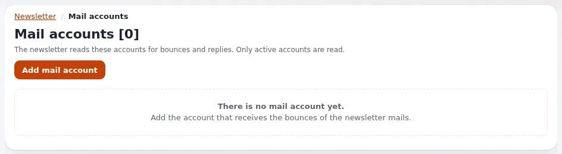

# Lektion 5.1: Mailkonten und Bounces

Manche Mails kommen zurück: Die Adresse existiert nicht, das Postfach ist voll, der Server lehnt ab. Ein Newsletter,
der diese Rückläufer ignoriert, schreibt weiter tote Adressen an, und Mail-Anbieter werten das als Zeichen eines
nachlässigen Absenders. Diese Lektion zeigt, wie zurückkommende Mail CJW Newsletter erreicht und was er damit macht.

> **Hinweis**
> Im Kurs schließt niemand ein echtes Postfach an: Das Formular für Mailkonten wird gelesen und verworfen. Eine
> Schulungsinstallation, die Mail in Dateien schreibt, erzeugt keine echten Bounces; der Trainer zeigt die Seiten und
> erklärt den Ablauf.

## Auf einen Blick

| | |
|---|---|
| Kurs | [Newsletter mit CJW Newsletter](../README.md) |
| Modul | [Modul 5: Bounces und Transporte](README.md) |
| Dauer | 45 Minuten (25 Präsentation, 20 Übung) |
| Niveau | Fortgeschrittene |
| Zielgruppe | Administratoren |
| Voraussetzungen | [Modul 4](../modul-04-versenden/README.md); Shell-Zugang für Schritt 7 |

## Lernziele

Nach dieser Lektion können die Teilnehmenden:

- den Weg eines Bounces erklären: Return-Path, Postfach, der Mailbox-Lauf, der Bounce-Zähler des Benutzers;
- die Felder eines Newsletter-Mailkontos nennen;
- einen Hard-Bounce von einem Soft-Bounce unterscheiden und sagen, was mit jedem geschieht;
- `BounceThresholdValue` erklären und Benutzer mit Bounces finden;
- den Mailbox-Befehl als Probelauf ausführen.

## Hinweise für Trainer

### So präsentieren Sie es

Quellen: [Bounces und die Sperrliste](../../../../../eng-us/help/creators/website-creators/newsletter-lists-and-subscriptions.md#bounces-and-the-blacklist),
[Cronjob-Teile](../../../../spezifikationen/6.0/cjw_newsletter.md#cronjob-teile) und die Anleitung zur Zustellbarkeit
der Erweiterung (verlinkt von der [Funktionsseite](../../../../../eng-us/features/6.0/extensions/cjw_newsletter.md#the-features-of-420)).

1. **Der Weg zurück** (5 Minuten). Eine zurückkommende Mail geht an den **E-Mail Rücksendepfad (Return-Path)** der
   Liste (Lektion 2.2). Dieses Postfach wird entweder von einem **Mailkonto** des Newsletters gelesen (der Teil
   `cjw_newsletter_mailbox`, der Befehl `ext:cjw_newsletter:mailbox`, **Mailkonten verarbeiten** auf dem Dashboard)
   oder vom Bounce-Leser der E-Mail-Einstellungen des Kernels, der jede Nachricht ebenfalls an den Newsletter
   weitergibt. Die eigenen Kopfzeilen des Newsletters (`X-Cjwnl-Senditem`, `X-Cjwnl-User`) sagen, welche Mail und
   welche Person zurückgekommen ist.
2. **Mailkonten** (5 Minuten). **E-Mail-Konten** im linken Menü, dann **E-Mail-Konten hinzufügen**: **E-Mail**,
   **Server**, **Port**, **Benutzer**, **Passwort**, **Typ**, **SSL**, **E-Mails auf Server löschen**, **Aktiv** und
   **Änderungen speichern** oder **Abbrechen**. Das Formular prüft seine Felder und zeigt das gespeicherte Passwort nie
   an.
3. **Die Bounce-Seiten** (5 Minuten). **Rückläufer** im linken Menü listet die eingesammelten Mails auf, mit **Alle
   E-Mails abrufen** und **E-Mails untersuchen** (Hintergrundläufe). Jede Mail lässt sich öffnen.
4. **Hard und Soft** (6 Minuten). Hard-Bounces (die Adresse oder Domain existiert nicht) und Beschwerden setzen die
   Adresse auf die Unterdrückungsliste und die Sperrliste des Newsletters (Standard in 4.2:
   `SuppressHardBounces=enabled`). Soft-Bounces (volles Postfach, Server nicht erreichbar) erhöhen den Bounce-Zähler
   des Benutzers, und die Mail wird später erneut versucht. Nach `[BounceSettings] BounceThresholdValue` Bounces
   (standardmäßig 3) erhält ein Benutzer nichts mehr.
5. **Cron** (2 Minuten). Der Teil `cjw_newsletter_mailbox` ist nicht in `cjw_newsletter` enthalten; er braucht eine
   eigene Crontab-Zeile.
6. **Dashboard** (2 Minuten). Kein aktives Mailkonto, Benutzer mit Bounces und nicht untersuchte Mails werden als
   Probleme gemeldet.

### Häufige Fragen

**Brauche ich ein eigenes Postfach?** Eine eigene Adresse für Rückläufer ist üblich, damit Bounces nicht mit Antworten
vermischt werden. Ihr Mail-Anbieter richtet sie ein.

**Warum hat ein Benutzer mit Soft-Bounce trotzdem die nächste Ausgabe bekommen?** Ein Soft-Bounce wird nur gezählt;
der Benutzer erhält erst nach Erreichen des Schwellenwerts nichts mehr. Wiederholungen derselben Mail folgen
`[DeliverabilitySettings]`.

**Was, wenn die Adresse einer Person versehentlich gebounct ist?** Heben Sie die Unterdrückung in Setup auf; das
nimmt die Adresse auch von der Sperrliste des Newsletters (Anleitung zur Zustellbarkeit).

### Stolperfallen

- **Im Kurs mit einem echten Postfach testen.** Es besteht die Gefahr, echte Mail zu lesen. Verwenden Sie außerhalb
  des Kurses ein eigenes Testpostfach auf einer Testinstallation.
- **E-Mails auf Server löschen beim ersten Versuch.** Lassen Sie es bei einer echten Einrichtung aus, bis das
  Untersuchen funktioniert, damit nichts verloren geht.
- **Die Cron-Zeile vergessen.** Ohne `cjw_newsletter_mailbox` (oder den Bounce-Leser des Kernels) wird nie etwas
  gelesen.

## Praktische Übung

Verwenden Sie die Schulungsinstallation. Speichern Sie kein Mailkonto.

1. Öffnen Sie **Newsletter**, klicken Sie im linken Menü auf **E-Mail-Konten** und notieren Sie die Zahl in der
   Überschrift.
2. Klicken Sie auf **E-Mail-Konten hinzufügen**. Lesen Sie jedes Feld: **E-Mail**, **Server**, **Port**,
   **Benutzer**, **Passwort**, **Typ**, **SSL**, **E-Mails auf Server löschen**, **Aktiv**.
3. Schreiben Sie auf Papier, welchen Wert jedes Feld für das Rücklaufpostfach Ihrer Organisation bekäme (keine
   Passwörter auf Papier: Schreiben Sie „vom Mail-Anbieter“).
4. Klicken Sie auf **Abbrechen**.
5. Klicken Sie im linken Menü auf **Rückläufer**. Lesen Sie die Überschrift und die Knöpfe **Alle E-Mails abrufen**
   und **E-Mails untersuchen**. Drücken Sie sie nicht.
6. Klicken Sie auf **Benutzer**, setzen Sie **Status** auf *Rückläufer* und suchen Sie. Notieren Sie die Spalte
   **Rückläufer**.
7. Führen Sie auf Ihrer eigenen Schulungsinstallation den Mailbox-Befehl als Probelauf aus und lesen Sie, was er
   meldet:

   ```bash
   php bin/php/console ext:cjw_newsletter:mailbox --dry-run
   ```

8. Suchen Sie in **INI Einstellungen** `BounceThresholdValue` unter `[BounceSettings]` und `SuppressHardBounces` unter
   `[DeliverabilitySettings]`.
9. Zeichnen Sie den Weg eines Hard-Bounces vom Mailserver des Abonnenten bis zur Sperrliste und vergleichen Sie mit
   Ihrem Nachbarn.

## Erwartetes Ergebnis

- Es wurde kein Mailkonto gespeichert; die Überschrift von **E-Mail-Konten** zeigt dieselbe Zahl wie in Schritt 1.
- Jede Person hat einen ausgefüllten Papierplan des Rücklaufpostfachs und eine Zeichnung des Wegs eines Hard-Bounces.
- Der Probelauf hat gemeldet, dass es nichts zu lesen gab (oder welche Konten es gab), und nichts geändert.
- Der Trainer prüft die Zeichnungen anhand der Anleitung zur Zustellbarkeit.



## Quiz

1. An welche Adresse der Liste senden Mailserver Bounces?
2. Welcher Cronjob-Teil liest die Bounce-Mailkonten?
   A. `cjw_newsletter` B. `cjw_newsletter_mailqueue_process` C. `cjw_newsletter_mailbox` D. `notification`
3. Was geschieht mit den mitgelieferten Einstellungen von 4.2 nach einem Hard-Bounce mit einer Adresse?
4. Was ist der Standardwert von `BounceThresholdValue`, und was passiert, wenn ein Benutzer ihn erreicht?
5. Warum sollte **E-Mails auf Server löschen** bei einer ersten Einrichtung aus bleiben?

<details>
<summary>Antworten</summary>

1. An den Return-Path (Lektion 2.2; [Funktionsseite](../../../../../eng-us/features/6.0/extensions/cjw_newsletter.md#the-parts)).
2. **C.** ([Cronjob-Teile](../../../../spezifikationen/6.0/cjw_newsletter.md#cronjob-teile)).
3. Sie kommt auf die Unterdrückungsliste und die Sperrliste des Newsletters (Anleitung zur Zustellbarkeit, verlinkt
   von der [Funktionsseite](../../../../../eng-us/features/6.0/extensions/cjw_newsletter.md#the-features-of-420)).
4. 3; der Benutzer erhält nichts mehr ([Bounces und die Sperrliste](../../../../../eng-us/help/creators/website-creators/newsletter-lists-and-subscriptions.md#bounces-and-the-blacklist)).
5. Damit keine zurückgekommene Mail verloren geht, solange nicht nachgewiesen ist, dass das Untersuchen funktioniert.

</details>

## Weiterführende Informationen

- [Newsletter-Listen und Abonnements](../../../../../eng-us/help/creators/website-creators/newsletter-lists-and-subscriptions.md#bounces-and-the-blacklist):
  Bounces und die Sperrliste.
- [E-Mail-Einstellungen: einrichten und betreiben](../../../../anleitungen/mail-einstellungen-administrator.md): der
  Bounce-Leser und die Unterdrückungsliste des Kernels.
- [Spezifikation: die Erweiterung cjw_newsletter](../../../../spezifikationen/6.0/cjw_newsletter.md#konsolenbefehle):
  der Befehl `mailbox`.

## Verwandte Seiten

- [Modul 5: Bounces und Transporte](README.md)
- [Newsletter mit CJW Newsletter: Kursüberblick](../README.md)
- [Trainer: hier beginnen](../../../../../eng-us/help/trainers/trainers-start-here.md)
- [Freie Dokumentation](../../../freie-dokumentation.md): Diese Seite darf unter der GNU FDL 1.3 frei kopiert, übersetzt und verbessert werden.

<!-- exp-partner-block:start -->
**Werden Sie Exponential-Partner.** Partner teilen ihre Informationen, stellen Mittel bereit, geben Beiträge
zurück und entwickeln die Produkte gemeinsam mit uns weiter, und so wächst Exponential. Eine Partner-Website und
ein Partner-Dashboard sind für Mitte 2027 geplant: Werden Sie noch heute Partner, damit wir schneller wachsen und
neue Funktionen früher bereitstellen können. Beginnen Sie mit [Partner: hier beginnen](../../../partner/partner-hier-beginnen.md) und
[Wie Sie sich bewerben](../../../partner/wie-sie-sich-bewerben.md).
<!-- exp-partner-block:end -->
