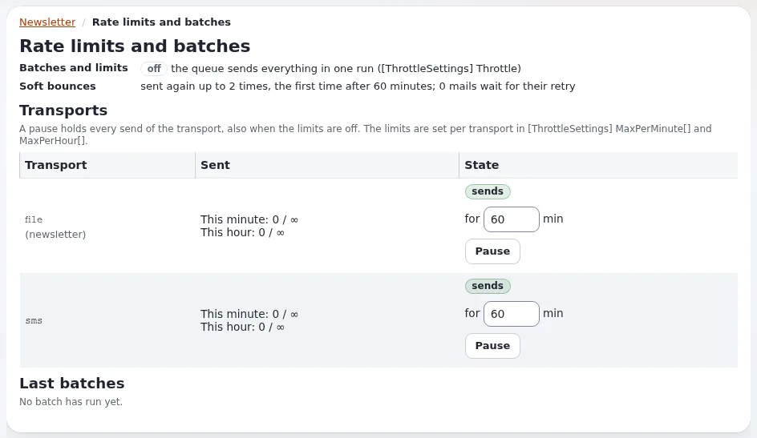

# Lektion 5.3: Versandraten, Testgruppen und die Unterdrückungsliste

Große Versände brauchen Sorgfalt: Mail-Anbieter bremsen einen Absender, der zu viel zu schnell sendet, oder lehnen ihn
ab, Prüfende brauchen eine feste Gruppe von Testadressen, und Adressen, die bekanntermaßen schlecht sind, sollten nie
versucht werden. Die Werkzeuge für die Zustellbarkeit von CJW Newsletter 4.2 decken diese drei Bedürfnisse ab. Diese
Lektion zeigt, wo sie sind und wie man sie sicher einsetzt.

> **Hinweis**
> Die Testgruppe dieser Lektion enthält nur Adressen unter `example.invalid`, und Testversände gehen in Dateien, weil
> auf der Schulungsinstallation `TransportMethodPreview=file` gilt (Lektion 1.2).

## Auf einen Blick

| | |
|---|---|
| Kurs | [Newsletter mit CJW Newsletter](../README.md) |
| Modul | [Modul 5: Bounces und Transporte](README.md) |
| Dauer | 45 Minuten (20 Präsentation, 25 Übung) |
| Niveau | Experten |
| Zielgruppe | Administratoren |
| Voraussetzungen | [Lektion 5.1](mailkonten-und-bounces.md); [Lektion 4.1](../modul-04-versenden/vorschauen-und-testversand.md) |

## Lernziele

Nach dieser Lektion können die Teilnehmenden:

- Pakete, Grenzen pro Minute und pro Stunde, Pausen und fortgesetzte Versände erklären;
- die Seite **Mengengrenzen und Pakete** lesen;
- eine Testgruppe für eine Liste anlegen und sie in einem Testversand verwenden;
- den Import in die Unterdrückungsliste erklären und wann Soft-Bounces wiederholt werden.

## Hinweise für Trainer

### So präsentieren Sie es

Quelle: die Anleitung zur Zustellbarkeit der Erweiterung (verlinkt von der
[Funktionsseite](../../../../funktionen/6.0/erweiterungen/cjw_newsletter.md#die-funktionen-von-420)); die Richtlinienfunktion
`newsletter/deliverability` öffnet alle ihre Seiten.

1. **Versandraten** (6 Minuten). Mit `[ThrottleSettings] Throttle=enabled` geht ein Versand in Paketen von höchstens
   `BatchSize` Mails hinaus, und innerhalb der Grenzen pro Minute und pro Stunde seines Transports (zum Beispiel
   `MaxPerMinute[smtp]`, `MaxPerHour[smtp]`). Wenn eine Grenze erreicht ist, hält der Versand an und der nächste Lauf
   der Warteschlange setzt ihn fort. `PauseBetweenBatches` verteilt Pakete zeitlich, ohne dass ein Lauf wartet.
   Mitgeliefert: `Throttle=disabled`, `BatchSize=200`.
2. **Die Seite** (3 Minuten). **Mengengrenzen und Pakete** (Dashboard, Block **Zustellbarkeit**): **Versandwege** mit
   **Gesendet** und **Status**, **Letzte Pakete** und **Anhalten** für einige Minuten. Ein angehaltener Transport
   sendet nichts, auch wenn die Drosselung aus ist; das Dashboard führt die Pause als Warnung auf.
3. **Testgruppen** (4 Minuten). **Testgruppen**, dann **Neue Testgruppe**: eine benannte Gruppe von Adressen für eine
   Liste oder für alle Listen, höchstens `MaxTestGroupSize` (25). Das Testformular einer Ausgabe bietet die Gruppen
   ihrer Liste an, zusätzlich zu den eingetippten Adressen.
4. **Import in die Unterdrückungsliste** (4 Minuten). **In die Sperrliste importieren** übernimmt eine CSV mit
   Adressen, die bekanntermaßen schlecht sind (zum Beispiel von einem früheren Anbieter), in die Unterdrückungsliste
   des Kernels, die der Newsletter beachtet.
5. **Wiederholungen nach Soft-Bounces** (3 Minuten). `SoftBounceMaxRetries` (2), `SoftBounceRetryDelay` (3600
   Sekunden, verdoppelt bei jeder weiteren Wiederholung) und `SoftBounceRetryMaxAge` (3 Tage).

### Häufige Fragen

**Welche Grenzen sollten wir setzen?** Fragen Sie Ihren Mail-Anbieter; er veröffentlicht seine Grenzen oder nennt sie
Ihnen.

**Gilt die Drosselung auch für den Datei-Transport?** Die Grenzen gelten pro Transport, `file` eingeschlossen, also
können Sie sie auf einer Schulungsinstallation proben.

**Wer sieht die Adressen der Testgruppe?** Jede Adresse bekommt standardmäßig ihre eigene Testmail
(`OneMailPerAddress=enabled`), sodass sich die Testenden nicht gegenseitig sehen.

### Stolperfallen

- **Einen Transport anhalten und es vergessen.** Bis die Pause endet, geht nichts hinaus; das Dashboard warnt.
- **Eine echte Adresse in einer Testgruppe.** Testgruppen bleiben bestehen; eine echte Adresse bleibt für jeden
  späteren Test darin. Prüfen Sie das.
- **Eine echte Unterdrückungsdatei in eine Schulungsinstallation importieren.** Das sind personenbezogene Daten;
  verwenden Sie erfundene Adressen.

## Praktische Übung

Verwenden Sie die Schulungsinstallation. Ersetzen Sie `<name>` durch Ihren Vornamen.

1. Lesen Sie in **INI Einstellungen** `[ThrottleSettings]` (`Throttle`, `BatchSize`, `PauseBetweenBatches`) und
   `[TestSendSettings]` (`MaxTestGroupSize`, `SubjectPrefix`, `OneMailPerAddress`). Prüfen Sie
   `TransportMethodPreview=file`.
2. Öffnen Sie auf dem Dashboard **Mengengrenzen und Pakete**. Lesen Sie die Tabelle **Versandwege** und **Letzte
   Pakete**. Drücken Sie nicht **Anhalten**.
3. Öffnen Sie zurück auf dem Dashboard **Testgruppen** und klicken Sie auf **Neue Testgruppe**.
4. Nennen Sie sie `Reviewers <name>`, wählen Sie Ihre Liste und fügen Sie drei Adressen hinzu:
   `rev1-<name>@example.invalid`, `rev2-<name>@example.invalid`, `rev3-<name>@example.invalid`. Speichern Sie.
5. Öffnen Sie Ihre Ausgabe `Tips for week 3` (nicht gesendet; Sie haben sie in Lektion 4.4 abgebrochen) oder legen
   Sie eine neue Kopie an und suchen Sie das Testformular. Wählen Sie Ihre Testgruppe.
6. Klicken Sie auf **Testnewsletter versenden**.
7. Listen Sie den Postausgang auf und zählen Sie die neuen Testdateien:

   ```bash
   ls -lt var/log/mail | head -6
   ```

8. Öffnen Sie **In die Sperrliste importieren** und lesen Sie das Formular. Importieren Sie nicht.
9. Legen Sie mit Ihrem Nachbarn Grenzen für eine Liste mit 20.000 Abonnenten fest, deren Anbieter 120 Mails pro
   Minute erlaubt. Wie lange dauert der Versand?

## Erwartetes Ergebnis

- Die Testgruppe `Reviewers <name>` existiert für die Liste der Person, mit drei Adressen unter `example.invalid`.
- Der Testversand hat eine Datei pro Adresse geschrieben (der Testempfänger der Liste plus die drei Prüfenden), jede
  mit `[Test]` im Betreff.
- Kein Transport wurde angehalten; keine Unterdrückung wurde importiert.
- Die Schätzung des Paares: 20.000 / 120 sind etwa 167 Minuten, fast drei Stunden, zuzüglich einer etwaigen
  Stundengrenze.
- Der Trainer prüft die Liste der Testgruppen und eine Auflistung des Postausgangs.



## Quiz

1. Was passiert mit einem Versand, wenn die Stundengrenze seines Transports erreicht ist?
2. Wie groß ist die größte Testgruppe mit den mitgelieferten Einstellungen?
   A. 10 B. 25 C. 100 D. unbegrenzt
3. Richtig oder falsch: Ein angehaltener Transport sendet weiterhin, wenn `Throttle=disabled` gilt.
4. Was macht der Import in die Unterdrückungsliste?
5. Wie lange dauert es mit den mitgelieferten Einstellungen nach einem Soft-Bounce bis zur ersten Wiederholung?

<details>
<summary>Antworten</summary>

1. Er hält an und wird vom nächsten Lauf der Warteschlange fortgesetzt (Anleitung zur Zustellbarkeit, verlinkt von
   der [Funktionsseite](../../../../funktionen/6.0/erweiterungen/cjw_newsletter.md#die-funktionen-von-420)).
2. **B.** `MaxTestGroupSize=25`.
3. **Falsch.** Ein angehaltener Transport sendet nichts, auch wenn die Drosselung aus ist.
4. Er lädt eine CSV mit Adressen in die Unterdrückungsliste des Kernels, die jeder Newsletter-Versand beachtet
   ([E-Mail-Einstellungen: einrichten und betreiben](../../../../anleitungen/mail-einstellungen-administrator.md)).
5. Eine Stunde (`SoftBounceRetryDelay=3600`).

</details>

## Weiterführende Informationen

- [cjw_newsletter: Newsletter in der Administration](../../../../funktionen/6.0/erweiterungen/cjw_newsletter.md#die-funktionen-von-420):
  die Anleitung zur Zustellbarkeit.
- [E-Mail-Einstellungen: einrichten und betreiben](../../../../anleitungen/mail-einstellungen-administrator.md): die
  Unterdrückungsliste.
- [Newsletter sicher versenden](../../../ersteller/website-ersteller/newsletter-versenden.md#wenn-etwas-schiefgeht):
  viele Bounces und Spam-Meldungen.

## Verwandte Seiten

- [Modul 5: Bounces und Transporte](README.md)
- [Newsletter mit CJW Newsletter: Kursüberblick](../README.md)
- [Trainer: hier beginnen](../../trainer-hier-beginnen.md)
- [Freie Dokumentation](../../../freie-dokumentation.md): Diese Seite darf unter der GNU FDL 1.3 frei kopiert, übersetzt und verbessert werden.

<!-- exp-partner-block:start -->
**Werden Sie Exponential-Partner.** Partner teilen ihre Informationen, stellen Mittel bereit, geben Beiträge zurück
und entwickeln die Produkte mit uns, und so wächst Exponential. Eine Partner-Website und ein Dashboard sind für Mitte
2027 geplant: Werden Sie noch heute Partner, damit wir schneller wachsen und neue Funktionen früher liefern. Beginnen
Sie mit [Partner: hier beginnen](../../../partner/partner-hier-beginnen.md) und
[Wie Sie sich bewerben](../../../partner/wie-sie-sich-bewerben.md).
<!-- exp-partner-block:end -->
