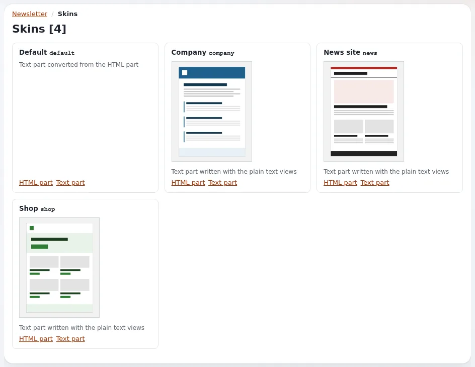

# Lektion 6.1: Skins und Ausgabeformate

Ein *Skin* ist das Aussehen einer Newsletter-Mail: ihr Layout, ihre Farben und die Art, wie Artikel angeordnet sind.
Jede Mail hat einen HTML-Teil und einen reinen Textteil, und der Skin erzeugt beide. In dieser Lektion vergleichen
die Teilnehmenden die mitgelieferten Skins, sehen, warum der Textteil wichtig ist, und lernen die Platzhalter, die eine
Mail persönlich machen und Menschen das Gehen ermöglichen.

> **Hinweis**
> Vorschauen senden nichts. Der Testversand in Schritt 9 schreibt Dateien, weil auf der Schulungsinstallation
> `TransportMethodPreview=file` gilt (Lektion 1.2), und geht nur an Adressen unter `example.invalid`.

## Auf einen Blick

| | |
|---|---|
| Kurs | [Newsletter mit CJW Newsletter](../README.md) |
| Modul | [Modul 6: Templates und Skins](README.md) |
| Dauer | 45 Minuten (20 Präsentation, 25 Übung) |
| Niveau | Fortgeschrittene |
| Zielgruppe | Redakteure, die das Aussehen wählen, Designer |
| Voraussetzungen | [Modul 4](../modul-04-versenden/README.md): eine Ausgabe für die Vorschau |

## Lernziele

Nach dieser Lektion können die Teilnehmenden:

- **Vorschau der Layouts** öffnen und die Skins mit ihrem **HTML-Teil** und **Text-Teil** vergleichen;
- erklären, warum jede Mail einen reinen Textteil trägt;
- die Skins wählen, die eine Liste erlaubt, und den Skin eines Versands;
- die Platzhalter für den Namen und die persönlichen Links verwenden und wissen, welche eine Personalisierung
  brauchen;
- erklären, warum die mitgelieferten Skins Tabellen und Inline-Styles verwenden.

## Hinweise für Trainer

### So präsentieren Sie es

Quellen: die Rendering-Anleitung der Erweiterung (verlinkt von der
[Funktionsseite](../../../../../eng-us/features/6.0/extensions/cjw_newsletter.md#the-features-of-420)) und
[Anmeldeformulare auf der Website](../../../../../eng-us/help/creators/website-creators/newsletters-with-cjw-newsletter.md#subscribe-forms-on-the-site).

1. **Die Skins** (5 Minuten). **Vorschau der Layouts** (Dashboard, Block **Layouts, Sprachen und Interessen**) zeigt
   *Default*, *Company*, *News site* und *Shop*, jeweils mit **HTML-Teil** und **Text-Teil**. `default` ist der Skin
   aus 4.1; `company` ist ein ruhiger Geschäftsbrief, `news` eine Nachrichtenübersicht, `shop` Karten mit Knöpfen.
2. **Warum Tabellen und Inline-Styles** (3 Minuten). Die Skins aus 4.2 sind 600 Pixel breite Tabellenlayouts mit
   jedem Style inline, ohne Webfonts und ohne Hintergrundbilder, damit sie in den gängigen Mailprogrammen und bei
   blockierten Bildern gleich aussehen.
3. **Der Textteil** (3 Minuten). Manche Leser und Filter sehen nur Text. `default` wandelt seinen Textteil aus dem
   HTML um; die anderen Skins schreiben ihn mit reinen Textansichten.
4. **Skins pro Liste und pro Versand** (3 Minuten). Das Formular der Liste nennt die erlaubten Skins (keiner angehakt
   heißt alle), und **Layout dieses Versands** auf der Versandseite wählt einen. Der eigene Skin der Liste ist immer
   erlaubt.
5. **Platzhalter** (6 Minuten). Im Text der Ausgabe geschrieben, pro Abonnent ersetzt:

   | Platzhalter | Wert | Braucht die Personalisierung der Liste |
   |---|---|---|
   | `[[first_name]]`, `[[last_name]]`, `[[name]]` | der Name des Abonnenten | ja |
   | `[[list_name]]` | der Name der Liste | nein |
   | `[[unsubscribe_url]]` | die Abmeldeseite dieses Abonnements | nein |
   | `[[configure_url]]` | die Seite der Newsletter-Einstellungen des Abonnenten | nein |

   Jeder Wert wird im HTML-Teil maskiert.

### Häufige Fragen

**Warum bleibt mein Platzhalter in einem Test unverändert?** Namensplatzhalter brauchen **Newsletter
personalisieren?** in der Liste und einen Abonnenten mit diesen Daten; Testadressen sind keine Abonnenten. Verwenden
Sie **Vorschau als Abonnent**.

**Kann ich eigene Farben hinzufügen?** Jeder Skin hat eine Einstellungsgruppe `[Skin_<name>]` mit einer
Akzentfarbe. Das Ändern der Templates eines Skins ist Lektion 6.2.

**Ändert ein Skin den Inhalt der Ausgabe?** Nein; er ändert, wie derselbe Inhalt angeordnet wird.

### Stolperfallen

- **Platzhalter mit nur einer Klammer getippt.** `[first_name]` wird so ausgegeben, wie es ist. Kopieren Sie sie aus
  der Tabelle.
- **Den Abmeldelink entfernen.** Jede Ausgabe muss einen tragen (Checkliste zur Einwilligung, Lektion 3.4).
- **Nur das HTML beurteilen.** Sehen Sie sich immer auch den **Text-Teil** an.

## Praktische Übung

Verwenden Sie die Schulungsinstallation. Ersetzen Sie `<name>` durch Ihren Vornamen.

1. Suchen Sie auf dem Newsletter-Dashboard **Layouts, Sprachen und Interessen** und klicken Sie auf **Vorschau der
   Layouts**.
2. Öffnen Sie für jeden der vier Skins den **HTML-Teil**, dann den **Text-Teil**. Notieren Sie eine Stärke jedes
   Skins.
3. Öffnen Sie Ihre Liste und klicken Sie auf **Bearbeiten**. Suchen Sie, wo die erlaubten Skins gewählt werden;
   haken Sie `default` und `news` an. Veröffentlichen Sie.
4. Legen Sie eine Kopie von `Tips for week 2` an und nennen Sie sie `Tips for week 4`.
5. Fügen Sie in ihrer **Description** als erste Zeile ein: `Hello [[first_name]],`.
6. Fügen Sie am Ende der **Description** ein: `To leave this list, open [[unsubscribe_url]]`. Veröffentlichen Sie.
7. Klicken Sie bei der Ausgabe auf **Newsletter versenden** (senden Sie nicht). Wählen Sie **News site** in **Layout
   dieses Versands** und verwenden Sie **Vorschau als Abonnent** für Dora.
8. Verlassen Sie die Versandseite mit **Abbrechen**.
9. Senden Sie mit **Testnewsletter versenden** einen Test von `Tips for week 4` an `test-<name>@example.invalid` und
   öffnen Sie die Datei in `var/log/mail`.
10. Suchen Sie in der Datei die Abmeldeadresse und prüfen Sie, ob `[[first_name]]` ersetzt wurde. Erklären Sie, warum.

## Erwartetes Ergebnis

- Die Person kann die vier Skins und je eine Stärke nennen.
- Die Liste erlaubt `default` und `news`; die Versandseite hat nur diese angeboten (und den eigenen Skin der Liste).
- In der Vorschau als Dora lautet die Begrüßung *Hello Dora,* und der Abmeldelink ist gefüllt.
- In der Testdatei ist der Abmeldelink gefüllt; der Name kann leer bleiben, weil die Testadresse kein Abonnent mit
  Daten ist.
- Der Trainer prüft die Vorschau einer Person am Beamer.

## Quiz

1. Nennen Sie die vier mitgelieferten Skins.
2. Welcher Platzhalter liefert den persönlichen Abmeldelink des Abonnenten?
   A. `[[configure_url]]` B. `[[unsubscribe_url]]` C. `[[list_name]]` D. `[unsubscribe]`
3. Warum verwenden die Skins aus 4.2 Tabellen und Inline-Styles?
4. Was braucht eine Liste, damit `[[first_name]]` gefüllt wird?
5. Warum trägt jede Mail einen Textteil?

Antworten

1. default, company, news, shop (Rendering-Anleitung, verlinkt von der [Funktionsseite](../../../../../eng-us/features/6.0/extensions/cjw_newsletter.md#the-features-of-420)).
2. **B.** (Rendering-Anleitung).
3. Damit sie in Outlook, Gmail und Apple Mail und bei blockierten Bildern gleich aussehen (Rendering-Anleitung).
4. Eingeschaltete Personalisierung in der Liste (und die Daten des Abonnenten) (Rendering-Anleitung; Lektion 2.2).
5. Manche Mailprogramme, Leser und Filter verwenden nur den Textteil.

## Weiterführende Informationen

- [cjw_newsletter: Newsletter in der Administration](../../../../../eng-us/features/6.0/extensions/cjw_newsletter.md#the-features-of-420):
  die Rendering-Anleitung mit jedem Platzhalter.
- [Newsletter mit cjw_newsletter](../../../../../eng-us/help/creators/website-creators/newsletters-with-cjw-newsletter.md#subscribe-forms-on-the-site):
  Skins und wo sie liegen.
- [Newsletter-Listen und Abonnements](../../../../../eng-us/help/creators/website-creators/newsletter-lists-and-subscriptions.md#consent):
  der Abmeldelink in jeder Ausgabe.

## Verwandte Seiten

- [Modul 6: Templates und Skins](README.md)
- [Newsletter mit CJW Newsletter: Kursüberblick](../README.md)
- [Trainer: hier beginnen](../../../../../eng-us/help/trainers/trainers-start-here.md)
- [Freie Dokumentation](../../../freie-dokumentation.md): Diese Seite darf unter der GNU FDL 1.3 frei kopiert, übersetzt und verbessert werden.

<!-- exp-partner-block:start -->
**Werden Sie Exponential-Partner.** Partner teilen ihre Informationen, stellen Mittel bereit, geben Beiträge zurück
und entwickeln die Produkte mit uns, und so wächst Exponential. Eine Partner-Website und ein Dashboard sind für Mitte
2027 geplant: Werden Sie noch heute Partner, damit wir schneller wachsen und neue Funktionen früher liefern. Beginnen
Sie mit [Partner: hier beginnen](../../../partner/partner-hier-beginnen.md) und
[Wie Sie sich bewerben](../../../partner/wie-sie-sich-bewerben.md).
<!-- exp-partner-block:end -->
