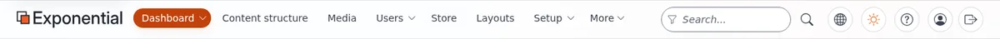
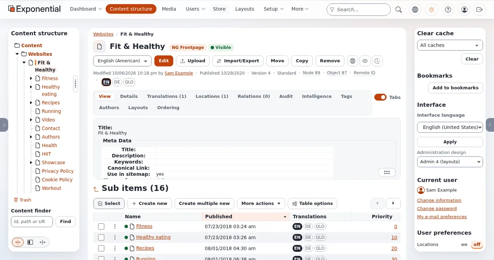

# Lektion 1.3: Ein Rundgang über den Bildschirm

Redakteure, die wissen, wo auf dem Bildschirm was ist, verirren sich nicht mehr. Diese Lektion geht einmal um den
Bildschirm der Administration im Design **Admin 4** herum: die Kopfzeile, die Reiter, die beiden Spalten und das
Dashboard. Zum Schluss ändern die Teilnehmenden zwei Einstellungen, die nur sie selbst betreffen: die Sprache der
Oberfläche und den Farbmodus.

## Auf einen Blick

| | |
|---|---|
| Kurs | [Redakteure 101](../README.md) |
| Modul | [Modul 1: Anmelden und Rundgang](README.md) |
| Dauer | 45 Minuten (20 Präsentation, 25 Übung) |
| Niveau | Einsteiger |
| Zielgruppe | Neue Redakteure und Autoren |
| Voraussetzungen | [Lektion 1.2](anmelden-und-abmelden.md); ein Schulungskonto mit der Rolle Editor |

## Lernziele

Nach dieser Lektion können die Teilnehmenden:

- die Teile der Kopfzeile benennen und sagen, was jede Schaltfläche tut;
- den Baum in der linken Spalte und die Werkzeuge der rechten Spalte finden;
- das Dashboard lesen und von dort **Meine Entwürfe** und **Meine Warteliste** öffnen;
- ihre **Sprache der Oberfläche** und den **Farbmodus** ändern und sagen, wer sonst davon betroffen ist (niemand);
- die Seitenspalten aus- und einblenden und in der Breite ändern.

## Hinweise für Trainer

### So präsentieren Sie es

Zeigen Sie alles auf dem Projektor, angemeldet mit einem Schulungskonto mit der Rolle Editor statt als Administrator,
damit der Bildschirm dem entspricht, was die Teilnehmenden sehen. Quelle für die ganze Lektion:
[Ein Rundgang durch die Administration](../../../rundgang-durch-die-administration.md).

1. **Die Kopfzeile, von links nach rechts** (6 Minuten):
   - das Logo **Exponential**: zurück zum Dashboard;
   - die **Reiter**: **Dashboard**, **Inhaltsstruktur**, **Medien** und weitere, je nach Rolle und Erweiterungen;
     Reiter, die nicht hineinpassen, wandern unter **Mehr**; ein kleiner Pfeil neben einem Reiter öffnet sein Menü
     (**Dashboard menu** ...);
   - **Suchen...**, mit der Trichter-Schaltfläche **Suchbereich** (Modul 7); die Taste `/` springt in das Feld;
   - die Globus-Schaltfläche **Website oder einen anderen Siteaccess öffnen**;
   - die Sonnen-Schaltfläche **Farbmodus**: hell, dunkel oder der Modus des Computers, ein Klick nach dem anderen;
   - die Schaltfläche **Hilfemenü**, die zum **Hilfe-Center** führt;
   - die Personen-Schaltfläche **Benutzermenü**: Ihr Name, **Passwort ändern** und Ihre E-Mail-Einstellungen;
   - der Pfeil, der einen Kasten verlässt: **Abmelden**.
2. **Die linke Spalte** (4 Minuten). Auf dem Dashboard listet sie Ihre eigenen Seiten auf: **Meine Warteliste**,
   **Meine Entwürfe**, **Meine Lesezeichen**, **Meine E-Mail-Einstellungen**, **Meine Benachrichtigungseinstellungen**,
   **Hilfe-Center**, **Passwort ändern**, **Profil bearbeiten**. In **Inhaltsstruktur** und **Medien** enthält sie den
   Baum (Modul 2) und darunter den **Inhaltsfinder**.
3. **Die rechte Spalte** (4 Minuten): **Lesezeichen** mit **Lesezeichen setzen**, **Oberfläche** mit der Liste
   **Sprache der Oberfläche** und **Anwenden**, **Aktueller Benutzer** und, für manche Rollen,
   **Benutzereinstellungen** und **Kurzeinstellungen**. Administratoren sehen außerdem **Cache leeren**.
4. **Ausblenden und Breite ändern** (2 Minuten). Die Laschen an den Fensterrändern (**Linke Spalte**,
   **Rechte Spalte**) blenden die Spalten aus und ein; der Griff mit drei Punkten ändert die Breite der linken Spalte,
   und die Schaltflächen **Schmal**, **Mittel** und **Breit** stellen ihre Breite ein. Die Wahl wird gespeichert.
5. **Das Dashboard** (4 Minuten): die Begrüßung mit Schnellaktionen wie **Inhaltsstruktur** und
   **Medienbibliothek**, die Zahlen, das Diagramm **Veröffentlichungen, letzte 14 Tage** und die Listen
   **Meine Warteliste**, **Meine Entwürfe**, **Aktuellster Inhalt** und **Mein aktuellster Content**. Administratoren
   sehen mehr Blöcke (das System, Updates, Sicherheitsereignisse).

### Häufige Fragen

**Übersetzt eine andere Sprache der Oberfläche die Inhalte?** Nein. Sie ändert die Menüs und Schaltflächen, nur für
Sie und bis Sie sich abmelden. Das Übersetzen von Inhalten ist ein Thema von Redakteure 201.

**Warum sieht meine Kollegin einen Reiter Layouts und ich nicht?** Ihre Rolle erlaubt es. Die Oberfläche des Editors
zeigt außerdem nur die Reiter für Inhalte.

**Kann ich ein anderes Design der Administration wählen?** Nur wenn Ihre Rolle die Berechtigung dazu hat; der Kasten
**Oberfläche** bietet es dann an. Diese Lektionen beschreiben **Admin 4**.

**Wo ist die Hilfe?** Unter der Schaltfläche **Hilfemenü** in der Kopfzeile: Das **Hilfe-Center** listet jede Seite
nach Zielgruppe und Thema auf und hat eine eigene Suche.

### Stolperfallen

- **Unterschiedliche Bildschirme im Raum.** Wer ein schmales Fenster hat, sieht die Reiter und die Suche hinter einer
  Schaltfläche mit drei Linien. Bitten Sie alle, das Browserfenster zu maximieren, oder zeigen Sie beide Ansichten.
- **Verlorene Spalten.** Wer die linke Spalte versehentlich ausgeblendet hat, findet den Baum nicht. Zeigen Sie auf die
  Lasche **Linke Spalte** am Fensterrand.
- **Sprachverwechslung.** Bitten Sie die Teilnehmenden nach der Übung, zur Kurssprache zurückzuschalten, sonst passen
  die Schaltflächennamen der nächsten Lektion nicht.

## Praktische Übung

Verwenden Sie die Schulungsinstallation und Ihr Schulungskonto mit der Rolle Editor.

1. Melden Sie sich an. Lesen Sie auf dem **Dashboard** die Begrüßung und suchen Sie den Block mit den Zahlen.
   Schreiben Sie auf, wie viele Entwürfe Sie haben.
2. Fahren Sie mit der Maus von links nach rechts über jede Schaltfläche der Kopfzeile und schreiben Sie den Namen auf,
   den sie anzeigt.
3. Klicken Sie auf die Sonnen-Schaltfläche (**Farbmodus**), bis der Bildschirm dunkel ist. Klicken Sie erneut, bis
   wieder der Modus eingestellt ist, den Sie mögen.
4. Suchen Sie in der rechten Spalte den Kasten **Oberfläche**. Wählen Sie unter **Sprache der Oberfläche** eine
   andere Sprache, die Sie lesen können (zum Beispiel **English (United States)** oder **Español (España)**, wenn die
   Liste sie anbietet), und klicken Sie auf **Anwenden**.
5. Sehen Sie sich die Namen der Reiter an: Sie sind jetzt in dieser Sprache. Schalten Sie zur Kurssprache zurück und
   klicken Sie auf **Anwenden**.
6. Klicken Sie auf die Lasche **Linke Spalte** am linken Fensterrand, um die linke Spalte auszublenden, und klicken
   Sie erneut darauf, um sie einzublenden.
7. Klicken Sie unten in der linken Spalte auf **Breit**, dann auf **Mittel**.
8. Klicken Sie auf den Reiter **Inhaltsstruktur**. Sie sehen, dass die linke Spalte jetzt den Baum zeigt.
9. Öffnen Sie in der Kopfzeile das **Hilfemenü** und gehen Sie zum **Hilfe-Center**. Geben Sie `rundgang` in sein
   Suchfeld ein und öffnen Sie die Seite **Ein Rundgang durch die Administration**.
10. Gehen Sie mit dem Logo **Exponential** zurück zum **Dashboard**.

## Erwartetes Ergebnis

- Die Liste der Schaltflächen der Kopfzeile stimmt mit der Tabelle in
  [Ein Rundgang durch die Administration](../../../rundgang-durch-die-administration.md#die-kopfzeile) überein (der genaue Umfang hängt von der
  Rolle ab).
- Die Namen der Reiter haben in Schritt 5 die Sprache gewechselt und wieder zurück.
- Die linke Spalte wurde ausgeblendet, wieder eingeblendet und in der Breite geändert.
- Das Hilfe-Center hat die Seite mit dem Rundgang gefunden.
- Der Trainer prüft das, indem er zwei Teilnehmende bittet, auf dem Projektor auf den Kasten **Oberfläche** und den
  **Inhaltsfinder** zu zeigen.

## Quiz

1. Welche Taste springt von überall in der Administration in das Feld **Suchen...**?
   A. `F1` B. `/` C. `Ctrl+S` D. `Esc`
2. Wer sieht sonst noch die Sprache der Oberfläche, die Sie wählen?
3. Nennen Sie zwei Listen, die Sie in der linken Spalte des Dashboards öffnen können.
4. Wo erscheint der Inhaltsbaum?
   A. Auf jeder Seite in der rechten Spalte B. In der linken Spalte in **Inhaltsstruktur** und **Medien** C. Nur auf
   dem Dashboard D. In der Kopfzeile
5. Bei einer Teilnehmerin ist der Baum verschwunden. Was ist die wahrscheinlichste Ursache, und was hilft?

Antworten

1. **B.** `/` ([Tastenkürzel](../../../tastenkuerzel.md#überall-in-der-administration)).
2. Niemand: Die Sprache der Oberfläche gilt nur für Sie, bis Sie sich abmelden.
3. Zwei beliebige von **Meine Warteliste**, **Meine Entwürfe**, **Meine Lesezeichen**, **Meine E-Mail-Einstellungen**,
   **Meine Benachrichtigungseinstellungen**.
4. **B.** ([Ein Rundgang durch die Administration](../../../rundgang-durch-die-administration.md#die-linke-spalte)).
5. Die linke Spalte wurde ausgeblendet; klicken Sie auf die Lasche **Linke Spalte** am Fensterrand, um sie wieder
   einzublenden.

## Weiterführende Literatur

- [Ein Rundgang durch die Administration](../../../rundgang-durch-die-administration.md): jeder Teil des Bildschirms, mit Bildern.
- [Tastenkürzel](../../../tastenkuerzel.md): die Tasten der Kopfzeile, der Menüs und des Baums.
- [Sprachen](../../../sprachen.md): die Sprache der Oberfläche und die Inhaltssprachen.
- [Das Design der Administration wählen](../../../../funktionen/6.0/ui-umschalter-design.md): die Designs, die eine Rolle
  wählen darf.

## Verwandte Seiten

- [Modul 1: Anmelden und Rundgang](README.md)
- [Redakteure 101: Kursüberblick](../README.md)
- [Trainer: hier beginnen](../../trainer-hier-beginnen.md)
- [Freie Dokumentation](../../../freie-dokumentation.md): Diese Seite darf unter der GNU FDL 1.3 frei kopiert, übersetzt und verbessert werden.

<!-- exp-partner-block:start -->
**Werden Sie Exponential-Partner.** Partner teilen ihre Informationen, stellen Mittel bereit, geben Beiträge zurück
und entwickeln die Produkte mit uns, und so wächst Exponential. Eine Partner-Website und ein Dashboard sind für Mitte
2027 geplant: Werden Sie noch heute Partner, damit wir schneller wachsen und neue Funktionen früher liefern. Beginnen
Sie mit [Partner: hier beginnen](../../../partner/partner-hier-beginnen.md) und
[Wie Sie sich bewerben](../../../partner/wie-sie-sich-bewerben.md).
<!-- exp-partner-block:end -->
