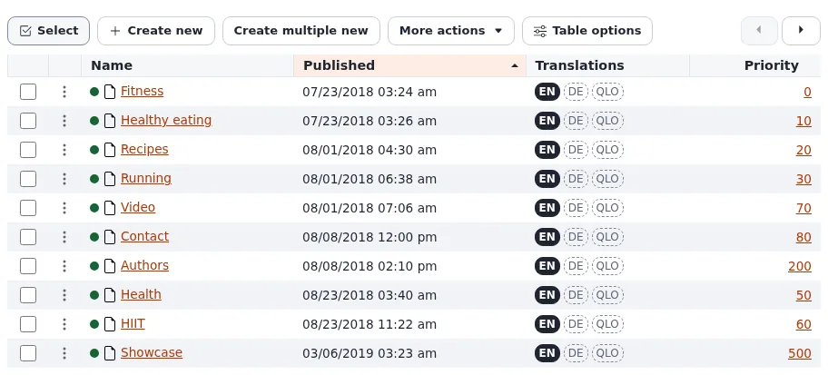

# Lektion 1.1: Was Exponential für Redakteure ist

Neue Redakteure lernen schneller, wenn sie zuerst ein Bild davon haben, woran sie arbeiten. Diese Lektion gibt ihnen
dieses Bild in fünf Ideen: Inhaltselemente, der Baum, Entwürfe, das Veröffentlichen und Rollen. Noch wird nichts
angeklickt; die Übung ist ein kurzer Blick auf eine Website und eine Skizze auf Papier.

> **Hinweis**
> Verwenden Sie für jede Übung dieses Kurses eine Schulungsinstallation, niemals eine Live-Website. Lektion 1.2
> erklärt, wie der Trainer eine vorbereitet.

## Auf einen Blick

| | |
|---|---|
| Kurs | [Redakteure 101](../README.md) |
| Modul | [Modul 1: Anmelden und Rundgang](README.md) |
| Dauer | 30 Minuten (20 Präsentation, 10 Übung) |
| Niveau | Einsteiger |
| Zielgruppe | Neue Redakteure, Autoren, Kommunikationsmitarbeiter, alle, die für eine mit Exponential gebaute Website schreiben werden |
| Voraussetzungen | Keine. Ein Browser für die Übung. |

## Lernziele

Nach dieser Lektion können die Teilnehmenden:

- erklären, dass alles auf der Website (eine Seite, ein Artikel, ein Bild, eine Datei, ein Benutzer) ein
  **Inhaltselement** ist;
- den **Inhaltsbaum** beschreiben und sagen, warum der Platz eines Elements darin wichtig ist;
- den Unterschied zwischen einem **Entwurf** und der **veröffentlichten** Version erklären;
- die zwei Orte nennen, an denen sie arbeiten: die **Administration** (oder den **Editor**) und die **Website**;
- sagen, was eine **Rolle** für sie entscheidet.

## Hinweise für Trainer

### So präsentieren Sie es

1. **Inhaltselemente** (5 Minuten). Exponential ist das Content-Management-System hinter der Website. Alles auf der
   Website ist ein Inhaltselement, auch Objekt genannt: ein Ordner, ein Artikel, ein Bild, eine Datei, sogar ein
   Benutzerkonto. Jedes Element hat einen **Typ** (in der Administration: *Folder*, *Article*, *Image* ...), und der
   Typ entscheidet, welche Felder das Element hat. Ein *Article* hat einen Titel, eine Einleitung, einen Haupttext und
   ein Bild; ein *Folder* hat einen Namen, eine Zusammenfassung und eine Beschreibung. Quelle:
   [Erste Schritte](../../../erste-schritte.md#was-exponential-ist).
2. **Der Baum** (5 Minuten). Elemente sind in einem Baum angeordnet, wie Ordner auf einem Computer: Ein Ordner
   enthält Artikel, ein Artikel kann Bilder enthalten. Zeichnen Sie ihn an die Tafel:

   ```text
   Websites (the top of the content)
     News (Folder)
       First article (Article)
       Second article (Article)
     About us (Folder)
   Media
     Images
     Files
   ```

   Wo ein Element steht, entscheidet darüber, wo es auf der Website erscheint, und meist auch über seine Adresse.
   Weisen Sie darauf hin, dass **Media** ein eigener Teil des Baums ist, der für Bilder und Dateien vorgesehen ist.
3. **Entwürfe und Veröffentlichen** (5 Minuten). Eine Änderung ist nie sofort sichtbar. Ein Klick auf
   **Bearbeiten** erzeugt einen **Entwurf**, eine Kopie, die nur ihr Ersteller sieht; die Website zeigt weiter die
   veröffentlichte Version, bis der Entwurf **veröffentlicht** wird. Die frühere Version bleibt als archivierte
   Version erhalten, sodass ein Redakteur jederzeit zurückgehen kann. Quelle:
   [Veröffentlichen, Versionen und der Papierkorb](../../../veroeffentlichen-und-versionen.md#entwürfe-und-versionen).
4. **Zwei Orte** (3 Minuten). Redakteure arbeiten in der **Administration** oder, auf vielen Installationen, im
   **Editor**, einer einfacheren Oberfläche mit nur dem, was Schreiben und Veröffentlichen brauchen. Besucher sehen
   die **Website**. Beides sind Teile derselben Installation (jeweils ein *Siteaccess*) und arbeiten mit denselben
   Inhalten.
5. **Rollen** (2 Minuten). Was ein Redakteur öffnen, erstellen und ändern darf, entscheidet die **Rolle** seines
   Kontos, meist *Editor*. Ein Redakteur sieht weniger Reiter und Schaltflächen als ein Administrator. Es ist kein
   Fehler, wenn eine Schaltfläche fehlt; das ist die Rolle.

Fassen Sie sich kurz: Die nächsten Lektionen zeigen all das auf dem Bildschirm.

### Häufige Fragen

**Ist eine Seite dasselbe wie ein Artikel?** Auf der Website ist eine „Seite“ das, was ein Besucher unter einer
Adresse sieht. In der Administration ist das meist ein Inhaltselement (ein Artikel, ein Ordner), das im Design der
Website angezeigt wird. Manche Websites gestalten Seiten außerdem mit Exponential Layouts; das ist ein eigener Kurs.

**Können Besucher meinen Entwurf sehen?** Nein. Ein Entwurf ist nur für seinen Ersteller sichtbar, bis er
veröffentlicht wird. [Veröffentlichen, Versionen und der Papierkorb](../../../veroeffentlichen-und-versionen.md#entwürfe-und-versionen)
listet die Status Entwurf, ausstehend, veröffentlicht und archiviert auf.

**Was passiert mit dem alten Text, wenn ich veröffentliche?** Er wird zu einer archivierten Version und bleibt unter
**Versionen verwalten** (Modul 6) verfügbar, bis die Höchstzahl an Versionen pro Element erreicht ist, die die
Website festlegt.

**Warum habe ich einen anderen Bildschirm als meine Kollegin?** Andere Rollen, ein anderes Design der Administration
oder eine andere Sprache der Oberfläche. Lektion 1.3 zeigt, wo das gewählt wird.

### Stolperfallen

- **Zu viel Theorie.** Einsteiger brauchen noch keine Klassen, Siteaccesses oder Richtlinien. Verwenden Sie die
  Wörter „Typ“ und „Teil der Installation“ und gehen Sie weiter.
- **„Speichern“ gegenüber „Veröffentlichen“.** Wer von Textverarbeitungen kommt, erwartet eine Speichern-Schaltfläche.
  Betonen Sie früh, dass das Speichern eines Entwurfs und das Veröffentlichen zwei verschiedene Dinge sind und dass nur
  das Veröffentlichen die Website verändert.
- **Der alte Produktname.** Manche Teilnehmende kennen das System aus früheren Stellen unter seinem früheren Namen.
  Exponential führt diese Software fort, die ihr ursprünglicher Hersteller nach fast 18 Jahren eingestellt hat; die
  Ideen, die sie kennen (der Baum, Entwürfe, Versionen), gelten weiterhin.

## Praktische Übung

Verwenden Sie die öffentliche Website der Schulungsinstallation, die der Trainer vorbereitet hat (oder eine andere mit
Exponential gebaute Website, die der Trainer nennt). Ein Konto ist nicht nötig.

1. Öffnen Sie die Startseite der Website in Ihrem Browser.
2. Schreiben Sie drei Dinge auf, die Sie auf der Startseite sehen und die Ihrer Meinung nach eigene Inhaltselemente
   sind (zum Beispiel ein Nachrichtenartikel, ein Bild, ein Menüeintrag).
3. Folgen Sie dem Hauptmenü zu einem Bereich der Website und notieren Sie seine Adresse aus der Adressleiste des
   Browsers.
4. Öffnen Sie einen Artikel in diesem Bereich und notieren Sie ebenfalls seine Adresse.
5. Vergleichen Sie die beiden Adressen: Beginnt die Adresse des Artikels mit der des Bereichs? Schreiben Sie auf, was
   Ihnen das darüber sagt, wo der Artikel im Baum steht.
6. Zeichnen Sie auf Papier den Teil des Baums, den Sie besucht haben: den Bereich als Ordner, den Artikel darunter.
7. Markieren Sie auf Ihrer Zeichnung, welches Element Sie öffnen würden, um den Titel des Artikels zu ändern.

## Erwartetes Ergebnis

- Alle Teilnehmenden haben eine kleine Baumskizze mit einem Bereich (Ordner) und mindestens einem Artikel darunter.
- Die meisten Websites geben einem Artikel eine Adresse unterhalb der Adresse seines Bereichs, sodass die
  Teilnehmenden schließen, dass der Artikel ein Unterelement des Bereichs ist. Wo die Website das nicht tut (manche
  Websites verwenden kurze Adressen), erklärt der Trainer, dass Adressen von der Website festgelegt werden können und
  dass Lektion 2.1 den echten Baum zeigt.
- Der Trainer sammelt zwei oder drei Skizzen ein und vergleicht sie in Lektion 2.1 an der Tafel mit dem echten Baum.



## Quiz

1. Welches davon ist ein Inhaltselement in Exponential?
   A. Nur Artikel B. Nur Seiten mit Text C. Artikel, Ordner, Bilder, Dateien und Benutzer D. Nur, was in der
   Medienbibliothek liegt
2. Sie klicken bei einem Artikel auf **Bearbeiten** und ändern seinen Titel. Wann sehen Besucher den neuen Titel?
3. Was entscheidet, welche Reiter und Schaltflächen Sie in der Administration sehen?
   A. Ihr Browser B. Ihre Rolle C. Die Tageszeit D. Die Größe der Website
4. Richtig oder falsch: Der Editor und die Administration arbeiten mit verschiedenen Kopien der Inhalte.
5. Was passiert mit dem bisher veröffentlichten Text, wenn eine neue Version veröffentlicht wird?

<details>
<summary>Antworten</summary>

1. **C.** Alles auf der Website ist ein Inhaltselement ([Erste Schritte](../../../erste-schritte.md#was-exponential-ist)).
2. Erst wenn der Entwurf veröffentlicht ist; bis dahin zeigt die Website die veröffentlichte Version.
3. **B.** Die Rolle Ihres Kontos.
4. **Falsch.** Beides sind Teile derselben Installation und arbeiten mit denselben Inhalten
   ([Anmelden im Editor](../../../anmelden-im-editor.md)).
5. Er wird zu einer archivierten Version und kann später wiederhergestellt werden
   ([Veröffentlichen, Versionen und der Papierkorb](../../../veroeffentlichen-und-versionen.md#entwürfe-und-versionen)).

</details>

## Weiterführende Literatur

- [Erste Schritte](../../../erste-schritte.md): die zehnminütige Einführung, auf der diese Lektion aufbaut.
- [Das Inhaltsmodell und das Bearbeiten von Inhalten](../../../../anleitungen/inhaltsmodell-und-bearbeitung.md): wie Typen
  (Klassen), Felder und Elemente zusammenpassen, für Teilnehmende, die mehr wissen möchten.
- [Veröffentlichen, Versionen und der Papierkorb](../../../veroeffentlichen-und-versionen.md): die Status einer Version.

## Verwandte Seiten

- [Modul 1: Anmelden und Rundgang](README.md)
- [Redakteure 101: Kursüberblick](../README.md)
- [Trainer: hier beginnen](../../trainer-hier-beginnen.md)
- [Freie Dokumentation](../../../freie-dokumentation.md): Diese Seite darf unter der GNU FDL 1.3 frei kopiert, übersetzt und verbessert werden.

<!-- exp-partner-block:start -->
**Werden Sie Exponential-Partner.** Partner teilen ihre Informationen, stellen Mittel bereit, geben Beiträge zurück
und entwickeln die Produkte mit uns, und so wächst Exponential. Eine Partner-Website und ein Dashboard sind für Mitte
2027 geplant: Werden Sie noch heute Partner, damit wir schneller wachsen und neue Funktionen früher liefern. Beginnen
Sie mit [Partner: hier beginnen](../../../partner/partner-hier-beginnen.md) und
[Wie Sie sich bewerben](../../../partner/wie-sie-sich-bewerben.md).
<!-- exp-partner-block:end -->
