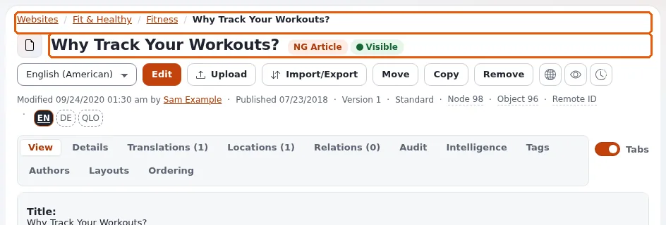

# Lektion 2.1: Der Baum und die Seite eines Elements

Im Inhaltsbaum finden Redakteure fast alles, woran sie arbeiten. Diese Lektion zeigt, wie man Ordner im Baum öffnet,
ein Element öffnet und die Seite eines Elements von oben liest: den Pfad, den Namen und den Typ, die Schaltflächen und
die Zeile mit seiner Version und seinen Nummern.

## Auf einen Blick

| | |
|---|---|
| Kurs | [Redakteure 101](../README.md) |
| Modul | [Modul 2: Der Inhaltsbaum und die Navigation](README.md) |
| Dauer | 45 Minuten (20 Präsentation, 25 Übung) |
| Niveau | Einsteiger |
| Zielgruppe | Neue Redakteure und Autoren |
| Voraussetzungen | [Modul 1](../modul-01-anmelden-und-rundgang/README.md); ein Schulungskonto mit der Rolle Editor |

## Lernziele

Nach dieser Lektion können die Teilnehmenden:

- Ordner im Baum von **Inhaltsstruktur** und von **Medien** öffnen und schließen;
- ein Element aus dem Baum öffnen und über den Pfad wieder nach oben gehen;
- Name, Typ, Sichtbarkeit, Version und Nummern (**Knoten**, **Objekt**) eines Elements auf seiner Seite ablesen;
- die Schaltflächen auf der Seite eines Elements benennen und sagen, welche davon etwas ändern;
- erklären, warum eine Schaltfläche bei ihnen fehlen oder ausgegraut sein kann.

## Hinweise für Trainer

### So präsentieren Sie es

Quelle für diese Lektion: [Ein Rundgang durch die Administration](../../../rundgang-durch-die-administration.md#die-linke-spalte) und
[Die Seite eines Elements](../../../rundgang-durch-die-administration.md#die-seite-eines-objekts).

1. **Zwei Bäume** (4 Minuten). Klicken Sie auf **Inhaltsstruktur**: Die linke Spalte zeigt den Baum, beginnend am
   Anfang der Inhalte (auf vielen Installationen ein Ordner wie *Home* oder *Websites*). Klicken Sie auf **Medien**:
   der Baum der Medienbibliothek, mit Ordnern wie **Images**, **Files** und **Multimedia**. Der **Papierkorb** steht
   unten im Baum.
2. **Ordner öffnen** (4 Minuten). Klicken Sie auf das kleine Dreieck vor einem Namen, um einen Ordner im Baum zu
   öffnen, ohne die Seite zu verlassen; klicken Sie auf den Namen, um das Element zu öffnen. Zeigen Sie beides und
   weisen Sie auf den Unterschied hin.
3. **Die Seite eines Elements, von oben nach unten** (8 Minuten). Öffnen Sie einen Ordner mit einigen Elementen
   darunter und zeigen Sie auf:
   - den **Pfad** (*Sie sind hier:*): Klicken Sie auf einen Teil, um nach oben zu gehen;
   - den **Namen** und die **Typkennzeichnung** (*Folder*, *Article* ...) und ob das Element *Sichtbar* oder
     versteckt ist;
   - die Sprachliste (zum Beispiel *English (American)*) und die Schaltflächen **Bearbeiten**, **Hochladen**,
     **Verschieben**, **Kopieren**, **Entfernen**;
   - die drei runden Schaltflächen **Auf der Website ansehen**, **Vorschau** und **Versionen verwalten**;
   - die Zeile *Geändert ... von ...*, *Veröffentlicht ...*, *Version ...* und die Nummern **Knoten** und **Objekt**;
   - die Schaltfläche **Lesezeichen setzen**.
4. **Was etwas ändert** (2 Minuten). **Bearbeiten**, **Verschieben**, **Kopieren** und **Entfernen** ändern Inhalte;
   **Auf der Website ansehen**, **Vorschau** und **Versionen verwalten** zeigen nur etwas an. Eine Schaltfläche, die
   Sie nicht verwenden dürfen, ist ausgegraut; wenn Sie darauf zeigen, steht dort, warum.
5. **Knoten und Objekt** (2 Minuten). Halten Sie es einfach: Die Nummer *Objekt* gehört zum Element selbst, die Nummer
   *Knoten* zu seinem Platz im Baum. Ein Element kann mehr als einen Platz haben (Redakteure 201 behandelt Orte). Die
   Knotennummer ist das, was der **Inhaltsfinder** annimmt (Lektion 2.3).

### Häufige Fragen

**Warum ist das Element, das ich suche, nicht im Baum?** Es kann in einem Ordner liegen, den Sie nicht geöffnet haben,
im Baum **Medien** statt in **Inhaltsstruktur**, im Papierkorb, oder Ihre Rolle erlaubt Ihnen nicht, es zu lesen.
Lektion 7.1 zeigt die Suche.

**Was bedeutet *Sichtbar*?** Das Element wird auf der Website angezeigt. Ein verstecktes Element bleibt in der
Administration, wird aber Besuchern nicht angezeigt, ebenso wenig alles darunter
([Veröffentlichen, Versionen und der Papierkorb](../../../veroeffentlichen-und-versionen.md#ein-objekt-verstecken)).

**Warum zeigt der Baum manche Elemente grau oder mit *(Versteckt)*?** Sie sind versteckt. Für Redakteure sind sie
weiterhin vorhanden.

### Stolperfallen

- **Auf den Namen statt auf das Dreieck klicken.** Die Teilnehmenden verlieren ihren Platz im Baum, weil sich die
  Seite ändert. Zeigen Sie den Unterschied zweimal.
- **Das falsche Element bearbeiten.** Bitten Sie die Teilnehmenden vor jeder Übung, die etwas ändert, den Namen und
  die Typkennzeichnung laut vorzulesen. Das fängt die meisten Fehler ab.
- **Zu früh zu tief.** Erklären Sie hier keine Orte, Sektionen oder Objektzustände; sie gehören zu Redakteure 201.

## Praktische Übung

Verwenden Sie die Schulungsinstallation und Ihr Schulungskonto mit der Rolle Editor. Nichts in dieser Übung ändert
Inhalte.

1. Klicken Sie auf den Reiter **Inhaltsstruktur**. Suchen Sie in der linken Spalte das oberste Element des Baums und
   schreiben Sie seinen Namen auf.
2. Klicken Sie auf das kleine Dreieck vor einem Ordner, um ihn im Baum zu öffnen. Klicken Sie noch nicht auf den
   Namen.
3. Klicken Sie jetzt auf den Namen eines Artikels (oder eines beliebigen Elements) unter diesem Ordner. Seine Seite
   öffnet sich.
4. Schreiben Sie auf: seinen Namen, seinen Typ (die Kennzeichnung neben dem Namen), ob es *Sichtbar* ist, seine
   *Version* und seine Nummern **Knoten** und **Objekt**.
5. Zeigen Sie auf die Schaltflächen **Bearbeiten**, **Hochladen**, **Verschieben**, **Kopieren** und **Entfernen**,
   ohne sie anzuklicken. Fahren Sie mit der Maus über eine ausgegraute Schaltfläche und schreiben Sie auf, was sie
   anzeigt.
6. Klicken Sie im Pfad oben auf den Ordner über dem Element. Sie sind zurück auf der Seite des Ordners.
7. Klicken Sie auf den Reiter **Medien**. Öffnen Sie im Baum den Ordner **Images** (oder den ersten Ordner der
   Medienbibliothek).
8. Öffnen Sie ein Bild und schreiben Sie seinen Typ und seine Nummer **Knoten** auf.
9. Scrollen Sie zum Ende des Baums und suchen Sie den **Papierkorb**. Öffnen Sie ihn noch nicht.
10. Klicken Sie beim Bild oder beim Artikel auf **Auf der Website ansehen**: Das Element öffnet sich so, wie Besucher
    es sehen. Schließen Sie diesen Tab und kehren Sie zurück.

## Erwartetes Ergebnis

- Die Notizen der Teilnehmenden nennen das oberste Element des Baums, ein Element mit seinem Typ, seiner
  Sichtbarkeit, seiner Version und zwei Nummern sowie ein Bild mit seiner Knotennummer.
- Die Teilnehmenden sind über den Pfad nach oben gegangen, nicht über die Zurück-Schaltfläche des Browsers.
- **Auf der Website ansehen** hat die öffentliche Website im Browser geöffnet.
- Der Trainer prüft das, indem er eine Teilnehmerin oder einen Teilnehmer bittet, die Notizen vorzulesen, und dasselbe
  Element auf dem Projektor öffnet.

## Quiz

1. Was ist der Unterschied zwischen einem Klick auf das Dreieck vor einem Ordner und einem Klick auf seinen Namen?
2. Welche dieser Schaltflächen ändert Inhalte?
   A. **Auf der Website ansehen** B. **Vorschau** C. **Verschieben** D. **Versionen verwalten**
3. Eine Schaltfläche ist ausgegraut. Wie finden Sie heraus, warum?
4. Welche Nummer nimmt der **Inhaltsfinder** an, um ein Element zu öffnen?
   A. Die Versionsnummer B. Die Knotennummer C. Das Jahr der Veröffentlichung D. Die Zahl der Unterelemente
5. Wo ist der Papierkorb?

Antworten

1. Das Dreieck öffnet den Ordner im Baum; der Name öffnet die Seite des Elements.
2. **C.** **Verschieben** setzt das Element an eine andere Stelle; die anderen zeigen nur etwas an.
3. Zeigen Sie darauf: Der Tooltip sagt, warum ([Inhalte erstellen und bearbeiten](../../../inhalte-bearbeiten.md#verschieben-kopieren-und-entfernen)).
4. **B.** Die Knotennummer ([Suchen](../../../suchen.md#ein-objekt-über-seine-nummer-oder-adresse-öffnen)).
5. Unten im Baum in der linken Spalte.

## Weiterführende Literatur

- [Ein Rundgang durch die Administration](../../../rundgang-durch-die-administration.md): der Bildschirm, die linke Spalte und die Seite eines
  Elements.
- [Erste Schritte](../../../erste-schritte.md): das Element finden, das Sie ändern möchten.
- [Bilder, Medien und Uploads](../../../medien-und-uploads.md): die Medienbibliothek.

## Verwandte Seiten

- [Modul 2: Der Inhaltsbaum und die Navigation](README.md)
- [Redakteure 101: Kursüberblick](../README.md)
- [Trainer: hier beginnen](../../trainer-hier-beginnen.md)
- [Freie Dokumentation](../../../freie-dokumentation.md): Diese Seite darf unter der GNU FDL 1.3 frei kopiert, übersetzt und verbessert werden.

<!-- exp-partner-block:start -->
**Werden Sie Exponential-Partner.** Partner teilen ihre Informationen, stellen Mittel bereit, geben Beiträge zurück
und entwickeln die Produkte mit uns, und so wächst Exponential. Eine Partner-Website und ein Dashboard sind für Mitte
2027 geplant: Werden Sie noch heute Partner, damit wir schneller wachsen und neue Funktionen früher liefern. Beginnen
Sie mit [Partner: hier beginnen](../../../partner/partner-hier-beginnen.md) und
[Wie Sie sich bewerben](../../../partner/wie-sie-sich-bewerben.md).
<!-- exp-partner-block:end -->
