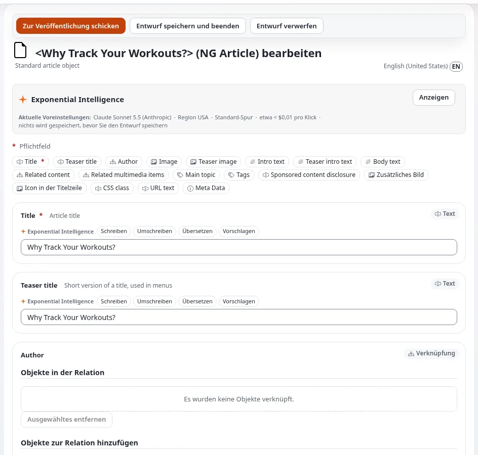

# Lektion 3.3: Das Bearbeitungsformular im Detail

Die Teilnehmenden haben das Bearbeitungsformular jetzt zweimal benutzt. Diese Lektion nimmt das Tempo heraus und sieht
sich jeden seiner Teile an, damit das Formular keine Überraschungen mehr bereithält: die Feldleiste, die linke Spalte
mit dem aktuellen Entwurf und der **Vorschau**, das automatische Speichern, Fehlermeldungen und die Extras, die manche
Websites hinzufügen.

## Auf einen Blick

| | |
|---|---|
| Kurs | [Redakteure 101](../README.md) |
| Modul | [Modul 3: Inhalte erstellen und bearbeiten](README.md) |
| Dauer | 45 Minuten (20 Präsentation, 25 Übung) |
| Niveau | Einsteiger |
| Zielgruppe | Neue Redakteure und Autoren |
| Voraussetzungen | [Lektion 3.2](ihren-ersten-artikel-erstellen.md): Alle Teilnehmenden haben einen veröffentlichten Artikel |

## Lernziele

Nach dieser Lektion können die Teilnehmenden:

- mit der Feldleiste zwischen Feldern springen und ein Pflichtfeld erkennen;
- die linke Spalte des Formulars lesen: die Nummern des Elements, den aktuellen Entwurf, **Versionen verwalten**,
  **Vorschau** und die Sektion;
- erklären, dass der Entwurf alle paar Minuten automatisch gespeichert wird und wo er wiederzufinden ist;
- eine Fehlermeldung oben im Formular und am Feld lesen und den Fehler beheben;
- sagen, was **Ohne Benachrichtigung veröffentlichen** und der Kasten **Exponential Intelligence** tun, wenn eine
  Website sie anbietet.

## Hinweise für Trainer

### So präsentieren Sie es

Quelle: [Das Bearbeitungsformular](../../../inhalte-bearbeiten.md#das-bearbeitungsformular) und
[In Aktion: einen Ordner bearbeiten](../../../rundgang-durch-die-administration.md#in-der-praxis-einen-ordner-bearbeiten).

1. **Von oben nach unten** (5 Minuten). Öffnen Sie Ihren Artikel mit **Bearbeiten** und zeigen Sie auf: die
   Schaltflächen **Zur Veröffentlichung schicken**, **Entwurf speichern und beenden** und **Entwurf verwerfen**; die
   Titelzeile *Edit <name> (Article)* mit der Sprache; die Feldleiste; die Feldkarten mit ihrer Art in der Ecke
   (*Text*, *Rich Text*, *Relation* ...).
2. **Die linke Spalte** (5 Minuten): die Nummern und Daten des Elements, **Derzeitiger Entwurf** mit seiner
   Versionsnummer, **Versionen verwalten**, **Vorschau** (den Entwurf so sehen, wie die Website ihn zeigen wird), die
   vorhandenen Übersetzungen und die **Sektion**, zu der das Element gehört.
3. **Automatisches Speichern** (3 Minuten). Das Formular speichert den Entwurf alle paar Minuten von selbst. Ein
   geschlossener Tab oder eine unterbrochene Verbindung kostet wenig: Der Entwurf wartet unter **Meine Entwürfe**.
   Gewöhnen Sie die Teilnehmenden trotzdem daran, vor einer Pause **Entwurf speichern und beenden** zu verwenden.
4. **Fehler** (4 Minuten). Ein Feld, das beim Veröffentlichen fehlerhaft ist, schickt das Formular mit einer Meldung
   oben und am Feld zurück. Zeigen Sie es mit einem leeren Pflichtfeld. Erwähnen Sie, dass der Rich-Text-Editor Links
   melden kann, die er reparieren musste (Lektion 4.2).
5. **Extras, die manche Websites haben** (3 Minuten):
   - **Ohne Benachrichtigung veröffentlichen** veröffentlicht, ohne die Personen per E-Mail zu benachrichtigen, die
     diesem Teil der Website folgen.
   - Der Kasten **Exponential Intelligence** und Schaltflächen wie **Schreiben**, **Umschreiben**, **Übersetzen**,
     **Vorschlagen** und **Verbessern** an Textfeldern, wenn der Schreibassistent eingeschaltet ist. Seine Vorschläge
     ändern nichts, bis der Redakteur sie annimmt und den Entwurf speichert. Exponential Intelligence hat einen
     eigenen Kurs.

### Häufige Fragen

**Wie oft wird der Entwurf automatisch gespeichert?** Alle paar Minuten; der genaue Abstand ist eine Einstellung der
Website. Bringen Sie den Teilnehmenden bei, sich am Ende ihrer Arbeit nicht darauf zu verlassen.

**Was zeigt die Vorschau, was das Bearbeitungsformular nicht zeigt?** Den Entwurf im Design der Website, in der Breite
eines Telefons, eines Tablets, eines Desktops oder eines großen Desktops. Lektion 6.2 behandelt sie.

**Kann ich die Sektion im Formular ändern?** Die linke Spalte zeigt sie an; das Ändern von Sektionen gehört zu
Redakteure 201 und braucht die Berechtigung.

**Warum hat mein Formular Felder, die das meines Kollegen nicht hat?** Verschiedene Typen haben verschiedene Felder,
und manche Felder erscheinen nur in manchen Sprachen oder für manche Rollen. Prüfen Sie den Typ in der Titelzeile.

### Stolperfallen

- **Arbeit verlieren, weil der Tab in den ersten Minuten geschlossen wird.** Das automatische Speichern läuft alle
  paar Minuten, nicht nach jeder Taste. Machen Sie **Entwurf speichern und beenden** zur Gewohnheit.
- **Der Schreibassistent.** Auf einer Website, auf der er eingeschaltet ist, klicken die Teilnehmenden aus Neugier auf
  seine Schaltflächen. Seine Vorschläge ändern nichts, bis sie angenommen werden; bitten Sie die Teilnehmenden, ihn für
  seinen eigenen Kurs aufzuheben.
- **Aus Gewohnheit ohne Benachrichtigung veröffentlichen.** Wer der Website folgt, verpasst dann die Änderung.
  Verwenden Sie es nur, wenn eine Änderung zu klein ist, um sie anzukündigen.

## Praktische Übung

Verwenden Sie die Schulungsinstallation und den Artikel aus Lektion 3.2.

1. Öffnen Sie Ihren Artikel und klicken Sie auf **Bearbeiten**.
2. Lesen Sie die Titelzeile und schreiben Sie den Typ und die Sprache auf, die Sie bearbeiten.
3. Klicken Sie einmal auf jede Schaltfläche der Feldleiste und beobachten Sie, wie das Formular zum Feld springt.
4. Suchen Sie die Feldart in der Ecke der Karte **Intro** und der Karte **Title**; schreiben Sie beide auf.
5. Suchen Sie in der linken Spalte **Derzeitiger Entwurf** und schreiben Sie seine Versionsnummer auf.
6. Leeren Sie das Feld **Title** und klicken Sie auf **Zur Veröffentlichung schicken**. Lesen Sie die Meldung oben und
   am Feld.
7. Geben Sie einen neuen Titel ein: `My first article, third version`.
8. Klicken Sie auf **Entwurf speichern und beenden**. Öffnen Sie **Meine Entwürfe** auf dem Dashboard: Ihr Entwurf ist
   aufgelistet.
9. Öffnen Sie den Entwurf aus **Meine Entwürfe** mit **Bearbeiten** und klicken Sie in der linken Spalte auf
   **Vorschau**. Sehen Sie sich den Entwurf im Design der Website an und kehren Sie dann mit **Zurück zur Bearbeitung**
   zum Formular zurück.
10. Klicken Sie auf **Zur Veröffentlichung schicken**. Prüfen Sie, dass die Seite des Artikels *Version 3* zeigt.
11. Zeigt Ihr Formular **Ohne Benachrichtigung veröffentlichen** oder den Kasten **Exponential Intelligence**, suchen
    Sie beide und schreiben Sie auf, wo sie sind. Verwenden Sie sie nicht.

## Erwartetes Ergebnis

- Die Notizen der Teilnehmenden enthalten *Article*, die Sprache (zum Beispiel *English (American)*), die Arten
  *Text* und *Rich Text* und die Versionsnummer des Entwurfs.
- Schritt 6 hat eine Fehlermeldung für den leeren Titel gezeigt.
- Der Entwurf erschien nach **Entwurf speichern und beenden** in **Meine Entwürfe** und wurde als *Version 3*
  veröffentlicht.
- Der Trainer prüft das, indem er zwei Teilnehmende bittet, auf ihren Bildschirmen auf **Derzeitiger Entwurf** und
  **Vorschau** zu zeigen.

## Quiz

1. Wo im Formular sehen Sie, an welcher Version Sie arbeiten?
2. Richtig oder falsch: Der Entwurf wird bei jedem Tastendruck gespeichert.
3. Was tut **Ohne Benachrichtigung veröffentlichen**?
   A. Veröffentlicht ohne Version B. Veröffentlicht, ohne Folgende per E-Mail zu benachrichtigen C. Speichert den
   Entwurf D. Versteckt das Element
4. Das Formular kam nach **Zur Veröffentlichung schicken** mit einer Meldung oben zurück. Was tun Sie?
5. Was passiert mit Ihrem Text, wenn Sie auf eine Vorschlagsschaltfläche des Schreibassistenten klicken, den Vorschlag
   aber nicht annehmen?

Antworten

1. In der linken Spalte, unter **Derzeitiger Entwurf**.
2. **Falsch.** Er wird alle paar Minuten automatisch gespeichert ([Inhalte erstellen und bearbeiten](../../../inhalte-bearbeiten.md#das-bearbeitungsformular)).
3. **B.** Es veröffentlicht, ohne die Personen per E-Mail zu benachrichtigen, die diesem Teil der Website folgen.
4. Lesen Sie die Meldung oben und am Feld, korrigieren Sie das Feld und klicken Sie erneut auf
   **Zur Veröffentlichung schicken**.
5. Nichts ändert sich: Vorschläge ändern nichts, bis Sie sie annehmen und den Entwurf speichern.

## Weiterführende Literatur

- [Inhalte erstellen und bearbeiten](../../../inhalte-bearbeiten.md#das-bearbeitungsformular): jeder Teil des Formulars.
- [Ohne Benachrichtigung veröffentlichen](../../../../funktionen/6.0/veroeffentlichen-ohne-benachrichtigung.md): wann die
  Schaltfläche erscheint.
- [Meine Entwürfe und meine Warteliste](../../../../anleitungen/entwuerfe-und-ausstehende-objekte.md): einen gespeicherten
  Entwurf finden.

## Verwandte Seiten

- [Modul 3: Inhalte erstellen und bearbeiten](README.md)
- [Redakteure 101: Kursüberblick](../README.md)
- [Trainer: hier beginnen](../../trainer-hier-beginnen.md)
- [Freie Dokumentation](../../../freie-dokumentation.md): Diese Seite darf unter der GNU FDL 1.3 frei kopiert, übersetzt und verbessert werden.

<!-- exp-partner-block:start -->
**Werden Sie Exponential-Partner.** Partner teilen ihre Informationen, stellen Mittel bereit, geben Beiträge zurück
und entwickeln die Produkte mit uns, und so wächst Exponential. Eine Partner-Website und ein Dashboard sind für Mitte
2027 geplant: Werden Sie noch heute Partner, damit wir schneller wachsen und neue Funktionen früher liefern. Beginnen
Sie mit [Partner: hier beginnen](../../../partner/partner-hier-beginnen.md) und
[Wie Sie sich bewerben](../../../partner/wie-sie-sich-bewerben.md).
<!-- exp-partner-block:end -->
