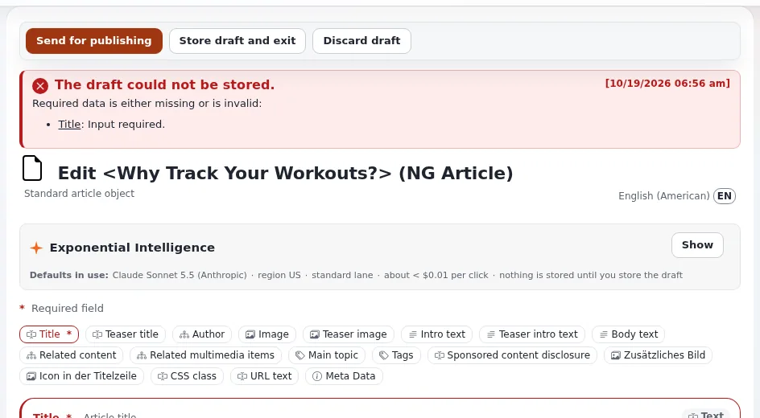

# Lektion 3.2: Ihren ersten Artikel erstellen

Artikel sind das, was die meisten Redakteure die meiste Zeit schreiben. In dieser Lektion erstellen die Teilnehmenden
einen Artikel in ihrem Kursordner, stoßen auf ein Rich-Text-Pflichtfeld, veröffentlichen und bearbeiten den Artikel
dann ein zweites Mal; dabei sehen sie, dass jede Bearbeitung eine neue Version erzeugt.

## Auf einen Blick

| | |
|---|---|
| Kurs | [Redakteure 101](../README.md) |
| Modul | [Modul 3: Inhalte erstellen und bearbeiten](README.md) |
| Dauer | 60 Minuten (20 Präsentation, 40 Übung) |
| Niveau | Einsteiger |
| Zielgruppe | Neue Redakteure und Autoren |
| Voraussetzungen | [Lektion 3.1](ihren-ersten-ordner-erstellen.md): Alle Teilnehmenden haben einen Kursordner |

## Lernziele

Nach dieser Lektion können die Teilnehmenden:

- unter ihrem eigenen Ordner einen **Article** erstellen und **Title**, **Intro** und **Body** ausfüllen;
- erklären, was passiert, wenn beim Veröffentlichen ein Pflichtfeld leer ist;
- einen veröffentlichten Artikel bearbeiten und die Änderung als neue Version veröffentlichen;
- die Sprache wählen, bevor sie auf **Bearbeiten** klicken, wenn ein Element mehrere Übersetzungen hat.

## Hinweise für Trainer

### So präsentieren Sie es

Quelle: [Inhalte erstellen und bearbeiten](../../../inhalte-bearbeiten.md) und
[Das Bearbeitungsformular](../../../inhalte-bearbeiten.md#das-bearbeitungsformular).

1. **Die Felder des Artikels** (5 Minuten). Erstellen Sie auf dem Projektor einen Artikel in Ihrem eigenen Ordner.
   Auf einer Standardinstallation hat ein Artikel **Title** (Pflichtfeld), **Short title**, **Author**, **Intro**
   (Rich Text, Pflichtfeld), **Body** (Rich Text), **Enable comments** und **Image**. Ihre Schulungs-Website kann
   abweichen; prüfen Sie das Formular einmal vor dem Kurs und passen Sie die Übung an.
2. **Pflichtfelder** (4 Minuten). Lassen Sie **Intro** leer und klicken Sie auf **Zur Veröffentlichung schicken**.
   Das Formular kommt mit einer Meldung oben und am Feld zurück. Füllen Sie es aus und veröffentlichen Sie erneut.
3. **Bearbeiten** (5 Minuten). Klicken Sie auf der Seite des Artikels auf **Bearbeiten**. Ein neuer Entwurf entsteht,
   eine Kopie der veröffentlichten Version; die Website zeigt weiter die veröffentlichte Version, bis Sie
   veröffentlichen. Ändern Sie den Titel und veröffentlichen Sie: Die Seite zeigt *Version 2*.
4. **Sprachen** (2 Minuten). Gibt es ein Element in mehr als einer Sprache, wählen Sie zuerst die Sprache in der Liste
   neben **Bearbeiten**. Auf einer einsprachigen Schulungs-Website zeigen Sie die Liste und gehen weiter.
5. **Bearbeitungskonflikte** (4 Minuten). Hat schon jemand einen Entwurf des Elements, erscheint zuerst die Seite
   **Möglicher Bearbeitungs-Konflikt**. Die Teilnehmenden können einen ihrer eigenen Entwürfe fortsetzen (auswählen
   und auf **Ausgewählte bearbeiten** klicken), einen **Neuer Entwurf** aus der veröffentlichten Version beginnen oder
   **Abbrechen**. Den Entwurf einer anderen Person kann man nicht bearbeiten.

### Häufige Fragen

**Was ist der Unterschied zwischen Title und Short title?** Der Kurztitel wird, wenn er ausgefüllt ist, auf einer
Standardinstallation in Listen und im Baum als Name des Elements verwendet; der Titel ist die vollständige
Überschrift.

**Kann ich aus einer Textverarbeitung einfügen?** Ja, in die Rich-Text-Felder. Lektion 4.1 zeigt, wie Sie prüfen, was
eingefügt wurde.

**Was passiert, wenn sich mein Browser beim Schreiben schließt?** Der Entwurf wird während der Arbeit alle paar
Minuten automatisch gespeichert, sodass ein geschlossener Tab wenig kostet. Er wartet unter **Meine Entwürfe**.

**Warum sehe ich bei meinem eigenen Artikel Möglicher Bearbeitungs-Konflikt?** Sie haben einen früheren Entwurf davon
zurückgelassen, zum Beispiel mit **Entwurf speichern und beenden**. Setzen Sie ihn fort oder erstellen Sie einen neuen
Entwurf.

### Stolperfallen

- **Das Bildfeld.** Lassen Sie die Teilnehmenden noch keine Bilder hochladen; Lektion 5.3 behandelt das. Lassen Sie
  **Image** leer.
- **Versehentlich zwei Entwürfe.** Wer in zwei Tabs zweimal auf **Bearbeiten** klickt, bekommt die Seite mit dem
  Bearbeitungskonflikt. Nutzen Sie das als Lernmoment.
- **Im falschen Ordner schreiben.** Bitten Sie die Teilnehmenden wie in Lektion 3.1, vor **Neu erstellen** den Pfad zu
  prüfen.

## Praktische Übung

Verwenden Sie die Schulungsinstallation und Ihr Schulungskonto mit der Rolle Editor.

1. Öffnen Sie Ihren Kursordner aus Lektion 3.1 (unter **Training**).
2. Klicken Sie unter **Unterelemente** auf **Neu erstellen** und wählen Sie **Article**.
3. Geben Sie unter **Title** `My first article` ein.
4. Lassen Sie **Intro** leer und klicken Sie auf **Zur Veröffentlichung schicken**. Lesen Sie die Meldung oben im
   Formular und am Feld.
5. Geben Sie unter **Intro** zwei Sätze über Ihre Arbeit ein.
6. Geben Sie unter **Body** einen kurzen Absatz darüber ein, was Sie in diesem Kurs lernen möchten.
7. Hat das Formular **Author**, prüfen Sie, dass Ihr Name eingetragen ist; tragen Sie ihn sonst ein.
8. Klicken Sie auf **Zur Veröffentlichung schicken**. Notieren Sie die Version auf der Seite des Artikels.
9. Klicken Sie auf **Bearbeiten**. Ändern Sie **Title** in `My first article, edited`.
10. Klicken Sie auf **Zur Veröffentlichung schicken** und notieren Sie erneut die Version.
11. Klicken Sie noch einmal auf **Bearbeiten**, öffnen Sie dann das Dashboard in einem zweiten Browser-Tab und sehen
    Sie sich **Meine Entwürfe** an.
12. Klicken Sie im ersten Tab auf **Entwurf verwerfen** und bestätigen Sie. Prüfen Sie den Titel des Artikels auf
    seiner Seite: Es ist der aus Schritt 9.

## Erwartetes Ergebnis

- Schritt 4: Das Formular hat das Veröffentlichen verweigert und das leere Pflichtfeld genannt.
- Der Artikel *My first article, edited* ist im Ordner der Teilnehmenden veröffentlicht, mit *Version 2*.
- Schritt 11: **Meine Entwürfe** hat den offenen Entwurf des Artikels aufgelistet.
- Nach Schritt 12 ist der Entwurf weg und der veröffentlichte Titel unverändert.
- Der Trainer prüft das, indem er den Artikel einer Teilnehmerin oder eines Teilnehmers und dessen Seite
  **Versionen verwalten** auf dem Projektor öffnet.

## Quiz

1. Sie klicken bei einem veröffentlichten Artikel auf **Bearbeiten**. Was sehen Besucher, während Sie schreiben?
2. Welche zwei Felder eines Standardartikels sind Pflichtfelder?
   A. **Title** und **Body** B. **Title** und **Intro** C. **Intro** und **Image** D. **Author** und **Title**
3. Was ermöglicht Ihnen die Seite **Möglicher Bearbeitungs-Konflikt**?
4. Richtig oder falsch: **Entwurf verwerfen** bei einem vorhandenen Artikel löscht den Artikel.
5. Ein Element gibt es auf Englisch und Deutsch. Was tun Sie, bevor Sie auf **Bearbeiten** klicken, um den deutschen
   Text zu ändern?

Antworten

1. Die veröffentlichte Version; der Entwurf ist nur für Sie sichtbar, bis Sie veröffentlichen.
2. **B.** Auf einer Standardinstallation; prüfen Sie das Formular Ihrer eigenen Installation.
3. Einen Ihrer eigenen Entwürfe fortsetzen, einen **Neuer Entwurf** aus der veröffentlichten Version beginnen oder
   **Abbrechen** ([Inhalte erstellen und bearbeiten](../../../inhalte-bearbeiten.md#wenn-jemand-anderes-bearbeitet)).
4. **Falsch.** Es wirft den Entwurf weg und lässt die veröffentlichte Version, wie sie war.
5. Wählen Sie Deutsch in der Sprachliste neben **Bearbeiten**.

## Weiterführende Literatur

- [Inhalte erstellen und bearbeiten](../../../inhalte-bearbeiten.md): das Bearbeitungsformular, Konflikte und
  Verknüpfungen.
- [Veröffentlichen, Versionen und der Papierkorb](../../../veroeffentlichen-und-versionen.md): was beim Veröffentlichen
  passiert.
- [Meine Entwürfe und meine Warteliste](../../../../anleitungen/entwuerfe-und-ausstehende-objekte.md): wo unfertige Entwürfe
  warten.

## Verwandte Seiten

- [Modul 3: Inhalte erstellen und bearbeiten](README.md)
- [Redakteure 101: Kursüberblick](../README.md)
- [Trainer: hier beginnen](../../trainer-hier-beginnen.md)
- [Freie Dokumentation](../../../freie-dokumentation.md): Diese Seite darf unter der GNU FDL 1.3 frei kopiert, übersetzt und verbessert werden.

<!-- exp-partner-block:start -->
**Werden Sie Exponential-Partner.** Partner teilen ihre Informationen, stellen Mittel bereit, geben Beiträge
zurück und entwickeln die Produkte gemeinsam mit uns weiter, und so wächst Exponential. Eine Partner-Website und
ein Partner-Dashboard sind für Mitte 2027 geplant: Werden Sie noch heute Partner, damit wir schneller wachsen und
neue Funktionen früher bereitstellen können. Beginnen Sie mit [Partner: hier beginnen](../../../partner/partner-hier-beginnen.md) und
[Wie Sie sich bewerben](../../../partner/wie-sie-sich-bewerben.md).
<!-- exp-partner-block:end -->
