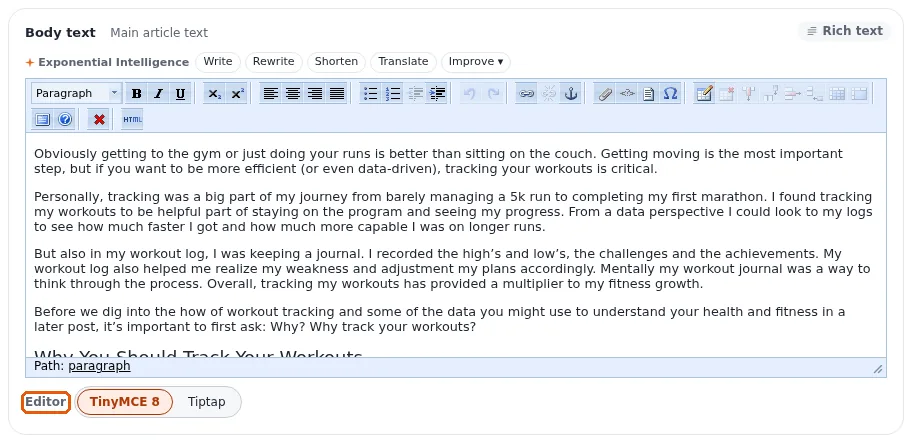

# Lektion 4.3: Einbettungen, Tabellen und die Wahl des Editors

Ein Rich-Text-Feld kann mehr als Wörter enthalten: Bilder und andere Elemente der Website lassen sich darin
**einbetten**, und Informationen lassen sich in einer **Tabelle** darstellen. Diese Lektion vermittelt beides und endet
mit der Seite, auf der jeder Redakteur den Online-Editor wählt, den er bevorzugt.

## Auf einen Blick

| | |
|---|---|
| Kurs | [Redakteure 101](../README.md) |
| Modul | [Modul 4: Der Online-Editor](README.md) |
| Dauer | 60 Minuten (20 Präsentation, 40 Übung) |
| Niveau | Einsteiger |
| Zielgruppe | Neue Redakteure und Autoren |
| Voraussetzungen | [Lektion 4.2](links-und-anker.md); mindestens ein Bild in der Medienbibliothek der Schulungs-Website |

## Lernziele

Nach dieser Lektion können die Teilnehmenden:

- ein vorhandenes Bild mit der Suche des Einbettungsdialogs in ein Rich-Text-Feld einbetten;
- Größe und Ausrichtung einer Einbettung per Doppelklick ändern;
- eine Tabelle einfügen, eine Zeile und eine Spalte hinzufügen und ihr eine Beschriftung geben;
- die Seite **Online-Editor** öffnen und ihre Editor-Engine wählen;
- erklären, dass ein Wechsel der Engine den gespeicherten Text erhält.

## Hinweise für Trainer

### So präsentieren Sie es

Quelle: [Der Online-Editor auf Basis von TinyMCE 8](../../../../../eng-us/features/6.0/online-editor-tinymce8.md).

1. **Einbetten** (6 Minuten). Setzen Sie in **Body** den Cursor in einen leeren Absatz und klicken Sie auf die
   Schaltfläche zum Einbetten (**Objekt einbetten**). Der Dialog durchsucht die Elemente der Website, mit einem
   Klassenfilter und einer Vorschau. Wählen Sie ein Bild und bestätigen Sie. Doppelklicken Sie dann auf die
   Einbettung: Sie können ihre Ansicht, ihre Klasse, ihre Größe (bei Bildern), ihre Ausrichtung und die Frage, ob sie
   inline steht, ändern. Erwähnen Sie den Reiter **Hochladen**, der eine neue Datei hochlädt und sofort einbettet, mit
   der Wahl „Von Ihrem Computer“ oder, wo die Website es erlaubt, „Von einer URL“. Modul 5 behandelt das Hochladen
   ausführlich.
2. **Tabellen** (6 Minuten). Klicken Sie auf die Tabellen-Schaltfläche. Mit den mitgelieferten Einstellungen zeigt der
   Dialog ein Größenraster, die Breite und den Rahmen (in px oder %), eine Klasse, eine Zusammenfassung und eine
   Beschriftung. Fügen Sie eine Tabelle mit 3 mal 3 Zellen ein, schreiben Sie hinein und verwenden Sie dann die
   Tabellen-Schaltflächen, um danach eine Zeile und danach eine Spalte einzufügen und eine Zeile zu löschen.
3. **Den Editor wählen** (5 Minuten). Öffnen Sie die Seite **Online-Editor** (Adresse `/ezoe/engine` nach der Adresse
   der Administration). Sie listet die Editoren mit Version, Beschreibung und Status auf, dazu die Liste
   **Editor für Textfelder**, deren erster Eintrag die Voreinstellung der Website ist (zum Beispiel *Default of this
   site (TinyMCE 8)*). Wählen Sie und klicken Sie auf **Speichern**. Wo die Website es eingeschaltet hat, tut ein
   Schalter namens **Editor** unter jedem Rich-Text-Feld dasselbe während der Bearbeitung; ein Klick speichert den
   Entwurf mit dem bis dahin eingegebenen Text und wechselt.
4. **Warum der Wechsel sicher ist** (3 Minuten). Die Engines schreiben denselben gespeicherten Text, sodass ein mit
   der einen geschriebener Artikel mit der anderen bearbeitet werden kann.

### Häufige Fragen

**Kann ich ein Dokument oder ein Video einbetten, nicht nur ein Bild?** Ja, der Einbettungsdialog bettet auch andere
Elemente ein; wie sie auf der Website erscheinen, hängt vom Design der Website ab.

**Wohin kommt ein Bild, das über den Reiter Hochladen hochgeladen wurde?** Es wird zu einem eigenen Element, an der
Stelle, die die Website für solche Uploads festgelegt hat; danach erscheint es in der Medienbibliothek oder an der im
Dialog genannten Stelle.

**Welchen Editor soll ich wählen?** Den, mit dem Ihr Team schult. Alle speichern denselben Text; der Unterschied liegt
in der Werkzeugleiste und den Dialogen.

**Warum zeigt meine Liste der Editoren nur einen oder zwei Einträge?** Die Liste zeigt die Engines, die Ihre
Installation anbietet.

### Stolperfallen

- **Einbetten ohne Alternativtext.** Der Alternativtext des Bildes kommt vom Bildelement. Fehlt er, korrigieren Sie
  ihn am Bild (Lektion 5.3), nicht im Artikel.
- **Riesige Tabellen.** Tabellen sind für tabellarische Daten da, nicht für das Layout. Halten Sie sie klein und geben
  Sie ihnen eine Beschriftung.
- **Die Engine mitten in der Bearbeitung wechseln.** Der Schalter speichert den Entwurf vor dem Wechsel; bringen Sie
  den Teilnehmenden trotzdem bei, zu Beginn einer Bearbeitung zu wechseln.

## Praktische Übung

Verwenden Sie die Schulungsinstallation und Ihren Artikel *My first article*.

1. Öffnen Sie Ihren Artikel und klicken Sie auf **Bearbeiten**. Gehen Sie zu **Body** und setzen Sie den Cursor in
   einen neuen, leeren Absatz.
2. Klicken Sie auf die Schaltfläche zum Einbetten. Suchen Sie im Dialog nach einem Bild, das der Trainer genannt hat,
   wählen Sie es und bestätigen Sie.
3. Doppelklicken Sie auf das eingebettete Bild. Ändern Sie seine Größe in eine kleinere und seine Ausrichtung auf
   rechts, und bestätigen Sie.
4. Klicken Sie in einem neuen Absatz darunter auf die Tabellen-Schaltfläche. Fügen Sie eine Tabelle mit 3 Spalten und
   3 Zeilen ein und geben Sie die Beschriftung `My course plan` ein.
5. Füllen Sie die erste Zeile mit `Day`, `Topic`, `Done` und zwei weitere Zeilen mit eigenen Einträgen.
6. Setzen Sie den Cursor in die letzte Zeile und fügen Sie mit den Tabellen-Schaltflächen danach eine Zeile ein.
   Löschen Sie sie dann wieder.
7. Klicken Sie auf **Zur Veröffentlichung schicken** und prüfen Sie das Bild und die Tabelle mit
   **Auf der Website ansehen**.
8. Öffnen Sie die Seite **Online-Editor** unter der Adresse, die Ihnen der Trainer gibt (`/ezoe/engine` nach der
   Adresse der Administration).
9. Lesen Sie die Tabelle der Editoren und schreiben Sie die Voreinstellung dieser Website aus der Liste
   **Editor für Textfelder** auf.
10. Wählen Sie einen anderen Editor aus der Liste (falls es einen gibt), klicken Sie auf **Speichern** und öffnen Sie
    Ihren Artikel mit **Bearbeiten**: Die Werkzeugleiste sieht anders aus, aber Ihr Text ist derselbe.
11. Klicken Sie auf **Entwurf verwerfen**, gehen Sie zurück zur Seite **Online-Editor**, wählen Sie wieder die
    Voreinstellung der Website und klicken Sie auf **Speichern**.

## Erwartetes Ergebnis

- Der veröffentlichte Artikel zeigt das Bild, kleiner und rechts ausgerichtet, und eine Tabelle mit der Beschriftung
  *My course plan*.
- Die Teilnehmenden haben den voreingestellten Editor der Website aufgeschrieben (auf einer aktuellen
  Schulungsinstallation oft *TinyMCE 8*; es ist eine Einstellung der Website).
- In Schritt 10 öffnete sich derselbe Text in einem anderen Editor, und in Schritt 11 wurde zurückgewechselt.
- Der Trainer prüft das, indem er den Artikel einer Teilnehmerin oder eines Teilnehmers auf der Website und die Seite
  **Online-Editor** auf dem Projektor öffnet.

## Quiz

1. Wie ändern Sie die Größe eines Bildes, das schon in einen Text eingebettet ist?
2. Was tut der Reiter **Hochladen** des Einbettungsdialogs?
3. Richtig oder falsch: Ein mit TinyMCE 8 geschriebener Artikel kann nicht mit TinyMCE 3 bearbeitet werden.
4. Nennen Sie drei Dinge, die Sie im Tabellendialog einstellen können.
5. Wo wählen Sie Ihre eigene Editor-Engine?
   A. Im Kasten **Oberfläche** der rechten Spalte B. Auf der Seite **Online-Editor** C. Im Reiter **Details** des
   Artikels D. Das kann nur ein Administrator

Antworten

1. Doppelklicken Sie auf die Einbettung und ändern Sie ihre Größe im Dialog.
2. Er lädt eine neue Datei hoch, erstellt daraus ein Element und bettet es in den Text ein.
3. **Falsch.** Beide Engines speichern denselben Text
   ([Der Online-Editor auf Basis von TinyMCE 8](../../../../../eng-us/features/6.0/online-editor-tinymce8.md)).
4. Drei beliebige von: Größe, Breite, Rahmen, Klasse, Zusammenfassung, Beschriftung.
5. **B.** Die Seite **Online-Editor** (`/ezoe/engine`) oder der Schalter **Editor** unter dem Feld, wo die Website ihn
   anzeigt.

## Weiterführende Literatur

- [Der Online-Editor auf Basis von TinyMCE 8](../../../../../eng-us/features/6.0/online-editor-tinymce8.md): Einbettungen,
  Tabellen, Engines und Einstellungen.
- [ezoe und TinyMCE 8](../../../../../eng-us/bc/6.0/ezoe-tinymce8.md): die Referenz für Administratoren.
- [Bilder, Medien und Uploads](../../../medien-und-uploads.md): wohin hochgeladene Dateien kommen.

## Verwandte Seiten

- [Modul 4: Der Online-Editor](README.md)
- [Redakteure 101: Kursüberblick](../README.md)
- [Trainer: hier beginnen](../../trainer-hier-beginnen.md)
- [Freie Dokumentation](../../../freie-dokumentation.md): Diese Seite darf unter der GNU FDL 1.3 frei kopiert, übersetzt und verbessert werden.

<!-- exp-partner-block:start -->
**Werden Sie Exponential-Partner.** Partner teilen ihre Informationen, stellen Mittel bereit, geben Beiträge
zurück und entwickeln die Produkte gemeinsam mit uns weiter, und so wächst Exponential. Eine Partner-Website und
ein Partner-Dashboard sind für Mitte 2027 geplant: Werden Sie noch heute Partner, damit wir schneller wachsen und
neue Funktionen früher bereitstellen können. Beginnen Sie mit [Partner: hier beginnen](../../../partner/partner-hier-beginnen.md) und
[Wie Sie sich bewerben](../../../partner/wie-sie-sich-bewerben.md).
<!-- exp-partner-block:end -->
