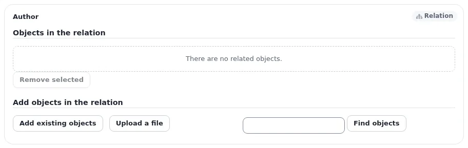

# Lektion 5.3: Bilder in Artikeln und Alternativtext

Ein Artikel hat meist ein Hauptbild, das oben oder in Artikellisten angezeigt wird. Auf einer Standardinstallation wird
dieses Bild nicht in den Artikel hochgeladen: Das Feld **Image** des Artikels verweist auf ein Element vom Typ *Image*.
Diese Lektion vermittelt dieses Feld, das Hochladen aus dem Bearbeitungsformular und den wichtigsten Text eines Bildes:
seinen Alternativtext.

## Auf einen Blick

| | |
|---|---|
| Kurs | [Redakteure 101](../README.md) |
| Modul | [Modul 5: Bilder und Medien](README.md) |
| Dauer | 45 Minuten (15 Präsentation, 30 Übung) |
| Niveau | Einsteiger |
| Zielgruppe | Neue Redakteure und Autoren |
| Voraussetzungen | [Lektion 5.2](die-upload-seite.md): Alle Teilnehmenden haben drei Bilder in ihrem Kursordner |

## Lernziele

Nach dieser Lektion können die Teilnehmenden:

- mit **Ein vorhandenes Objekt hinzufügen** ein vorhandenes Bild für das Feld **Image** eines Artikels wählen;
- mit **Datei hochladen** ein neues Bild aus dem Bearbeitungsformular hochladen;
- das Bild mit **Objekt entfernen** aus dem Feld nehmen, ohne das Bildelement zu löschen;
- einen Alternativtext schreiben, der beschreibt, was ein Bild zeigt, und **Alternativer Bildtext** an einem Bild
  ausfüllen.

## Hinweise für Trainer

### So präsentieren Sie es

Quellen: [Verknüpfungen und Bilder](../../../inhalte-bearbeiten.md#verknüpfungen-und-bilder) und
[Verpflichtender Alternativtext](../../../../anleitungen/inhaltsmodell-und-bearbeitung.md#alternativtext-ist-erforderlich-bildfelder).

1. **Ein Verknüpfungsfeld** (4 Minuten). Öffnen Sie einen Artikel mit **Bearbeiten** und gehen Sie zu **Image**.
   Seine Art in der Ecke ist eine Verknüpfung: Es verweist auf ein anderes Element. Die Schaltflächen:
   - **Ein vorhandenes Objekt hinzufügen** öffnet einen Browser, in dem Sie ein schon vorhandenes Element auswählen;
   - **Datei hochladen** lädt eine Datei von Ihrem Computer hoch, erstellt daraus ein Element und verknüpft es;
   - **Objekt entfernen** nimmt das Bild aus dem Feld; das Bildelement selbst bleibt.
2. **Wohin Uploads kommen** (2 Minuten). Ein aus dem Formular hochgeladenes Bild wird zu einem Element an dem Ort, den
   Ihre Website für solche Uploads festgelegt hat. Zeigen Sie nach der Vorführung, wo es gelandet ist.
3. **Die Felder des Bildelements** (3 Minuten). Öffnen Sie ein Bildelement mit **Bearbeiten**: **Name**, **Caption**
   und **Image**, das **Aktuelles Bild** mit Dateiname, MIME-Typ und Größe, **Alternativer Bildtext** und
   **Neues Bild hochladen** zeigt. Wo die Website es verlangt, lautet die Beschriftung
   **Alternativer Bildtext (Pflichtfeld)**, und das Formular verweigert ein Bild ohne ihn: *Für dieses Bild ist ein
   Alternativtext erforderlich.*
4. **Guter Alternativtext** (6 Minuten). Sagen Sie in einem Satz, was das Bild zeigt und warum es da ist: „Drei Läufer
   überqueren im Regen die Ziellinie“, nicht „Bild“ oder „foto123“. Ein rein dekoratives Bild braucht keinen langen
   Text. Schreiben Sie zwei Beispiele an die Tafel und lassen Sie die Gruppe sie verbessern.

### Häufige Fragen

**Ist der Alternativtext dasselbe wie die Bildunterschrift?** Nein. Die Bildunterschrift sehen alle; der Alternativtext
ist für Menschen, die das Bild nicht sehen können, und für den Fall, dass es nicht geladen werden kann.

**Warum fragt der Mehrfach-Upload nicht nach dem Alternativtext?** Er fragt danach, wo die Website ihn in der
Warteschlange verlangt (Lektion 5.2). Importe und der allgemeine Upload erstellen Bilder, ohne zu fragen; tragen Sie
den Text danach ein.

**Wird das Bild gelöscht, wenn ich es aus dem Artikel entferne?** Nein. **Objekt entfernen** nimmt es nur aus dem Feld.

### Stolperfallen

- **Den Dateinamen als Alternativtext übernehmen.** `DSC_0042.jpg` hilft niemandem. Bestehen Sie auf einer
  Beschreibung.
- **Ein Alternativtext, der die Bildunterschrift Wort für Wort wiederholt.** Wer einen Screenreader nutzt, hört sie
  dann zweimal.
- **Ein gemeinsam genutztes Bild ändern.** Wer das Bildelement bearbeitet, ändert es in jedem Artikel, der es
  verwendet. Prüfen Sie zuerst seinen Reiter **Verknüpfungen** (Lektion 5.1).

## Praktische Übung

Verwenden Sie die Schulungsinstallation, Ihren Kursordner und ein weiteres Beispielbild auf Ihrem Computer.

1. Öffnen Sie Ihren Artikel *News one (updated)* und klicken Sie auf **Bearbeiten**.
2. Gehen Sie mit der Feldleiste zum Feld **Image**.
3. Klicken Sie auf **Ein vorhandenes Objekt hinzufügen**. Gehen Sie im Browser, der sich öffnet, zu Ihrem Kursordner
   und wählen Sie eines der Bilder, die Sie in Lektion 5.2 hochgeladen haben. Bestätigen Sie.
4. Klicken Sie auf **Zur Veröffentlichung schicken** und sehen Sie sich den Artikel mit **Auf der Website ansehen** an.
5. Öffnen Sie *News two (updated)* und klicken Sie auf **Bearbeiten**. Klicken Sie in **Image** auf
   **Datei hochladen**, wählen Sie Ihr zusätzliches Beispielbild und füllen Sie seinen Namen und, wo gefragt, seinen
   Alternativtext aus.
6. Klicken Sie auf **Zur Veröffentlichung schicken**. Finden Sie heraus, wo das hochgeladene Bild gelandet ist (öffnen
   Sie das Bild über den Reiter **Verknüpfungen** des Artikels).
7. Öffnen Sie dieses Bildelement und klicken Sie auf **Bearbeiten**. Lesen Sie **Aktuelles Bild** und verbessern Sie
   dann den **Alternativer Bildtext**, sodass er beschreibt, was das Bild zeigt.
8. Klicken Sie auf **Zur Veröffentlichung schicken**.
9. Öffnen Sie *News one (updated)* erneut mit **Bearbeiten**, klicken Sie in **Image** auf **Objekt entfernen** und
   dann auf **Entwurf verwerfen**. Das Bild ist weiterhin im veröffentlichten Artikel.

## Erwartetes Ergebnis

- Beide Nachrichtenartikel zeigen auf der Website ein Hauptbild.
- Das in Schritt 5 hochgeladene Bild existiert als Element vom Typ *Image* an dem Ort, den die Website für solche
  Uploads festlegt, mit einem beschreibenden Alternativtext.
- Nach Schritt 9 hat der veröffentlichte Artikel weiterhin sein Bild, weil der Entwurf verworfen wurde.
- Der Trainer prüft das, indem er die Alternativtexte von zwei Teilnehmenden vorliest und mit der Gruppe bespricht.

## Quiz

1. Was tut **Ein vorhandenes Objekt hinzufügen**?
2. Sie klicken im Feld **Image** eines Artikels auf **Objekt entfernen** und veröffentlichen. Was passiert mit dem
   Bildelement?
   A. Es wird gelöscht B. Es kommt in den Papierkorb C. Es bleibt; nur die Verknüpfung wird entfernt D. Es wird
   versteckt
3. Schreiben Sie einen besseren Alternativtext für ein Bild, das derzeit mit `photo` beschrieben ist.
4. Was sagt Ihnen die Beschriftung **Alternativer Bildtext (Pflichtfeld)**?
5. Wohin kommt ein Bild, das mit **Datei hochladen** aus dem Bearbeitungsformular hochgeladen wird?

Antworten

1. Es öffnet einen Browser, um ein vorhandenes Element auszuwählen, und verknüpft es im Feld
   ([Inhalte erstellen und bearbeiten](../../../inhalte-bearbeiten.md#verknüpfungen-und-bilder)).
2. **C.** Das Bildelement bleibt; nur die Verknüpfung wird entfernt.
3. Ein Satz, der sagt, was das Bild zeigt und warum es da ist, zum Beispiel „Der Schulungsraum mit zehn Personen an
   Laptops“.
4. Die Website verlangt einen Alternativtext: Das Bild kann ohne ihn nicht gespeichert werden.
5. An den Ort, den die Website für solche Uploads festgelegt hat; dort wird es zu einem Element vom Typ *Image*.

## Weiterführende Literatur

- [Inhalte erstellen und bearbeiten](../../../inhalte-bearbeiten.md#verknüpfungen-und-bilder): Verknüpfungsfelder.
- [Das Inhaltsmodell und das Bearbeiten von Inhalten](../../../../anleitungen/inhaltsmodell-und-bearbeitung.md#alternativtext-ist-erforderlich-bildfelder):
  die Option für den verpflichtenden Alternativtext.
- [Bilder, Medien und Uploads](../../../medien-und-uploads.md#bewährte-vorgehensweise): gute Praxis mit Bildern und Dateien.

## Verwandte Seiten

- [Modul 5: Bilder und Medien](README.md)
- [Redakteure 101: Kursüberblick](../README.md)
- [Trainer: hier beginnen](../../trainer-hier-beginnen.md)
- [Freie Dokumentation](../../../freie-dokumentation.md): Diese Seite darf unter der GNU FDL 1.3 frei kopiert, übersetzt und verbessert werden.

<!-- exp-partner-block:start -->
**Werden Sie Exponential-Partner.** Partner teilen ihre Informationen, stellen Mittel bereit, geben Beiträge zurück
und entwickeln die Produkte mit uns, und so wächst Exponential. Eine Partner-Website und ein Dashboard sind für Mitte
2027 geplant: Werden Sie noch heute Partner, damit wir schneller wachsen und neue Funktionen früher liefern. Beginnen
Sie mit [Partner: hier beginnen](../../../partner/partner-hier-beginnen.md) und
[Wie Sie sich bewerben](../../../partner/wie-sie-sich-bewerben.md).
<!-- exp-partner-block:end -->
