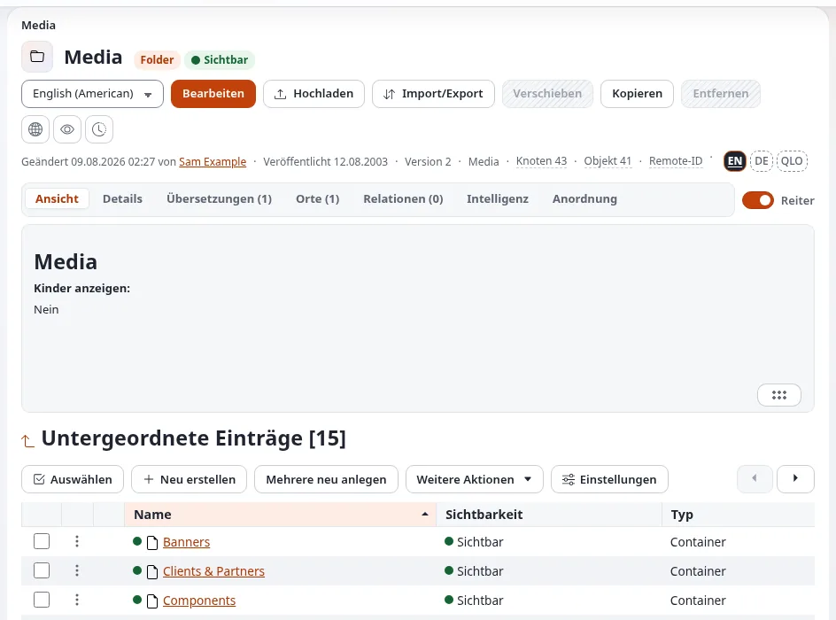

# Lektion 5.1: Die Medienbibliothek

Bilder, Dokumente und Videos sind ebenfalls Inhaltselemente. Sie liegen meist in der **Medienbibliothek**, einem Teil
des Inhaltsbaums, der für Dateien vorgesehen ist. Diese kurze Lektion zeigt den Teilnehmenden, wie die Bibliothek
aufgebaut ist und was ein Bildelement enthält, bevor sie in Lektion 5.2 etwas hochladen.

## Auf einen Blick

| | |
|---|---|
| Kurs | [Redakteure 101](../README.md) |
| Modul | [Modul 5: Bilder und Medien](README.md) |
| Dauer | 30 Minuten (10 Präsentation, 20 Übung) |
| Niveau | Einsteiger |
| Zielgruppe | Neue Redakteure und Autoren |
| Voraussetzungen | [Modul 2](../modul-02-der-inhaltsbaum/README.md) |

## Lernziele

Nach dieser Lektion können die Teilnehmenden:

- erklären, dass ein hochgeladenes Bild zu einem Element vom Typ *Image* wird und die meisten anderen Dateien zu einem
  Element vom Typ *File*;
- die Medienbibliothek und ihre Ordner über den Reiter **Medien** öffnen;
- **Name**, **Caption** und das Bild mit seinem Alternativtext an einem Bildelement ablesen;
- mit dem Reiter **Verknüpfungen** herausfinden, wo ein Bild verwendet wird.

## Hinweise für Trainer

### So präsentieren Sie es

Quelle: [Bilder, Medien und Uploads](../../../medien-und-uploads.md#die-medienbibliothek).

1. **Dateien sind Elemente** (3 Minuten). Jede Datei, die Sie hochladen, wird zu einem eigenen Inhaltselement: Ein
   Bild wird zu einem Element vom Typ *Image*, die meisten anderen Dateien zu einem Element vom Typ *File*; die Website
   entscheidet, welcher Typ aus welcher Art von Datei wird. Danach können Sie es in Artikeln, Galerien und Seiten wie
   jedes andere Element verwenden.
2. **Die Bibliothek** (3 Minuten). Der Reiter **Medien** öffnet die Medienbibliothek. Auf den meisten Websites hat sie
   Ordner wie **Images**, **Files** und **Multimedia**. Sie funktioniert wie **Inhaltsstruktur**: Ordner im Baum
   öffnen, ein Element öffnen, **Bearbeiten**, **Verschieben** und **Entfernen** darauf anwenden.
3. **Ein Bildelement** (4 Minuten). Öffnen Sie ein Bild. Auf einer Standardinstallation hat es **Name**
   (Pflichtfeld), **Caption** (Rich Text) und **Image**, die Datei mit ihrem **Alternativtext**. Öffnen Sie den Reiter
   **Verknüpfungen**: Er zeigt die Elemente, die das Bild verwenden.

Dateien müssen nicht in der Medienbibliothek liegen. Websites können Uploads in jeden Ordner erlauben, zum Beispiel
neben den Artikel, der sie verwendet; die Regeln Ihres Teams entscheiden.

### Häufige Fragen

**Warum ist ein Bild ein eigenes Element und nicht Teil des Artikels?** Damit ein Bild an vielen Stellen verwendet und
einmal geändert werden kann, und damit es einen eigenen Namen, eine eigene Bildunterschrift und einen eigenen
Alternativtext hat.

**Kann ich sehen, wo ein Bild verwendet wird, bevor ich es entferne?** Ja: Der Reiter **Verknüpfungen** des Bildes
listet die Elemente auf, die damit verknüpft sind. Das Entfernen schickt es zuerst in den Papierkorb.

**Was ist der Unterschied zwischen Bildunterschrift und Alternativtext?** Die Bildunterschrift wird allen Besuchern
neben dem Bild angezeigt (wo das Design sie anzeigt). Der Alternativtext beschreibt das Bild für Menschen, die es nicht
sehen können; Screenreader lesen ihn vor, und Browser zeigen ihn, wenn das Bild nicht geladen werden kann.

### Stolperfallen

- **Unordnung.** Eine Medienbibliothek ohne Ordner wird schnell unbrauchbar. Vereinbaren Sie Ordner mit Ihrem Team.
- **Namen von Kameras.** Bilder mit dem Namen `IMG_4711` sind unauffindbar. Die Upload-Seite lässt Sie vor dem
  Hochladen einen Titel festlegen (Lektion 5.2).
- **Ein Bild bearbeiten, das andere verwenden.** Wer ein Bildelement ändert, ändert es überall, wo es verwendet wird.
  Prüfen Sie zuerst **Verknüpfungen**.

## Praktische Übung

Verwenden Sie die Schulungsinstallation und Ihr Schulungskonto mit der Rolle Editor. Nichts in dieser Übung ändert
Inhalte.

1. Klicken Sie auf den Reiter **Medien**.
2. Schreiben Sie die Namen der Ordner der Medienbibliothek aus dem Baum auf.
3. Öffnen Sie den Ordner **Images** (oder den Ordner, den der Trainer nennt) und zählen Sie die Elemente in der
   Überschrift **Unterelemente**.
4. Öffnen Sie das Bild, das Sie in Lektion 4.3 eingebettet haben.
5. Schreiben Sie seine Typkennzeichnung, seinen **Name** und auf, ob es eine **Caption** hat.
6. Öffnen Sie den Reiter **Ansehen** und suchen Sie den Alternativtext des Bildes, falls es einen hat.
7. Öffnen Sie den Reiter **Verknüpfungen** und schreiben Sie auf, welche Elemente dieses Bild verwenden. Ihr Artikel
   aus Lektion 4.3 sollte darunter sein.
8. Öffnen Sie **Details** und schreiben Sie die Sektion auf, zu der das Bild gehört.
9. Öffnen Sie den Ordner **Files** (falls Ihre Bibliothek einen hat) und öffnen Sie ein Dateielement. Vergleichen Sie
   seine Felder mit denen des Bildes.

## Erwartetes Ergebnis

- Die Teilnehmenden zählen die Ordner der Bibliothek auf (zum Beispiel **Images**, **Files**, **Multimedia**).
- Das Bild ist vom Typ *Image*, mit einem Namen, eventuell einer Bildunterschrift und einem Alternativtext.
- Der Reiter **Verknüpfungen** zeigt den Artikel der Teilnehmenden unter den Elementen, die das Bild verwenden (das
  Einbetten erzeugt auf einer Standardinstallation eine Verknüpfung; erscheint sie nicht, erklärt der Trainer, dass die
  Verknüpfung beim Veröffentlichen des Artikels gespeichert wird).
- Der Trainer prüft das, indem er eine Teilnehmerin oder einen Teilnehmer bittet, den Reiter **Verknüpfungen** auf dem
  Projektor zu zeigen.

## Quiz

1. Wozu wird ein hochgeladenes Bild?
   A. Zu einem Feld des Artikels B. Zu einem Element vom Typ *Image* C. Zu einer Datei in einem versteckten Ordner
   D. Zu einem Lesezeichen
2. Nennen Sie die drei Felder eines Standard-Bildelements.
3. Wofür ist der Alternativtext da?
4. Wie finden Sie heraus, welche Elemente ein Bild verwenden?
5. Richtig oder falsch: Dateien müssen immer in die Medienbibliothek hochgeladen werden.

Antworten

1. **B.** ([Bilder, Medien und Uploads](../../../medien-und-uploads.md)).
2. **Name**, **Caption** und **Image** (auf einer Standardinstallation).
3. Er beschreibt das Bild für Menschen, die es nicht sehen können, und wird angezeigt, wenn das Bild nicht geladen
   werden kann.
4. Öffnen Sie den Reiter **Verknüpfungen** des Bildes.
5. **Falsch.** Sie können in jeden Ordner hochladen, der Dateien annimmt.

## Weiterführende Literatur

- [Bilder, Medien und Uploads](../../../medien-und-uploads.md): die Bibliothek, Uploads und gute Praxis.
- [Ein Rundgang durch die Administration](../../../rundgang-durch-die-administration.md#die-seite-eines-objekts): die Reiter der Seite eines Elements.

## Verwandte Seiten

- [Modul 5: Bilder und Medien](README.md)
- [Redakteure 101: Kursüberblick](../README.md)
- [Trainer: hier beginnen](../../trainer-hier-beginnen.md)
- [Freie Dokumentation](../../../freie-dokumentation.md): Diese Seite darf unter der GNU FDL 1.3 frei kopiert, übersetzt und verbessert werden.

<!-- exp-partner-block:start -->
**Werden Sie Exponential-Partner.** Partner teilen ihre Informationen, stellen Mittel bereit, geben Beiträge zurück
und entwickeln die Produkte mit uns, und so wächst Exponential. Eine Partner-Website und ein Dashboard sind für Mitte
2027 geplant: Werden Sie noch heute Partner, damit wir schneller wachsen und neue Funktionen früher liefern. Beginnen
Sie mit [Partner: hier beginnen](../../../partner/partner-hier-beginnen.md) und
[Wie Sie sich bewerben](../../../partner/wie-sie-sich-bewerben.md).
<!-- exp-partner-block:end -->
