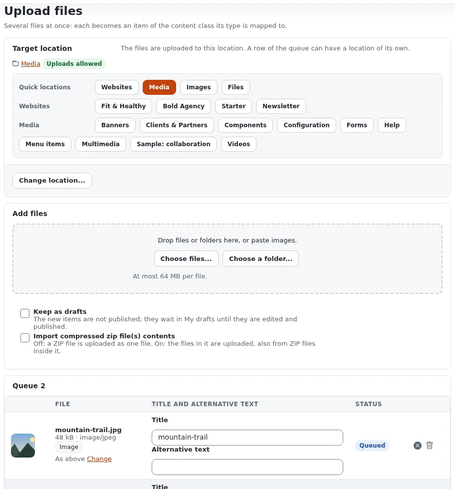

# Lektion 5.2: Die Upload-Seite

Die Upload-Seite nimmt eine Datei oder Hunderte an, per Schaltfläche, per Ziehen oder durch Einfügen eines Bildes.
Redakteure, die sie kennen, sparen Stunden. In dieser Lektion laden die Teilnehmenden eine Handvoll Bilder in ihren
eigenen Ordner hoch, geben ihnen ordentliche Titel und Alternativtexte und nutzen die Aktionen nach dem Hochladen.

## Auf einen Blick

| | |
|---|---|
| Kurs | [Redakteure 101](../README.md) |
| Modul | [Modul 5: Bilder und Medien](README.md) |
| Dauer | 60 Minuten (20 Präsentation, 40 Übung) |
| Niveau | Einsteiger |
| Zielgruppe | Neue Redakteure und Autoren |
| Voraussetzungen | [Lektion 5.1](die-medienbibliothek.md); drei oder vier kleine Beispielbilder auf dem Computer jeder Teilnehmerin und jedes Teilnehmers |

## Lernziele

Nach dieser Lektion können die Teilnehmenden:

- die Upload-Seite vom Dashboard, über die Schaltfläche **Hochladen** eines Ordners oder aus dem Menü eines Elements
  öffnen;
- den **Zielort** über die **Schnellauswahl** oder **Ort ändern ...** wählen;
- Dateien mit **Dateien wählen ...**, durch Ziehen oder durch Einfügen hinzufügen und die Warteschlange vor dem
  Hochladen prüfen;
- pro Bild einen Titel und einen Alternativtext festlegen und **Als Entwürfe behalten** nutzen;
- **Alle hochladen** verwenden, das Ergebnis lesen und mit den hochgeladenen Elementen weiterarbeiten.

## Hinweise für Trainer

### So präsentieren Sie es

Quelle: [Bilder, Medien und Uploads](../../../medien-und-uploads.md#dateien-hochladen). Die eigene Beschreibung der Seite
ist `extension/ezmultiupload/doc/upload-page.md` in der Installation.

1. **Die Seite öffnen** (3 Minuten): **Dateien hochladen** in den Schnellaktionen des Dashboards, **Hochladen** auf
   der Seite eines Ordners (lädt in diesen Ordner hoch) oder **Mehrere Dateien hochladen** im Menü eines Elements im
   Baum.
2. **Zielort** (3 Minuten). Die Seite zeigt **Dateien hochladen**, dann **Zielort**: den Pfad, gekennzeichnet mit
   *Hochladen erlaubt*, wenn dort Dateien abgelegt werden können. Die **Schnellauswahl** (etwa **Media**, **Images**,
   **Files**) und **Ort ändern ...** wählen einen anderen Ort. Die Seite merkt sich den letzten Ort.
3. **Dateien hinzufügen** (3 Minuten): **Dateien wählen ...**, **Ordner wählen ...**, Ziehen auf die gestrichelte
   Fläche oder Einfügen eines Bildes. Die Seite zeigt die größte Datei, die sie annimmt.
4. **Die Warteschlange** (5 Minuten). Noch wird nichts gesendet. Jede Datei zeigt ihren Namen, ihre Größe, ihren Typ,
   eine Vorschau, den Elementtyp, zu dem sie wird, wohin sie kommt, und einen **Titel** (standardmäßig der Dateiname).
   Füllen Sie den **Alternativtext** aus, wo die Website ihn verlangt. Eine Datei, die nicht hochgeladen werden kann,
   sagt, warum. Eine Datei mit demselben Namen und derselben Größe, die es am Ort schon gibt, wird markiert; Sie
   entscheiden, ob Sie sie überspringen, die neue umbenennen oder trotzdem hochladen.
5. **Optionen** (3 Minuten). **Als Entwürfe behalten**: Die neuen Elemente werden nicht veröffentlicht; sie warten
   unter **Meine Entwürfe**, bis sie bearbeitet und veröffentlicht werden. **Inhalt komprimierter ZIP-Dateien
   importieren**: aus, dann wird eine ZIP-Datei als eine Datei hochgeladen; an, dann werden die Dateien darin einzeln
   hochgeladen.
6. **Hochladen und danach** (3 Minuten). **Alle hochladen** sendet jeweils drei Dateien gleichzeitig, mit einem
   Fortschrittsbalken; **Alle abbrechen**, **Fehlgeschlagene erneut versuchen** und **Erledigte entfernen** verwalten
   die Warteschlange. Die Liste **Hochgeladen** zeigt jedes neue Element mit **Ansehen** und **Bearbeiten**; kreuzen
   Sie Elemente an, um **Verschieben nach ...**, **Ort hinzufügen ...** oder **Entfernen ...** zu verwenden.

### Häufige Fragen

**Welche Dateitypen kann ich hochladen?** Das entscheidet Ihre Website. Eine Zeile in der Warteschlange sagt es, wenn
ein Typ dort nicht erlaubt ist.

**Warum wurden die Bilder aus meiner ZIP-Datei übersprungen?** Wo die Website einen Alternativtext verlangt, werden
Bilder aus einer ZIP-Datei übersprungen, weil eine ZIP-Datei keinen Platz dafür hat. Laden Sie sie stattdessen einzeln
hoch.

**Wie groß darf eine Datei sein?** Die Seite zeigt es an, zum Beispiel *Höchstens 64 MB pro Datei*. Es ist eine
Einstellung des Servers.

### Stolperfallen

- **An den falschen Ort hochladen.** Die Seite merkt sich den letzten Ort, und auf einer gemeinsamen
  Schulungs-Website kann das der Ordner einer anderen Person sein. Bitten Sie die Teilnehmenden, vor
  **Alle hochladen** den **Zielort** zu lesen.
- **Persönliche Bilder.** Bitten Sie die Teilnehmenden, neutrale Beispielbilder mitzubringen (Landschaften,
  Gegenstände). Laden Sie niemals Fotos echter Personen ohne deren Zustimmung hoch, auch nicht auf eine
  Schulungs-Website.
- **Riesige Fotos.** Sehr große Kamerabilder brauchen in einem Schulungsnetz lange zum Hochladen. Bereiten Sie kleine
  Beispiele vor.

## Praktische Übung

Verwenden Sie die Schulungsinstallation, Ihren Kursordner und die Beispielbilder auf Ihrem Computer.

1. Öffnen Sie Ihren Kursordner und klicken Sie auf **Hochladen**. Die Upload-Seite öffnet sich mit Ihrem Ordner als
   **Zielort**.
2. Prüfen Sie, dass der Ort *Hochladen erlaubt* zeigt. Wenn nicht, sagen Sie es dem Trainer.
3. Klicken Sie auf **Dateien wählen ...** und wählen Sie drei Beispielbilder.
4. Lesen Sie in der Warteschlange für jede Datei, zu welchem Elementtyp sie wird und wohin sie kommt.
5. Ändern Sie jeden **Titel** in einen klaren Namen, zum Beispiel `Training - lake at sunset`.
6. Füllen Sie den **Alternativtext** jedes Bildes mit einer kurzen Beschreibung dessen aus, was es zeigt.
7. Setzen Sie ein Häkchen bei **Als Entwürfe behalten**.
8. Klicken Sie auf **Alle hochladen** und beobachten Sie die Fortschrittsbalken.
9. Klicken Sie in der Liste **Hochgeladen** bei einem Element auf **Ansehen**.
10. Öffnen Sie **Meine Entwürfe** auf dem Dashboard: Ihre drei Bilder sind als Entwürfe aufgelistet.
11. Öffnen Sie einen Bildentwurf mit **Bearbeiten**, prüfen Sie seine Felder und klicken Sie auf
    **Zur Veröffentlichung schicken**. Veröffentlichen Sie die anderen beiden auf dieselbe Weise.
12. Prüfen Sie zurück in Ihrem Kursordner, dass die drei Bilder in der Liste **Unterelemente** stehen.

## Erwartetes Ergebnis

- Drei Elemente vom Typ *Image* mit klaren Titeln und Alternativtexten sind im Kursordner der Teilnehmenden
  veröffentlicht.
- **Meine Entwürfe** hat sie nach dem Hochladen aufgelistet und ist nach Schritt 11 für sie leer.
- Der Trainer prüft das, indem er den Ordner einer Teilnehmerin oder eines Teilnehmers und den Reiter **Ansehen** eines
  Bildes auf dem Projektor öffnet.

## Quiz

1. Nennen Sie zwei Wege, die Upload-Seite zu öffnen.
2. Was tut **Als Entwürfe behalten**?
3. Zwei Dateien in der Warteschlange können nicht hochgeladen werden. Wo sehen Sie, warum?
   A. In einer E-Mail B. In der Zeile jeder Datei in der Warteschlange C. Nur im Serverlog D. Nirgends
4. Was passiert mit einer ZIP-Datei, wenn **Inhalt komprimierter ZIP-Dateien importieren** aus ist?
5. Warum sollten Sie den **Zielort** prüfen, bevor Sie auf **Alle hochladen** klicken?

Antworten

1. Zwei beliebige von: **Dateien hochladen** auf dem Dashboard, **Hochladen** auf der Seite eines Ordners,
   **Mehrere Dateien hochladen** im Menü eines Elements ([Bilder, Medien und Uploads](../../../medien-und-uploads.md#dateien-hochladen)).
2. Die neuen Elemente werden nicht veröffentlicht; sie warten unter **Meine Entwürfe**, bis sie bearbeitet und
   veröffentlicht werden.
3. **B.** Die Zeile jeder Datei sagt, warum.
4. Sie wird als eine Datei hochgeladen.
5. Die Seite merkt sich den letzten Ort, der vielleicht nicht der gewünschte ist.

## Weiterführende Literatur

- [Bilder, Medien und Uploads](../../../medien-und-uploads.md): die Upload-Seite und ihre Optionen.
- [Meine Entwürfe und meine Warteliste](../../../../anleitungen/entwuerfe-und-ausstehende-objekte.md): wo behaltene Entwürfe
  warten.
- [Schaltflächen der Schnellauswahl](../../../../funktionen/6.0/schaltflaechen-fuer-schnelle-platzierung.md): wie die Schnellauswahl
  festgelegt wird.

## Verwandte Seiten

- [Modul 5: Bilder und Medien](README.md)
- [Redakteure 101: Kursüberblick](../README.md)
- [Trainer: hier beginnen](../../trainer-hier-beginnen.md)
- [Freie Dokumentation](../../../freie-dokumentation.md): Diese Seite darf unter der GNU FDL 1.3 frei kopiert, übersetzt und verbessert werden.

<!-- exp-partner-block:start -->
**Werden Sie Exponential-Partner.** Partner teilen ihre Informationen, stellen Mittel bereit, geben Beiträge zurück
und entwickeln die Produkte mit uns, und so wächst Exponential. Eine Partner-Website und ein Dashboard sind für Mitte
2027 geplant: Werden Sie noch heute Partner, damit wir schneller wachsen und neue Funktionen früher liefern. Beginnen
Sie mit [Partner: hier beginnen](../../../partner/partner-hier-beginnen.md) und
[Wie Sie sich bewerben](../../../partner/wie-sie-sich-bewerben.md).
<!-- exp-partner-block:end -->
