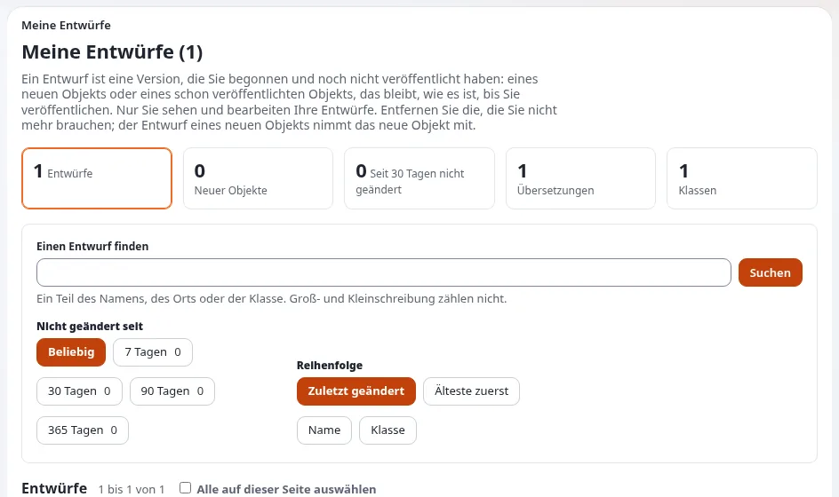

# Lektion 6.1: Entwürfe, Veröffentlichen und ausstehende Elemente

Die Teilnehmenden haben inzwischen mehrmals veröffentlicht. Diese Lektion benennt, was dabei geschehen ist: Jedes
Speichern ist eine **Version**, und eine Version ist ein Entwurf, ausstehend, veröffentlicht oder archiviert. Die
Teilnehmenden räumen ihre Seite **Meine Entwürfe** auf und lernen, was ein **ausstehendes** Element ist, damit eine
Freigabe auf ihrer echten Website sie nicht überrascht.

## Auf einen Blick

| | |
|---|---|
| Kurs | [Redakteure 101](../README.md) |
| Modul | [Modul 6: Veröffentlichen, Versionen und Entwürfe](README.md) |
| Dauer | 45 Minuten (15 Präsentation, 30 Übung) |
| Niveau | Einsteiger |
| Zielgruppe | Neue Redakteure und Autoren |
| Voraussetzungen | [Modul 3](../modul-03-erstellen-und-bearbeiten/README.md) und [Modul 5](../modul-05-bilder-und-medien/README.md) |

## Lernziele

Nach dieser Lektion können die Teilnehmenden:

- die vier Status einer Version benennen (**Entwurf**, **Ausstehend**, **Veröffentlicht**, **Archiviert**) und
  sagen, wer jeden davon sieht;
- **Meine Entwürfe** nutzen: ihre eigenen Entwürfe finden, fortsetzen und entfernen und alte Entwürfe auf einmal
  entfernen;
- erklären, was mit einem neuen Element passiert, wenn sein einziger Entwurf entfernt wird;
- sagen, was **Meine Warteliste** auflistet und warum eine Version dort warten kann.

## Hinweise für Trainer

### So präsentieren Sie es

Quellen: [Entwürfe und Versionen](../../../veroeffentlichen-und-versionen.md#entwürfe-und-versionen) und
[Meine Entwürfe und meine Warteliste](../../../../anleitungen/entwuerfe-und-ausstehende-objekte.md).

1. **Die vier Status** (5 Minuten). Schreiben Sie sie an die Tafel:

   | Status | Was er bedeutet |
   |---|---|
   | **Entwurf** | Wird gerade geschrieben. Nur sein Ersteller sieht und bearbeitet ihn. |
   | **Ausstehend** | Zur Veröffentlichung geschickt, aber ein Workflow hält ihn zurück, meist eine Freigabe. |
   | **Veröffentlicht** | Die Version, die die Website zeigt. Pro Element jeweils eine. |
   | **Archiviert** | Eine früher veröffentlichte Version, aufbewahrt, damit Sie zu ihr zurückkehren können. |

   Wenn ein Entwurf veröffentlicht wird, wird die zuvor veröffentlichte Version archiviert.
2. **Meine Entwürfe** (6 Minuten). Öffnen Sie die Seite vom Dashboard aus. Sie zeigt Zahlen (Ihre Entwürfe, die neuer
   Elemente, die seit einer Weile nicht geänderten), eine Suche, Filter nach Übersetzung, Klasse, Alter und
   Reihenfolge und pro Entwurf eine Karte mit **Bearbeiten**, **Ansehen** und **Entfernen**. Unten:
   **Ausgewählte entfernen**, **Alte Entwürfe entfernen** (nach 7, 30, 90 oder 365 Tagen ohne Änderung) und
   **Alle entfernen**, jeweils an Ort und Stelle bestätigt. Ihre Entwürfe gehören Ihnen: Die Seite entfernt nur Ihre
   eigenen.
3. **Neue Elemente** (2 Minuten). Wer den Entwurf eines neuen Elements (nie veröffentlicht) entfernt, entfernt auch
   dieses neue Element. Ein Entwurf eines veröffentlichten Elements lässt die veröffentlichte Version, wie sie ist.
4. **Ausstehend** (2 Minuten). Gibt es eine Freigabe für Ihre Rolle oder Ihren Teil der Website, macht
   **Zur Veröffentlichung schicken** die Version ausstehend; jemand gibt sie frei, dann wird sie veröffentlicht.
   **Meine Warteliste** listet auf, was Sie geschickt haben, und, wenn Sie Inhalte freigeben, was auf Sie wartet.
   Redakteure 201 behandelt Freigaben.

### Häufige Fragen

**Kann meine Kollegin meinen Entwurf sehen?** Nein. Nur sein Ersteller sieht und bearbeitet einen Entwurf.

**Warum zeigt mein Entwurf „New, to be published below ...“?** Es ist der Entwurf eines neuen Elements, das nie
veröffentlicht wurde.

**Was soll ich mit einem ausstehenden Element tun, das seit Tagen wartet?** Fragen Sie die Person, die freigibt. Hält
keine Freigabe es mehr zurück, sagt die Seite das; dann sieht sich ein Administrator die Workflow-Prozesse an.

### Stolperfallen

- **Den falschen Entwurf entfernen.** **Alle entfernen** löscht jeden Entwurf. Bitten Sie die Teilnehmenden, die
  gemeinten anzukreuzen und **Ausgewählte entfernen** zu verwenden.
- **Ein neues Element verschwindet.** Eine Teilnehmerin entfernt den einzigen Entwurf eines neuen Artikels, und der
  Artikel ist weg. Das ist richtig so: Er wurde nie veröffentlicht.
- **Freigaben auf der Schulungs-Website.** Hat die Schulungs-Website einen Freigabe-Workflow, wartet jede
  Veröffentlichung. Schalten Sie ihn für Redakteure 101 ab oder erklären Sie ihn jetzt.

## Praktische Übung

Verwenden Sie die Schulungsinstallation und Ihren Kursordner.

1. Klicken Sie in Ihrem Kursordner auf **Neu erstellen**, wählen Sie **Article**, geben Sie den Titel
   `Draft to remove` und eine Einleitung ein und klicken Sie auf **Entwurf speichern und beenden**.
2. Öffnen Sie *My first article* und klicken Sie auf **Bearbeiten**. Ändern Sie ein Wort und klicken Sie auf
   **Entwurf speichern und beenden**.
3. Öffnen Sie **Meine Entwürfe** vom Dashboard aus. Lesen Sie die Zahlen oben und schreiben Sie auf, wie viele
   Entwürfe Sie haben.
4. Suchen Sie die Karte von *Draft to remove*. Lesen Sie ihre Ortszeile: Sie sagt, dass das Element neu ist.
5. Suchen Sie die Karte von *My first article*. Klicken Sie auf **Ansehen**, um den Entwurf zu sehen.
6. Kreuzen Sie zurück auf **Meine Entwürfe** *Draft to remove* an und klicken Sie auf **Ausgewählte entfernen**.
   Bestätigen Sie.
7. Prüfen Sie Ihren Kursordner: Es gibt kein *Draft to remove*.
8. Klicken Sie auf **Meine Entwürfe** beim Entwurf von *My first article* auf **Bearbeiten** und dann auf
   **Zur Veröffentlichung schicken**.
9. Öffnen Sie **Meine Warteliste** vom Dashboard aus. Schreiben Sie auf, was sie zeigt.
10. Öffnen Sie zurück auf **Meine Entwürfe** **Alte Entwürfe entfernen** und lesen Sie die angebotenen Zeiträume.
    Bestätigen Sie nicht.

## Erwartetes Ergebnis

- Nach Schritt 6 ist der neue Artikel *Draft to remove* vollständig verschwunden; er ist nie im Ordner erschienen.
- *My first article* ist mit dem geänderten Wort veröffentlicht, eine Version höher.
- **Meine Warteliste** zeigt auf einer Schulungs-Website ohne Freigabe keine Einträge (0).
- Der Trainer prüft das, indem er alle Teilnehmenden fragt, wie viele Entwürfe sie noch haben (meist keinen).

## Quiz

1. Welchen Status hat eine Version, nachdem sie veröffentlicht und danach eine neuere Version veröffentlicht wurde?
   A. Entwurf B. Ausstehend C. Veröffentlicht D. Archiviert
2. Sie entfernen den einzigen Entwurf eines neuen Artikels. Was passiert mit dem Artikel?
3. Wer sieht Ihre Entwürfe?
4. Nennen Sie zwei Zeiträume, die **Alte Entwürfe entfernen** anbietet.
5. Ihre Version ist ausstehend. Was ist der wahrscheinlichste Grund?

Antworten

1. **D.** Archiviert ([Veröffentlichen, Versionen und der Papierkorb](../../../veroeffentlichen-und-versionen.md#entwürfe-und-versionen)).
2. Er wird ebenfalls entfernt; er wurde nie veröffentlicht.
3. Nur Sie.
4. Zwei beliebige von 7, 30, 90 oder 365 Tagen ([Meine Entwürfe und meine Warteliste](../../../../anleitungen/entwuerfe-und-ausstehende-objekte.md#kurz-gesagt)).
5. Ein Workflow hält sie zurück, meist eine Freigabe.

## Weiterführende Literatur

- [Veröffentlichen, Versionen und der Papierkorb](../../../veroeffentlichen-und-versionen.md): Status, Veröffentlichen und
  Zurückgehen.
- [Meine Entwürfe und meine Warteliste](../../../../anleitungen/entwuerfe-und-ausstehende-objekte.md): beide Seiten vollständig.
- [Workflows](../../../../anleitungen/workflows.md): was eine Version zurückhalten kann, für Neugierige.

## Verwandte Seiten

- [Modul 6: Veröffentlichen, Versionen und Entwürfe](README.md)
- [Redakteure 101: Kursüberblick](../README.md)
- [Trainer: hier beginnen](../../trainer-hier-beginnen.md)
- [Freie Dokumentation](../../../freie-dokumentation.md): Diese Seite darf unter der GNU FDL 1.3 frei kopiert, übersetzt und verbessert werden.

<!-- exp-partner-block:start -->
**Werden Sie Exponential-Partner.** Partner teilen ihre Informationen, stellen Mittel bereit, geben Beiträge zurück
und entwickeln die Produkte mit uns, und so wächst Exponential. Eine Partner-Website und ein Dashboard sind für Mitte
2027 geplant: Werden Sie noch heute Partner, damit wir schneller wachsen und neue Funktionen früher liefern. Beginnen
Sie mit [Partner: hier beginnen](../../../partner/partner-hier-beginnen.md) und
[Wie Sie sich bewerben](../../../partner/wie-sie-sich-bewerben.md).
<!-- exp-partner-block:end -->
