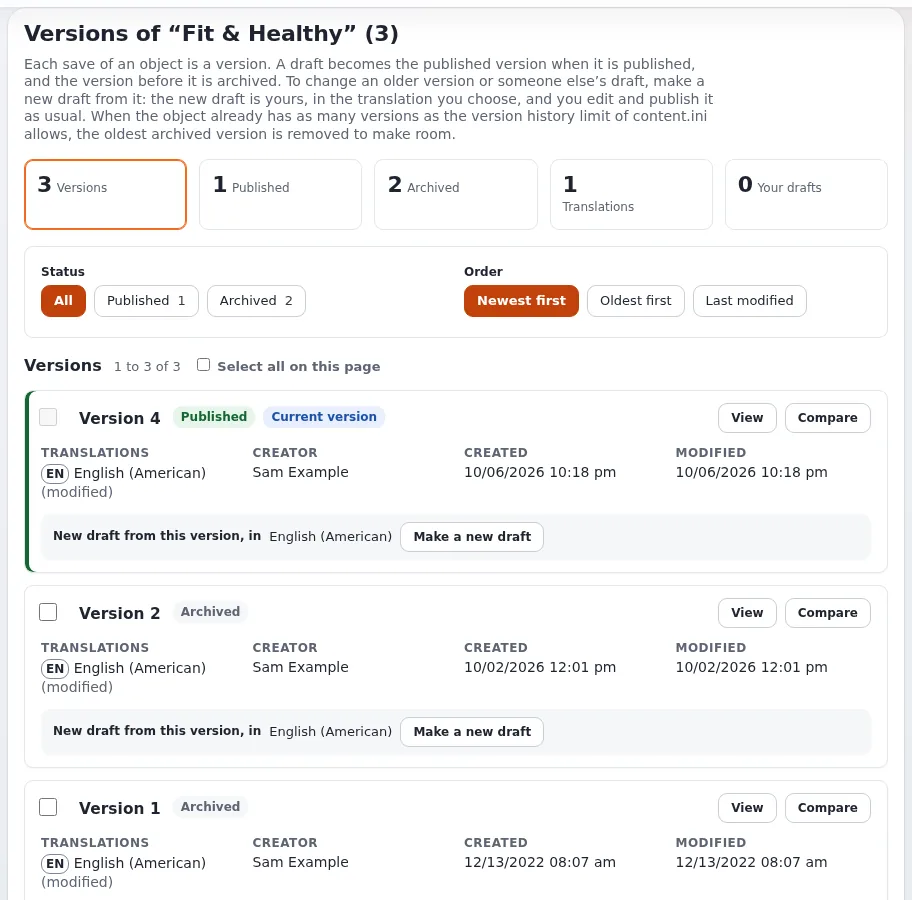

# Lektion 6.3: Versionen und ihr Vergleich

„Wer hat das geändert, und wie war es vorher?“ ist auf einer belebten Website eine der häufigsten Fragen. Die
Versionsseite beantwortet sie. In dieser Lektion öffnen die Teilnehmenden die Versionen ihres eigenen Artikels, lesen
die Übersicht und vergleichen zwei Versionen Feld für Feld.

## Auf einen Blick

| | |
|---|---|
| Kurs | [Redakteure 101](../README.md) |
| Modul | [Modul 6: Veröffentlichen, Versionen und Entwürfe](README.md) |
| Dauer | 45 Minuten (15 Präsentation, 30 Übung) |
| Niveau | Einsteiger |
| Zielgruppe | Neue Redakteure und Autoren |
| Voraussetzungen | [Lektion 6.2](vorschau-eines-entwurfs.md); ein Artikel mit mindestens drei Versionen (*My first article*) |

## Lernziele

Nach dieser Lektion können die Teilnehmenden:

- die Versionsseite mit **Versionen verwalten** von der Seite eines Elements oder aus dem Bearbeitungsformular öffnen;
- die Übersicht (Versionen, veröffentlicht, archiviert, Übersetzungen, Ihre Entwürfe) und für jede Version Ersteller
  und Daten lesen;
- die Liste nach Status filtern und ihre Reihenfolge ändern;
- zwei Versionen mit **Zwei Versionen vergleichen** und **Unterschiede anzeigen** vergleichen.

## Hinweise für Trainer

### So präsentieren Sie es

Quelle: [Zu einer früheren Version zurückkehren](../../../veroeffentlichen-und-versionen.md#zu-einer-früheren-version-zurückkehren) und
[Versionen eines Objekts](../../../../anleitungen/inhaltsverlauf.md).

1. **Öffnen** (2 Minuten). Die runde Schaltfläche mit einer Uhr auf der Seite eines Elements, **Versionen verwalten**,
   oder derselbe Eintrag in der linken Spalte des Bearbeitungsformulars. Die Seite trägt den Titel
   *Versionen von "<name>" (n)*.
2. **Die eigene Erklärung der Seite** (2 Minuten). Lesen Sie den Absatz unter dem Titel laut vor: Jedes Speichern ist
   eine Version; ein Entwurf wird beim Veröffentlichen zur veröffentlichten Version, und die Version davor wird
   archiviert; um eine ältere Version oder den Entwurf einer anderen Person zu ändern, erstellen Sie daraus einen neuen
   Entwurf. Erreicht das Element die Höchstzahl an Versionen der Website, wird die älteste archivierte Version
   entfernt, um Platz zu schaffen.
3. **Übersicht, Filter und Reihenfolge** (4 Minuten). **Übersicht**: die Zahl der Versionen, der veröffentlichten, der
   archivierten, der Übersetzungen und Ihrer Entwürfe. **Filter und Reihenfolge**: der Status (**Alle**,
   **Veröffentlicht**, **Archiviert** ...) und die Reihenfolge (**Neueste zuerst**, **Älteste zuerst**,
   **Zuletzt geändert**).
4. **Die Karte einer Version** (3 Minuten). Ihre Nummer und ihr Status (*Veröffentlicht*, *Aktuelle Version*,
   *Archiviert*), **Ansehen**, **Vergleichen**, ihre Übersetzungen, **Ersteller**, **Erstellt** und
   **Zuletzt geändert** sowie **Neuer Entwurf aus dieser Version, in** mit **Neuen Entwurf machen** (Lektion 6.4).
5. **Vergleichen** (4 Minuten). Wählen Sie unter **Zwei Versionen vergleichen** die **Ältere Version**, die
   **Neuere Version** und die **Übersetzung** und klicken Sie dann auf **Unterschiede anzeigen**. Änderungen werden Feld
   für Feld markiert. **Vergleichen** auf einer Karte startet denselben Vergleich ab dieser Version.

### Häufige Fragen

**Wie viele Versionen werden aufbewahrt?** So viele, wie eine Grenze der Website festlegt (die Grenze der
Versionsgeschichte in `content.ini`). Die Seite sagt das in ihrer Erklärung.

**Kann ich Versionen entfernen?** Versionen können ausgewählt und mit **Ausgewählte Versionen entfernen** entfernt
werden; die veröffentlichte Version kann auf diese Weise nie entfernt werden (die Seite sagt *Die veröffentlichte
Version wird nicht entfernt.*). Überlassen Sie das erfahrenen Redakteuren.

**Warum fehlen manche Nummern (Version 20, dann 22)?** Entwürfe, die verworfen oder entfernt wurden, hinterlassen
Lücken. Das ist normal.

### Stolperfallen

- **In der falschen Übersetzung vergleichen.** Prüfen Sie bei einem mehrsprachigen Element die **Übersetzung**, bevor
  Sie auf **Unterschiede anzeigen** klicken.
- **Zu wenige Versionen zum Vergleichen.** Achten Sie darauf, dass alle Teilnehmenden einen Artikel mit drei oder mehr
  Versionen haben; Lektion 3.3 hat *My first article* seine dritte Version gegeben.
- **Versionen im Kurs entfernen.** Lassen Sie Einsteiger **Ausgewählte Versionen entfernen** nicht verwenden; die
  Versionsgeschichte ist das Sicherheitsnetz von Lektion 6.4.

## Praktische Übung

Verwenden Sie die Schulungsinstallation und Ihren Artikel *My first article*.

1. Öffnen Sie *My first article*. Klicken Sie auf die runde Schaltfläche **Versionen verwalten**.
2. Lesen Sie den Titel der Seite und schreiben Sie auf, wie viele Versionen der Artikel hat.
3. Lesen Sie die **Übersicht** und schreiben Sie die Zahl der veröffentlichten und der archivierten Versionen auf.
4. Wählen Sie unter **Filter und Reihenfolge** **Archiviert**. Wählen Sie dann wieder **Alle** und stellen Sie die
   Reihenfolge auf **Älteste zuerst**.
5. Klicken Sie auf der Karte der ältesten Version auf **Ansehen**. Lesen Sie den Titel, den sie hatte. Gehen Sie mit
   **Zurück** (oder der Zurück-Schaltfläche des Browsers) zurück.
6. Wählen Sie unter **Zwei Versionen vergleichen** die älteste Version als **Ältere Version** und die veröffentlichte
   Version als **Neuere Version**. Lassen Sie **Übersetzung** unverändert.
7. Klicken Sie auf **Unterschiede anzeigen** und lesen Sie die markierten Änderungen in **Title** und **Body**.
8. Klicken Sie jetzt auf der Karte der Version direkt vor der veröffentlichten auf **Vergleichen** und lesen Sie die
   Unterschiede.
9. Schreiben Sie für die veröffentlichte Version ihren **Ersteller** und ihr Änderungsdatum auf.

## Erwartetes Ergebnis

- Die Notizen der Teilnehmenden enthalten die Zahl der Versionen (mindestens drei), die Zahl der veröffentlichten und
  archivierten Versionen, den ältesten Titel (*My first article*) und den Ersteller (die Teilnehmerin oder der
  Teilnehmer selbst) und das Datum der veröffentlichten Version.
- **Unterschiede anzeigen** hat die Titeländerung und die Änderungen am Haupttext aus den Lektionen 4.1 bis 4.3
  markiert.
- Der Trainer prüft das, indem er zwei Versionen des Artikels einer Teilnehmerin oder eines Teilnehmers auf dem
  Projektor vergleicht.

## Quiz

1. Nennen Sie zwei Wege, die Versionsseite zu öffnen.
2. Was passiert mit der ältesten archivierten Version, wenn ein Element die Höchstzahl an Versionen der Website
   erreicht?
3. Nach welchen drei Angaben fragt **Zwei Versionen vergleichen**?
4. Richtig oder falsch: **Ausgewählte Versionen entfernen** kann die veröffentlichte Version entfernen.
5. Die Versionsnummern eines Elements springen von 20 auf 22. Stimmt etwas nicht?

Antworten

1. Die runde Schaltfläche **Versionen verwalten** auf der Seite des Elements oder **Versionen verwalten** in der
   linken Spalte des Bearbeitungsformulars.
2. Sie wird entfernt, um Platz zu schaffen ([Veröffentlichen, Versionen und der Papierkorb](../../../veroeffentlichen-und-versionen.md#entwürfe-und-versionen)).
3. Die **Ältere Version**, die **Neuere Version** und die **Übersetzung**.
4. **Falsch.** Die veröffentlichte Version kann auf diese Weise nie entfernt werden.
5. Nein. Verworfene oder entfernte Entwürfe hinterlassen Lücken in den Nummern.

## Weiterführende Literatur

- [Versionen eines Objekts](../../../../anleitungen/inhaltsverlauf.md): die Versionsseite vollständig.
- [Veröffentlichen, Versionen und der Papierkorb](../../../veroeffentlichen-und-versionen.md#zu-einer-früheren-version-zurückkehren):
  zurückgehen.
- [Ein Rundgang durch die Administration](../../../rundgang-durch-die-administration.md#7-versionen-und-zurückgehen): Versionen im Rundgang mit
  dem Ordner.

## Verwandte Seiten

- [Modul 6: Veröffentlichen, Versionen und Entwürfe](README.md)
- [Redakteure 101: Kursüberblick](../README.md)
- [Trainer: hier beginnen](../../trainer-hier-beginnen.md)
- [Freie Dokumentation](../../../freie-dokumentation.md): Diese Seite darf unter der GNU FDL 1.3 frei kopiert, übersetzt und verbessert werden.

<!-- exp-partner-block:start -->
**Werden Sie Exponential-Partner.** Partner teilen ihre Informationen, stellen Mittel bereit, geben Beiträge zurück
und entwickeln die Produkte mit uns, und so wächst Exponential. Eine Partner-Website und ein Dashboard sind für Mitte
2027 geplant: Werden Sie noch heute Partner, damit wir schneller wachsen und neue Funktionen früher liefern. Beginnen
Sie mit [Partner: hier beginnen](../../../partner/partner-hier-beginnen.md) und
[Wie Sie sich bewerben](../../../partner/wie-sie-sich-bewerben.md).
<!-- exp-partner-block:end -->
