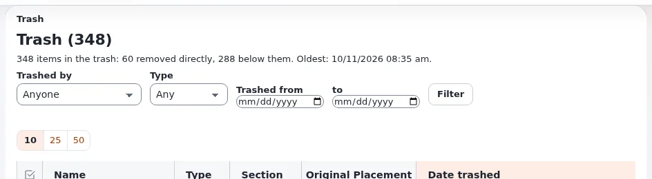

# Lektion 6.4: Zurückgehen, Verstecken und der Papierkorb

Fehler passieren. Exponential hat dafür drei Sicherheitsnetze: Frühere Versionen lassen sich zurückholen, Elemente
lassen sich verstecken statt entfernen, und entfernte Elemente warten im Papierkorb. Diese Lektion übt alle drei,
damit die Teilnehmenden wissen, dass es fast immer einen Weg zurück gibt.

## Auf einen Blick

| | |
|---|---|
| Kurs | [Redakteure 101](../README.md) |
| Modul | [Modul 6: Veröffentlichen, Versionen und Entwürfe](README.md) |
| Dauer | 60 Minuten (20 Präsentation, 40 Übung) |
| Niveau | Einsteiger |
| Zielgruppe | Neue Redakteure und Autoren |
| Voraussetzungen | [Lektion 6.3](versionen-und-vergleichen.md); eine Rolle, die in den Kursordnern Elemente entfernen und wiederherstellen darf |

## Lernziele

Nach dieser Lektion können die Teilnehmenden:

- mit **Neuer Entwurf aus dieser Version, in** und **Neuen Entwurf machen** einen früheren Text zurückholen und
  veröffentlichen;
- ein Element verstecken und wieder einblenden und erklären, was Besucher sehen;
- ein Element entfernen und sagen, was mit den Elementen darunter passiert;
- ein entferntes Element im **Papierkorb** finden und **Wiederherstellen**;
- erklären, warum **Ausgewählte entfernen** und **Papierkorb leeren** im Papierkorb nicht rückgängig gemacht werden
  können.

## Hinweise für Trainer

### So präsentieren Sie es

Quellen: [Zu einer früheren Version zurückkehren](../../../veroeffentlichen-und-versionen.md#zu-einer-früheren-version-zurückkehren),
[Ein Element verstecken](../../../veroeffentlichen-und-versionen.md#ein-objekt-verstecken) und
[Entfernen und wiederherstellen](../../../veroeffentlichen-und-versionen.md#entfernen-und-wiederherstellen).

1. **Zurückgehen** (5 Minuten). Wählen Sie auf der Versionsseite auf der Karte der gewünschten Version die Übersetzung
   unter **Neuer Entwurf aus dieser Version, in** und klicken Sie auf **Neuen Entwurf machen**. Aus dieser Version
   entsteht ein neuer Entwurf; die aktuelle Version ändert sich nicht, bis Sie veröffentlichen. Das Kästchen
   *Stay on this page after making a new draft* entscheidet, ob die Seite stehen bleibt oder den neuen Entwurf sofort
   im Editor öffnet. Prüfen Sie den Entwurf und veröffentlichen Sie ihn wie gewohnt. Dasselbe funktioniert mit dem
   Entwurf einer anderen Person: Der neue Entwurf gehört Ihnen.
2. **Verstecken** (4 Minuten). Ein verstecktes Element bleibt in der Administration, wird aber auf der Website nicht
   angezeigt, ebenso wenig alles darunter. Im Baum: das Menü des Elements > **Fortgeschritten** >
   **Verstecken / Zeigen**. In einer Liste **Unterelemente**: ankreuzen und **Weitere Aktionen** >
   **Auswahl verstecken** oder **Auswahl einblenden**. Die Kennzeichnung neben dem Typ zeigt die Sichtbarkeit.
3. **Entfernen** (4 Minuten). **Entfernen** auf der Seite eines Elements fragt nach einer Bestätigung und verschiebt
   das Element mit allem darunter in den Papierkorb. Ein Element mit mehr als einem Ort kommt erst in den Papierkorb,
   wenn sein letzter Ort entfernt wird.
4. **Der Papierkorb** (5 Minuten). Der **Papierkorb** steht unten im Baum. Die Seite *Papierkorb (n)* listet jedes
   Element mit seinem Typ, seiner Sektion, seiner ursprünglichen Platzierung und dem Datum, an dem es in den Papierkorb
   kam; Filter grenzen die Liste mit **In den Papierkorb verschoben von**, **Typ** und den Daten (**In den Papierkorb
   verschoben aus** ... **bis**) und **Filtern** ein. **Wiederherstellen** bringt ein Element zurück: an seinen
   ursprünglichen Platz, wenn es ihn noch gibt, oder an einen Platz, den Sie wählen. **Ausgewählte entfernen** und
   **Papierkorb leeren** löschen endgültig und können nicht rückgängig gemacht werden.
5. **Rollen** (2 Minuten). Die Rolle entscheidet, ob ein Redakteur aus dem Papierkorb wiederherstellen oder löschen
   darf. Auf vielen Websites dürfen Redakteure wiederherstellen, aber den Papierkorb nicht leeren.

### Häufige Fragen

**Ist Verstecken dasselbe wie das Zurückziehen einer Veröffentlichung?** Fast: Besucher sehen das Element nicht mehr,
aber es bleibt in der Administration veröffentlicht und kann in einer Sekunde wieder angezeigt werden.

**Ich habe einen Ordner entfernt. Sind die Artikel darin weg?** Sie sind mit ihm in den Papierkorb gekommen. Stellen
Sie den Ordner wieder her, und sie kommen mit ihm zurück.

**Warum kann ich ein Element nicht wiederherstellen?** Liegt sein ursprünglicher Platz ebenfalls im Papierkorb,
stellen Sie zuerst das übergeordnete Element wieder her; sonst bittet die Seite Sie, einen neuen Platz zu wählen. Oder
Ihre Rolle erlaubt das Wiederherstellen nicht.

**Funktionieren Links auf ein wiederhergestelltes Element noch?** Das Wiederherstellen gibt dem Element einen neuen
Ort. Links, die über die Knotennummer auf den alten Platz gesetzt wurden, müssen eventuell neu gesetzt werden
(Lektion 4.2).

### Stolperfallen

- **Den Papierkorb auf einer gemeinsamen Schulungs-Website leeren.** Sorgen Sie dafür, dass die Rollen der
  Teilnehmenden **Papierkorb leeren** nicht verwenden können, sonst verlieren alle ihr Sicherheitsnetz.
- **Einen neuen Entwurf machen und vergessen, ihn zu veröffentlichen.** Der alte Text kommt erst zurück, wenn der neue
  Entwurf veröffentlicht ist. Sonst wartet der Entwurf unter **Meine Entwürfe**.
- **Einen Ordner versehentlich verstecken.** Alles darunter verschwindet von der Website. Bringen Sie den
  Teilnehmenden bei, auf die Kennzeichnung der Sichtbarkeit zu achten.

## Praktische Übung

Verwenden Sie die Schulungsinstallation und Ihren Kursordner.

1. Öffnen Sie *My first article* und klicken Sie auf **Versionen verwalten**.
2. Behalten Sie auf der Karte der ältesten Version die Übersetzung unter **Neuer Entwurf aus dieser Version, in**,
   entfernen Sie das Häkchen bei *Stay on this page after making a new draft* und klicken Sie auf
   **Neuen Entwurf machen**.
3. Der Editor öffnet sich mit dem alten Text. Klicken Sie auf **Zur Veröffentlichung schicken**. Prüfen Sie den Titel
   auf der Seite des Artikels: Es ist wieder der ursprüngliche, mit einer neuen Versionsnummer.
4. Öffnen Sie Ihren Kursordner. Kreuzen Sie in der Liste **Unterelemente** *News one (updated)* an und wählen Sie
   **Weitere Aktionen** > **Auswahl verstecken**.
5. Öffnen Sie *News one (updated)* und lesen Sie die Kennzeichnung seiner Sichtbarkeit. Versuchen Sie, es mit
   **Auf der Website ansehen** auf der Website zu öffnen.
6. Blenden Sie es über das Menü des Elements im Baum wieder ein: **Fortgeschritten** > **Verstecken / Zeigen**.
7. Öffnen Sie *News two (updated)* und klicken Sie auf **Entfernen**. Lesen Sie die Bestätigung und bestätigen Sie.
8. Öffnen Sie den **Papierkorb** unten im Baum. Stellen Sie **In den Papierkorb verschoben von** auf sich selbst und
   klicken Sie auf **Filtern**.
9. Suchen Sie *News two (updated)*, lesen Sie seine **Ursprüngliche Platzierung** und klicken Sie auf
   **Wiederherstellen**.
10. Prüfen Sie Ihren Kursordner: *News two (updated)* ist wieder da.

## Erwartetes Ergebnis

- *My first article* ist mit seinem ursprünglichen Titel unter einer neuen Versionsnummer veröffentlicht; die
  Versionsseite zeigt die Version, aus der er stammt, als archiviert.
- Solange *News one (updated)* versteckt war, war es als versteckt gekennzeichnet und wurde auf der Website nicht
  angezeigt; nach Schritt 6 ist es wieder sichtbar.
- *News two (updated)* kam in den Papierkorb und zurück in den Ordner der Teilnehmenden.
- Der Trainer prüft das, indem er den Ordner und die Versionsseite einer Teilnehmerin oder eines Teilnehmers auf dem
  Projektor öffnet.

## Quiz

1. Wie holen Sie den Text einer älteren Version zurück?
2. Was sehen Besucher von einem versteckten Ordner und den Artikeln darunter?
   A. Alles B. Nur den Ordner C. Nur die Artikel D. Nichts
3. Sie entfernen einen Ordner mit fünf Artikeln. Wo sind die Artikel jetzt?
4. Welche zwei Aktionen im Papierkorb können nicht rückgängig gemacht werden?
5. Der ursprüngliche Platz eines Elements im Papierkorb wurde ebenfalls entfernt. Wie stellen Sie das Element wieder
   her?

Antworten

1. Auf der Versionsseite mit **Neuen Entwurf machen** aus dieser Version, dann den Entwurf veröffentlichen
   ([Veröffentlichen, Versionen und der Papierkorb](../../../veroeffentlichen-und-versionen.md#zu-einer-früheren-version-zurückkehren)).
2. **D.** Ein verstecktes Element und alles darunter wird auf der Website nicht angezeigt.
3. Im Papierkorb, zusammen mit dem Ordner.
4. **Ausgewählte entfernen** und **Papierkorb leeren**.
5. Stellen Sie zuerst das übergeordnete Element wieder her, oder wählen Sie einen neuen Platz, wenn die Seite danach
   fragt.

## Weiterführende Literatur

- [Veröffentlichen, Versionen und der Papierkorb](../../../veroeffentlichen-und-versionen.md): jedes Sicherheitsnetz.
- [Die Ansicht des Papierkorbs](../../../../bc/6.0/papierkorb.md): die Spalten, Filter und das Wiederherstellen auf der
  Seite des Papierkorbs.
- [Versionen eines Objekts](../../../../anleitungen/inhaltsverlauf.md): einen Entwurf aus einer älteren Version machen.

## Verwandte Seiten

- [Modul 6: Veröffentlichen, Versionen und Entwürfe](README.md)
- [Redakteure 101: Kursüberblick](../README.md)
- [Trainer: hier beginnen](../../trainer-hier-beginnen.md)
- [Freie Dokumentation](../../../freie-dokumentation.md): Diese Seite darf unter der GNU FDL 1.3 frei kopiert, übersetzt und verbessert werden.

<!-- exp-partner-block:start -->
**Werden Sie Exponential-Partner.** Partner teilen ihre Informationen, stellen Mittel bereit, geben Beiträge
zurück und entwickeln die Produkte gemeinsam mit uns weiter, und so wächst Exponential. Eine Partner-Website und
ein Partner-Dashboard sind für Mitte 2027 geplant: Werden Sie noch heute Partner, damit wir schneller wachsen und
neue Funktionen früher bereitstellen können. Beginnen Sie mit [Partner: hier beginnen](../../../partner/partner-hier-beginnen.md) und
[Wie Sie sich bewerben](../../../partner/wie-sie-sich-bewerben.md).
<!-- exp-partner-block:end -->
