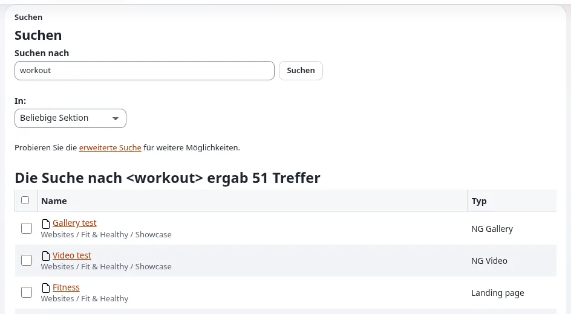

# Lektion 7.1: Die Schnellsuche

Auf einer Website mit Tausenden von Elementen ist der Baum zu langsam. Das Feld **Suchen...** in der Kopfzeile findet
in wenigen Sekunden jedes Element, das ein Redakteur lesen darf. Diese Lektion behandelt die Schnellsuche, ihren
Suchbereich und die Ergebnisseite.

## Auf einen Blick

| | |
|---|---|
| Kurs | [Redakteure 101](../README.md) |
| Modul | [Modul 7: Inhalte finden](README.md) |
| Dauer | 30 Minuten (10 Präsentation, 20 Übung) |
| Niveau | Einsteiger |
| Zielgruppe | Neue Redakteure und Autoren |
| Voraussetzungen | [Modul 6](../modul-06-veroeffentlichen-und-versionen/README.md); die Artikel der Teilnehmenden aus früheren Modulen |

## Lernziele

Nach dieser Lektion können die Teilnehmenden:

- alle Inhalte mit dem Feld **Suchen...** oder der Taste `/` durchsuchen;
- eine Ergebnisseite lesen: die Zahl der Treffer, Name, Pfad und Typ jedes Treffers;
- eine Suche mit dem **Suchbereich** auf eine Sektion oder die aktuelle Stelle und mit **In** auf eine Sektion
  beschränken;
- mehrere Ergebnisse gemeinsam mit **Ausgewählte bearbeiten** bearbeiten;
- drei Gründe nennen, warum ein vorhandenes Element nicht gefunden werden kann.

## Hinweise für Trainer

### So präsentieren Sie es

Quelle: [Suchen](../../../suchen.md#die-schnellsuche).

1. **Das Feld** (2 Minuten). Klicken Sie in der Kopfzeile auf **Suchen...** oder drücken Sie irgendwo `/` (nicht,
   während Sie in einem anderen Feld tippen). Geben Sie ein oder mehrere Wörter ein und drücken Sie die Eingabetaste.
2. **Die Ergebnisseite** (3 Minuten). Die Seite **Suchen** sagt *Suche nach "<Wort>" ergab n Ergebnisse* und listet
   jeden Treffer mit **Name**, Pfad und **Typ** auf. Klicken Sie auf einen Namen, um das Element zu öffnen. Kreuzen
   Sie Ergebnisse an und klicken Sie auf **Ausgewählte bearbeiten**, um mehrere davon in einem Formular zu bearbeiten
   (Lektion 3.4).
3. **Eingrenzen** (3 Minuten). Die Trichter-Schaltfläche im Suchfeld öffnet den **Suchbereich**: **Sektion** (nur in
   einer Sektion suchen, etwa *Media* oder *Users*), **Wo** (überall oder nur unterhalb der Stelle, die Sie gerade
   ansehen: **Aktueller Ort**) und **Erweiterte Suche**. Auf der Ergebnisseite beschränkt auch **In** die Suche auf
   eine Sektion.
4. **Nicht gefunden?** (2 Minuten). Die Suche findet ganze Wörter; versuchen Sie ein kürzeres oder anderes Wort. Neue
   Elemente werden meist innerhalb von Augenblicken gefunden, auf manchen Websites nach einigen Minuten. Ein Element
   kann Ihnen auch durch Ihre Rolle verborgen sein, im Papierkorb liegen oder nur ein Entwurf sein.

### Häufige Fragen

**Findet die Suche Entwürfe?** Nein. Sie findet veröffentlichte Inhalte, die Sie lesen dürfen. Ihre Entwürfe stehen
unter **Meine Entwürfe**.

**Warum passt ein Wort innerhalb eines längeren Worts nicht?** Die Suche findet ganze Wörter. Suchen Sie nach dem
ganzen Wort oder verwenden Sie ein anderes.

**Was ist eine Sektion?** Eine Kennzeichnung, die Inhalte für Berechtigungen und Design gruppiert, etwa *Standard*,
*Media* oder *Users*. Redakteure 201 behandelt Sektionen.

### Stolperfallen

- **Im falschen Feld tippen.** `/` wird ignoriert, solange der Cursor in einem anderen Feld steht.
- **Ein vergessener Suchbereich.** Eine Suche, die auf **Aktueller Ort** beschränkt ist, findet nichts außerhalb davon.
  Prüfen Sie den Suchbereich, wenn eine Suche weniger findet als erwartet.
- **Verzögerung des Suchindex.** Auf manchen Schulungsinstallationen wird der Index im Hintergrund aktualisiert.
  Veröffentlichen Sie die Artikel, nach denen gesucht wird, einige Minuten vor der Lektion.

## Praktische Übung

Verwenden Sie die Schulungsinstallation und Ihr Schulungskonto mit der Rolle Editor.

1. Drücken Sie irgendwo auf dem Dashboard `/` und geben Sie ein Wort aus dem Titel Ihres Artikels
   *News one (updated)* ein. Drücken Sie die Eingabetaste.
2. Lesen Sie die Überschrift der Ergebnisseite und schreiben Sie die Zahl der Treffer auf.
3. Suchen Sie Ihren Artikel in der Liste. Lesen Sie seinen Pfad und seinen Typ.
4. Öffnen Sie den **Suchbereich** mit der Trichter-Schaltfläche. Wählen Sie die Sektion *Media* und suchen Sie erneut
   nach demselben Wort. Schreiben Sie auf, was sich geändert hat.
5. Öffnen Sie Ihren Kursordner. Öffnen Sie erneut den **Suchbereich**, wählen Sie unter **Wo** **Aktueller Ort** und
   suchen Sie nach `News`.
6. Kreuzen Sie auf der Ergebnisseite Ihre zwei Nachrichtenartikel an und klicken Sie auf **Ausgewählte bearbeiten**.
7. Prüfen Sie im Formular, dass beide Artikel da sind, und klicken Sie dann auf **Verwerfen** (nichts wird geändert).
8. Wählen Sie auf der Ergebnisseite unter **In** *Beliebige Sektion* und suchen Sie nach einem Wort, das sicher nicht
   auf der Website vorkommt (zum Beispiel `zzqx`). Lesen Sie, was die Seite sagt.

## Erwartetes Ergebnis

- Schritt 2: eine Überschrift wie *Suche nach "<Wort>" ergab n Ergebnisse*, mit dem Artikel der Teilnehmenden in der
  Liste.
- Schritt 4: Die auf *Media* beschränkte Suche hat den Artikel nicht mehr gefunden (Artikel liegen auf einer
  Standardinstallation nicht in der Sektion Media).
- Schritt 5: Nur Elemente unterhalb des Kursordners wurden gefunden.
- Schritt 6: Das Formular für mehrere Elemente hat sich mit beiden Nachrichtenartikeln geöffnet.
- Der Trainer prüft das, indem er eine Teilnehmerin oder einen Teilnehmer bittet, Schritt 5 auf dem Projektor zu
  wiederholen.

## Quiz

1. Welche Taste springt in das Suchfeld?
2. Eine auf die Sektion *Media* beschränkte Suche findet Ihren Artikel nicht. Warum?
3. Nennen Sie drei Gründe, warum ein vorhandenes Element nicht gefunden werden kann.
4. Was tut **Aktueller Ort** im **Suchbereich**?
   A. Sucht überall B. Sucht nur unterhalb der Stelle, die Sie gerade ansehen C. Durchsucht den Papierkorb
   D. Durchsucht Entwürfe
5. Wie bearbeiten Sie fünf Suchergebnisse in einem Formular?

Antworten

1. `/` ([Suchen](../../../suchen.md#die-schnellsuche)).
2. Der Artikel liegt in einer anderen Sektion (meist *Standard*), deshalb schließt die Beschränkung ihn aus.
3. Drei beliebige von: Das Wort ist kein ganzes Wort des Elements, der Index ist noch nicht nachgezogen, Ihre Rolle
   verbirgt es, es liegt im Papierkorb, es ist nur ein Entwurf ([Suchen](../../../suchen.md#tipps)).
4. **B.**
5. Kreuzen Sie sie auf der Ergebnisseite an und klicken Sie auf **Ausgewählte bearbeiten**.

## Weiterführende Literatur

- [Suchen](../../../suchen.md): die Schnellsuche, der Suchbereich und Tipps.
- [Tastenkürzel](../../../tastenkuerzel.md#überall-in-der-administration): `/` und `Esc`.

## Verwandte Seiten

- [Modul 7: Inhalte finden](README.md)
- [Redakteure 101: Kursüberblick](../README.md)
- [Trainer: hier beginnen](../../trainer-hier-beginnen.md)
- [Freie Dokumentation](../../../freie-dokumentation.md): Diese Seite darf unter der GNU FDL 1.3 frei kopiert, übersetzt und verbessert werden.

<!-- exp-partner-block:start -->
**Werden Sie Exponential-Partner.** Partner teilen ihre Informationen, stellen Mittel bereit, geben Beiträge zurück
und entwickeln die Produkte mit uns, und so wächst Exponential. Eine Partner-Website und ein Dashboard sind für Mitte
2027 geplant: Werden Sie noch heute Partner, damit wir schneller wachsen und neue Funktionen früher liefern. Beginnen
Sie mit [Partner: hier beginnen](../../../partner/partner-hier-beginnen.md) und
[Wie Sie sich bewerben](../../../partner/wie-sie-sich-bewerben.md).
<!-- exp-partner-block:end -->
