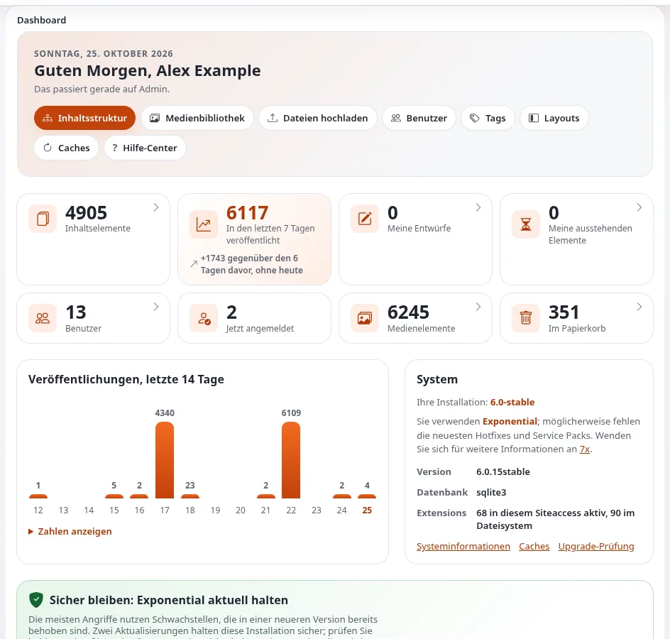

# Lektion 8.1: Das Dashboard als täglicher Start

Das Dashboard ist die erste Seite nach der Anmeldung. Die Teilnehmenden haben es in Modul 1 gesehen; jetzt, wo sie
Entwürfe, veröffentlichte Elemente und vielleicht ausstehende Elemente haben, bedeutet es etwas. Diese Lektion macht
aus dem Dashboard eine tägliche Routine: Was wartet auf mich, was habe ich getan, was hat sich auf der Website
geändert?

## Auf einen Blick

| | |
|---|---|
| Kurs | [Redakteure 101](../README.md) |
| Modul | [Modul 8: Dashboard, Lesezeichen und Ihr Konto](README.md) |
| Dauer | 30 Minuten (10 Präsentation, 20 Übung) |
| Niveau | Einsteiger |
| Zielgruppe | Neue Redakteure und Autoren |
| Voraussetzungen | Module 1 bis 7 |

## Lernziele

Nach dieser Lektion können die Teilnehmenden:

- mit den Schnellaktionen des Dashboards **Inhaltsstruktur**, die **Medienbibliothek** und **Dateien hochladen**
  erreichen;
- die Zahlen lesen und die Liste hinter jeder Zahl öffnen;
- das Diagramm **Veröffentlichungen, letzte 14 Tage** lesen, auch als Tabelle;
- **Meine Warteliste**, **Meine Entwürfe**, **Aktuellster Inhalt** und **Mein aktuellster Content** zum Planen ihrer
  Arbeit nutzen.

## Hinweise für Trainer

### So präsentieren Sie es

Quelle: [Das Dashboard](../../../rundgang-durch-die-administration.md#das-dashboard).

1. **Von oben** (6 Minuten):
   - die Begrüßung mit Ihrem Namen und Schnellaktionen wie **Inhaltsstruktur**, **Medienbibliothek** und
     **Dateien hochladen**;
   - die **Zahlen**: Inhaltselemente, in den letzten sieben Tagen veröffentlichte Elemente, **Meine Entwürfe**,
     **Meine Warteliste** und für Administratoren weitere; ein Klick auf eine Zahl öffnet ihre Liste;
   - **Veröffentlichungen, letzte 14 Tage**: ein kleines Diagramm; **Zahlen anzeigen** zeigt es als Tabelle;
   - die Listen **Meine Warteliste**, **Meine Entwürfe**, **Aktuellster Inhalt** (mit **Name**, **Typ**,
     **Veröffentlicht** und **Autor**) und **Mein aktuellster Content**.
   Manche Installationen fügen mehr hinzu, etwa **Exponential Intelligence: my drafts**, wo der Schreibassistent
   eingeschaltet ist. Administratoren sehen Blöcke zum System, zu Updates und zu Sicherheitsereignissen.
2. **Eine Routine** (4 Minuten). Schlagen Sie einen zweiminütigen Start in den Tag vor: **Meine Warteliste** öffnen
   (wartet etwas auf mich oder auf meine Freigabe?), dann **Meine Entwürfe** (ist etwas unfertig?), dann
   **Aktuellster Inhalt** (was haben meine Kollegen veröffentlicht?).

### Häufige Fragen

**Kann ich das Dashboard selbst anordnen?** Die Blöcke legen die Installation und Ihre Rolle fest. Die Links der
linken Spalte zu Ihren eigenen Seiten sind immer da.

**Warum hat das Dashboard meiner Kollegin mehr Blöcke?** Eine andere Rolle oder Erweiterungen, die für manche Rollen
Blöcke hinzufügen.

**Warum zeigt Aktuellster Inhalt Elemente, die ich nicht bearbeiten kann?** Es zeigt die neuesten veröffentlichten
Inhalte, die Sie lesen dürfen, ob Sie sie bearbeiten dürfen oder nicht.

### Stolperfallen

- **Zahlen auf einer frischen Schulungs-Website.** Mit wenig Inhalt ist das Diagramm fast leer. Es füllt sich, während
  die Teilnehmenden veröffentlichen.
- **Aktuellster Inhalt und Mein aktuellster Content verwechseln.** Weisen Sie auf das Wort „Mein“ hin.

## Praktische Übung

Verwenden Sie die Schulungsinstallation und Ihr Schulungskonto mit der Rolle Editor.

1. Klicken Sie auf das Logo **Exponential**, um das **Dashboard** zu öffnen.
2. Lesen Sie den Block mit den Zahlen. Schreiben Sie die Zahl Ihrer Entwürfe und Ihrer ausstehenden Elemente auf.
3. Klicken Sie auf die Zahl der in den letzten sieben Tagen veröffentlichten Elemente und sehen Sie sich die Liste an,
   die sich öffnet. Gehen Sie zurück zum Dashboard.
4. Suchen Sie das Diagramm **Veröffentlichungen, letzte 14 Tage** und klicken Sie auf **Zahlen anzeigen**. Schreiben
   Sie die Zahl von heute auf.
5. Suchen Sie in **Mein aktuellster Content** Ihre Artikel und Bilder aus diesem Kurs.
6. Suchen Sie in **Aktuellster Inhalt** einen Artikel einer anderen Teilnehmerin oder eines anderen Teilnehmers und
   schreiben Sie den Autor auf.
7. Klicken Sie auf die Schnellaktion **Dateien hochladen** und prüfen Sie, wo sie sich öffnet (laden Sie nichts
   hoch). Gehen Sie zurück.
8. Schreiben Sie mithilfe der Blöcke des Dashboards Ihre eigene Routine in drei Schritten für den Start in den Tag auf
   eine Karte.

## Erwartetes Ergebnis

- Die Notizen der Teilnehmenden nennen ihre Entwürfe und ausstehenden Elemente (nach Modul 6 meist null), die heutige
  Zahl der Veröffentlichungen (nach diesem Kurs mehrere) und einen Artikel einer anderen Person mit dessen Autor.
- **Dateien hochladen** hat die Upload-Seite mit einem Zielort in der Medienbibliothek geöffnet.
- Alle Teilnehmenden haben eine Routinekarte, die der Trainer für zwei oder drei von ihnen vorliest.

## Quiz

1. Nennen Sie die vier Listen mit Inhalten unten auf dem Dashboard.
2. Was tut **Zahlen anzeigen**?
3. Richtig oder falsch: Jede Rolle sieht auf dem Dashboard dieselben Blöcke.
4. Wo beginnen Sie, wenn Sie wissen möchten, ob etwas auf Ihre Freigabe wartet?
   A. **Meine Entwürfe** B. **Meine Warteliste** C. **Aktuellster Inhalt** D. Das Diagramm
5. Was bewirkt ein Klick auf eine Zahl im Block mit den Zahlen?

Antworten

1. **Meine Warteliste**, **Meine Entwürfe**, **Aktuellster Inhalt** und **Mein aktuellster Content**
   ([Ein Rundgang durch die Administration](../../../rundgang-durch-die-administration.md#das-dashboard)).
2. Es zeigt das Diagramm **Veröffentlichungen, letzte 14 Tage** als Tabelle.
3. **Falsch.** Administratoren und manche Erweiterungen fügen Blöcke hinzu.
4. **B.**
5. Er öffnet die Liste hinter der Zahl.

## Weiterführende Literatur

- [Ein Rundgang durch die Administration](../../../rundgang-durch-die-administration.md#das-dashboard): das Dashboard Teil für Teil.
- [Meine Entwürfe und meine Warteliste](../../../../anleitungen/entwuerfe-und-ausstehende-objekte.md): die beiden Listen vollständig.

## Verwandte Seiten

- [Modul 8: Dashboard, Lesezeichen und Ihr Konto](README.md)
- [Redakteure 101: Kursüberblick](../README.md)
- [Trainer: hier beginnen](../../trainer-hier-beginnen.md)
- [Freie Dokumentation](../../../freie-dokumentation.md): Diese Seite darf unter der GNU FDL 1.3 frei kopiert, übersetzt und verbessert werden.

<!-- exp-partner-block:start -->
**Werden Sie Exponential-Partner.** Partner teilen ihre Informationen, stellen Mittel bereit, geben Beiträge zurück
und entwickeln die Produkte mit uns, und so wächst Exponential. Eine Partner-Website und ein Dashboard sind für Mitte
2027 geplant: Werden Sie noch heute Partner, damit wir schneller wachsen und neue Funktionen früher liefern. Beginnen
Sie mit [Partner: hier beginnen](../../../partner/partner-hier-beginnen.md) und
[Wie Sie sich bewerben](../../../partner/wie-sie-sich-bewerben.md).
<!-- exp-partner-block:end -->
