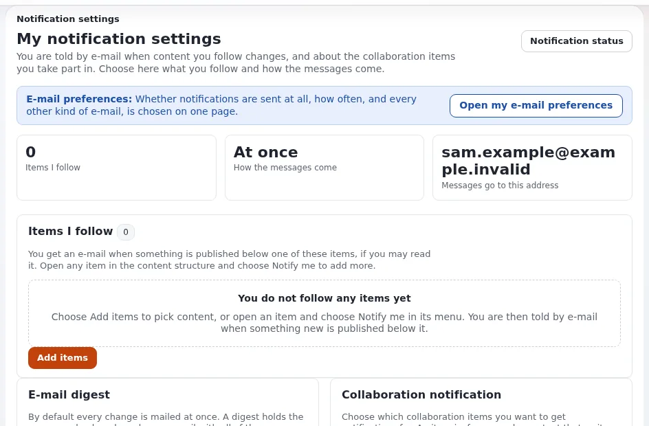

# Lektion 8.3: Ihr Konto und Benachrichtigungen

Das Konto eines Redakteurs ist der Schlüssel zur Website, und die Website kann ihren Redakteuren mitteilen, wenn sich
etwas ändert. Diese Lektion behandelt beides: das Passwort ändern, die zweistufige Anmeldung, Elementen mit
Benachrichtigungen folgen und wählen, welche E-Mails man erhält.

> **Hinweis**
> Eine Schulungsinstallation kann meist keine E-Mails senden und sollte es auch nicht. Die Teilnehmenden legen ihre
> Einstellungen fest; niemand wartet auf eine Nachricht. Tragen Sie auf einer Schulungs-Website niemals echte
> E-Mail-Adressen ein.

## Auf einen Blick

| | |
|---|---|
| Kurs | [Redakteure 101](../README.md) |
| Modul | [Modul 8: Dashboard, Lesezeichen und Ihr Konto](README.md) |
| Dauer | 45 Minuten (15 Präsentation, 30 Übung) |
| Niveau | Einsteiger |
| Zielgruppe | Neue Redakteure und Autoren |
| Voraussetzungen | [Lektion 8.2](lesezeichen.md) |

## Lernziele

Nach dieser Lektion können die Teilnehmenden:

- **Mein Konto** öffnen und sagen, wofür jede Karte da ist;
- ihr Passwort unter **Passwort ändern** ändern, auf Wunsch mit **Sicheres Passwort erzeugen**;
- erklären, wie die zweistufige Anmeldung funktioniert und wo sie eingeschaltet wird;
- einem Element folgen und unter **Meine Benachrichtigungseinstellungen** eine E-Mail-Zusammenfassung einstellen;
- unter **Meine E-Mail-Einstellungen** wählen, welche E-Mails sie erhalten.

## Hinweise für Trainer

### So präsentieren Sie es

Quelle: [Ihr Konto und die Anmeldung](../../../konten-und-anmeldung.md).

1. **Mein Konto** (3 Minuten). **Profil bearbeiten** in der linken Spalte des Dashboards oder Ihr Name im
   Benutzermenü führt zu **Mein Konto**: die Karten **Profil**, **Passwort**, **Zweistufige Anmeldung**,
   **Lesezeichen**, **Benachrichtigungen**, **E-Mail-Einstellungen** und für manche Rollen **Kontoeinstellungen** und
   **API-Schlüssel**.
2. **Passwort ändern** (3 Minuten). **Aktuelles Passwort**, **Neues Passwort**, **Neues Passwort bestätigen**. Die
   Seite zeigt, was ein neues Passwort braucht (zum Beispiel *mindestens 10 Zeichen*), und prüft es während der
   Eingabe. **Sicheres Passwort erzeugen** erstellt eines; **Anzeigen** zeigt, was Sie eingegeben haben;
   **Passwort ändern** speichert. Eine Passwortänderung meldet jede andere Sitzung des Kontos ab.
3. **Zweistufige Anmeldung** (3 Minuten). Nach dem Passwort ein sechsstelliger Code aus einer Authenticator-App
   (empfohlen) oder aus einer E-Mail. Eingeschaltet wird sie mit **Einschalten** auf der Karte
   **Zweistufige Anmeldung**; die Einrichtung fragt nach einem Code aus der App, bevor sich etwas ändert. Zeigen Sie die
   Bildschirme; lassen Sie die Teilnehmenden sie auf einem Schulungskonto nur einrichten, wenn sie es möchten.
4. **Benachrichtigungen** (4 Minuten). **Meine Benachrichtigungseinstellungen**: **Einträge, denen ich folge** mit
   **Einträge hinzufügen**, und **E-Mail-Digest** (*Alle Nachrichten in einer Zusammenfassung erhalten*; ausgeschaltet
   eine E-Mail pro Änderung). Eine Zusammenfassung kann **Täglich um** eine Uhrzeit, **Einmal pro Woche, am** einem
   Wochentag oder **Einmal pro Monat, am Tag** kommen; **Digest-Einstellungen speichern** speichert sie. Um einem
   Element zu folgen, wählen Sie **Zu meinen Benachrichtigungen hinzufügen** in seinem Menü.
5. **E-Mail-Einstellungen** (2 Minuten). **Meine E-Mail-Einstellungen** wählt, welche E-Mails die Website Ihnen
   schickt; jede optionale E-Mail lässt sich dort abbestellen.

### Häufige Fragen

**Ich habe mein Telefon mit der Authenticator-App verloren.** Fragen Sie einen Administrator: Er kann Ihr Konto auf
E-Mail-Codes umstellen oder den zweiten Schritt ausschalten, und Sie richten die App neu ein.

**Bekomme ich für jede Änderung unter einem Element, dem ich folge, eine E-Mail?** Ja, es sei denn, Sie schalten die
Zusammenfassung ein; dann sammelt eine E-Mail pro Tag, Woche oder Monat die Nachrichten.

**Warum sehe ich die Karte API-Schlüssel nicht?** Nur manche Rollen dürfen API-Schlüssel verwenden.

### Stolperfallen

- **Vergessene neue Passwörter.** Die Teilnehmenden ändern ihr Passwort und vergessen es vor der nächsten Lektion.
  Bitten Sie sie, **Sicheres Passwort erzeugen** nur zu verwenden, wenn sie es in einem Passwortmanager speichern
  können; sonst wählen sie eine lange Passphrase.
- **Zweistufige Anmeldung auf gemeinsamen Schulungskonten.** Schaltet jemand sie ein und geht, kann die nächste Gruppe
  das Konto nicht nutzen. Setzen Sie die Schulungskonten nach dem Kurs zurück.
- **Echte Adressen.** Schulungskonten verwenden Adressen unter `example.invalid`, sodass Benachrichtigungen niemanden
  erreichen können.

## Praktische Übung

Verwenden Sie die Schulungsinstallation und Ihr Schulungskonto mit der Rolle Editor.

1. Öffnen Sie **Profil bearbeiten** in der linken Spalte des Dashboards. Schreiben Sie die Karten auf, die
   **Mein Konto** zeigt.
2. Öffnen Sie **Passwort ändern** (über das Benutzermenü oder **Mein Konto**).
3. Geben Sie Ihr aktuelles Passwort ein. Klicken Sie auf **Sicheres Passwort erzeugen** und **Anzeigen** und lesen Sie
   das erzeugte Passwort. Klicken Sie auf **Abbrechen**: Nichts wird geändert. (Ändern Sie es nur dann wirklich, wenn
   der Trainer Sie darum bittet und Sie es speichern können.)
4. Öffnen Sie zurück auf **Mein Konto** die Karte **Zweistufige Anmeldung** und lesen Sie die Möglichkeiten unter
   **Zweiter Schritt bei der Anmeldung**. Verlassen Sie die Seite, ohne zu speichern.
5. Öffnen Sie im Baum das Menü Ihres Kursordners und wählen Sie **Zu meinen Benachrichtigungen hinzufügen**.
6. Öffnen Sie **Meine Benachrichtigungseinstellungen**. Prüfen Sie, dass Ihr Ordner unter
   **Einträge, denen ich folge** aufgelistet ist.
7. Schalten Sie unter **E-Mail-Digest** *Alle Nachrichten in einer Zusammenfassung erhalten* ein, wählen Sie
   **Einmal pro Woche, am** **Freitag** und klicken Sie auf **Digest-Einstellungen speichern**.
8. Öffnen Sie **Meine E-Mail-Einstellungen** und lesen Sie, welche Arten von E-Mails die Website anbietet. Verlassen
   Sie die Seite ohne Änderungen.

## Erwartetes Ergebnis

- Die Notizen der Teilnehmenden zählen die Karten von **Mein Konto** auf (mindestens **Profil**, **Passwort**,
  **Zweistufige Anmeldung**, **Lesezeichen**, **Benachrichtigungen**, **E-Mail-Einstellungen**).
- Das Passwort ist unverändert (sofern der Trainer nichts anderes verlangt hat).
- **Meine Benachrichtigungseinstellungen** listet den Kursordner unter **Einträge, denen ich folge** auf, mit einer
  wöchentlichen Zusammenfassung am Freitag.
- Der Trainer prüft das, indem er nach denselben Schritten **Meine Benachrichtigungseinstellungen** seines eigenen
  Kontos öffnet.

## Quiz

1. Wo ändern Sie Ihr Passwort? Nennen Sie einen Weg dorthin.
2. Was bewirkt eine Passwortänderung bei Ihren anderen Sitzungen?
3. Welchen zweiten Schritt empfiehlt die Hilfe für die zweistufige Anmeldung?
   A. Einmalcode per E-Mail B. Authenticator-App (TOTP) C. Aus D. Ein zweites Passwort
4. Wie beginnen Sie, einem Element zu folgen?
5. Was ändert die E-Mail-Zusammenfassung?

Antworten

1. Unter **Passwort ändern**, über das Benutzermenü, die linke Spalte des Dashboards oder **Mein Konto**
   ([Ihr Konto und die Anmeldung](../../../konten-und-anmeldung.md#ihr-passwort-ändern)).
2. Sie meldet sie ab ([Anmelden in der Administration](../../../anmelden-in-der-administration.md#angemeldet-bleiben-und-abmelden)).
3. **B.** Sie funktioniert ohne Netzwerk ([Ihr Konto und die Anmeldung](../../../konten-und-anmeldung.md#zweistufige-anmeldung)).
4. Wählen Sie **Zu meinen Benachrichtigungen hinzufügen** im Menü des Elements oder **Einträge hinzufügen** unter
   **Meine Benachrichtigungseinstellungen**.
5. Statt einer E-Mail pro Änderung sammelt eine E-Mail pro Tag, Woche oder Monat die Nachrichten.

## Weiterführende Literatur

- [Ihr Konto und die Anmeldung](../../../konten-und-anmeldung.md): das Konto, Passwörter und die zweistufige Anmeldung.
- [Zweistufige Anmeldung](../../../../anleitungen/zwei-faktor-anmeldung.md): für Administratoren, die sie einrichten.
- [Benachrichtigungen](../../../../../eng-us/features/6.0/notifications.md): wie Benachrichtigungen und Zusammenfassungen
  funktionieren.

## Verwandte Seiten

- [Modul 8: Dashboard, Lesezeichen und Ihr Konto](README.md)
- [Redakteure 101: Kursüberblick](../README.md)
- [Trainer: hier beginnen](../../trainer-hier-beginnen.md)
- [Freie Dokumentation](../../../freie-dokumentation.md): Diese Seite darf unter der GNU FDL 1.3 frei kopiert, übersetzt und verbessert werden.

<!-- exp-partner-block:start -->
**Werden Sie Exponential-Partner.** Partner teilen ihre Informationen, stellen Mittel bereit, geben Beiträge
zurück und entwickeln die Produkte gemeinsam mit uns weiter, und so wächst Exponential. Eine Partner-Website und
ein Partner-Dashboard sind für Mitte 2027 geplant: Werden Sie noch heute Partner, damit wir schneller wachsen und
neue Funktionen früher bereitstellen können. Beginnen Sie mit [Partner: hier beginnen](../../../partner/partner-hier-beginnen.md) und
[Wie Sie sich bewerben](../../../partner/wie-sie-sich-bewerben.md).
<!-- exp-partner-block:end -->
