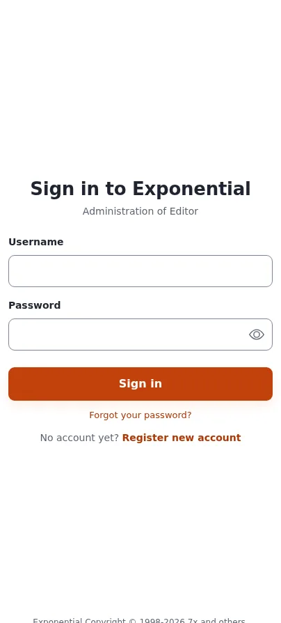
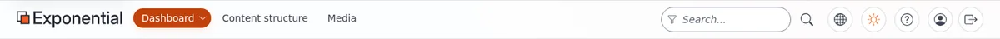

# Lektion 9.1: Arbeiten im Editor

Viele Installationen geben ihren Redakteuren den **Editor**: eine eigene Administration, die nur zeigt, was Schreiben
und Veröffentlichen brauchen. Alles, was in diesem Kurs gelernt wurde, funktioniert dort genauso. Diese Lektion zeigt
den Teilnehmenden den Editor neben der Administration, damit sie wissen, was sie erwartet, wenn ihre eigene Website
ihn verwendet.

## Auf einen Blick

| | |
|---|---|
| Kurs | [Redakteure 101](../README.md) |
| Modul | [Modul 9: Der Siteaccess des Editors](README.md) |
| Dauer | 30 Minuten (10 Präsentation, 20 Übung) |
| Niveau | Einsteiger |
| Zielgruppe | Neue Redakteure und Autoren |
| Voraussetzungen | Module 1 bis 8; die Adresse des Editors auf der Schulungsinstallation |

## Lernziele

Nach dieser Lektion können die Teilnehmenden:

- die Adresse des Editors öffnen und sich dort anmelden;
- die Reiter nennen, die der Editor zeigt, und sie mit der Administration vergleichen;
- erklären, dass der Editor und die Administration mit denselben Inhalten arbeiten;
- sagen, warum Seiten für Einstellungen, Layouts und das System nicht im Editor sind und wo sie stattdessen liegen.

## Hinweise für Trainer

### So präsentieren Sie es

Quellen: [Anmelden im Editor](../../../anmelden-im-editor.md) und
[Das neue Aussehen des Setup-Assistenten und der Siteaccess des Editors](../../../../../eng-us/features/6.0/setup-wizard-and-editor-siteaccess.md).

1. **Drei Teile einer Installation** (3 Minuten). Neue Installationen kommen mit drei Siteaccesses: der Website für
   Besucher, der Administration für Administratoren und dem **Editor** für Menschen, die Inhalte bearbeiten, die
   Website aber nicht verwalten. Üblicherweise hat der Editor einen Hostnamen wie `edit.example.com` oder einen Pfad
   wie `/editor`. Sein Titel sagt *Editor*, zum Beispiel auf der Anmeldeseite (*Administration of Editor*) und im
   Browser-Tab (*Dashboard - Editor*).
2. **Was er zeigt** (4 Minuten). Nur die Reiter für Inhalte: auf einer typischen Installation **Dashboard**,
   **Inhaltsstruktur** und **Medien**, dazu Reiter wie **Benutzer**, **Shop**, **Tags** oder **Newsletter**, wo die
   Rolle und die Erweiterungen es erlauben. Er hat keine Entwickler-Werkzeugleiste und auf einem Element keinen Reiter
   **Layouts**; die Module hinter den ausgeblendeten Reitern (Setup, Layouts, Rollen, Sektionen, Objektzustände,
   Workflows und mehr) antworten dort mit „nicht gefunden“. Objektzustände und Rollenzuweisungen werden in der
   Administration festgelegt.
3. **Was gleich bleibt** (3 Minuten). Das Dashboard, der Baum, die Seiten der Elemente, das Bearbeitungsformular, die
   Upload-Seite, Versionen, Suche und Lesezeichen funktionieren wie im Rest dieses Kurses. Eine Anmeldung im Editor
   meldet Sie nicht in der Administration an und umgekehrt.

### Häufige Fragen

**Welchen soll ich verwenden?** Den, den Ihnen Ihr Administrator gibt. Den Editor gibt es, damit Redakteure weniger
sehen, um das sie sich kümmern müssen.

**Ist mein Entwurf aus der Administration im Editor sichtbar?** Ja. Beide arbeiten mit denselben Inhalten; Ihre
Entwürfe stehen in beiden unter **Meine Entwürfe**.

**Warum sagt der Editor „nicht gefunden“ für eine Seite, die meine Kollegin in der Administration öffnet?** Dieses
Modul ist im Editor absichtlich gesperrt. Verwenden Sie die Administration, wenn Ihre Rolle es erlaubt.

### Stolperfallen

- **Kein Editor auf der Schulungsinstallation.** Installationen, die vor dem Siteaccess des Editors erstellt wurden,
  haben keinen. Zeigen Sie dann die Bildschirmfotos in [Anmelden im Editor](../../../anmelden-im-editor.md) und
  überspringen Sie die Anmeldeschritte der Übung.
- **Zwei Anmeldungen.** Die Teilnehmenden sind überrascht, dass sie sich erneut anmelden müssen. Das ist so gewollt:
  Eine Anmeldung gehört zu einem Teil der Installation.

## Praktische Übung

Verwenden Sie die Adresse des Editors der Schulungsinstallation, die der Trainer an die Tafel schreibt.

1. Öffnen Sie die Adresse des Editors in einem neuen Browser-Tab. Lesen Sie die Zeile unter dem Titel der
   Anmeldeseite.
2. Melden Sie sich mit Ihrem Schulungskonto an.
3. Schreiben Sie die Reiter auf, die der Editor in seiner Kopfzeile zeigt.
4. Öffnen Sie **Meine Entwürfe** und **Meine Lesezeichen** aus der linken Spalte: Ihre Lesezeichen aus Lektion 8.2
   sind da.
5. Öffnen Sie **Inhaltsstruktur** und suchen Sie Ihren Kursordner. Öffnen Sie *My first article*.
6. Schreiben Sie die Reiter der Seite des Artikels im Editor auf und vergleichen Sie sie mit denen der Administration
   (wechseln Sie in den anderen Browser-Tab).
7. Klicken Sie bei *My first article* auf **Bearbeiten**, ändern Sie ein Wort und klicken Sie auf
   **Zur Veröffentlichung schicken**.
8. Laden Sie im Browser-Tab der Administration den Artikel neu: Die Änderung ist da.
9. Melden Sie sich mit **Abmelden** aus dem Editor ab. Prüfen Sie, dass Sie im anderen Tab weiterhin in der
   Administration angemeldet sind.

## Erwartetes Ergebnis

- Die Anmeldeseite hat den Editor genannt (zum Beispiel *Administration of Editor*).
- Die Liste der Reiter ist kürzer als die der Administration (zum Beispiel **Dashboard**, **Inhaltsstruktur**,
  **Medien**).
- Die im Editor veröffentlichte Änderung erschien sofort in der Administration.
- Das Abmelden aus dem Editor hat die Teilnehmenden nicht aus der Administration abgemeldet.
- Der Trainer prüft das, indem er eine Teilnehmerin oder einen Teilnehmer bittet, einen Reiter zu nennen, den die
  Administration hat und der Editor nicht.

## Quiz

1. Welche drei Siteaccesses hat eine neue Installation?
2. Richtig oder falsch: Der Editor arbeitet mit einer Kopie der Inhalte.
3. Nennen Sie zwei Dinge, die die Administration hat und der Editor nicht.
4. Sie melden sich aus dem Editor ab. Sind Sie weiterhin in der Administration angemeldet?
5. Wo werden Objektzustände festgelegt, wenn der Editor sie sperrt?
   A. Auf dem Dashboard des Editors B. In der Administration C. Auf der öffentlichen Website D. Nirgends

Antworten

1. Die Website, die Administration und der Editor
   ([Das neue Aussehen des Setup-Assistenten und der Siteaccess des Editors](../../../../../eng-us/features/6.0/setup-wizard-and-editor-siteaccess.md#the-three-siteaccesses)).
2. **Falsch.** Beide arbeiten mit denselben Inhalten.
3. Zwei beliebige von: der Reiter **Layouts**, **Setup**, die Entwickler-Werkzeugleiste, Rollen, Sektionen,
   Objektzustände, Workflows.
4. Ja. Eine Anmeldung gehört zu einem Teil der Installation.
5. **B.**

## Weiterführende Literatur

- [Anmelden im Editor](../../../anmelden-im-editor.md): die Anmeldung im Editor.
- [Das neue Aussehen des Setup-Assistenten und der Siteaccess des Editors](../../../../../eng-us/features/6.0/setup-wizard-and-editor-siteaccess.md):
  was der Editor zeigt und sperrt.

## Verwandte Seiten

- [Modul 9: Der Siteaccess des Editors](README.md)
- [Redakteure 101: Kursüberblick](../README.md)
- [Trainer: hier beginnen](../../trainer-hier-beginnen.md)
- [Freie Dokumentation](../../../freie-dokumentation.md): Diese Seite darf unter der GNU FDL 1.3 frei kopiert, übersetzt und verbessert werden.

<!-- exp-partner-block:start -->
**Werden Sie Exponential-Partner.** Partner teilen ihre Informationen, stellen Mittel bereit, geben Beiträge zurück
und entwickeln die Produkte mit uns, und so wächst Exponential. Eine Partner-Website und ein Dashboard sind für Mitte
2027 geplant: Werden Sie noch heute Partner, damit wir schneller wachsen und neue Funktionen früher liefern. Beginnen
Sie mit [Partner: hier beginnen](../../../partner/partner-hier-beginnen.md) und
[Wie Sie sich bewerben](../../../partner/wie-sie-sich-bewerben.md).
<!-- exp-partner-block:end -->
