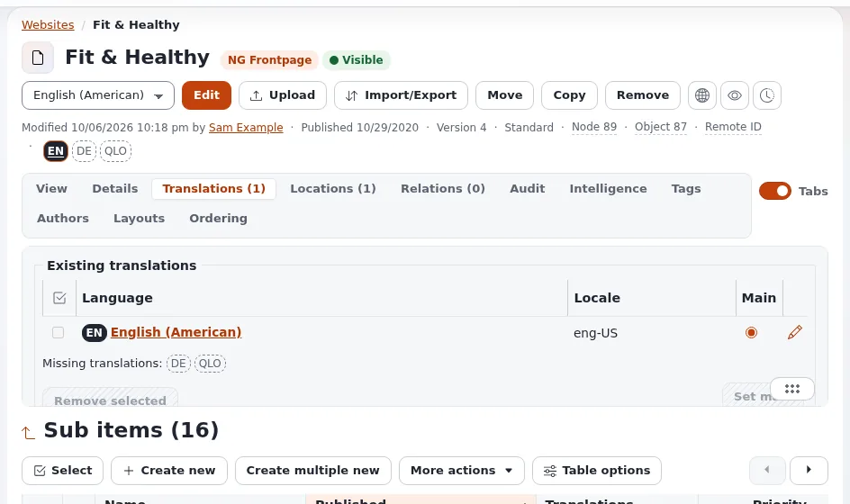

# Lektion 1.3: Hauptsprache, immer verfügbar und eine Übersetzung entfernen

Jedes Element hat eine **Hauptsprache**, und manche Elemente werden auch dort angezeigt, wo ihre Sprache fehlt.
Redakteure begegnen beidem, wenn Inhalte in der falschen Sprache angelegt wurden oder eine Übersetzung weg muss. Diese
Lektion behandelt die drei Aktionen des Tabs **Übersetzungen**, mit einer Warnung: Das Entfernen einer Übersetzung
löscht Inhalte endgültig.

## Auf einen Blick

| | |
|---|---|
| Kurs | [Redakteure 201](../README.md) |
| Modul | [Modul 1: Übersetzungen und Sprachen](README.md) |
| Dauer | 45 Minuten (20 Präsentation, 25 Übung) |
| Niveau | Fortgeschrittene |
| Zielgruppe | Erfahrene Redakteure und Übersetzer |
| Voraussetzungen | [Lektion 1.2](ein-element-uebersetzen.md): Alle Teilnehmenden haben *Opening hours* in zwei Sprachen |

## Lernziele

Nach dieser Lektion können die Teilnehmenden:

- erklären, was die Hauptsprache ist, und sie mit **Als Haupt setzen** ändern;
- erklären, was *Die Hauptsprache verwenden, wenn keine vorrangige Übersetzung vorhanden ist.* (immer verfügbar)
  bewirkt und wann es nützlich ist;
- eine Übersetzung mit **Ausgewählte entfernen** entfernen und sagen, warum die Hauptsprache nicht entfernt werden kann;
- die sichere Reihenfolge für Inhalte in der falschen Sprache befolgen: übersetzen, als Haupt setzen, entfernen.

## Hinweise für Trainer

### So präsentieren Sie es

Quellen: [Die Hauptsprache](../../../sprachen.md#die-hauptsprache) und
[Hauptsprache und immer verfügbar](../../../../anleitungen/inhaltssprachen.md#6-hauptsprache-und-immer-verfügbar).

1. **Die Hauptsprache** (4 Minuten). Sie ist die Sprache, in der das Element angelegt wurde, oder die später im Tab
   **Übersetzungen** gewählte: Wählen Sie sie in der Spalte **Haupt** aus und klicken Sie auf **Als Haupt setzen**. Die
   Hauptübersetzung kann nicht entfernt werden; zuerst muss eine andere zur Hauptübersetzung werden.
2. **Immer verfügbar** (4 Minuten). Das Häkchen *Die Hauptsprache verwenden, wenn keine vorrangige Übersetzung
   vorhanden ist.* mit **Aktualisieren**. Ein immer verfügbares Element wird in seiner Hauptsprache in einem Siteaccess
   angezeigt, der keine seiner Sprachen auflistet und in dem es sonst verborgen wäre. Ordner, Benutzer, Benutzergruppen
   und Medien sind meist immer verfügbar, damit eine deutsche Website den Bildordner oder den Autor trotzdem findet.
3. **Eine Übersetzung entfernen** (5 Minuten). Markieren Sie die Übersetzung unter **Bestehende Übersetzungen** und
   klicken Sie auf **Ausgewählte entfernen**. Warnen Sie deutlich: Das Entfernen einer Übersetzung löscht alle ihre
   Felder in dieser Sprache, in jeder Version, endgültig. Es braucht die Berechtigung; fragen Sie im Zweifel einen
   Administrator.
4. **Die sichere Reihenfolge** (5 Minuten). Inhalte in der falschen Sprache angelegt (zum Beispiel britisches statt
   amerikanisches Englisch): zuerst auf Grundlage der falschen in die richtige Sprache übersetzen, dann die richtige
   Sprache mit **Als Haupt setzen** zur Hauptsprache machen, dann die falsche Übersetzung entfernen. Nichts geht
   verloren.

### Häufige Fragen

**Warum kann ich die Hauptsprache nicht entfernen?** Jedes Element braucht eine Hauptsprache. Machen Sie zuerst eine
andere Übersetzung zur Hauptsprache.

**Ist das Entfernen einer Übersetzung dasselbe wie das Entfernen des Elements?** Nein. Das Element und seine anderen
Sprachen bleiben; nur der Text dieser Sprache verschwindet, in jeder Version, und lässt sich nicht aus dem Papierkorb
wiederherstellen.

**Sollten Artikel immer verfügbar sein?** Meist nicht: Ein deutscher Besucher sähe dann englische Artikel. Ordner,
Bilder und Benutzer sind es meist.

### Stolperfallen

- **Entfernen vor dem Übersetzen.** Der Text ist weg, und der Papierkorb kann ihn nicht zurückbringen. Übersetzen Sie
  immer zuerst.
- **Fehlende Berechtigung.** Auf vielen Websites dürfen nur Administratoren Übersetzungen entfernen; die Schaltfläche
  ist dann möglicherweise ausgegraut.
- **Versehentlich immer verfügbar.** Ein Häkchen bei einem Artikel lässt ihn auf jeder Sprachversion der Website in der
  Hauptsprache erscheinen. Fragen Sie den Trainer, bevor Sie es bei echten Inhalten ändern.

## Praktische Übung

Verwenden Sie die Schulungsinstallation und Ihren Artikel *Opening hours* aus Lektion 1.2.

1. Öffnen Sie *Opening hours* und den Tab **Übersetzungen**. Notieren Sie die Hauptsprache.
2. Wählen Sie in der Spalte **Haupt** die zweite Sprache und klicken Sie auf **Als Haupt setzen**.
3. Zeigen Sie auf die Kennzeichen: Die zweite Sprache ist jetzt als Hauptsprache markiert.
4. Setzen Sie die ursprüngliche Sprache auf dieselbe Weise wieder als Hauptsprache.
5. Lesen Sie das Häkchen *Die Hauptsprache verwenden, wenn keine vorrangige Übersetzung vorhanden ist.* und notieren
   Sie, ob es für diesen Artikel gesetzt ist. Ändern Sie es nicht.
6. Öffnen Sie den Tab **Übersetzungen** Ihres Kursordners und vergleichen Sie: Ist der Ordner immer verfügbar?
7. Legen Sie einen kurzen Artikel `Wrong language test` nur in der zweiten Sprache an (wählen Sie sie beim Anlegen in
   der Sprachliste, oder fragen Sie den Trainer, wie Ihre Website das anbietet), und veröffentlichen Sie ihn.
8. Übersetzen Sie ihn auf Grundlage der zweiten Sprache in die Hauptsprache und veröffentlichen Sie.
9. Machen Sie im Tab **Übersetzungen** die Hauptsprache mit **Als Haupt setzen** zur Hauptsprache.
10. Markieren Sie die zweite Sprache und klicken Sie auf **Ausgewählte entfernen**. Lesen Sie die Bestätigung
    sorgfältig und bestätigen Sie (wenn Ihre Rolle es darf).
11. Prüfen Sie die Kennzeichen: Nur die Hauptsprache ist ausgefüllt.

## Erwartetes Ergebnis

- *Opening hours* hat wieder seine ursprüngliche Hauptsprache.
- Die Teilnehmenden wissen, ob ihr Artikel und ihr Ordner immer verfügbar sind.
- *Wrong language test* hat am Ende nur die Hauptsprache, ohne seinen Text zu verlieren (er wurde zuerst übersetzt).
- Der Trainer prüft das, indem er *Wrong language test* und seinen Tab **Übersetzungen** am Beamer öffnet. Wenn die
  Rolle keine Übersetzungen entfernen darf, führt der Trainer Schritt 10 vor.

## Quiz

1. Wie ändern Sie die Hauptsprache eines Elements?
2. Warum kann die Hauptübersetzung nicht entfernt werden?
3. Was bewirkt immer verfügbar in einem Siteaccess, der keine der Sprachen des Elements auflistet?
   A. Verbirgt das Element B. Zeigt es in seiner Hauptsprache C. Übersetzt es D. Zeigt einen Fehler
4. Bringen Sie in die richtige Reihenfolge: die falsche Übersetzung entfernen, in die richtige Sprache übersetzen, die
   richtige Sprache als Haupt setzen.
5. Richtig oder falsch: Eine entfernte Übersetzung kann aus dem Papierkorb wiederhergestellt werden.

Antworten

1. Im Tab **Übersetzungen** die Sprache in der Spalte **Haupt** auswählen und auf **Als Haupt setzen** klicken.
2. Jedes Element braucht eine Hauptsprache; zuerst muss eine andere zur Hauptsprache werden
   ([Inhaltssprachen](../../../../anleitungen/inhaltssprachen.md#6-hauptsprache-und-immer-verfügbar)).
3. **B.**
4. In die richtige Sprache übersetzen, sie als Haupt setzen, dann die falsche Übersetzung entfernen.
5. **Falsch.** Es löscht die Felder dieser Sprache in jeder Version endgültig.

## Weiterführende Informationen

- [Inhaltssprachen](../../../../anleitungen/inhaltssprachen.md#8-inhalte-von-einer-sprache-in-eine-andere-verschieben):
  Inhalte von einer Sprache in eine andere übertragen.
- [Inhaltssprachen](../../../../anleitungen/inhaltssprachen.md#9-übersetzungen-und-sprachen-sicher-entfernen): was das
  Entfernen löscht.
- [Sprachen](../../../sprachen.md#eine-übersetzung-entfernen): die Kurzfassung.

## Verwandte Seiten

- [Modul 1: Übersetzungen und Sprachen](README.md)
- [Redakteure 201: Kursüberblick](../README.md)
- [Trainer: hier beginnen](../../../../../eng-us/help/trainers/trainers-start-here.md)
- [Freie Dokumentation](../../../freie-dokumentation.md): Diese Seite darf unter der GNU FDL 1.3 frei kopiert, übersetzt und verbessert werden.

<!-- exp-partner-block:start -->
**Werden Sie Exponential-Partner.** Partner teilen ihre Informationen, stellen Mittel bereit, geben Beiträge zurück
und entwickeln die Produkte mit uns, und so wächst Exponential. Eine Partner-Website und ein Dashboard sind für Mitte
2027 geplant: Werden Sie noch heute Partner, damit wir schneller wachsen und neue Funktionen früher liefern. Beginnen
Sie mit [Partner: hier beginnen](../../../partner/partner-hier-beginnen.md) und
[Wie Sie sich bewerben](../../../partner/wie-sie-sich-bewerben.md).
<!-- exp-partner-block:end -->
