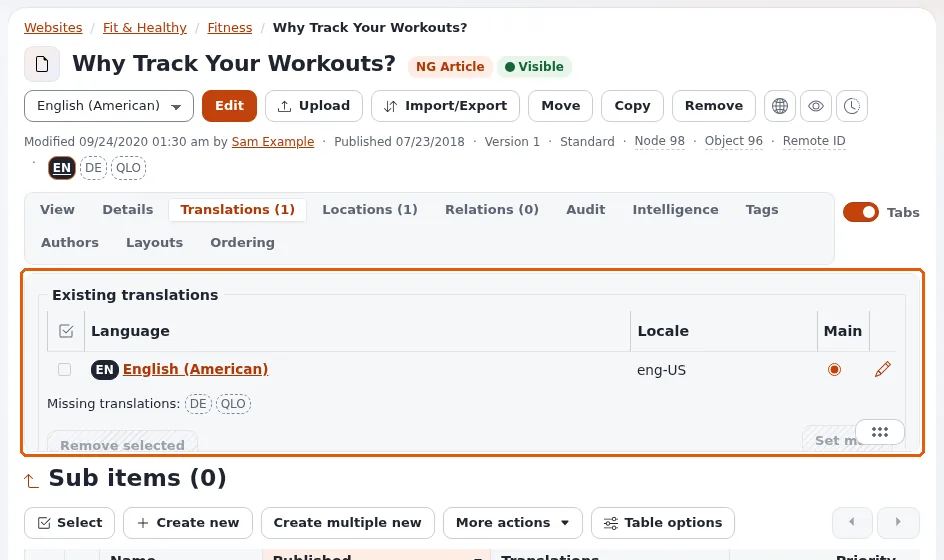

# Lektion 1.1: Inhaltssprachen und Übersetzungen

Eine mehrsprachige Website enthält ein Element in mehreren Sprachen. Bevor die Teilnehmenden etwas übersetzen, müssen
sie den Unterschied zwischen den Sprachen kennen, in denen Inhalte geschrieben sind, und der Sprache der Schaltflächen
der Administration, und sie müssen ablesen können, welche Übersetzungen ein Element hat.

> **Hinweis**
> Verwenden Sie eine Schulungsinstallation mit mindestens zwei Inhaltssprachen (zum Beispiel Englisch und Deutsch).
> Das Hinzufügen einer Inhaltssprache ist eine Aufgabe für Administratoren: siehe **Dieses Modul vorbereiten** in der
> Modulübersicht.

## Auf einen Blick

| | |
|---|---|
| Kurs | [Redakteure 201](../README.md) |
| Modul | [Modul 1: Übersetzungen und Sprachen](README.md) |
| Dauer | 30 Minuten (15 Präsentation, 15 Übung) |
| Niveau | Fortgeschrittene |
| Zielgruppe | Redakteure, die jede Woche veröffentlichen und nun auf einer mehrsprachigen Website arbeiten |
| Voraussetzungen | Redakteure 101 oder gleichwertige Erfahrung; ein Schulungskonto mit der Rolle Editor |

## Lernziele

Nach dieser Lektion können die Teilnehmenden:

- den Unterschied zwischen einer **Inhaltssprache** und der **Oberflächensprache** erklären;
- die Sprachkennzeichen eines Elements (ausgefüllt: vorhanden; gestrichelt: fehlt) und den Tab **Übersetzungen**
  lesen;
- sagen, welche Übersetzung ein Siteaccess zeigt und wann ein Element gar nicht angezeigt wird;
- die **Hauptsprache** eines Elements nennen.

## Hinweise für Trainer

### So präsentieren Sie es

Quellen: [Sprachen](../../../sprachen.md) und [Inhaltssprachen](../../../../anleitungen/inhaltssprachen.md#kurz-gesagt).

1. **Zwei Arten von Sprache** (3 Minuten). Inhaltssprachen sind die Sprachen, in denen Elemente geschrieben sind: Ein
   Artikel kann auf Englisch und auf Deutsch existieren, jeweils eine **Übersetzung** desselben Elements. Die
   Oberflächensprache ist die Sprache der Menüs und Schaltflächen, gewählt im Kasten **Oberfläche** der rechten
   Spalte, nur für Sie; an den Inhalten ändert sie nichts.
2. **Kennzeichen** (4 Minuten). Auf der Seite eines Elements zeigt die Zeile unter den Schaltflächen ein Kennzeichen
   pro Sprache der Website. Ein ausgefülltes Kennzeichen (etwa **EN**) ist eine vorhandene Übersetzung; ein
   gestricheltes (etwa **DE**) gibt es noch nicht. Wer auf ein Kennzeichen zeigt, liest es, zum Beispiel *English
   (American) – Hauptsprache* oder *In German übersetzen*.
3. **Der Tab Übersetzungen** (4 Minuten). Öffnen Sie **Übersetzungen (n)**: Der Kasten **Bestehende Übersetzungen**
   listet jede Sprache mit ihrer **Örtlichkeit** auf und ob sie die **Haupt**-Sprache ist, darunter *Fehlende
   Übersetzungen*. Schaltflächen: **Ausgewählte entfernen**, **Als Haupt setzen** und **Aktualisieren** für die
   Einstellung *Die Hauptsprache verwenden, wenn keine vorrangige Übersetzung vorhanden ist.* Lektion 1.3 behandelt
   diese.
4. **Welche Übersetzung eine Website zeigt** (4 Minuten). Jeder Siteaccess (zum Beispiel eine englische und eine
   deutsche Website) zeigt ein Element in der ersten Sprache seiner eigenen Sprachliste, die das Element hat. Ein
   Element in keiner davon ist dort verborgen, es sei denn, es ist **immer verfügbar**. Ordner, Benutzer und Medien
   sind meist immer verfügbar.

### Häufige Fragen

**Wenn ich die Oberfläche auf Deutsch umstelle, bearbeite ich dann den deutschen Text?** Nein. Die Oberflächensprache
ändert die Schaltflächen; die zu bearbeitende Übersetzung wählen Sie in der Sprachliste neben **Bearbeiten**.

**Warum sehe ich ein Kennzeichen für eine Sprache, die niemand verwendet?** Die Website hat diese Inhaltssprache. Das
Hinzufügen einer Sprache übersetzt nichts; es macht das Übersetzen in sie nur möglich.

**Sehen Besucher eine Übersetzung, sobald ich sie veröffentliche?** Nur in einem Siteaccess, der diese Sprache
auflistet. Welche Siteaccesses welche Sprachen zeigen, ist eine Einstellung der Administratoren.

### Stolperfallen

- **Die beiden Sprachen verwechseln.** Bitten Sie die Teilnehmenden, die Oberflächensprache einmal umzustellen und zu
  sehen, dass sich die Inhalte nicht ändern.
- **Testsprachen.** Manche Installationen haben eine Testsprache, eine Pseudosprache zum Prüfen von Layouts. Sagen Sie
  den Teilnehmenden, dass sie sie ignorieren sollen.
- **Annehmen, dass jedes Element in jeder Sprache existiert.** Die Kennzeichen zeigen die Wahrheit; lesen Sie sie,
  bevor Sie versprechen, dass eine Übersetzung online ist.

## Praktische Übung

Verwenden Sie die Schulungsinstallation und Ihr Editor-Schulungskonto.

1. Öffnen Sie das Element, das der Trainer genannt hat (ein veröffentlichter Artikel, der in zwei Sprachen existiert).
2. Lesen Sie die Sprachkennzeichen unter den Schaltflächen. Zeigen Sie auf jedes und notieren Sie, was der Tooltip
   sagt.
3. Öffnen Sie den Tab **Übersetzungen**. Notieren Sie die unter **Bestehende Übersetzungen** aufgeführten Sprachen und
   welche als **Haupt** markiert ist.
4. Lesen Sie die Liste *Fehlende Übersetzungen*.
5. Öffnen Sie die Sprachliste neben **Bearbeiten** und lesen Sie ihre Einträge (die vorhandenen Sprachen und **Neue
   Übersetzung**).
6. Stellen Sie die **Sprache der Oberfläche** in der rechten Spalte auf eine andere Sprache um und klicken Sie auf
   **Anwenden**. Prüfen Sie: Der Text des Artikels hat sich nicht geändert. Stellen Sie zurück.
7. Öffnen Sie Ihren eigenen Kursordner aus Redakteure 101 (oder einen beliebigen Ordner) und lesen Sie seine
   Kennzeichen: Welche Sprachen hat er?
8. Öffnen Sie die öffentliche Website in der Sprache, die der Trainer nennt, und suchen Sie den Artikel dort.

## Erwartetes Ergebnis

- Die Notizen listen die Sprachen des Artikels mit ihren Tooltips, die Hauptsprache und die fehlenden Sprachen auf.
- Schritt 6 hat gezeigt, dass die Oberflächensprache die Inhalte nicht ändert.
- Schritt 8 hat den Artikel auf der Website der anderen Sprache gefunden (der Trainer hat beide Siteaccesses
  vorbereitet).
- Der Trainer prüft das, indem er eine Person bittet, die beiden Arten von Kennzeichen zu erklären.

## Quiz

1. Was bedeutet ein gestricheltes Sprachkennzeichen auf der Seite eines Elements?
2. Richtig oder falsch: Wer die Oberflächensprache ändert, ändert die Sprache des Textes, den er bearbeitet.
3. Welcher Tab listet die Übersetzungen eines Elements mit seiner Hauptsprache auf?
   A. **Details** B. **Übersetzungen** C. **Orte** D. **Verknüpfungen**
4. Ein Siteaccess listet nur Deutsch auf. Ihr Element existiert nur auf Englisch und ist nicht immer verfügbar. Was
   sehen die Besucher dieses Siteaccess?
5. Was übersetzt das Hinzufügen einer Inhaltssprache zur Website?

Antworten

1. Die Übersetzung existiert noch nicht; wer darauf zeigt, liest zum Beispiel *In German übersetzen*
   ([Sprachen](../../../sprachen.md#sehen-welche-übersetzungen-ein-objekt-hat)).
2. **Falsch.**
3. **B.**
4. Nichts: Das Element ist dort verborgen ([Inhaltssprachen](../../../../anleitungen/inhaltssprachen.md#kurz-gesagt)).
5. Nichts. Übersetzt wird Element für Element im Editor.

## Weiterführende Informationen

- [Sprachen](../../../sprachen.md): Inhaltssprachen und die Oberflächensprache.
- [Inhaltssprachen](../../../../anleitungen/inhaltssprachen.md): der vollständige Leitfaden, für den Trainer.

## Verwandte Seiten

- [Modul 1: Übersetzungen und Sprachen](README.md)
- [Redakteure 201: Kursübersicht](../README.md)
- [Trainer: hier beginnen](../../../../../eng-us/help/trainers/trainers-start-here.md)
- [Freie Dokumentation](../../../freie-dokumentation.md): Diese Seite darf unter der GNU FDL 1.3 frei kopiert, übersetzt und verbessert werden.

<!-- exp-partner-block:start -->
**Werden Sie Exponential-Partner.** Partner teilen ihre Informationen, stellen Mittel bereit, geben Beiträge
zurück und entwickeln die Produkte gemeinsam mit uns weiter, und so wächst Exponential. Eine Partner-Website und
ein Partner-Dashboard sind für Mitte 2027 geplant: Werden Sie noch heute Partner, damit wir schneller wachsen und
neue Funktionen früher bereitstellen können. Beginnen Sie mit [Partner: hier beginnen](../../../partner/partner-hier-beginnen.md) und
[Wie Sie sich bewerben](../../../partner/wie-sie-sich-bewerben.md).
<!-- exp-partner-block:end -->
