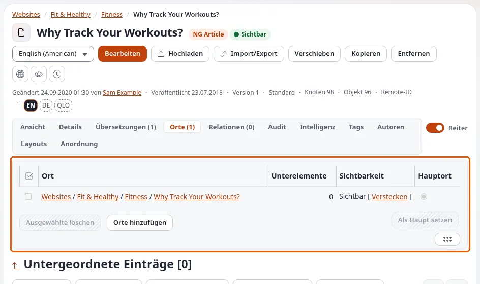

# Lektion 2.2: Ein Element an mehreren Stellen: Orte

Ein Element kann an mehr als einer Stelle des Baums erscheinen, ohne kopiert zu werden: derselbe Artikel in *News* und
in *Projects*, ein Text, zwei Stellen. Jede Stelle ist ein **Ort** (in den Nummern des Elements ein Knoten). Diese
Lektion vermittelt das Hinzufügen, Lesen und Entfernen von Orten.

## Auf einen Blick

| | |
|---|---|
| Kurs | [Redakteure 201](../README.md) |
| Modul | [Modul 2: Verknüpfungen, Orte und Einbetten](README.md) |
| Dauer | 45 Minuten (15 Präsentation, 30 Übung) |
| Niveau | Fortgeschrittene |
| Zielgruppe | Redakteure, die Inhalte organisieren |
| Voraussetzungen | [Lektion 2.1](verknuepfungen-und-einbetten.md) |

## Lernziele

Nach dieser Lektion können die Teilnehmenden:

- den Unterschied zwischen einer Kopie und einem zweiten Ort erklären;
- einen Ort mit **Orte hinzufügen** im Tab **Orte** oder **Position hinzufügen** in einer Liste **Unterelemente**
  hinzufügen;
- den Tab **Orte** lesen (**Ort**, **Unterelemente**, **Hauptort**) und den Hauptort mit **Als Haupt setzen** ändern;
- einen Ort verbergen und einen Ort mit **Ausgewählte entfernen** entfernen, ohne das Element zu entfernen.

## Hinweise für Trainer

### So präsentieren Sie es

Quellen: [Viele Elemente auf einmal](../../../inhalte-bearbeiten.md#viele-objekte-auf-einmal),
[Entfernen und wiederherstellen](../../../veroeffentlichen-und-versionen.md#entfernen-und-wiederherstellen) und
[Kopieren, Orte und wie Auswahlen angezeigt werden](../../../../anleitungen/inhaltsmodell-und-bearbeitung.md#10-kopieren-orte-und-wie-auswahlen-angezeigt-werden).

1. **Objekt und Knoten** (3 Minuten). Erinnern Sie an Redakteure 101: Die Nummer *Objekt* eines Elements gehört zum
   Element, seine Nummer *Knoten* zu einer Stelle. Ein zweiter Ort gibt demselben Objekt einen zweiten Knoten. Wer das
   Element bearbeitet, ändert es an jeder Stelle; eine Kopie wäre ein eigenes Element.
2. **Hinzufügen** (3 Minuten). Im Tab **Orte** öffnet **Orte hinzufügen** einen Browser, um ein oder mehrere neue
   übergeordnete Elemente zu wählen. Markieren Sie in einer Liste **Unterelemente** Elemente und wählen Sie
   **Weitere Aktionen** > **Position hinzufügen**.
3. **Der Tab** (4 Minuten). **Orte (n)** listet jede Stelle mit ihrem Pfad (**Ort**), ihrer Anzahl an
   **Unterelementen** und welche der **Hauptort** ist. Schaltflächen: **Verbergen**, **Ausgewählte entfernen**, **Orte
   hinzufügen**, **Als Haupt setzen**. Der Hauptort ist der, der für die Hauptadresse des Elements und meist für seine
   Sektion verwendet wird.
4. **Einen Ort entfernen** (3 Minuten). Wer einen Ort entfernt, behält das Element an seinen anderen Stellen; es kommt
   erst in den Papierkorb, wenn sein letzter Ort entfernt wird.
5. **Sichtbarkeit pro Ort** (2 Minuten). Ein Ort kann für sich verborgen werden. Im Fenster **Orte** des
   Bearbeitungsformulars beginnt **Sichtbarkeit nach Veröffentlichung** bei vorhandenen Orten mit **Unverändert**,
   sodass das Veröffentlichen keinen verborgenen Ort sichtbar macht.

### Häufige Fragen

**Wann sollte ich einen zweiten Ort statt eines Links verwenden?** Wenn das Element an beiden Stellen aufgelistet
werden soll, zum Beispiel in zwei Menüs oder zwei Listen. Ein Link verweist nur; ein Ort macht das Element zu einem
Unterelement der zweiten Stelle.

**Welche Adresse bekommt das Element?** Jeder Ort hat seine eigene Adresse; der Hauptort liefert die Hauptadresse des
Elements.

**Sind die Unterelemente des Elements auch an der zweiten Stelle?** Ja: Die eigenen Unterelemente des Elements
erscheinen unter jedem seiner Orte.

### Stolperfallen

- **Den falschen Ort entfernen.** **Ausgewählte entfernen** im Tab **Orte** entfernt nur die markierten Stellen. Lesen
  Sie die Pfade.
- **Eine Kopie erwarten.** Die Teilnehmenden bearbeiten das Element „an der zweiten Stelle“ und sind überrascht, dass
  sich die erste auch geändert hat. Zeigen Sie es absichtlich.
- **Berechtigungen.** Das Hinzufügen eines Ortes braucht die Berechtigung, im neuen übergeordneten Element anzulegen.

## Praktische Übung

Verwenden Sie die Schulungsinstallation und Ihren Kursordner.

1. Legen Sie in Ihrem Kursordner einen Unterordner `Projects` an und veröffentlichen Sie ihn.
2. Öffnen Sie Ihren Artikel *Our team* (Lektion 2.1) und seinen Tab **Orte**. Notieren Sie seinen einen Ort.
3. Klicken Sie auf **Orte hinzufügen**, wählen Sie im Browser `Projects` und bestätigen Sie.
4. Lesen Sie den Tab **Orte** erneut: zwei Orte, einer als **Hauptort** markiert. Notieren Sie beide Knotennummern
   (öffnen Sie den Pfad jedes Ortes, um seinen Knoten zu sehen).
5. Öffnen Sie `Projects` und suchen Sie *Our team* in seinen **Unterelementen**.
6. Bearbeiten Sie *Our team* aus `Projects` heraus, ändern Sie seinen Titel in `Our team, two places` und
   veröffentlichen Sie. Prüfen Sie seinen Titel im Kursordner.
7. Wählen Sie im Tab **Orte** den Ort in `Projects` aus und klicken Sie auf **Als Haupt setzen**.
8. Markieren Sie den Ort in Ihrem Kursordner und klicken Sie auf **Verbergen**. Prüfen Sie auf der Website, dass der
   Artikel über `Projects` noch erreichbar ist.
9. Machen Sie ihn wieder sichtbar (Menü des Elements > **Fortgeschritten** > **Verstecken / Zeigen** an diesem Ort,
   oder wie der Trainer zeigt).
10. Markieren Sie den Ort in `Projects` und klicken Sie auf **Ausgewählte entfernen**; bestätigen Sie. Der Artikel ist
    noch in Ihrem Kursordner und nicht im Papierkorb.

## Erwartetes Ergebnis

- *Our team, two places* war mit einem Text in beiden Ordnern sichtbar und hat dann in Schritt 10 den Ort `Projects`
  verloren.
- Nach Schritt 7 war der Hauptort in `Projects`; nach Schritt 10 ist der verbleibende Ort der Hauptort.
- Der Papierkorb enthält den Artikel nicht.
- Der Trainer prüft das, indem er den Tab **Orte** einer Person am Beamer öffnet.

## Quiz

1. Was ist der Unterschied zwischen einer Kopie und einem zweiten Ort?
2. Nennen Sie die vier Schaltflächen des Tabs **Orte**.
3. Sie entfernen einen der beiden Orte eines Elements. Wohin kommt das Element?
   A. In den Papierkorb B. Nirgendwohin, es bleibt an seinem anderen Ort C. Es wird gelöscht D. Es wird verborgen
4. Wofür wird der Hauptort verwendet?
5. Sie bearbeiten ein Element über seinen zweiten Ort. Was ändert sich am ersten?

Antworten

1. Eine Kopie ist ein eigenes Element; ein Ort ist eine weitere Stelle desselben Elements.
2. **Verbergen**, **Ausgewählte entfernen**, **Orte hinzufügen**, **Als Haupt setzen**.
3. **B.** Es kommt erst in den Papierkorb, wenn sein letzter Ort entfernt wird
   ([Veröffentlichen, Versionen und der Papierkorb](../../../veroeffentlichen-und-versionen.md#entfernen-und-wiederherstellen)).
4. Für die Hauptadresse des Elements und meist für seine Sektion.
5. Dieselbe Änderung: Es ist ein Element.

## Weiterführende Informationen

- [Inhalte erstellen und bearbeiten](../../../inhalte-bearbeiten.md#viele-objekte-auf-einmal): **Position hinzufügen** in Listen.
- [Das Inhaltsmodell und das Bearbeiten von Inhalten](../../../../anleitungen/inhaltsmodell-und-bearbeitung.md#10-kopieren-orte-und-wie-auswahlen-angezeigt-werden):
  Kopieren und das Fenster Orte.
- [Sektionen](../../../../anleitungen/sektionen.md#82-verschieben-und-orte): was Orte mit Sektionen machen.

## Verwandte Seiten

- [Modul 2: Verknüpfungen, Orte und Einbetten](README.md)
- [Redakteure 201: Kursüberblick](../README.md)
- [Trainer: hier beginnen](../../trainer-hier-beginnen.md)
- [Freie Dokumentation](../../../freie-dokumentation.md): Diese Seite darf unter der GNU FDL 1.3 frei kopiert, übersetzt und verbessert werden.

<!-- exp-partner-block:start -->
**Werden Sie Exponential-Partner.** Partner teilen ihre Informationen, stellen Mittel bereit, geben Beiträge zurück
und entwickeln die Produkte mit uns, und so wächst Exponential. Eine Partner-Website und ein Dashboard sind für Mitte
2027 geplant: Werden Sie noch heute Partner, damit wir schneller wachsen und neue Funktionen früher liefern. Beginnen
Sie mit [Partner: hier beginnen](../../../partner/partner-hier-beginnen.md) und
[Wie Sie sich bewerben](../../../partner/wie-sie-sich-bewerben.md).
<!-- exp-partner-block:end -->
