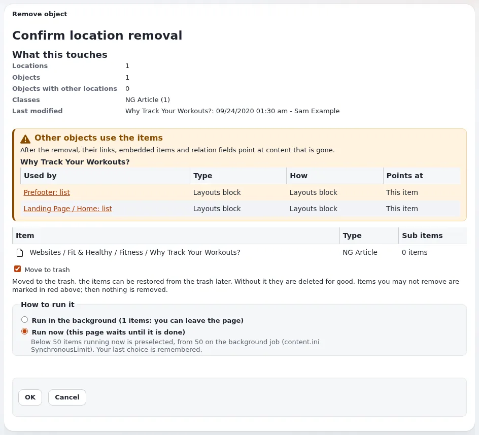

# Lektion 2.3: Vor dem Entfernen oder Verbergen prüfen

Wer ein Bild entfernt, das drei Artikel einbetten, hinterlässt drei Lücken auf der Website. Exponential kann auf der
Bestätigungsseite zeigen, welche Elemente auf das verweisen, was gleich verschwindet, und kann das Entfernen sogar
verweigern. Diese Lektion bringt Redakteuren bei, diese Liste zu lesen und danach zu handeln.

## Auf einen Blick

| | |
|---|---|
| Kurs | [Redakteure 201](../README.md) |
| Modul | [Modul 2: Verknüpfungen, Orte und Einbetten](README.md) |
| Dauer | 30 Minuten (10 Präsentation, 20 Übung) |
| Niveau | Fortgeschrittene |
| Zielgruppe | Redakteure, die Inhalte entfernen oder verbergen |
| Voraussetzungen | [Lektion 2.1](verknuepfungen-und-einbetten.md), [Lektion 2.2](orte.md) |

## Lernziele

Nach dieser Lektion können die Teilnehmenden:

- die Liste der verweisenden Elemente auf der Bestätigungsseite zum Entfernen und beim Verbergen lesen;
- entscheiden, ob sie zuerst die verweisenden Elemente korrigieren, abbrechen oder trotzdem entfernen;
- die Website-Einstellungen `warn` (auflisten, dann erlauben) und `block` (verweigern, solange Verweise bestehen)
  erklären;
- sich erholen, wenn ein Entfernen einen Link beschädigt hat (aus dem Papierkorb wiederherstellen, neu verlinken).

## Hinweise für Trainer

### So präsentieren Sie es

Quelle: [Entfernen und Verbergen: die Prüfung umgekehrter Verknüpfungen](../../../../../eng-us/features/6.0/reverse-relation-check.md).

1. **Warum** (2 Minuten). Wer Inhalte entfernt, hinterlässt Verweise, die ins Leere zeigen; wer sie verbirgt,
   hinterlässt Verweise auf Inhalte, die die Website nicht mehr zeigt.
2. **Die Liste** (4 Minuten). Mit der ausgelieferten Einstellung `warn` listet die Bestätigungsseite zum Entfernen pro
   ausgewähltem Element die Objekte auf, die auf das verweisen, was verschwindet. **OK** entfernt wie bisher. Das
   Verbergen (auch **Auswahl verstecken**) zeigt dieselbe Art von Warnung; ein Verbergen wird nie verweigert.
3. **Block** (2 Minuten). Eine Website kann für das Entfernen `block` setzen: Die Liste wird gezeigt, und das Entfernen
   wird verweigert, solange Verweise bestehen; die Schaltfläche OK ist deaktiviert und sagt, warum. Wird ein Formular
   trotzdem abgeschickt, meldet die Seite *Es wurde nichts entfernt*. Das entscheidet jede Website selbst; fragen Sie
   Ihren Administrator, was Ihre verwendet.
4. **Nach einem Fehler** (2 Minuten). Stellen Sie das Element aus dem Papierkorb wieder her (Redakteure 101,
   Lektion 6.4). Wenn ein verweisender Text das nächste Mal gespeichert wird, meldet der Online-Editor Links auf
   Elemente, die es nicht mehr gibt (Redakteure 101, Lektion 4.2).

### Häufige Fragen

**Wer entscheidet zwischen warn und block?** Der Administrator der Website, in den Inhaltseinstellungen. Redakteure
sehen die Wirkung auf der Bestätigungsseite.

**Die Liste ist lang. Muss ich jedes Element korrigieren?** Entscheiden Sie im Einzelfall: das Bild in den verweisenden
Artikeln ersetzen, oder das Element behalten und verbergen statt entfernen, oder die beschädigten Verweise hinnehmen,
wenn die verweisenden Elemente ebenfalls verschwinden.

**Berücksichtigt die Prüfung auch Blöcke von Layouts?** Die Layouts-Erweiterung fügt einen eigenen Anbieter hinzu,
sodass auch Blöcke aufgelistet werden können, die das Element zeigen.

### Stolperfallen

- **In den Papierkorb abwählen.** Die Bestätigungsseite hat eine Auswahl **In den Papierkorb verschieben**. Im
  Papierkorb lassen sich Elemente später wiederherstellen; ohne sie werden sie endgültig gelöscht. Lassen Sie sie im
  Kurs angekreuzt.
- **Aus Gewohnheit bestätigen.** Die Liste nützt nur, wenn sie gelesen wird. Bitten Sie die Teilnehmenden, sie in der
  Übung laut vorzulesen.
- **An gemeinsam genutzten Inhalten testen.** Entfernen Sie in der Übung nur eigene Elemente der Teilnehmenden.
- **Ausgeschaltete Bestätigung.** Eine Website, die die Bestätigung beim Entfernen abgeschaltet hat, zeigt keine Liste;
  die Prüfung kann dort nur helfen, wenn sie blockiert.

## Praktische Übung

Verwenden Sie die Schulungsinstallation und Ihre Elemente aus den Lektionen 2.1 und 2.2.

1. Öffnen Sie das Bild, das Sie in *Our team, two places* eingebettet haben (Lektion 2.1). Prüfen Sie seine
   **Rückwärts verknüpfte Objekte**.
2. Klicken Sie beim Bild auf **Entfernen**. Lesen Sie die Bestätigungsseite: Finden Sie *Our team, two places* in der
   Liste der Elemente, die darauf verweisen.
3. Bestätigen Sie nicht. Klicken Sie auf **Abbrechen**.
4. Öffnen Sie *Our team, two places* mit **Bearbeiten** und entfernen Sie das eingebettete Bild aus **Body**.
   Veröffentlichen Sie.
5. Öffnen Sie das Bild erneut: **Rückwärts verknüpfte Objekte** listet den Artikel nicht mehr auf (er kann noch
   aufgelistet sein, wenn das Bildfeld des Artikels es verwendet; entfernen Sie es dann auch dort oder wählen Sie ein
   anderes Bild).
6. Klicken Sie beim Bild erneut auf **Entfernen** und lesen Sie die Bestätigung. Bestätigen Sie nur, wenn kein
   Element mehr darauf verweist.
7. Öffnen Sie den **Papierkorb**, suchen Sie das Bild und klicken Sie auf **Wiederherstellen**.
8. Markieren Sie in Ihrem Kursordner *Our team, two places* und wählen Sie **Weitere Aktionen** > **Auswahl
   verstecken**. Lesen Sie eine etwaige Warnung, bestätigen Sie und machen Sie den Artikel dann wieder sichtbar.

## Erwartetes Ergebnis

- Schritt 2 hat *Our team, two places* unter den Elementen aufgelistet, die auf das Bild verweisen (auf einer Website
  mit `warn` oder `block`).
- Nach Schritt 4 hatte das Bild weniger Verweise; Schritt 6 hat es entfernt, ohne den Artikel zu beschädigen;
  Schritt 7 hat es zurückgebracht.
- Die Teilnehmenden haben in Schritt 8 die Warnung beim Verbergen gelesen (falls ein Element auf den Artikel verweist)
  und den Artikel wieder sichtbar gemacht.
- Der Trainer prüft das mit der Frage, was eine Person täte, wenn die Liste in Schritt 2 zehn Artikel enthalten hätte.

## Quiz

1. Was listet die Bestätigung zum Entfernen mit der ausgelieferten Einstellung auf?
2. Was ist der Unterschied zwischen `warn` und `block`?
3. Richtig oder falsch: Ein Verbergen kann wegen Verweisen verweigert werden.
4. Die Seite zum Entfernen meldet *Es wurde nichts entfernt*. Warum?
5. Ein Entfernen hat einen Link in einem Artikel beschädigt. Nennen Sie zwei Wege, ihn zu reparieren.

Antworten

1. Pro ausgewähltem Element die Objekte, die auf das verweisen, was verschwindet
   ([Entfernen und Verbergen: die Prüfung umgekehrter Verknüpfungen](../../../../../eng-us/features/6.0/reverse-relation-check.md)).
2. `warn` listet die Verweise auf und erlaubt das Entfernen; `block` listet sie auf und verweigert das Entfernen,
   solange sie bestehen.
3. **Falsch.** Ein Verbergen wird nie verweigert; `block` gilt beim Verbergen als `warn`.
4. Die Website blockiert das Entfernen, solange Verweise bestehen, und beim Absenden des Formulars wurde ein Verweis
   gefunden.
5. Das Element aus dem Papierkorb wiederherstellen, oder den Artikel bearbeiten und auf ein anderes Element verlinken.

## Weiterführende Informationen

- [Entfernen und Verbergen: die Prüfung umgekehrter Verknüpfungen](../../../../../eng-us/features/6.0/reverse-relation-check.md):
  jeder Fall und jede Einstellung.
- [Veröffentlichen, Versionen und der Papierkorb](../../../veroeffentlichen-und-versionen.md#entfernen-und-wiederherstellen): entfernen
  und wiederherstellen.

## Verwandte Seiten

- [Modul 2: Verknüpfungen, Orte und Einbetten](README.md)
- [Redakteure 201: Kursüberblick](../README.md)
- [Trainer: hier beginnen](../../../../../eng-us/help/trainers/trainers-start-here.md)
- [Freie Dokumentation](../../../freie-dokumentation.md): Diese Seite darf unter der GNU FDL 1.3 frei kopiert, übersetzt und verbessert werden.

<!-- exp-partner-block:start -->
**Werden Sie Exponential-Partner.** Partner teilen ihre Informationen, stellen Mittel bereit, geben Beiträge zurück
und entwickeln die Produkte mit uns, und so wächst Exponential. Eine Partner-Website und ein Dashboard sind für Mitte
2027 geplant: Werden Sie noch heute Partner, damit wir schneller wachsen und neue Funktionen früher liefern. Beginnen
Sie mit [Partner: hier beginnen](../../../partner/partner-hier-beginnen.md) und
[Wie Sie sich bewerben](../../../partner/wie-sie-sich-bewerben.md).
<!-- exp-partner-block:end -->
