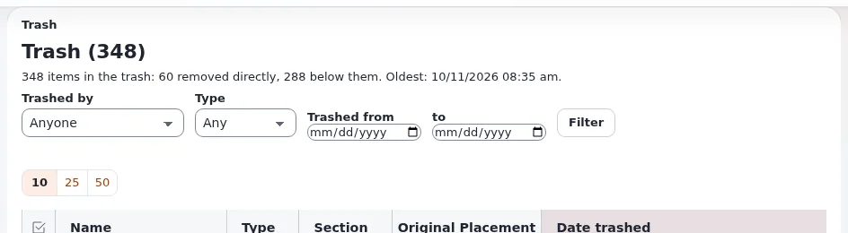

# Lektion 3.4: Große Vorgänge und der Papierkorb im Detail

Eine alte Kampagne mit 300 Seiten zu entfernen oder einen ganzen Bereich der Website zu kopieren, war im Browser früher
riskant. Exponential führt solche Vorgänge im Hintergrund als **Inhaltsaufträge** aus, in Stapeln, die
Unterbrechungen überstehen. Diese Lektion zeigt Redakteuren die Auftragsseiten und geht dann tiefer in den Papierkorb
als Redakteure 101.

## Auf einen Blick

| | |
|---|---|
| Kurs | [Redakteure 201](../README.md) |
| Modul | [Modul 3: Inhalte organisieren](README.md) |
| Dauer | 45 Minuten (15 Präsentation, 30 Übung) |
| Niveau | Fortgeschrittene |
| Zielgruppe | Redakteure, die größere Teile einer Website umorganisieren |
| Voraussetzungen | [Lektion 3.1](verschieben-und-kopieren.md); ein Ordner mit 50 oder mehr Elementen auf der Schulungs-Website |

## Lernziele

Nach dieser Lektion können die Teilnehmenden:

- auf einer Bestätigungsseite zwischen **jetzt ausführen** und **im Hintergrund** wählen und den Unterschied erklären;
- den Fortschritt eines Inhaltsauftrags verfolgen und alle ihre Aufträge finden;
- den Papierkorb nach **In den Papierkorb verschoben von**, **Typ** und Datum filtern und **Ursprüngliche Platzierung**
  lesen;
- ein Element wiederherstellen, dessen ursprüngliche Stelle es nicht mehr gibt, und erklären, warum **Ausgewählte
  entfernen** und **Papierkorb leeren** im Papierkorb endgültig sind.

## Hinweise für Trainer

### So präsentieren Sie es

Quellen: [Inhaltsaufträge](../../../../../eng-us/features/6.0/content-jobs.md) und
[Die Papierkorbansicht](../../../../../eng-us/bc/6.0/trash.md).

1. **Inhaltsaufträge** (6 Minuten). Starten Sie ein Entfernen, Kopieren, Verschieben, Verbergen oder Zuweisen einer
   Sektion auf einem großen Teilbaum. Die Bestätigungsseite zeigt, was der Vorgang betrifft (Anzahlen, Sprachen,
   Objekte, die andere Orte behalten), und eine Auswahl: **jetzt ausführen** oder **im Hintergrund**. Ab 50 Knoten wird
   „im Hintergrund“ zuerst angeboten. Der Browser folgt dann der Seite des Auftrags: wer ihn gestartet hat, was er tut,
   der Fortschritt mit verbleibender Zeit, die Stapel und Schaltflächen zum Abbrechen, Fortsetzen oder Herunterladen
   des Logs. Die Liste der Aufträge liegt unter `content/jobs` (wo Ihre Rolle es erlaubt).
2. **Warum das wichtig ist** (2 Minuten). Ein Auftrag arbeitet in Stapeln und setzt nach einer Unterbrechung dort fort,
   wo er aufgehört hat. Sie können die Seite verlassen, während er arbeitet.
3. **Der Papierkorb, genauer** (5 Minuten). *Papierkorb (n)* listet **Name**, **Typ**, **Sektion**, **Ursprüngliche
   Platzierung** und **Gelöscht am** auf. Filter: **In den Papierkorb verschoben von**, **Typ**, **In den Papierkorb
   verschoben aus** ... **bis**, dann **Filtern**. **Wiederherstellen** setzt ein Element an seine alte Stelle zurück,
   wenn diese Stelle noch existiert; liegt diese Stelle auch im Papierkorb, stellen Sie zuerst das übergeordnete
   Element wieder her; andernfalls wählen Sie eine neue Stelle. **Ausgewählte entfernen** und **Papierkorb leeren**
   löschen endgültig.

### Häufige Fragen

**Muss ich auf der Auftragsseite warten?** Nein. Verlassen Sie sie; der Auftrag läuft weiter. Kommen Sie über die
Auftragsliste zurück.

**Kann ich einen Auftrag auf halbem Weg abbrechen?** Ja, mit seiner Abbrechen-Schaltfläche. Eine teilweise Kopie lässt
sich von der Auftragsseite aus entfernen.

**Warum sehe ich die Auftragsliste nicht?** Sie braucht eine eigene Berechtigung (`content/jobs`); fragen Sie einen
Administrator.

### Stolperfallen

- **Einen großen Vorgang aus Gewohnheit „jetzt“ ausführen.** Auf einer ausgelasteten Website kann die Anfrage in eine
  Zeitüberschreitung laufen. Bevorzugen Sie den Hintergrund.
- **Den Papierkorb leeren.** Die Rollen vieler Redakteure sollten das nicht erlauben. Wenn Ihre es erlaubt, überlegen
  Sie zweimal.
- **An der falschen Stelle wiederherstellen.** Wenn die Seite nach einer neuen Stelle fragt, lesen Sie den Pfad, bevor
  Sie bestätigen.

## Praktische Übung

Verwenden Sie die Schulungsinstallation. Der Trainer hat für jede Person einen Ordner `Old campaign` mit 50 oder mehr
Elementen vorbereitet (zum Beispiel mit **Mehrere neu anlegen** oder als Kopie eines Beispielordners angelegt).

1. Öffnen Sie `Old campaign` und klicken Sie auf **Entfernen**.
2. Lesen Sie die Bestätigungsseite: die Anzahlen und die Auswahl zwischen jetzt ausführen und im Hintergrund. Wählen
   Sie **im Hintergrund** und bestätigen Sie.
3. Beobachten Sie die Auftragsseite: Fortschritt, Stapel und verbleibende Zeit. Notieren Sie die Nummer des Auftrags
   und wie lange er gedauert hat.
4. Öffnen Sie die Auftragsliste (`content/jobs` nach der Adresse der Administration), wenn Ihre Rolle es erlaubt, und
   suchen Sie Ihren Auftrag.
5. Öffnen Sie den **Papierkorb**. Setzen Sie **In den Papierkorb verschoben von** auf sich selbst und **Typ** auf
   *Folder* und klicken Sie auf **Filtern**.
6. Suchen Sie `Old campaign` und lesen Sie seine **Ursprüngliche Platzierung**.
7. Entfernen Sie auch den Unterordner `Projects` Ihres Kursordners (Lektion 2.2). Versuchen Sie dann, einen Artikel aus
   `Projects` allein wiederherzustellen: Lesen Sie, was die Seite sagt, und folgen Sie dem (zuerst das übergeordnete
   Element wiederherstellen oder eine neue Stelle wählen).
8. Stellen Sie `Old campaign` mit **Wiederherstellen** wieder her und prüfen Sie, dass es mit seinen Elementen zurück
   ist.

## Erwartetes Ergebnis

- Das Entfernen von `Old campaign` lief als Hintergrundauftrag mit sichtbarem Fortschritt.
- Der gefilterte Papierkorb hat die Ordner der Person mit ihren ursprünglichen Platzierungen gezeigt.
- Schritt 7 hat gezeigt, dass ein Element, dessen übergeordnetes Element im Papierkorb liegt, zuerst die
  Wiederherstellung des übergeordneten Elements oder eine neue Stelle braucht.
- `Old campaign` ist mit all seinen Elementen zurück.
- Der Trainer prüft das, indem er die Auftragsseite einer Person oder die Auftragsliste am Beamer öffnet.

## Quiz

1. Ab wie vielen Knoten wird mit den mitgelieferten Einstellungen „im Hintergrund“ zuerst angeboten?
   A. 10 B. 50 C. 500 D. 1000
2. Was können Sie tun, während ein Inhaltsauftrag läuft?
3. Nennen Sie die drei Filter des Papierkorbs.
4. Sie stellen ein Element wieder her, dessen ursprüngliches übergeordnetes Element ebenfalls im Papierkorb liegt.
   Welche Möglichkeiten haben Sie?
5. Richtig oder falsch: **Papierkorb leeren** lässt sich über das Audit-Protokoll rückgängig machen.

Antworten

1. **B.** ([Inhaltsaufträge](../../../../../eng-us/features/6.0/content-jobs.md#run-an-operation-as-a-job)).
2. Die Seite verlassen und weiterarbeiten; der Auftrag läuft in Stapeln weiter.
3. **In den Papierkorb verschoben von**, **Typ** und das Datum (**In den Papierkorb verschoben aus** ... **bis**).
4. Zuerst das übergeordnete Element wiederherstellen oder eine neue Stelle wählen.
5. **Falsch.** **Ausgewählte entfernen** und **Papierkorb leeren** im Papierkorb löschen endgültig.

## Weiterführende Informationen

- [Inhaltsaufträge](../../../../../eng-us/features/6.0/content-jobs.md): große Vorgänge im Hintergrund ausführen.
- [Die Papierkorbansicht](../../../../../eng-us/bc/6.0/trash.md): wer was in den Papierkorb gelegt hat und wo es war.
- [Veröffentlichen, Versionen und der Papierkorb](../../../veroeffentlichen-und-versionen.md#der-papierkorb): der Papierkorb in
  Kürze.

## Verwandte Seiten

- [Modul 3: Inhalte organisieren](README.md)
- [Redakteure 201: Kursüberblick](../README.md)
- [Trainer: hier beginnen](../../../../../eng-us/help/trainers/trainers-start-here.md)
- [Freie Dokumentation](../../../freie-dokumentation.md): Diese Seite darf unter der GNU FDL 1.3 frei kopiert, übersetzt und verbessert werden.

<!-- exp-partner-block:start -->
**Werden Sie Exponential-Partner.** Partner teilen ihre Informationen, stellen Mittel bereit, geben Beiträge zurück
und entwickeln die Produkte mit uns, und so wächst Exponential. Eine Partner-Website und ein Dashboard sind für Mitte
2027 geplant: Werden Sie noch heute Partner, damit wir schneller wachsen und neue Funktionen früher liefern. Beginnen
Sie mit [Partner: hier beginnen](../../../partner/partner-hier-beginnen.md) und
[Wie Sie sich bewerben](../../../partner/wie-sie-sich-bewerben.md).
<!-- exp-partner-block:end -->
