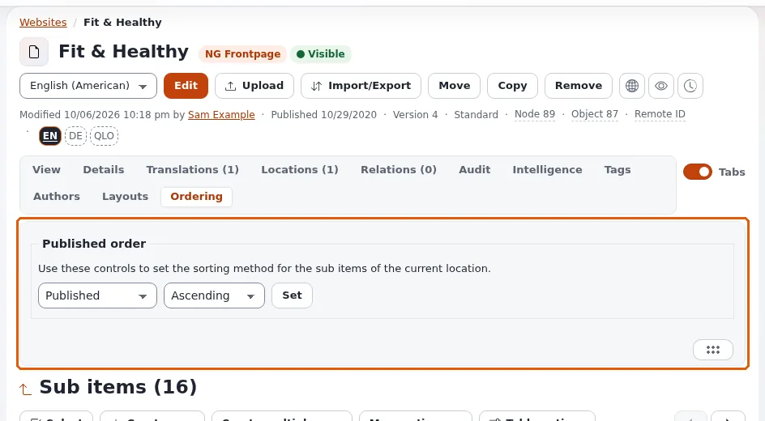

# Lektion 3.2: Unterelemente sortieren

Die Reihenfolge der Elemente in einem Ordner ist oft die Reihenfolge eines Menüs oder einer Liste auf der Website.
Diese Lektion zeigt, wo die Sortierung eines Ordners festgelegt wird und wie man Elemente von Hand anordnet.

## Auf einen Blick

| | |
|---|---|
| Kurs | [Redakteure 201](../README.md) |
| Modul | [Modul 3: Inhalte organisieren](README.md) |
| Dauer | 30 Minuten (10 Präsentation, 20 Übung) |
| Niveau | Fortgeschrittene |
| Zielgruppe | Redakteure, die sich um Menüs und Listen kümmern |
| Voraussetzungen | [Lektion 3.1](verschieben-und-kopieren.md) |

## Lernziele

Nach dieser Lektion können die Teilnehmenden:

- die Sortierung eines Ordners im Tab **Sortierung** mit **Sortieren nach**, **Sortierreihenfolge** und **Setzen**
  festlegen;
- erklären, dass die Sortierung für die Unterelemente des Ordners auf der Website und in der Administration gilt;
- Elemente mit Prioritäten von Hand anordnen: den Griff ziehen oder die Tastatur verwenden;
- sagen, was sie dürfen müssen, um die Sortierung zu ändern.

## Hinweise für Trainer

### So präsentieren Sie es

Quellen: [Viele Elemente auf einmal](../../../inhalte-bearbeiten.md#viele-objekte-auf-einmal) und
[Tastenkürzel](../../../tastenkuerzel.md#listen-von-unterelementen).

1. **Der Tab Sortierung** (4 Minuten). Auf der Seite eines Ordners sagt der Tab **Sortierung** *Sortiermethode für die
   Unterelemente hier einzustellen.* **Sortieren nach**: **Priorität**, **Veröffentlicht**, **Geändert**, **Name**,
   **Sektion**, **Tiefe**, **Klassen-Identifikator**, **Klassenname**, **Pfad-String**; **Sortierreihenfolge**:
   **Aufsteigend** oder **Absteigend**; dann **Setzen**. Ohne die Berechtigung, das Element zu bearbeiten, sagt der Tab
   das.
2. **Prioritäten** (4 Minuten). Wenn ein Ordner nach **Priorität** sortiert ist, zeigt die Liste **Unterelemente** am
   Anfang jeder Zeile einen Griff. Ziehen Sie eine Zeile an eine neue Stelle, oder verwenden Sie die Tastatur:
   Fokussieren Sie den Griff, `Space` oder `Enter` hebt die Zeile an, `↑` und `↓` bewegen sie, `Space` oder `Enter`
   legt sie ab; `Alt+↑` und `Alt+↓` bewegen eine Zeile sofort um eine Stelle. Die neue Reihenfolge wird gespeichert.
3. **Die Website** (2 Minuten). Die meisten Designs listen Unterelemente in der Sortierung des Ordners auf, sodass sich
   Menüs und Listen sofort ändern.

### Häufige Fragen

**Welche Sortierung sollte ein Nachrichtenordner verwenden?** Meist **Veröffentlicht**, **Absteigend**: das Neueste
zuerst, niemand muss von Hand sortieren.

**Warum fehlt der Griff?** Die Liste ist nicht nach Priorität sortiert. Setzen Sie **Sortieren nach** zuerst auf
**Priorität**.

**Ändert ein Klick auf eine Spaltenüberschrift der Liste Unterelemente die Reihenfolge auf der Website?** Nein. Das
sortiert Ihre Ansicht der Liste; der Tab **Sortierung** legt die Reihenfolge des Ordners fest.

### Stolperfallen

- **Versehentlich die Reihenfolge eines Live-Menüs ändern.** Verwenden Sie im Kurs nur die eigenen Ordner der
  Teilnehmenden.
- **Die beiden Sortierungen verwechseln.** Ein Klick auf eine Spalte ist für Sie; der Tab Sortierung ist für die
  Website.
- **Anheben mit der Tastatur.** `Esc` legt eine angehobene Zeile zurück; vermitteln Sie das.

## Praktische Übung

Verwenden Sie die Schulungsinstallation und Ihren Kursordner (mit mindestens vier Unterelementen).

1. Öffnen Sie Ihren Kursordner und seinen Tab **Sortierung**. Notieren Sie das aktuelle **Sortieren nach** und die
   **Sortierreihenfolge**.
2. Wählen Sie **Sortieren nach**: **Name**, **Sortierreihenfolge**: **Aufsteigend** und klicken Sie auf **Setzen**.
3. Sehen Sie sich die Liste **Unterelemente** und den Ordner auf der Website an (**Auf der Website ansehen**): Die
   Elemente stehen in alphabetischer Reihenfolge, wo das Design sie auflistet.
4. Wählen Sie **Sortieren nach**: **Priorität** und klicken Sie auf **Setzen**.
5. Ziehen Sie in der Liste **Unterelemente** die letzte Zeile an ihrem Griff nach oben.
6. Fokussieren Sie mit `Tab` den Griff der zweiten Zeile, drücken Sie `Space`, bewegen Sie sie mit zweimal `↓` nach
   unten und drücken Sie `Space`.
7. Drücken Sie `Alt+↑` auf einem Griff, um eine Zeile um eine Stelle nach oben zu bewegen.
8. Prüfen Sie die Reihenfolge erneut auf der Website.
9. Klicken Sie auf die Spaltenüberschrift **Name** der Liste: Die Liste wird nur für Sie sortiert. Laden Sie die Seite
   neu: Die Reihenfolge nach Priorität ist zurück.

## Erwartetes Ergebnis

- Der Ordner ist nach **Priorität** sortiert, in der Reihenfolge, die die Person angeordnet hat.
- Die Website listet die Elemente in derselben Reihenfolge auf (in Designs, die Unterelemente auflisten).
- Schritt 9 hat gezeigt, dass ein Klick auf eine Spalte die Sortierung des Ordners nicht ändert.
- Der Trainer prüft das, indem er eine Person bittet, am Beamer eine Zeile nur mit der Tastatur zu bewegen.

## Quiz

1. Wo legen Sie die Reihenfolge fest, in der die Unterelemente eines Ordners auf der Website erscheinen?
2. Welche Sortierung muss ein Ordner haben, bevor Sie Zeilen ziehen können?
   A. Name B. Veröffentlicht C. Priorität D. Geändert
3. Mit welchen Tasten heben Sie eine Zeile an ihrem Griff an und legen sie ab?
4. Richtig oder falsch: Ein Klick auf eine Spaltenüberschrift der Liste Unterelemente ändert die Reihenfolge auf der
   Website.
5. Schlagen Sie eine Sortierung für einen Nachrichtenordner vor und begründen Sie sie.

Antworten

1. Im Tab **Sortierung** des Ordners, mit **Sortieren nach**, **Sortierreihenfolge** und **Setzen**.
2. **C.**
3. `Space` oder `Enter` ([Tastenkürzel](../../../tastenkuerzel.md#listen-von-unterelementen)).
4. **Falsch.** Er sortiert die Liste nur für Sie.
5. **Veröffentlicht**, **Absteigend**: das neueste Element zuerst, ohne Handarbeit.

## Weiterführende Informationen

- [Tastenkürzel](../../../tastenkuerzel.md#listen-von-unterelementen): Zeilen mit der Tastatur bewegen.
- [Inhalte erstellen und bearbeiten](../../../inhalte-bearbeiten.md#viele-objekte-auf-einmal): die Liste Unterelemente.

## Verwandte Seiten

- [Modul 3: Inhalte organisieren](README.md)
- [Redakteure 201: Kursüberblick](../README.md)
- [Trainer: hier beginnen](../../../../../eng-us/help/trainers/trainers-start-here.md)
- [Freie Dokumentation](../../../freie-dokumentation.md): Diese Seite darf unter der GNU FDL 1.3 frei kopiert, übersetzt und verbessert werden.

<!-- exp-partner-block:start -->
**Werden Sie Exponential-Partner.** Partner teilen ihre Informationen, stellen Mittel bereit, geben Beiträge zurück
und entwickeln die Produkte mit uns, und so wächst Exponential. Eine Partner-Website und ein Dashboard sind für Mitte
2027 geplant: Werden Sie noch heute Partner, damit wir schneller wachsen und neue Funktionen früher liefern. Beginnen
Sie mit [Partner: hier beginnen](../../../partner/partner-hier-beginnen.md) und
[Wie Sie sich bewerben](../../../partner/wie-sie-sich-bewerben.md).
<!-- exp-partner-block:end -->
