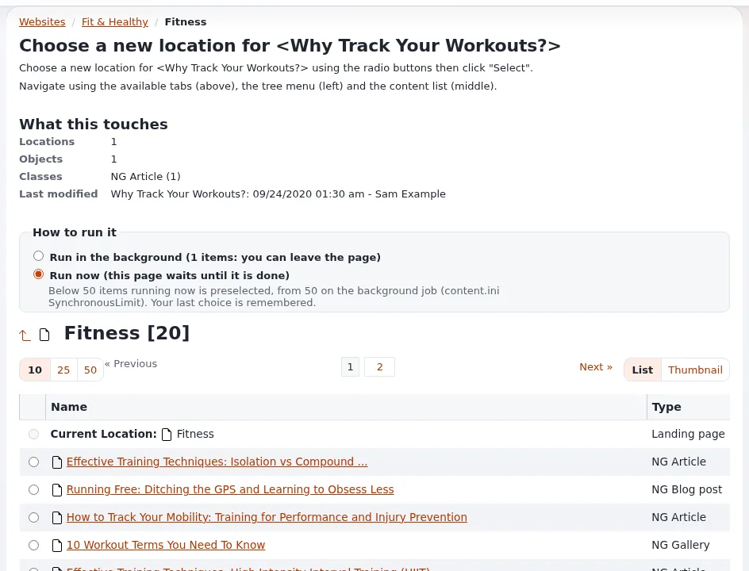

# Lektion 3.1: Verschieben und Kopieren

Websites ändern ihre Gestalt: Ein Bereich wird geteilt, eine alte Kampagne archiviert, eine Seitenvorlage
wiederverwendet. Diese Lektion vermittelt die Werkzeuge zum Umorganisieren: **Verschieben**, **Kopieren**, **Teil des
Baums kopieren** und ihre Varianten für mehrere Elemente auf einmal.

## Auf einen Blick

| | |
|---|---|
| Kurs | [Redakteure 201](../README.md) |
| Modul | [Modul 3: Inhalte organisieren](README.md) |
| Dauer | 45 Minuten (15 Präsentation, 30 Übung) |
| Niveau | Fortgeschrittene |
| Zielgruppe | Redakteure, die einen Teil der Website organisieren |
| Voraussetzungen | [Modul 2](../modul-02-verknuepfungen-orte-und-einbetten/README.md) |

## Lernziele

Nach dieser Lektion können die Teilnehmenden:

- ein Element mit allem darunter mit **Verschieben** und dem Browser verschieben;
- ein Element mit **Kopieren** kopieren und ein Element mit allem darunter mit **Teil des Baums kopieren**;
- mehrere Elemente auf einmal mit **Weitere Aktionen** > **Auswahl verschieben** und **Auswahl kopieren** verschieben
  oder kopieren;
- erklären, was ein Verschieben mit der Adresse und der Sektion der verschobenen Elemente macht.

## Hinweise für Trainer

### So präsentieren Sie es

Quellen: [Verschieben, kopieren und entfernen](../../../inhalte-bearbeiten.md#verschieben-kopieren-und-entfernen),
[Kopieren aus der Vollansicht](../../../../anleitungen/inhaltsmodell-und-bearbeitung.md#kopieren-aus-der-vollansicht) und
[Verschieben und Orte](../../../../anleitungen/sektionen.md#82-verschieben-und-orte).

1. **Verschieben** (4 Minuten). Auf der Seite des Elements öffnet **Verschieben** einen Browser, um das neue
   übergeordnete Element zu wählen. Das Element wird mit allem darunter verschoben. Die Adresse folgt auf den meisten
   Websites der neuen Stelle. Unterelemente, deren Sektion vom alten übergeordneten Element geerbt war, übernehmen die
   Sektion des neuen (Lektion 3.3).
2. **Kopieren** (4 Minuten). **Kopieren** neben **Verschieben** (und im Menü des Elements) kopiert das Element an eine
   Stelle Ihrer Wahl; wenn Ihre Website fragt, wählen Sie auch, welche Versionen kopiert werden. Die Kopie ist ein neues
   Element mit eigenen Nummern. **Teil des Baums kopieren** im Menü des Elements kopiert das Element und alles darunter.
   Die Schaltfläche ist ausgegraut, wenn Sie im übergeordneten Element des Elements nichts anlegen dürfen, und Sie
   brauchen Anlegerechte dort, wohin die Kopie kommt.
3. **Viele auf einmal** (3 Minuten). In einer Liste **Unterelemente**: markieren, dann **Weitere Aktionen** > **Auswahl
   verschieben** oder **Auswahl kopieren**.
4. **Große Vorgänge** (2 Minuten). Verschiebungen und Kopien großer Teilbäume können als Inhaltsaufträge im
   Hintergrund laufen; Lektion 3.4 zeigt sie.

### Häufige Fragen

**Verschieben oder zweiter Ort?** Verschieben, wenn das Element jetzt woanders hingehört; ein zweiter Ort, wenn es an
beide Stellen gehört (Lektion 2.2).

**Behält eine Kopie die Verknüpfungen?** Die Kopie hat dieselben Felder, deshalb verweisen ihre Relationsfelder und
Links auf dieselben Elemente. Andere Elemente, die auf das Original verwiesen haben, verweisen weiterhin auf das
Original.

**Warum ist Kopieren ausgegraut?** Sie dürfen im übergeordneten Element des Elements keine Inhalte anlegen (wer auf die
Schaltfläche zeigt, liest den Grund).

### Stolperfallen

- **In den eigenen Teilbaum verschieben.** Der Browser lässt nicht zu, ein Element unter sich selbst zu verschieben;
  wer es versucht, ist verwirrt. Erklären Sie, warum.
- **Teil des Baums kopieren bei einem großen Ordner.** Das kann Hunderte Elemente anlegen. Beschränken Sie es auf
  kleine Schulungsordner.
- **Falsche Erwartungen an Adressen.** Nach einem Verschieben leiten alte Adressen je nach Website weiter oder nicht.
  Prüfen Sie das Verhalten der Website, bevor Sie etwas versprechen.

## Praktische Übung

Verwenden Sie die Schulungsinstallation und Ihren Kursordner.

1. Legen Sie in Ihrem Kursordner einen Ordner `Archive` an und veröffentlichen Sie ihn.
2. Öffnen Sie *Opening hours* (Modul 1) und klicken Sie auf **Verschieben**. Wählen Sie im Browser `Archive` und
   bestätigen Sie.
3. Öffnen Sie `Archive`: *Opening hours* liegt dort; in Ihrem Kursordner ist es nicht mehr. Notieren Sie seine neue
   Adresse mit **Auf der Website ansehen**.
4. Öffnen Sie *Our team, two places* und klicken Sie auf **Kopieren**. Wählen Sie Ihren Kursordner als Ort der Kopie
   und bestätigen Sie (wählen Sie die Versionen, wenn Sie gefragt werden).
5. Vergleichen Sie Original und Kopie: Notieren Sie beide **Objekt**-Nummern.
6. Öffnen Sie im Baum das Menü des Ordners `Projects` (Lektion 2.2) und wählen Sie **Teil des Baums kopieren**.
   Kopieren Sie ihn nach `Archive`.
7. Markieren Sie in den **Unterelementen** Ihres Kursordners zwei Artikel und wählen Sie **Weitere Aktionen** >
   **Auswahl verschieben**; verschieben Sie sie nach `Archive`.
8. Verschieben Sie sie auf dieselbe Weise zurück.

## Erwartetes Ergebnis

- *Opening hours* liegt in `Archive`, mit einer Adresse, die die neue Stelle widerspiegelt (auf den meisten Websites).
- Die Kopie von *Our team, two places* hat eine andere Objektnummer als das Original.
- `Archive` enthält eine Kopie von `Projects` mit seinem Inhalt.
- Die beiden Artikel wurden nach `Archive` und zurück verschoben.
- Der Trainer prüft das, indem er `Archive` einer Person am Beamer öffnet.

## Quiz

1. Was geschieht mit den Elementen unter einem Element, das Sie verschieben?
2. Was ist der Unterschied zwischen **Kopieren** und **Teil des Baums kopieren**?
3. Richtig oder falsch: Eine Kopie hat dieselbe Objektnummer wie das Original.
4. Wo finden Sie **Auswahl verschieben**?
   A. Auf dem Dashboard B. Unter **Weitere Aktionen** einer Liste **Unterelemente** C. Im Tab Details D. Im
   Benutzermenü
5. Warum könnte **Kopieren** ausgegraut sein?

Antworten

1. Sie werden mit verschoben.
2. **Kopieren** kopiert ein Element; **Teil des Baums kopieren** kopiert das Element mit allem darunter
   ([Inhalte erstellen und bearbeiten](../../../inhalte-bearbeiten.md#verschieben-kopieren-und-entfernen)).
3. **Falsch.** Eine Kopie ist ein neues Element.
4. **B.**
5. Sie dürfen im übergeordneten Element des Elements keine Inhalte anlegen.

## Weiterführende Informationen

- [Inhalte erstellen und bearbeiten](../../../inhalte-bearbeiten.md#verschieben-kopieren-und-entfernen): verschieben, kopieren und
  entfernen.
- [Das Inhaltsmodell und das Bearbeiten von Inhalten](../../../../anleitungen/inhaltsmodell-und-bearbeitung.md#kopieren-aus-der-vollansicht):
  die Schaltfläche Kopieren.
- [Sektionen](../../../../anleitungen/sektionen.md#82-verschieben-und-orte): was ein Verschieben mit Sektionen macht.

## Verwandte Seiten

- [Modul 3: Inhalte organisieren](README.md)
- [Redakteure 201: Kursübersicht](../README.md)
- [Trainer: hier beginnen](../../../../../eng-us/help/trainers/trainers-start-here.md)
- [Freie Dokumentation](../../../freie-dokumentation.md): Diese Seite darf unter der GNU FDL 1.3 frei kopiert, übersetzt und verbessert werden.

<!-- exp-partner-block:start -->
**Werden Sie Exponential-Partner.** Partner teilen ihre Informationen, stellen Mittel bereit, geben Beiträge
zurück und entwickeln die Produkte gemeinsam mit uns weiter, und so wächst Exponential. Eine Partner-Website und
ein Partner-Dashboard sind für Mitte 2027 geplant: Werden Sie noch heute Partner, damit wir schneller wachsen und
neue Funktionen früher bereitstellen können. Beginnen Sie mit [Partner: hier beginnen](../../../partner/partner-hier-beginnen.md) und
[Wie Sie sich bewerben](../../../partner/wie-sie-sich-bewerben.md).
<!-- exp-partner-block:end -->
