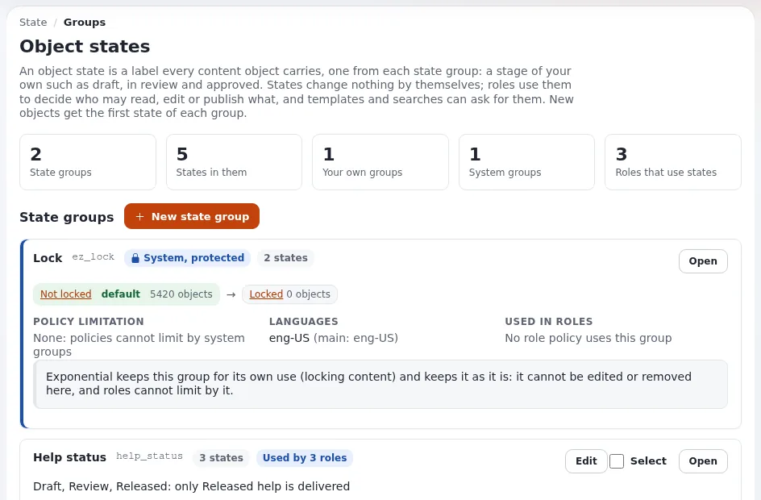

# Lektion 4.1: Was Objektzustände sind

Manche Websites geben Inhalten eigene Stufen: *Draft*, *In review*, *Approved* oder *Embargoed* und *Released*. In
Exponential sind das **Objektzustände**. Von sich aus ändern sie nichts; Rollen machen sie bedeutsam. Diese Lektion
erklärt Zustände und wie Redakteure sie lesen.

## Auf einen Blick

| | |
|---|---|
| Kurs | [Redakteure 201](../README.md) |
| Modul | [Modul 4: Objektzustände](README.md) |
| Dauer | 30 Minuten (15 Präsentation, 15 Übung) |
| Niveau | Fortgeschrittene |
| Zielgruppe | Redakteure auf Websites, die Objektzustände verwenden |
| Voraussetzungen | [Modul 3](../modul-03-inhalte-organisieren/README.md) |

## Lernziele

Nach dieser Lektion können die Teilnehmenden:

- erklären, was ein Objektzustand und eine Zustandsgruppe sind;
- Objektzustände von den Zuständen einer Version unterscheiden (Entwurf, ausstehend, veröffentlicht, archiviert);
- die Zustände eines Elements im Kasten **Zustand des Objekts** des Tabs **Details** lesen;
- erklären, dass Rollen den Zuständen ihre Bedeutung geben, und die mitgelieferte Gruppe nennen (Sperre).

## Hinweise für Trainer

### So präsentieren Sie es

Quelle: [Objektzustände](../../../../anleitungen/objektzustaende.md#kurz-gesagt).

1. **Zustände und Gruppen** (4 Minuten). Ein Objektzustand ist eine Kennzeichnung, die jedes Element trägt, eine aus
   jeder **Zustandsgruppe**. Exponential liefert eine Gruppe mit, die Sperrgruppe (*Not locked*, *Locked*). Websites
   fügen eigene hinzu, zum Beispiel eine Gruppe *review* mit *Draft*, *In review* und *Approved*.
2. **Keine Versionszustände** (3 Minuten). Eine Version ist ein Entwurf, ausstehend, veröffentlicht oder archiviert
   (Redakteure 101). Ein Objektzustand gehört zum Element als Ganzem und wird von Hand (oder von einem Workflow)
   gesetzt, unabhängig von den Versionen. Ein Artikel kann veröffentlicht sein und im Zustand *In review*.
3. **Der Standard** (2 Minuten). Der erste Zustand einer Gruppe ist ihr Standard: Jedes neue Element bekommt ihn.
4. **Rollen** (4 Minuten). Eine Richtlinie kann durch eine Zustandsgruppe eingeschränkt werden, zum Beispiel „Besucher
   dürfen nur Inhalte im Zustand *Approved* lesen“ oder „Autoren dürfen nur Inhalte im Zustand *Draft* bearbeiten“. So
   kann ein Zustand Inhalte vor Besuchern verbergen oder einem Redakteur die Bearbeitungsrechte entziehen. Zeigen Sie
   das Beispiel aus dem Leitfaden als Bild an der Tafel.
5. **Wo man ihn liest** (2 Minuten). Im Tab **Details**, Kasten **Zustand des Objekts**: eine Liste pro Gruppe
   (**Zustandsgruppe**, **Verfügbare Zustände**).

### Häufige Fragen

**Ist der Zustand *Draft* dasselbe wie eine Entwurfsversion?** Nein. Nur der Name ist auf Websites, die ihn wählen,
derselbe. Ein Element im Zustand *Draft* kann veröffentlicht sein.

**Warum kann ich einen Zustand nicht ändern?** Ihre Rolle darf ihn möglicherweise nicht setzen oder nicht auf diesen
Zustand. Eine Liste, die Sie nicht ändern dürfen, wird deaktiviert angezeigt.

**Warum hat meine Website keine Zustandsgruppen?** Zustände sind optional; viele Websites verwenden nur die
Sperrgruppe.

### Stolperfallen

- **Die beiden Arten von Entwurf verwechseln.** Schreiben Sie beide nebeneinander an die Tafel.
- **Erwarten, dass Zustände von selbst etwas bewirken.** Sie wirken nur über Rollen, Workflows und Templates.
- **Der Editor-Siteaccess.** Er bietet die Zustandsseiten nicht an; Zustände werden in der Administration gesetzt.

## Praktische Übung

Verwenden Sie die Schulungsinstallation (die Administration, nicht den Editor). Der Trainer hat vor dem Kurs eine
Zustandsgruppe angelegt (zum Beispiel *Review*).

1. Öffnen Sie Ihren Artikel *Our team, two places* und seinen Tab **Details**.
2. Suchen Sie den Kasten **Zustand des Objekts**. Notieren Sie jede **Zustandsgruppe** und den Zustand, in dem der
   Artikel ist.
3. Öffnen Sie die Liste einer Gruppe, ohne sie zu ändern, und notieren Sie ihre **Verfügbaren Zustände**.
4. Legen Sie in Ihrem Kursordner einen neuen Artikel an und veröffentlichen Sie ihn. Lesen Sie seine Zustände: Er hat
   den Standardzustand (den ersten) jeder Gruppe.
5. Vergleichen Sie mit einem Bild der Medienbibliothek: Welche Zustände hat es?
6. Notieren Sie in eigenen Worten, wofür die Gruppe des Trainers auf dieser Schulungs-Website gedacht ist (der Trainer
   erklärt, welche Rollen sie verwenden).

## Erwartetes Ergebnis

- Die Notizen listen die Sperrgruppe und die Gruppe des Trainers mit den aktuellen Zuständen des Artikels auf.
- Der neue Artikel hat den ersten Zustand jeder Gruppe.
- Die Teilnehmenden können sagen, welche Rolle nach der Gruppe des Trainers einschränkt und was das für Besucher oder
  Redakteure bedeutet.
- Der Trainer prüft das, indem er zwei Teilnehmende bittet, den Unterschied zwischen einer Entwurfsversion und dem
  Zustand *Draft* zu erklären.

## Quiz

1. Was ist eine Zustandsgruppe?
2. Richtig oder falsch: Ein Objektzustand ist Teil einer Version.
3. Welchen Zustand bekommt ein neues Element in einer Gruppe?
   A. Den letzten B. Keinen C. Den ersten, den Standard der Gruppe D. Den vom Besucher gewählten
4. Was gibt einem Zustand seine Wirkung auf der Website?
5. Wo lesen Sie die Zustände eines Elements?

Antworten

1. Eine Menge von Zuständen; jedes Element trägt einen Zustand aus jeder Gruppe
   ([Objektzustände](../../../../anleitungen/objektzustaende.md#kurz-gesagt)).
2. **Falsch.** Er gehört zum Element als Ganzem.
3. **C.**
4. Rollen (durch die Zustandsgruppe eingeschränkte Richtlinien) sowie Workflows und Templates, die danach fragen.
5. Im Tab **Details**, Kasten **Zustand des Objekts**.

## Weiterführende Informationen

- [Objektzustände](../../../../anleitungen/objektzustaende.md): der vollständige Leitfaden, mit einem durchgearbeiteten
  Prüfbeispiel.
- [Rollen und Richtlinien](../../../../anleitungen/rollen-und-richtlinien.md): Einschränkungen nach Zustand, für Administratoren.

## Verwandte Seiten

- [Modul 4: Objektzustände](README.md)
- [Redakteure 201: Kursüberblick](../README.md)
- [Trainer: hier beginnen](../../trainer-hier-beginnen.md)
- [Freie Dokumentation](../../../freie-dokumentation.md): Diese Seite darf unter der GNU FDL 1.3 frei kopiert, übersetzt und verbessert werden.

<!-- exp-partner-block:start -->
**Werden Sie Exponential-Partner.** Partner teilen ihre Informationen, stellen Mittel bereit, geben Beiträge zurück
und entwickeln die Produkte mit uns, und so wächst Exponential. Eine Partner-Website und ein Dashboard sind für Mitte
2027 geplant: Werden Sie noch heute Partner, damit wir schneller wachsen und neue Funktionen früher liefern. Beginnen
Sie mit [Partner: hier beginnen](../../../partner/partner-hier-beginnen.md) und
[Wie Sie sich bewerben](../../../partner/wie-sie-sich-bewerben.md).
<!-- exp-partner-block:end -->
