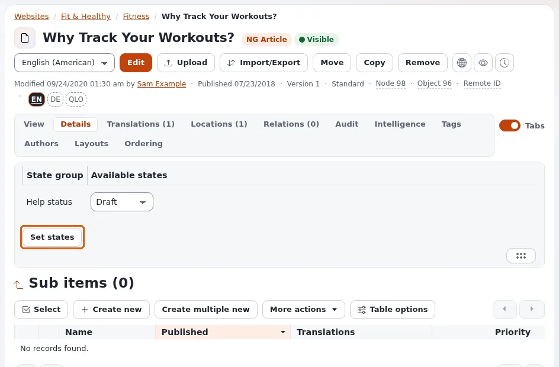

# Lektion 4.2: Zustände in einem Prüfablauf setzen

Zustände werden von Hand im Tab **Details** gesetzt, für ein Element oder einen ganzen Teilbaum. Auf einer Website,
die Zustände für Prüfungen verwendet, übergibt ein Autor einen Text, indem er einen Zustand setzt, und ein Prüfer gibt
ihn so frei. Diese Lektion übt beide Rollen.

## Auf einen Blick

| | |
|---|---|
| Kurs | [Redakteure 201](../README.md) |
| Modul | [Modul 4: Objektzustände](README.md) |
| Dauer | 45 Minuten (15 Präsentation, 30 Übung) |
| Niveau | Fortgeschrittene |
| Zielgruppe | Redakteure auf Websites, die Objektzustände verwenden |
| Voraussetzungen | [Lektion 4.1](was-objektzustaende-sind.md); die Prüfgruppe und die Rollen des Trainers |

## Lernziele

Nach dieser Lektion können die Teilnehmenden:

- den Zustand eines Elements mit dem Kasten **Zustand des Objekts** und **Zustände einstellen** setzen;
- einen Zustand mit **Auch für alles unterhalb dieses Knotens** für einen ganzen Teilbaum setzen;
- erklären, dass das Setzen eines Zustands keine neue Version erzeugt;
- einen Prüfablauf mit Zuständen aus Sicht des Autors und des Prüfers beschreiben.

## Hinweise für Trainer

### So präsentieren Sie es

Quellen: [Zustände für Inhalte setzen](../../../../anleitungen/objektzustaende.md#7-zustände-an-inhalten-setzen) und
[Ein durchgearbeitetes Beispiel: ein Prüf-Workflow](../../../../anleitungen/objektzustaende.md#9-ein-durchgearbeitetes-beispiel-ein-prüf-workflow).

1. **Ein Element** (3 Minuten). Tab **Details**, Kasten **Zustand des Objekts**: Wählen Sie den Zustand in der Liste
   der Gruppe und klicken Sie auf **Zustände einstellen**. Das Element wird sofort mit dem neuen Zustand gespeichert;
   es entsteht keine neue Version. Eine Gruppe, in der Sie nur den aktuellen Zustand setzen dürfen, zeigt eine
   deaktivierte Liste.
2. **Ein Teilbaum** (3 Minuten). Kreuzen Sie vor **Zustände einstellen** **Auch für alles unterhalb dieses Knotens**
   an: Der Zustand wird für das Element und alles darunter gesetzt, wobei Elemente übersprungen werden, denen Sie den
   Zustand nicht geben dürfen. Ein großer Teilbaum wird nach einer Bestätigung zu einem Inhaltsauftrag im Hintergrund
   (Lektion 3.4).
3. **Der Prüfablauf** (6 Minuten). Zeichnen Sie die Tabelle aus dem Beispiel des Leitfadens:

   | Wer | Tut | Zustand des Artikels |
   |---|---|---|
   | Autor | Legt den Artikel an und veröffentlicht ihn | Draft (der Standard); für Besucher unsichtbar |
   | Autor | Zustand des Objekts: In review, **Zustände einstellen** | In review; der Autor kann ihn nicht mehr bearbeiten |
   | Prüfer | Liest ihn, schickt ihn zurück | Draft; der Autor bearbeitet wieder |
   | Prüfer | Gibt frei | Approved; Besucher sehen ihn |

   Die Rollen Ihrer Schulungsinstallation entscheiden, was jede Person darf. Eine Freigabe mit Objektzuständen
   unterscheidet sich vom Freigabe-Workflow aus Modul 5: Hier ist der Inhalt veröffentlicht und nur durch den Zustand
   verborgen; dort wartet die Version unveröffentlicht.

### Häufige Fragen

**Welchen Ablauf sollte unsere Website verwenden, Zustände oder den Freigabe-Workflow?** Das entscheiden die
Administratoren der Website; beides ist dokumentiert. Zustände passen zu „veröffentlicht, aber noch nicht sichtbar“;
der Freigabe-Workflow passt zu „nicht veröffentlicht, bis es freigegeben ist“.

**Kann ich eine Zustandsänderung rückgängig machen?** Setzen Sie wieder den vorherigen Zustand; es gibt keine Version,
zu der man zurückkehren könnte.

**Warum hat die Änderung am Teilbaum einige Elemente übersprungen?** Sie dürfen ihnen den Zustand nicht geben.

### Stolperfallen

- **Rollen nicht vorbereitet.** Der Ablauf funktioniert nur mit den Rollen aus dem Beispiel des Leitfadens. Proben Sie
  mit zwei Konten.
- **Änderungen am Teilbaum bei gemeinsam genutzten Inhalten.** Verwenden Sie nur die Ordner der Teilnehmenden.
- **Eine Version erwarten.** Die Teilnehmenden suchen die Zustandsänderung unter **Versionen verwalten**; dort ist sie
  nicht.

## Praktische Übung

Verwenden Sie die Schulungsinstallation (die Administration). Arbeiten Sie zu zweit: Eine Person ist Autor, die
andere Prüfer; der Trainer hat den Prüferkonten eine Prüferrolle gegeben.

1. Autor: Legen Sie in Ihrem Kursordner einen Artikel `Review me` an und veröffentlichen Sie ihn.
2. Autor: Öffnen Sie ein privates Browserfenster und suchen Sie den Artikel auf der öffentlichen Website (er sollte
   verborgen sein, wenn die Rolle der Besucher nur freigegebene Inhalte liest).
3. Autor: Wählen Sie im Tab **Details** unter **Zustand des Objekts** den Zustand für die Prüfung (zum Beispiel
   *In review*) und klicken Sie auf **Zustände einstellen**.
4. Autor: Klicken Sie beim Artikel auf **Bearbeiten** und notieren Sie, ob Ihre Rolle es noch erlaubt.
5. Prüfer: Öffnen Sie `Review me` (der Autor sagt Ihnen, wo), lesen Sie ihn und setzen Sie den Zustand mit **Zustände
   einstellen** auf den ersten Zustand zurück, um ihn zurückzuschicken.
6. Autor: Bearbeiten und veröffentlichen Sie eine Korrektur und setzen Sie dann erneut den Prüfzustand.
7. Prüfer: Setzen Sie den freigegebenen Zustand.
8. Autor: Prüfen Sie die öffentliche Website erneut im privaten Fenster.
9. Beide: Kreuzen Sie im Tab **Details** Ihres Kursordners **Auch für alles unterhalb dieses Knotens** an, wählen Sie
   den ersten Zustand und klicken Sie auf **Zustände einstellen**. Lesen Sie die Bestätigung, falls eine erscheint.

## Erwartetes Ergebnis

- `Review me` hat die Zustände durchlaufen und ist erst auf der Website sichtbar, nachdem der freigegebene Zustand
  gesetzt wurde (auf einer Website, deren Besucherrolle nur freigegebene Inhalte liest).
- **Versionen verwalten** des Artikels zeigt nur die durch Bearbeiten entstandenen Versionen, nicht die
  Zustandsänderungen.
- Schritt 9 hat den Zustand für den ganzen Kursordner gesetzt.
- Der Trainer prüft das, indem er den Tab **Details** von `Review me` am Beamer öffnet.

## Quiz

1. Welche Schaltfläche setzt den im Kasten **Zustand des Objekts** gewählten Zustand?
2. Richtig oder falsch: Das Setzen eines Zustands erzeugt eine neue Version.
3. Wie setzen Sie einen Zustand für einen Ordner und alles darunter?
4. Warum kann der Autor im Prüfbeispiel den Artikel nicht mehr bearbeiten, nachdem er *In review* gesetzt hat?
5. Was ist der Unterschied zwischen einer Freigabe mit Objektzuständen und dem Freigabe-Workflow?

Antworten

1. **Zustände einstellen** ([Objektzustände](../../../../anleitungen/objektzustaende.md#71-ein-objekt-im-browser)).
2. **Falsch.**
3. Vor **Zustände einstellen** **Auch für alles unterhalb dieses Knotens** ankreuzen.
4. Die Bearbeitungsrichtlinie des Autors ist auf den Zustand *Draft* beschränkt.
5. Mit Zuständen ist die Version veröffentlicht und durch ihren Zustand verborgen; mit dem Freigabe-Workflow wartet die
   Version unveröffentlicht, bis sie freigegeben ist.

## Weiterführende Informationen

- [Objektzustände](../../../../anleitungen/objektzustaende.md#7-zustände-an-inhalten-setzen): Zustände setzen.
- [Objektzustände](../../../../anleitungen/objektzustaende.md#9-ein-durchgearbeitetes-beispiel-ein-prüf-workflow): das Prüfbeispiel mit den
  Rollen.
- [Workflows](../../../../anleitungen/workflows.md): der Freigabe-Workflow, zum Vergleich.

## Verwandte Seiten

- [Modul 4: Objektzustände](README.md)
- [Redakteure 201: Kursüberblick](../README.md)
- [Trainer: hier beginnen](../../../../../eng-us/help/trainers/trainers-start-here.md)
- [Freie Dokumentation](../../../freie-dokumentation.md): Diese Seite darf unter der GNU FDL 1.3 frei kopiert, übersetzt und verbessert werden.

<!-- exp-partner-block:start -->
**Werden Sie Exponential-Partner.** Partner teilen ihre Informationen, stellen Mittel bereit, geben Beiträge zurück
und entwickeln die Produkte mit uns, und so wächst Exponential. Eine Partner-Website und ein Dashboard sind für Mitte
2027 geplant: Werden Sie noch heute Partner, damit wir schneller wachsen und neue Funktionen früher liefern. Beginnen
Sie mit [Partner: hier beginnen](../../../partner/partner-hier-beginnen.md) und
[Wie Sie sich bewerben](../../../partner/wie-sie-sich-bewerben.md).
<!-- exp-partner-block:end -->
