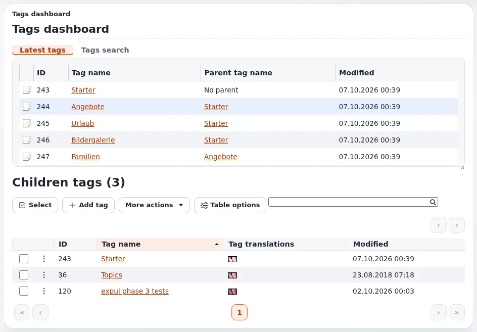

# Lektion 7.2: Das Tags-Dashboard und der Tag-Baum

Redakteure, denen die Taxonomie anvertraut ist, pflegen den Tag-Baum: Sie fügen Tags hinzu, beheben Duplikate und
übersetzen Tags. Diese Lektion zeigt das Dashboard **Tags** und die häufigste Pflege, für Teilnehmende, deren Rolle es
erlaubt.

## Auf einen Blick

| | |
|---|---|
| Kurs | [Redakteure 201](../README.md) |
| Modul | [Modul 7: Tags](README.md) |
| Dauer | 45 Minuten (15 Präsentation, 30 Übung) |
| Niveau | Fortgeschrittene |
| Zielgruppe | Redakteure, die Tags pflegen |
| Voraussetzungen | [Lektion 7.1](inhalte-taggen.md); eine Rolle mit den Tags-Richtlinien (read, add, edit) |

## Lernziele

Nach dieser Lektion können die Teilnehmenden:

- das **Tags dashboard** öffnen und seine Liste lesen (**ID**, **Tag name**, **Parent tag name**, **Modified**);
- einen Tag öffnen und seine Angaben, seine untergeordneten Tags und die damit getaggten Inhalte sehen;
- mit **Add tag** einen Tag und mit **Add child tag** einen untergeordneten Tag hinzufügen;
- Synonyme, das Zusammenführen und das Verschieben von Tags erklären und wissen, wann man einen Administrator fragt.

## Hinweise für Trainer

### So präsentieren Sie es

Quelle: [eztags](../../../../funktionen/6.0/erweiterungen/eztags.md).

1. **Das Dashboard** (4 Minuten). Der Reiter **Tags** (`/tags/dashboard`) öffnet das **Tags dashboard**: den Tag-Baum
   in der linken Spalte, eine Liste mit **ID**, **Tag name**, **Parent tag name** und **Modified**, **Children tags
   (n)** sowie **Add tag**, **More actions** und **Table options**.
2. **Ein Tag** (4 Minuten). Öffnen Sie einen Tag: **Tag ID**, **Last modified**, ob er ein **Main tag** oder ein
   **Synonym** ist, seine Übersetzungen, seine untergeordneten Tags und die damit getaggten Inhalte. **Add child tag**
   fügt darunter einen Tag hinzu.
3. **Pflege** (5 Minuten). Nennen Sie die Aktionen, ohne alle auszuführen: einen Tag bearbeiten und übersetzen
   (**Edit in <language>**), ein Synonym hinzufügen, einen Tag zum Synonym eines anderen machen, zwei Tags
   **zusammenführen** (ihre Inhalte bekommen einen Tag), Tags unter ein anderes übergeordnetes Element **verschieben**,
   löschen. Zusammenführen und Löschen ändern viele Elemente auf einmal; vereinbaren Sie im Team, wer das tut.
4. **Suchindex** (2 Minuten). Die Tag-Seite sagt möglicherweise, dass eine manuelle Neuerzeugung des Suchindex nötig
   ist, damit Änderungen in der Suche sichtbar werden; das ist eine Aufgabe für Administratoren, sofern die Website
   nicht automatisch neu indiziert.

### Häufige Fragen

**Wer darf Tags ändern?** Rollen mit den Richtlinien des Moduls `tags` (read, dashboard, add, edit, delete und mehr),
die sich auf Teile des Tag-Baums beschränken lassen.

**Zusammenführen oder Synonym?** Zusammenführen, wenn die beiden Tags dasselbe bedeuten und einer verschwinden soll;
ein Synonym, wenn beide Wörter weiter funktionieren sollen.

**Können Redakteure im Editor-Siteaccess das Dashboard verwenden?** Wo ihre Rolle es erlaubt; manche Websites behalten
den Tag-Baum Administratoren vor.

### Stolperfallen

- **Einen verwendeten Tag löschen.** Die Inhalte verlieren den Tag. Sehen Sie sich zuerst die damit getaggten Inhalte
  an.
- **Fehlende Übersetzungen.** Ein in einer Sprache angelegter neuer Tag wird auf der Website einer anderen Sprache
  möglicherweise nicht angezeigt.
- **Keine Berechtigung.** Ohne die Tags-Richtlinien wird das Dashboard nicht angezeigt (stattdessen eine
  Zugriffsmeldung). Führen Sie es vor.

## Praktische Übung

Verwenden Sie die Schulungsinstallation mit einer Rolle, die Tags lesen und hinzufügen darf.

1. Öffnen Sie den Reiter **Tags**. Lesen Sie die Liste des **Tags dashboard** und notieren Sie drei Tags mit ihren
   übergeordneten Tags.
2. Öffnen Sie im Tag-Baum links den Tag `Training` (der Trainer hat ihn angelegt).
3. Lesen Sie die Angaben des Tags: **Tag ID**, **Main tag** oder **Synonym** und seine Übersetzungen.
4. Suchen Sie die mit `Training` getaggten Inhalte: Ihr Artikel aus Lektion 7.1 ist dabei.
5. Klicken Sie auf **Add child tag**. Nennen Sie ihn `<Ihr Vorname> workshop` und speichern Sie.
6. Bearbeiten Sie Ihren Artikel und fügen Sie ihm den neuen untergeordneten Tag hinzu; veröffentlichen Sie.
7. Öffnen Sie den neuen Tag und prüfen Sie, dass Ihr Artikel aufgeführt ist.
8. Der Trainer führt am Beamer vor: das Zusammenführen zweier doppelter Tags (vor dem Kurs vorbereitet) und das
   Hinzufügen eines Synonyms.

## Erwartetes Ergebnis

- Alle Teilnehmenden haben unter `Training` einen untergeordneten Tag angelegt und einen Artikel damit getaggt.
- Die Seite des neuen Tags listet den Artikel auf.
- Die Teilnehmenden haben gesehen, wie eine Zusammenführung und ein Synonym entstehen.
- Der Trainer prüft das, indem er `Training` im Tag-Baum öffnet: ein untergeordneter Tag pro Person.

## Quiz

1. Wo ist das **Tags dashboard**?
2. Welche Schaltfläche fügt unter dem gerade angezeigten Tag einen Tag hinzu?
   A. **Add tag** B. **Add child tag** C. **Neue Übersetzung** D. **Als Haupt setzen**
3. Was ist der Unterschied zwischen dem Zusammenführen zweier Tags und dem Synonym-Machen eines Tags?
4. Warum sehen Sie sich die Inhalte eines Tags an, bevor Sie ihn löschen?
5. Welche Richtlinien braucht ein Redakteur, um Tags hinzuzufügen?

Antworten

1. Unter dem Reiter **Tags** (`/tags/dashboard`) ([eztags](../../../../funktionen/6.0/erweiterungen/eztags.md#verwenden)).
2. **B.**
3. Das Zusammenführen macht aus zwei Tags einen (die Inhalte bekommen den verbleibenden Tag); ein Synonym lässt beide
   Wörter zu einem Haupt-Tag führen.
4. Die Inhalte verlieren den Tag, wenn er gelöscht wird.
5. Richtlinien des Moduls `tags`, mindestens read und add (und edit, um Tags zu ändern).

## Weiterführende Informationen

- [eztags](../../../../funktionen/6.0/erweiterungen/eztags.md): die Erweiterung, ihre Richtlinien und Einstellungen.
- [Rollen und Richtlinien](../../../../anleitungen/rollen-und-richtlinien.md): Redakteuren die Tags-Richtlinien geben.

## Verwandte Seiten

- [Modul 7: Tags](README.md)
- [Redakteure 201: Kursüberblick](../README.md)
- [Trainer: hier beginnen](../../trainer-hier-beginnen.md)
- [Freie Dokumentation](../../../freie-dokumentation.md): Diese Seite darf unter der GNU FDL 1.3 frei kopiert, übersetzt und verbessert werden.

<!-- exp-partner-block:start -->
**Werden Sie Exponential-Partner.** Partner teilen ihre Informationen, stellen Mittel bereit, geben Beiträge zurück
und entwickeln die Produkte mit uns, und so wächst Exponential. Eine Partner-Website und ein Dashboard sind für Mitte
2027 geplant: Werden Sie noch heute Partner, damit wir schneller wachsen und neue Funktionen früher liefern. Beginnen
Sie mit [Partner: hier beginnen](../../../partner/partner-hier-beginnen.md) und
[Wie Sie sich bewerben](../../../partner/wie-sie-sich-bewerben.md).
<!-- exp-partner-block:end -->
