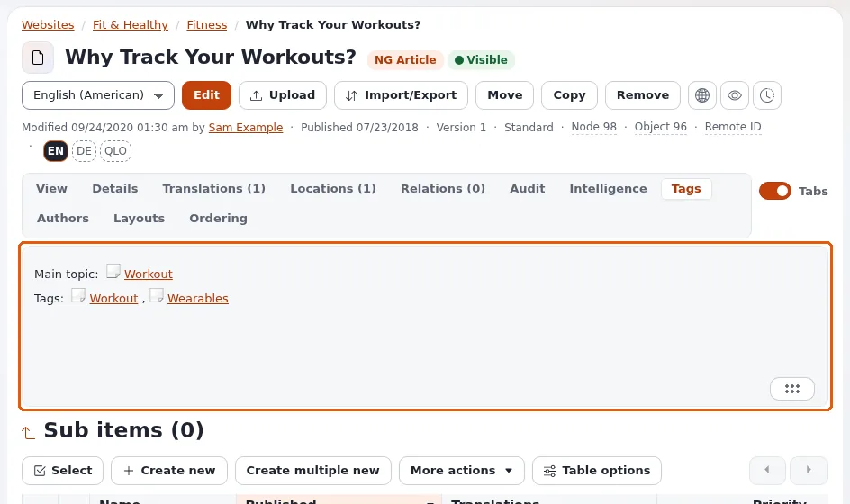

# Lektion 7.1: Inhalte taggen

Tags ordnen Inhalte über den Baum hinweg ein: Ein Artikel in *News* und eine Seite in *Projects* können beide mit
*Climate* getaggt sein, und eine Tag-Seite listet alles mit diesem Tag auf. Die Erweiterung **Tags** von Exponential
(eztags) hält die Tags in einem eigenen Baum. Diese Lektion bringt Redakteuren bei, gut zu taggen.

## Auf einen Blick

| | |
|---|---|
| Kurs | [Redakteure 201](../README.md) |
| Modul | [Modul 7: Tags](README.md) |
| Dauer | 45 Minuten (15 Präsentation, 30 Übung) |
| Niveau | Fortgeschrittene |
| Zielgruppe | Redakteure auf Websites, die Tags verwenden |
| Voraussetzungen | Redakteure 101, Modul 3; ein Inhaltstyp mit einem Tags-Feld auf der Schulungsinstallation |

## Lernziele

Nach dieser Lektion können die Teilnehmenden:

- erklären, was ein Tag ist und wie er sich von einem Ordner und von einer Sektion unterscheidet;
- im Bearbeitungsformular mit **Find a tag to add** und der Autovervollständigung Tags hinzufügen und einen mit
  **Remove tag** entfernen;
- **Suggested tags** und, wo das Feld es erlaubt, **Add new** verwenden;
- die Seite eines Tags öffnen und alles sehen, was mit ihm getaggt ist.

## Hinweise für Trainer

### So präsentieren Sie es

Quelle: [eztags](../../../../../eng-us/features/6.0/extensions/eztags.md).

1. **Was Tags sind** (4 Minuten). eztags fügt Inhaltstypen ein Tag-Feld hinzu und einen Baum von Tags, der unter
   **Tags** verwaltet wird. Tags können vordefiniert sein (eine geschlossene Liste) oder offen (Redakteure fügen neue
   hinzu), oder eine Mischung. Ein Tag kann Synonyme und Übersetzungen haben. Anders als ein Ordner platziert ein Tag
   das Element nicht; anders als eine Sektion ändert er keine Berechtigungen.
2. **Das Feld** (5 Minuten). Im Bearbeitungsformular zeigt ein Tags-Feld **Selected tags** (oder *There are no
   selected tags*), ein Suchfeld **Find a tag to add**, das beim Tippen vorhandene Tags vorschlägt, **Suggested tags**
   auf Grundlage des Inhalts (oder *There are no tags to suggest*) und, wo offene Tags erlaubt sind, **Add new**.
   **Remove tag** nimmt einen Tag wieder ab. Ein Feld kann je nach den Einstellungen des Inhaltstyps auch als
   Auswahlliste oder als Baum (**Choose a tag**) angezeigt werden.
3. **Tag-Seiten** (3 Minuten). Jeder Tag hat eine Seite (standardmäßig `/tags/view/<tag>`), die die damit getaggten
   Inhalte auflistet. Der Tab **Tags** auf der Seite eines Elements zeigt seine Tags in der Administration.
4. **Gut taggen** (3 Minuten). Bevorzugen Sie vorhandene Tags vor neuen; drei oder vier genaue Tags sind besser als
   zehn vage; vereinbaren Sie Singular oder Plural.

### Häufige Fragen

**Warum kann ich keinen neuen Tag hinzufügen?** Das Feld erlaubt nur vordefinierte Tags, oder Ihre Rolle darf keine
Tags hinzufügen.

**Was ist ein Synonym?** Ein anderes Wort für denselben Tag (zum Beispiel *Car* für *Automobile*). Mit einem Synonym
getaggte Inhalte werden unter dem Haupt-Tag gefunden.

**Funktionieren Tags in jeder Sprache?** Tags lassen sich übersetzen; ein Tag ohne Übersetzung in einer Sprache wird
dort je nach den Einstellungen der Website möglicherweise nicht angezeigt.

### Stolperfallen

- **Kein Tags-Feld auf der Schulungs-Website.** Der Standardartikel hat kein eztags-Feld; der Trainer fügt vor dem Kurs
  eines hinzu (siehe die Modulübersicht). Das Schlüsselwortfeld, das manche Typen haben (*Tags* des
  Schlüsselwort-Typs des Kernels), ist ein anderes, einfacheres Feld.
- **Doppelte Tags.** *climate*, *Climate* und *Climate change* in einem Kurs. Zeigen Sie zuerst den Tag-Baum.
- **Verzögerung in der Suche.** Tag-Änderungen brauchen möglicherweise, bis der Suchindex nachgezogen hat, bevor die
  Suche sie findet.

## Praktische Übung

Verwenden Sie die Schulungsinstallation; der Trainer hat dem Typ *Article* ein Tags-Feld und einige Tags hinzugefügt
(zum Beispiel *Training*, *Events*, *Climate*).

1. Öffnen Sie Ihren Artikel *Our team, two places* und klicken Sie auf **Bearbeiten**. Gehen Sie mit der Feldleiste
   zum Tags-Feld.
2. Geben Sie in **Find a tag to add** die ersten Buchstaben von `Training` ein. Wählen Sie den Tag aus den Vorschlägen.
3. Fügen Sie auf dieselbe Weise einen zweiten vorhandenen Tag hinzu.
4. Lesen Sie **Suggested tags** und fügen Sie einen Vorschlag hinzu, wenn er passt.
5. Wenn das Feld **Add new** anbietet, fügen Sie einen neuen Tag `<Ihr Vorname> test` hinzu.
6. Entfernen Sie einen Tag mit **Remove tag** und fügen Sie ihn dann wieder hinzu.
7. Klicken Sie auf **Zur Veröffentlichung schicken**.
8. Öffnen Sie den Tab **Tags** des Artikels und lesen Sie seine Tags.
9. Öffnen Sie die Tag-Seite von `Training` auf der Website (der Trainer nennt die Adresse, standardmäßig
   `/tags/view/Training`) und suchen Sie Ihren Artikel und die Artikel der anderen Teilnehmenden.

## Erwartetes Ergebnis

- Der Artikel trägt zwei oder drei Tags, sichtbar in seinem Tab **Tags**.
- Die Tag-Seite von `Training` listet den getaggten Artikel jeder Person auf.
- Wenn **Add new** angeboten wurde, existiert ein neuer Tag unter der Stelle, an die das Feld neue Tags setzt.
- Der Trainer prüft das, indem er die Tag-Seite am Beamer öffnet.

## Quiz

1. Wie unterscheidet sich ein Tag von einem Ordner?
2. Welcher Teil des Tags-Felds schlägt beim Tippen vorhandene Tags vor?
   A. **Selected tags** B. **Find a tag to add** C. **Remove tag** D. **Suggested tags**
3. Warum könnte **Add new** fehlen?
4. Wo sehen Sie alle Inhalte, die mit einem Tag versehen sind?
5. Nennen Sie eine Regel für gutes Taggen.

Antworten

1. Ein Tag ordnet Inhalte ein, ohne sie zu platzieren; ein Element kann viele Tags haben, ein Ordner dagegen ist eine
   Stelle im Baum.
2. **B.** ([eztags](../../../../../eng-us/features/6.0/extensions/eztags.md#use-it): Die Autovervollständigung schlägt vorhandene
   Tags vor).
3. Das Feld erlaubt nur vordefinierte Tags, oder die Rolle darf keine Tags hinzufügen.
4. Auf der Seite des Tags (standardmäßig `/tags/view/<tag>`).
5. Zum Beispiel: vorhandene Tags bevorzugen; wenige genaue Tags verwenden; Singular oder Plural vereinbaren.

## Weiterführende Informationen

- [eztags](../../../../../eng-us/features/6.0/extensions/eztags.md): was die Erweiterung leistet und ihre Einstellungen.

## Verwandte Seiten

- [Modul 7: Tags](README.md)
- [Redakteure 201: Kursüberblick](../README.md)
- [Trainer: hier beginnen](../../../../../eng-us/help/trainers/trainers-start-here.md)
- [Freie Dokumentation](../../../freie-dokumentation.md): Diese Seite darf unter der GNU FDL 1.3 frei kopiert, übersetzt und verbessert werden.

<!-- exp-partner-block:start -->
**Werden Sie Exponential-Partner.** Partner teilen ihre Informationen, stellen Mittel bereit, geben Beiträge zurück
und entwickeln die Produkte mit uns, und so wächst Exponential. Eine Partner-Website und ein Dashboard sind für Mitte
2027 geplant: Werden Sie noch heute Partner, damit wir schneller wachsen und neue Funktionen früher liefern. Beginnen
Sie mit [Partner: hier beginnen](../../../partner/partner-hier-beginnen.md) und
[Wie Sie sich bewerben](../../../partner/wie-sie-sich-bewerben.md).
<!-- exp-partner-block:end -->
