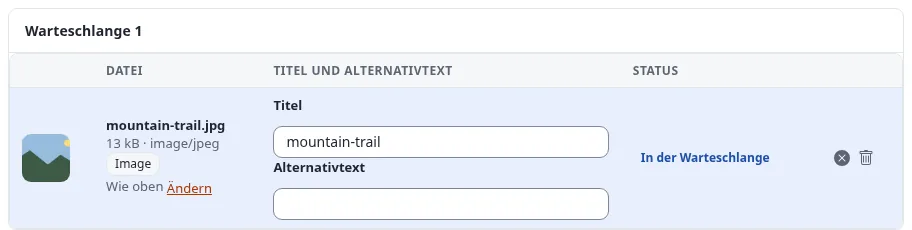

# Lektion 8.2: Barrierefreie Inhalte

Die Administration und das Design der Website können barrierefrei gebaut sein, aber ob eine Seite für jemanden
funktioniert, der einen Screenreader verwendet, hängt auch vom Redakteur ab: Alternativtexte, Überschriftenreihenfolge
und Linktexte schreiben Menschen, nicht die Software. Diese Lektion gibt Redakteuren die Gewohnheiten und eine
Checkliste.

## Auf einen Blick

| | |
|---|---|
| Kurs | [Redakteure 201](../README.md) |
| Modul | [Modul 8: Qualität und Barrierefreiheit](README.md) |
| Dauer | 60 Minuten (20 Präsentation, 40 Übung) |
| Niveau | Fortgeschrittene |
| Zielgruppe | Alle Redakteure |
| Voraussetzungen | Redakteure 101, Module 4 und 5 |

## Lernziele

Nach dieser Lektion können die Teilnehmenden:

- einen Alternativtext schreiben, der sagt, was ein Bild zeigt und warum es da ist, und ein dekoratives Bild erkennen;
- einen Text mit Überschriften in der richtigen Reihenfolge gliedern, ohne Ebenen zu überspringen;
- Linktexte schreiben, die für sich allein verständlich sind;
- einer Tabelle eine Beschriftung geben und sie nur für tabellarische Daten verwenden;
- einen Artikel anhand einer kurzen Checkliste zur Barrierefreiheit prüfen.

## Hinweise für Trainer

### So präsentieren Sie es

Quellen: [Standards für Barrierefreiheit](../../../../standards/barrierefreiheit.md) und
[Bilder, Medien und Uploads](../../../medien-und-uploads.md#bewährte-vorgehensweise).

1. **Warum Redakteure wichtig sind** (3 Minuten). Die Erklärung zur Barrierefreiheit des Projekts sagt es klar:
   Alternativtext, Überschriftenreihenfolge und Linktext in veröffentlichten Inhalten hängen von den Redakteuren ab;
   die Bildfelder bieten ein Feld für den Alternativtext, aber nichts zwingt Redakteure, es zu füllen, sofern die
   Website es nicht verlangt.
2. **Alternativtext** (5 Minuten). Sagen Sie in einem Satz, was das Bild zeigt und warum es da ist. Für ein dekoratives
   Bild (ein Muster, eine Trennlinie) ist ein leerer Alternativtext richtig, damit Screenreader es überspringen. Wo die
   Website Exponential Intelligence verwendet, bieten ihre Bildfelder **Write alt text** und **Decorative (empty alt
   text)** an; der Redakteur prüft den Vorschlag und entscheidet.
3. **Überschriften** (4 Minuten). Verwenden Sie die Liste der Absatzformate; eine Hauptüberschrift pro Seite (meist der
   Titel), dann Überschriften in der richtigen Reihenfolge, nie eine Ebene der Optik wegen übersprungen.
   Screenreader-Nutzer springen von Überschrift zu Überschrift.
4. **Links** (3 Minuten). „Die Öffnungszeiten lesen“, nicht „hier klicken“. Eine Liste von Links, die ohne
   Zusammenhang vorgelesen wird, muss verständlich sein.
5. **Tabellen und Sprache** (3 Minuten). Tabellen nur für tabellarische Daten, mit Beschriftung und Kopfzeile. Kurze
   Sätze, erklärte Abkürzungen.
6. **Die Checkliste** (2 Minuten). Teilen Sie sie aus (unten, in der Übung).

### Häufige Fragen

**Wie lang sollte ein Alternativtext sein?** So lang wie nötig, um das Wichtige zu sagen, meist ein Satz. Die
Bildunterschrift muss nicht wiederholt werden.

**Und Bilder von Text?** Vermeiden Sie sie; wenn sie verwendet werden müssen, enthält der Alternativtext den Text.

**Prüft die Website die Barrierefreiheit für uns?** Die Administration warnt bei manchen Dingen (zum Beispiel einem
erforderlichen Alternativtext); der größte Teil der Checkliste ist das Urteil des Redakteurs.

### Stolperfallen

- **„Bild von ...“** Screenreader sagen bereits, dass es ein Bild ist. Beginnen Sie mit dem, was es zeigt.
- **Fette Zeilen als Überschriften.** Zeigen Sie den Pfad in der Statusleiste des Editors: *paragraph » strong* ist
  keine Überschrift.
- **Farbe als einziges Signal.** „Die rot markierten Felder sind Pflicht“ erreicht nicht alle; sagen Sie es in Worten.

## Praktische Übung

Verwenden Sie die Schulungsinstallation und Ihren Artikel *Our team, two places*.

1. Öffnen Sie den Artikel auf der Website und lesen Sie ihn mit der folgenden Checkliste. Notieren Sie jedes Problem.

   | Prüfpunkt | Ja / Nein |
   |---|---|
   | Jedes informative Bild hat einen Alternativtext, der sagt, was es zeigt | |
   | Dekorative Bilder haben einen leeren Alternativtext | |
   | Überschriften sind echte Überschriften (Absatzformat), in der richtigen Reihenfolge, keine Ebene übersprungen | |
   | Jeder Linktext ist für sich allein verständlich | |
   | Tabellen haben eine Beschriftung und eine Kopfzeile und enthalten nur tabellarische Daten | |
   | Die Sätze sind kurz; Abkürzungen sind erklärt | |

2. Öffnen Sie den Artikel mit **Bearbeiten**. Korrigieren Sie die Überschriften mit der Liste der Absatzformate.
3. Schreiben Sie jeden Linktext um, der für sich allein nicht verständlich ist.
4. Öffnen Sie jedes eingebettete und verknüpfte Bildelement und verbessern Sie seinen **Alternativer Bildtext**;
   veröffentlichen Sie jedes.
5. Wenn Ihr Artikel eine Tabelle hat, fügen Sie eine Beschriftung hinzu.
6. Veröffentlichen Sie den Artikel.
7. Tauschen Sie mit Ihrem Nachbarn: Prüfen Sie seinen Artikel mit der Checkliste und nennen Sie ihm eine Verbesserung.
8. Wenn Ihre Website Exponential Intelligence verwendet, öffnen Sie ein Bild mit **Bearbeiten** und sehen Sie sich
   **Write alt text** und **Decorative (empty alt text)** an; schicken Sie nichts ab, außer der Trainer sagt es.

## Erwartetes Ergebnis

- Die Checkliste der Person hat nach den Korrekturen in jeder Zeile ein „Ja“.
- Die Prüfung durch den Nachbarn hat höchstens Kleinigkeiten gefunden.
- Der Trainer prüft das, indem er zwei Alternativtexte und zwei Linktexte vorliest und die Gruppe fragt, ob sie
  funktionieren, ohne die Seite zu sehen.

## Quiz

1. Schreiben Sie einen Alternativtext für ein Foto eines fünfköpfigen Teams an einem Whiteboard, das eine Website plant.
2. Wann ist ein leerer Alternativtext richtig?
3. Richtig oder falsch: Es ist in Ordnung, für eine kleinere Schrift von einer Überschrift der Ebene 2 zu einer der
   Ebene 4 zu springen.
4. Schreiben Sie den Linktext „hier klicken“ für einen Link zu den Öffnungszeiten um.
5. Welche drei Dinge in veröffentlichten Inhalten hängen laut der Erklärung zur Barrierefreiheit des Projekts von den
   Redakteuren ab?

Antworten

1. Zum Beispiel: „Fünf Kolleginnen und Kollegen skizzieren am Whiteboard die Seiten der neuen Website.“
2. Bei einem dekorativen Bild, das keine Information trägt.
3. **Falsch.** Überschriften stehen in der richtigen Reihenfolge; das Design, nicht die Überschriftenebene, legt die
   Größe fest.
4. Zum Beispiel: „Unsere Öffnungszeiten ansehen“.
5. Alternativtext, Überschriftenreihenfolge und Linktext
   ([Standards für Barrierefreiheit](../../../../standards/barrierefreiheit.md)).

## Weiterführende Informationen

- [Standards für Barrierefreiheit](../../../../standards/barrierefreiheit.md): was das Projekt einhält und die bekannten
  Lücken.
- [Bilder, Medien und Uploads](../../../medien-und-uploads.md#bewährte-vorgehensweise): Alternativtext und Titel.
- [Für Barrierefreiheit eintreten](../../../fuersprecher/fuer-barrierefreiheit-eintreten.md): über barrierefreies
  Veröffentlichen sprechen.

## Verwandte Seiten

- [Modul 8: Qualität und Barrierefreiheit](README.md)
- [Redakteure 201: Kursüberblick](../README.md)
- [Trainer: hier beginnen](../../trainer-hier-beginnen.md)
- [Freie Dokumentation](../../../freie-dokumentation.md): Diese Seite darf unter der GNU FDL 1.3 frei kopiert, übersetzt und verbessert werden.

<!-- exp-partner-block:start -->
**Werden Sie Exponential-Partner.** Partner teilen ihre Informationen, stellen Mittel bereit, geben Beiträge zurück
und entwickeln die Produkte mit uns, und so wächst Exponential. Eine Partner-Website und ein Dashboard sind für Mitte
2027 geplant: Werden Sie noch heute Partner, damit wir schneller wachsen und neue Funktionen früher liefern. Beginnen
Sie mit [Partner: hier beginnen](../../../partner/partner-hier-beginnen.md) und
[Wie Sie sich bewerben](../../../partner/wie-sie-sich-bewerben.md).
<!-- exp-partner-block:end -->
