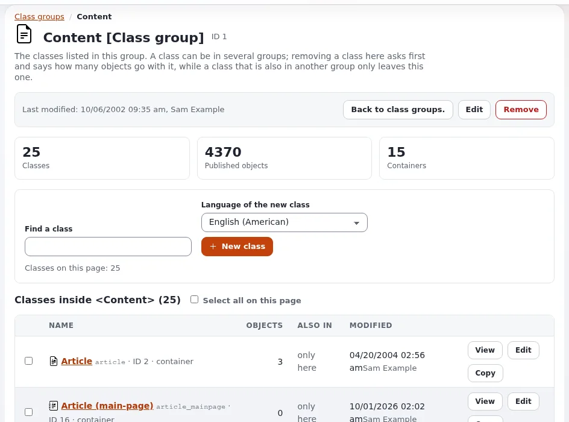

# Lektion 2.4: Durchsuchbare Attribute wählen

Die Suchmaschine indiziert nur Attribute, die in ihrer Klasse als **Durchsuchbar** markiert sind. Dieses eine
Kontrollkästchen entscheidet, ob ein Wort in einem Feld überhaupt jemals gefunden werden kann. Zu wenige durchsuchbare
Felder, und Besucher verpassen Inhalte; zu viele, und die Ergebnisse füllen sich mit Treffern in internen Codes. Diese
Lektion bringt den Teilnehmenden bei, die Markierung zu lesen und zu wählen.

> **Hinweis**
> Eine Änderung an einer Klasse betrifft jedes Objekt dieser Klasse. Nehmen Sie sie nur auf Ihrer eigenen
> Schulungsinstallation vor.

## Auf einen Blick

| | |
|---|---|
| Kurs | [Suche](../README.md) |
| Modul | [Modul 2: Indizierung](README.md) |
| Dauer | 30 Minuten (10 Präsentation, 20 Übung) |
| Niveau | Fortgeschrittene |
| Zielgruppe | Website-Administratoren und Entwickler, die Klassen pflegen |
| Voraussetzungen | [Lektion 2.3](den-suchindex-neu-aufbauen.md); ein Administratorkonto mit Zugang zu **Setup > Klassen** |

## Lernziele

Nach dieser Lektion können die Teilnehmenden:

- die Markierungen **Ist durchsuchbar** und **Ist nicht durchsuchbar** auf der Seite einer Klasse unter **Setup >
  Klassen** finden;
- erklären, dass manche Datentypen nicht durchsuchbar sein können und das Kontrollkästchen dann deaktiviert ist;
- begründet wählen, welche Attribute einer Klasse durchsuchbar sein sollten;
- ein Attribut durchsuchbar machen und den Index neu aufbauen, damit vorhandene Objekte darüber gefunden werden.

## Hinweise für Trainer

### So präsentieren Sie es

Quelle: [Website-Suche](../../../../../eng-us/help/creators/website-creators/site-search.md#settings-that-matter),
[Das Inhaltsmodell und das Bearbeiten von Inhalten](../../../../anleitungen/inhaltsmodell-und-bearbeitung.md#2-eine-klasse-anlegen) und
das Bearbeitungsformular für Klassen (admin4).

1. **Wo die Markierung ist** (3 Minuten). Öffnen Sie **Setup > Klassen**, eine Klassengruppe und die Klasse *Article*.
   Unter **Attribute** zeigt jedes Feld seine Markierungen, zum Beispiel *Ist erforderlich, Ist durchsuchbar, Sammelt
   keine Informationen*. Im Bearbeitungsformular heißt das Kontrollkästchen **Durchsuchbar**; sein Tooltip sagt, dass
   es festlegt, „ob der Inhalt des Attributs von der Suchmaschine indiziert werden soll“. Wenn der Datentyp keine
   Indizierung unterstützt, ist das Kontrollkästchen deaktiviert.
2. **Was man wählt** (4 Minuten). Der Leitfaden für Website-Ersteller nennt die Regel: Markieren Sie nützliche
   Attribute als durchsuchbar (Titel, Einleitungen, Haupttexte), keine internen Codes. Besprechen Sie Beispiele:
   Schlüsselwörter ja, die interne Nummer eines Produkts vielleicht (Mitarbeitende suchen danach), ein Freitextfeld
   „Notizen für Redakteure“ nein.
3. **Ändern** (3 Minuten). Die Markierung gilt für neue Indizierungen. Bereits indizierte Objekte behalten ihre alten
   Einträge, bis sie erneut veröffentlicht werden oder der Index neu aufgebaut wird (Lektion 2.3).

### Häufige Fragen

**Verbirgt ein nicht durchsuchbares Feld seinen Inhalt?** Nein. Es verhindert nur, dass die Wörter von der Suche
gefunden werden. Der Inhalt wird weiterhin überall angezeigt, wo Templates ihn zeigen.

**Warum ist das Kontrollkästchen bei einem Bildfeld ausgegraut?** Sein Datentyp unterstützt keine Suchindizierung; der
Tooltip nennt den Datentyp.

**Ändert das das Formular der Redakteure?** Nein. Redakteure sehen keinen Unterschied.

### Stolperfallen

- **Die Klasse ohne Neuaufbau bearbeiten.** Die Teilnehmenden ändern die Markierung und suchen sofort: Für vorhandene
  Objekte ändert sich nichts. Lassen Sie sie das sehen, und bauen Sie dann neu auf.
- **Eine Klasse in Bearbeitung lassen.** Eine nicht abgeschlossene Klassenbearbeitung bleibt als temporäre Version
  bestehen. Achten Sie darauf, dass die Teilnehmenden am Ende auf **OK** oder **Abbrechen** klicken, wie das Formular
  es anbietet.
- **Klassen auf einem gemeinsamen Schulungsserver ändern.** Alle Teilnehmenden teilen die Klasse. Machen Sie diese
  Übung nur mit einer Installation pro Person.

## Praktische Übung

Verwenden Sie Ihre eigene Schulungsinstallation, als Administrator angemeldet, und ein Terminal in ihrem
Wurzelverzeichnis.

1. Öffnen Sie **Setup > Klassen**, die Gruppe, die *Article* enthält, und klicken Sie auf *Article*.
2. Notieren Sie unter **Attribute**, welche Felder *Ist durchsuchbar* und welche *Ist nicht durchsuchbar* zeigen.
3. Legen Sie einen **Article** an und veröffentlichen Sie ihn, dessen **Short title** (oder ein anderes durchsuchbares
   Textfeld) das Wort `kumquat` enthält, der Titel aber nicht. Suchen Sie nach `kumquat`.
4. Klicken Sie auf der Seite der Klasse auf **Bearbeiten**. Suchen Sie dieses Feld und entfernen Sie das Häkchen bei
   **Durchsuchbar**. Speichern Sie die Klasse mit **OK**.
5. Suchen Sie erneut nach `kumquat`.
6. Bauen Sie den Index neu auf:

   ```bash
   php bin/php/updatesearchindex.php -s <siteaccess> --clean
   ```

7. Suchen Sie ein drittes Mal nach `kumquat`.
8. Bearbeiten Sie die Klasse erneut, setzen Sie das Häkchen bei **Durchsuchbar** für das Feld, klicken Sie auf **OK**
   und bauen Sie den Index noch einmal neu auf, damit die Klasse wieder wie ausgeliefert ist.

## Erwartetes Ergebnis

- Schritt 3 findet den Artikel.
- Schritt 5 findet ihn noch: Die alten Indexeinträge sind noch da.
- Schritt 7 findet nichts: Nach dem Neuaufbau ist das Feld nicht mehr indiziert.
- Nach Schritt 8 zeigt die Klasse für das Feld wieder *Ist durchsuchbar*, und `kumquat` wird wieder gefunden.
- Der Trainer prüft am Ende die Klassenseite von zwei Teilnehmenden.



## Quiz

1. Wo sehen Sie, ob ein Attribut durchsuchbar ist, ohne das Bearbeitungsformular zu öffnen?
2. Sie machen ein Attribut durchsuchbar. Wann werden vorhandene Objekte über seinen Inhalt gefunden?
   A. sofort B. nach einem Neuaufbau des Index oder einer neuen Veröffentlichung C. nach dem Leeren des Template-Caches
   D. nie
3. Warum ist das Kontrollkästchen **Durchsuchbar** bei manchen Attributen deaktiviert?
4. Nennen Sie zwei Attribute eines Artikels, die durchsuchbar sein sollten, und eine Art von Feld, die es meist nicht
   sein sollte.
5. Richtig oder falsch: Das Entfernen von **Durchsuchbar** verbirgt den Inhalt des Feldes vor Besuchern.

<details>
<summary>Antworten</summary>

1. Auf der Seite der Klasse unter **Setup > Klassen**, unter **Attribute** (*Ist durchsuchbar* oder *Ist nicht
   durchsuchbar*).
2. **B.** Die Markierung gilt, wenn ein Objekt erneut indiziert wird.
3. Der Datentyp unterstützt keine Suchindizierung.
4. Zum Beispiel der Titel und der Haupttext (oder die Einleitung); interne Codes oder Notizen für Redakteure meist nicht
   ([Website-Suche](../../../../../eng-us/help/creators/website-creators/site-search.md#settings-that-matter)).
5. **Falsch.** Es verhindert nur, dass die Wörter von der Suche gefunden werden.

</details>

## Weiterführende Informationen

- [Website-Suche](../../../../../eng-us/help/creators/website-creators/site-search.md): welche Attribute als durchsuchbar markiert werden
  sollten.
- [Das Inhaltsmodell und das Bearbeiten von Inhalten](../../../../anleitungen/inhaltsmodell-und-bearbeitung.md): Klassen und ihre
  Attribute.
- [Klassengruppen](../../../../anleitungen/klassengruppen.md): eine Klasse unter **Setup > Klassen** finden.

## Verwandte Seiten

- [Modul 2: Indizierung](README.md)
- [Suche: Kursübersicht](../README.md)
- [Trainer: hier beginnen](../../../../../eng-us/help/trainers/trainers-start-here.md)
- [Freie Dokumentation](../../../freie-dokumentation.md): Diese Seite darf unter der GNU FDL 1.3 frei kopiert, übersetzt und verbessert werden.

<!-- exp-partner-block:start -->
**Werden Sie Exponential-Partner.** Partner teilen ihre Informationen, stellen Mittel bereit, geben Beiträge
zurück und entwickeln die Produkte gemeinsam mit uns weiter, und so wächst Exponential. Eine Partner-Website und
ein Partner-Dashboard sind für Mitte 2027 geplant: Werden Sie noch heute Partner, damit wir schneller wachsen und
neue Funktionen früher bereitstellen können. Beginnen Sie mit [Partner: hier beginnen](../../../partner/partner-hier-beginnen.md) und
[Wie Sie sich bewerben](../../../partner/wie-sie-sich-bewerben.md).
<!-- exp-partner-block:end -->
