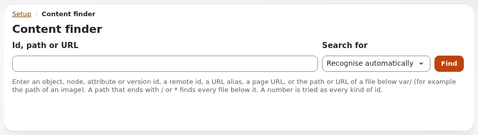

# Lektion 3.2: Der Inhaltsfinder

Support-Arbeit beginnt oft mit einer Nummer: einer Knoten-ID aus einer Adresse, einer Objekt-ID aus einem Log, dem Pfad
einer Bilddatei. Der Inhaltsfinder macht aus jeder davon das Objekt, mit seinen Versionen, Orten und
Papierkorbeinträgen. Er ist keine Wortsuche, und genau deshalb gehört er in einen Suchkurs: Die Teilnehmenden müssen
wissen, wann sie was verwenden.

> **Hinweis**
> Der Finder bietet auch **In den Papierkorb**, **Endgültig löschen**, **Aus dem Papierkorb löschen**,
> **Wiederherstellen** und **Version entfernen** an. In dieser Lektion wird nur geschaut; nichts wird entfernt.

## Auf einen Blick

| | |
|---|---|
| Kurs | [Suche](../README.md) |
| Modul | [Modul 3: Suchen in der Praxis](README.md) |
| Dauer | 30 Minuten (10 Präsentation, 20 Übung) |
| Niveau | Fortgeschrittene |
| Zielgruppe | Website-Administratoren und Support-Mitarbeitende |
| Voraussetzungen | [Lektion 3.1](die-admin-suche-und-erweiterte-suche.md); ein Administratorkonto |

## Lernziele

Nach dieser Lektion können die Teilnehmenden:

- **Setup > Inhaltsfinder** und das kleine Finder-Feld unter dem Inhaltsbaum öffnen;
- ein Objekt über Knoten-ID, Objekt-ID, URL-Alias, Seitenadresse und Bilddateipfad finden, mit **Suchen nach**
  *Automatisch erkennen* und mit einem festen Typ;
- ein Ergebnis lesen: **Gefunden über**, die Angaben zum Objekt, seine Versionen, seine Orte und einen etwaigen
  Papierkorbeintrag;
- die beiden Richtlinien `contentfinder/search` und `contentfinder/delete` nennen und sagen, wer sie bekommen sollte.

## Hinweise für Trainer

### So präsentieren Sie es

Quelle: [Der Inhaltsfinder](../../../../../eng-us/features/6.0/content-finder.md).

1. **Was er annimmt** (4 Minuten). Ein Feld, **ID, Pfad oder URL**, und **Suchen nach** mit *Automatisch erkennen*
   (Standard), *Objekt-ID*, *Knoten-ID*, *Attribut-ID*, *Versions-ID*, *Remote-ID*, *URL-Alias*, *Dateipfad*. Eine
   reine Zahl wird als Objekt-, Knoten-, Attribut- und Versions-ID versucht, und jeder Treffer wird angezeigt.
   Präfixe wie `node:43` oder `object:41` legen den Typ fest. Eine vollständige Seitenadresse, ein URL-Alias wie
   `News/Summer-party`, eine 32-stellige Remote-ID und ein Pfad unter `var/` funktionieren alle.
2. **Was er zeigt** (3 Minuten). **Gefunden über** sagt, was gepasst hat. Dann das Objekt (Klasse, Name, Eigentümer,
   Sektion, Sprachen, Zustände, Remote-ID, Daten), jede Version mit einem Link zur Versionsansicht, jeder Ort
   (Knoten-ID, Pfad, URL-Alias, Hauptort, verborgen) und, wenn es im Papierkorb liegt, wo es war, wann und von wem es
   in den Papierkorb gelegt wurde.
3. **Wer ihn verwenden darf** (3 Minuten). `contentfinder/search` zum Öffnen und Suchen; `contentfinder/delete` für
   die Aktionen. In einer neuen Installation hat nur die Rolle Administrator sie. Der Finder zeigt nie mehr, als der
   Benutzer anderswo sehen darf; wenn nichts sichtbar ist, antwortet er **Nichts gefunden, oder Sie haben keinen
   Zugriff auf das Gefundene.** Jede Suche und jede Aktion wird im Audit aufgezeichnet.

### Häufige Fragen

**Warum findet ein Wort hier nichts?** Der Finder durchsucht keinen Text. Ein Wort wird als Remote-ID und als URL-Alias
(und als Teil eines Alias) versucht; für Wörter verwenden Sie die Suche.

**Kann eine Support-Rolle ihn verwenden, ohne löschen zu dürfen?** Ja: Geben Sie nur `contentfinder/search`.

**Funktioniert er auf der öffentlichen Website?** Nein. Er antwortet nur in Administrations-Siteaccesses
(`contentfinder.ini [ContentFinderSettings] SiteAccessList[]`).

### Stolperfallen

- **Eine Aktion anklicken, „um zu sehen, was passiert“.** Jede Aktion führt über eine Bestätigungsseite, aber sagen Sie
  den Teilnehmenden, dass sie in dieser Lektion keine Aktionsschaltfläche drücken.
- **Eine Knoten-ID und eine Objekt-ID sind verschiedene Zahlen.** Eine reine Zahl kann beide treffen, als zwei
  Ergebnisse. Zeigen Sie jeweils die Zeile **Gefunden über**.

## Praktische Übung

Verwenden Sie Ihre eigene Schulungsinstallation, als Administrator angemeldet. Drücken Sie keine Aktionsschaltfläche.

1. Öffnen Sie einen Beispielartikel in der **Inhaltsstruktur**. Notieren Sie die Zahlen auf seinen Schaltflächen
   **Knoten** und **Objekt**.
2. Öffnen Sie **Setup > Inhaltsfinder**. Geben Sie die Knotennummer in **ID, Pfad oder URL** ein und klicken Sie auf
   **Finden**. Lesen Sie **Gefunden über**.
3. Geben Sie die Objektnummer ein und klicken Sie auf **Finden**. Vergleichen Sie die Ergebnisse mit Schritt 2.
4. Wählen Sie **Suchen nach** *Knoten-ID* und suchen Sie nach der Objektnummer. Was ändert sich?
5. Kopieren Sie die Adresse des Artikels von der öffentlichen Website (oder seinen URL-Alias-Pfad) und suchen Sie mit
   *Automatisch erkennen* danach.
6. Suchen Sie ein Bildobjekt in **Medien**, öffnen Sie sein Bild im Browser, kopieren Sie die Bildadresse und suchen
   Sie im Finder danach.
7. Entfernen Sie nichts. Öffnen Sie stattdessen den Papierkorb, wählen Sie ein Element, das schon dort liegt, und
   suchen Sie im Finder nach seiner Knotennummer. Lesen Sie den Papierkorbeintrag.
8. Notieren Sie, welche Rolle in Ihrer Organisation `contentfinder/search` haben sollte und welche
   `contentfinder/delete`.

## Erwartetes Ergebnis

- Die Schritte 2 und 3 finden dasselbe Objekt, wobei **Gefunden über** jeweils den Knoten und das Objekt nennt; eine
  reine Zahl kann auch ein Attribut oder eine Version mit derselben Nummer treffen.
- Schritt 4 findet den Knoten mit dieser Nummer, der meist ein anderes Objekt ist oder nichts.
- Die Schritte 5 und 6 finden den Artikel und das Bildobjekt.
- Schritt 7 zeigt, wo das Element war, wann und von wem es in den Papierkorb gelegt wurde.
- Der Trainer prüft Schritt 8 in einer kurzen Runde: Suchen für Support-Rollen, Löschen nur für Rollen, die auch
  Inhalte entfernen.

## Quiz

1. Was nimmt der Inhaltsfinder als Eingabe an? Nennen Sie vier Arten.
2. Richtig oder falsch: Der Inhaltsfinder durchsucht die Wörter im Haupttext eines Artikels.
3. Welche Richtlinie erlaubt einer Rolle, den Finder ohne seine Aktionen zu verwenden?
   A. `content/read` B. `contentfinder/search` C. `contentfinder/delete` D. `setup/system_info`
4. Was antwortet der Finder, wenn der Benutzer das Gefundene nicht sehen darf?
5. Wo wird jede Suche im Finder aufgezeichnet?

Antworten

1. Vier beliebige aus: Objekt-ID, Knoten-ID, Attribut-ID, Versions-ID, Remote-ID, URL-Alias, Seitenadresse, Dateipfad
   unter `var/` ([Der Inhaltsfinder](../../../../../eng-us/features/6.0/content-finder.md)).
2. **Falsch.** Er schlägt IDs, Aliase und Pfade nach, keinen Text.
3. **B.**
4. **Nichts gefunden, oder Sie haben keinen Zugriff auf das Gefundene.**, dasselbe wie bei einer ID, die es nicht gibt.
5. Im Audit-Protokoll, als `content.finder.search`.

## Weiterführende Informationen

- [Der Inhaltsfinder](../../../../../eng-us/features/6.0/content-finder.md): jede Eingabe, jedes Ergebnisfeld und jede Aktion.
- [Rollen, Richtlinien und nicht aktivierte Benutzer](../../../../anleitungen/rollen-und-richtlinien.md): einer Support-Rolle
  den Finder geben.
- [Audit-Protokoll](../../../../../eng-us/features/6.0/audit-trail.md): die Audit-Einträge des Finders lesen.

## Verwandte Seiten

- [Modul 3: Suchen in der Praxis](README.md)
- [Suche: Kursüberblick](../README.md)
- [Trainer: hier beginnen](../../../../../eng-us/help/trainers/trainers-start-here.md)
- [Freie Dokumentation](../../../freie-dokumentation.md): Diese Seite darf unter der GNU FDL 1.3 frei kopiert, übersetzt und verbessert werden.

<!-- exp-partner-block:start -->
**Werden Sie Exponential-Partner.** Partner teilen ihre Informationen, stellen Mittel bereit, geben Beiträge
zurück und entwickeln die Produkte gemeinsam mit uns weiter, und so wächst Exponential. Eine Partner-Website und
ein Partner-Dashboard sind für Mitte 2027 geplant: Werden Sie noch heute Partner, damit wir schneller wachsen und
neue Funktionen früher bereitstellen können. Beginnen Sie mit [Partner: hier beginnen](../../../partner/partner-hier-beginnen.md) und
[Wie Sie sich bewerben](../../../partner/wie-sie-sich-bewerben.md).
<!-- exp-partner-block:end -->
