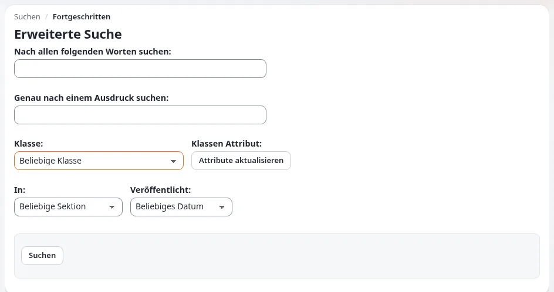

# Lektion 3.1: Die Admin-Suche und die erweiterte Suche

Administratoren und Support-Mitarbeitende durchsuchen die Administration viele Male am Tag, oft für Redakteure, die
etwas „nicht finden“. Diese Lektion macht sie schnell mit der Schnellsuche, ihrem Suchbereich und der erweiterten
Suche, damit sie dasselbe den Redakteuren beibringen und Support-Fragen genau beantworten können.

## Auf einen Blick

| | |
|---|---|
| Kurs | [Suche](../README.md) |
| Modul | [Modul 3: Suchen in der Praxis](README.md) |
| Dauer | 30 Minuten (10 Präsentation, 20 Übung) |
| Niveau | Fortgeschrittene |
| Zielgruppe | Website-Administratoren, Support-Mitarbeitende, leitende Redakteure |
| Voraussetzungen | [Modul 2](../modul-02-indizierung/README.md); ein Administratorkonto auf der Schulungsinstallation |

## Lernziele

Nach dieser Lektion können die Teilnehmenden:

- eine Suche mit dem Feld **Suchen...** oder der Taste `/` beginnen und sie mit **Suchbereich** eingrenzen (Sektion,
  aktueller Ort);
- die Ergebnisseite lesen (Überschrift mit der Anzahl der Treffer, **Name**, **Typ**, die Liste **In**) und
  **Ausgewählte bearbeiten** verwenden;
- eine erweiterte Suche mit **Genau nach einem Ausdruck suchen**, **Klasse** mit **Klassen Attribut** (nach
  **Attribute aktualisieren**), **In** und **Veröffentlicht** aufbauen;
- einem Redakteur erklären, warum ein bekanntes Element nicht gefunden wird.

## Hinweise für Trainer

### So präsentieren Sie es

Quelle: [Suchen](../../../suchen.md) und [Tastenkürzel](../../../tastenkuerzel.md). Die folgenden Namen sind
die des Designs admin4.

1. **Schnellsuche** (3 Minuten). Klicken Sie in der Kopfzeile auf **Suchen...** oder drücken Sie `/` (nicht während Sie
   in einem anderen Feld tippen). Die Trichter-Schaltfläche **Suchbereich** bietet **Sektion**, **Wo** (überall oder
   **Aktueller Ort**) und **Erweiterte Suche**. Die Überschrift der Ergebnisseite lautet zum Beispiel `Die Suche nach
   <Wort> ergab 6 Treffer`; die Liste **In** grenzt auf eine Sektion ein.
2. **Ausgewählte bearbeiten** (2 Minuten). Markieren Sie mehrere Ergebnisse und klicken Sie auf **Ausgewählte
   bearbeiten**, um sie in einem Formular zu bearbeiten. Nützlich für den Support: denselben Fehler in mehreren
   Elementen beheben.
3. **Erweiterte Suche** (5 Minuten). Zeigen Sie jedes Feld: **Nach allen folgenden Worten suchen**, **Genau nach einem
   Ausdruck suchen**, **Klasse** (*Beliebige Klasse* oder eine Klasse), **Klassen Attribut** (erst nach **Attribute
   aktualisieren**), **In** (*Beliebige Sektion* oder eine), **Veröffentlicht** (*Beliebiges Datum*, *Letzter Tag*,
   *Letzte Woche*, *Letzter Monat*, *Letzten drei Monate*, *Letztes Jahr*). Klicken Sie auf **Finden**.

### Häufige Fragen

**Warum bleibt die Liste der Klassenattribute leer?** Wählen Sie zuerst die Klasse und klicken Sie auf **Attribute
aktualisieren**; die Liste wird für diese Klasse gefüllt.

**Wie viele Ergebnisse bekomme ich pro Seite?** Die Suche begrenzt die Anzahl pro Anfrage (`MaximumSearchLimit`, bei
Auslieferung 30); verwenden Sie für mehr die Blätterlinks.

**Kann ich nach einem Wortteil suchen?** Nur wenn Platzhalter eingeschaltet sind (Modul 5); auf einer
Standardinstallation findet die Suche ganze Wörter.

**Ein Redakteur findet ein Element nicht, das ich sehe. Warum?** Seine Rolle erlaubt ihm vielleicht nicht, es zu
lesen; es kann ein Entwurf sein, im Papierkorb liegen oder verborgen sein. Die Hilfe für Redakteure nennt dieselben
Gründe.

### Stolperfallen

- **Der Suchbereich bleibt eingestellt.** Wer **Aktueller Ort** gewählt hat, bekommt an anderen Stellen weiterhin
  wenige Ergebnisse. Zeigen Sie, wie man **Wo** im **Suchbereich** wieder auf überall stellt.
- **Im erweiterten Formular nach der Wahl einer Klasse die Eingabetaste drücken.** Die Liste der Klassenattribute wird
  erst aktualisiert, wenn **Attribute aktualisieren** geklickt wird.

## Praktische Übung

Verwenden Sie Ihre eigene Schulungsinstallation, als Administrator angemeldet. Wählen Sie Wörter, die in Ihren
Beispielinhalten vorkommen.

1. Drücken Sie auf dem Dashboard `/`, geben Sie ein häufiges Wort aus den Beispielinhalten ein und drücken Sie die
   Eingabetaste. Notieren Sie die Anzahl der Treffer in der Überschrift.
2. Grenzen Sie die Suche mit der Liste **In** auf der Ergebnisseite auf die Sektion *Media* ein, dann auf *Standard*
   (oder die Sektionen, die Ihre Installation hat).
3. Öffnen Sie einen Ordner in der **Inhaltsstruktur**, wählen Sie dann **Suchbereich**, **Wo**: **Aktueller Ort**, und
   suchen Sie nach demselben Wort.
4. Markieren Sie zwei Ergebnisse und klicken Sie auf **Ausgewählte bearbeiten**. Sehen Sie sich das Formular an und
   verlassen Sie es, ohne zu speichern (mit der Abbrechen- oder Verwerfen-Schaltfläche des Formulars).
5. Öffnen Sie die **Erweiterte Suche**. Geben Sie in **Genau nach einem Ausdruck suchen** zwei Wörter ein, die in einem
   Artikeltitel nebeneinander stehen. Klicken Sie auf **Finden**.
6. Löschen Sie den Ausdruck. Wählen Sie **Klasse** *Article*, klicken Sie auf **Attribute aktualisieren**, wählen Sie
   **Klassen Attribut** *Title* und suchen Sie nach einem Wort aus einem Titel.
7. Fügen Sie **Veröffentlicht** *Letzte Woche* hinzu und suchen Sie erneut.
8. Notieren Sie für eine Suche, wie sich die Trefferzahl von Schritt 1 bis Schritt 7 verändert hat.

## Erwartetes Ergebnis

- Schritt 1 zeigt die Überschrift mit der Anzahl der Treffer und die Spalten **Name** und **Typ**.
- Die Schritte 2 und 3 zeigen weniger Ergebnisse als Schritt 1.
- Schritt 4 öffnet ein Bearbeitungsformular für beide Elemente; beim Verlassen wird nichts geändert.
- Schritt 5 findet nur Elemente, in denen die Wörter in dieser Reihenfolge zusammen stehen.
- Schritt 6 findet nur Artikel mit dem Wort im Titel; Schritt 7 nur die in der letzten Woche veröffentlichten.
- Der Trainer bittet zwei Teilnehmende, ihre Trefferzahlen aus Schritt 8 zu erklären.

## Quiz

1. Welche Taste startet die Schnellsuche von überall in der Administration?
2. Worauf müssen Sie in der erweiterten Suche klicken, bevor **Klassen Attribut** die Felder einer Klasse auflistet?
   A. **Finden** B. **Attribute aktualisieren** C. **Ausgewählte bearbeiten** D. **Suchbereich**
3. Nennen Sie die sechs Auswahlmöglichkeiten von **Veröffentlicht**.
4. Was bewirkt **Ausgewählte bearbeiten** auf der Ergebnisseite?
5. Nennen Sie drei Gründe, warum ein Redakteur ein vorhandenes Element möglicherweise nicht findet.

Antworten

1. `/` (nicht während Sie in einem anderen Feld tippen) ([Suchen](../../../suchen.md)).
2. **B.**
3. *Beliebiges Datum*, *Letzter Tag*, *Letzte Woche*, *Letzter Monat*, *Letzten drei Monate*, *Letztes Jahr*.
4. Es öffnet ein Formular, um alle markierten Ergebnisse zu bearbeiten.
5. Drei beliebige aus: Seine Rolle erlaubt ihm nicht, es zu lesen; es ist ein Entwurf; es liegt im Papierkorb; es ist
   verborgen; das Wort steht in einem nicht durchsuchbaren Feld; der Suchbereich grenzt die Suche ein.

## Weiterführende Informationen

- [Suchen](../../../suchen.md): die Seite für Redakteure, die Sie nach dieser Lektion austeilen.
- [Tastenkürzel](../../../tastenkuerzel.md): Tastenkürzel in der Administration und in der Hilfe.
- [Rundgang durch die Administration](../../../rundgang-durch-die-administration.md): wo sich die Kopfzeile und ihre Suche in der
  Administration befinden.

## Verwandte Seiten

- [Modul 3: Suchen in der Praxis](README.md)
- [Suche: Kursüberblick](../README.md)
- [Trainer: hier beginnen](../../trainer-hier-beginnen.md)
- [Freie Dokumentation](../../../freie-dokumentation.md): Diese Seite darf unter der GNU FDL 1.3 frei kopiert, übersetzt und verbessert werden.

<!-- exp-partner-block:start -->
**Werden Sie Exponential-Partner.** Partner teilen ihre Informationen, stellen Mittel bereit, geben Beiträge zurück
und entwickeln die Produkte mit uns, und so wächst Exponential. Eine Partner-Website und ein Dashboard sind für Mitte
2027 geplant: Werden Sie noch heute Partner, damit wir schneller wachsen und neue Funktionen früher liefern. Beginnen
Sie mit [Partner: hier beginnen](../../../partner/partner-hier-beginnen.md) und
[Wie Sie sich bewerben](../../../partner/wie-sie-sich-bewerben.md).
<!-- exp-partner-block:end -->
