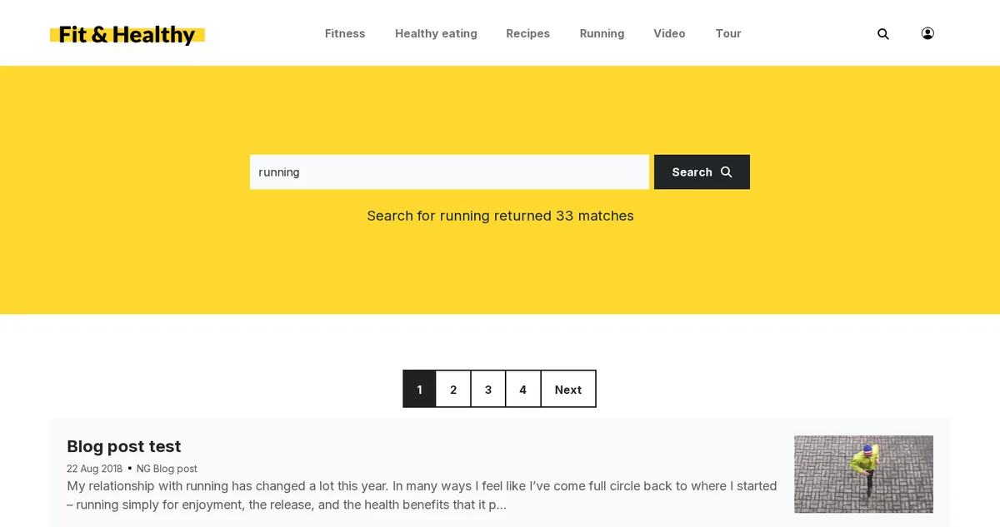

# Lektion 3.3: Website-Suche für Besucher

Besucher beurteilen eine Website nach ihrer Suche. Sie verwenden das Suchfeld des öffentlichen Siteaccess, das ihre
Wörter an die View `content/search` schickt. Diese Lektion zeigt Administratoren, was ein Besucher wirklich bekommt,
wie sich die Anfrage über die Adresse gestalten lässt und wo ein Entwickler das Aussehen der Ergebnisse ändert.

## Auf einen Blick

| | |
|---|---|
| Kurs | [Suche](../README.md) |
| Modul | [Modul 3: Suchen in der Praxis](README.md) |
| Dauer | 30 Minuten (10 Präsentation, 20 Übung) |
| Niveau | Fortgeschrittene |
| Zielgruppe | Website-Administratoren, Website-Ersteller und Entwickler |
| Voraussetzungen | [Lektion 3.1](die-admin-suche-und-erweiterte-suche.md); die öffentliche Website der Schulungsinstallation in einem Browser |

## Lernziele

Nach dieser Lektion können die Teilnehmenden:

- die öffentliche Website als anonymer Besucher durchsuchen und die Ergebnisse mit denen der Administration
  vergleichen;
- `content/search` direkt mit `SearchText` aufrufen und mit `SubTreeArray` und `SearchPageLimit` eingrenzen;
- erklären, dass ein Siteaccess mit `[SiteAccessSettings] PathPrefix` nur seinen eigenen Baum durchsucht, wenn kein
  Teilbaum angegeben ist;
- das Template nennen, das die Ergebnisse zeigt (`content/search.tpl`), und sagen, warum Suchseiten nicht gecrawlt
  werden.

## Hinweise für Trainer

### So präsentieren Sie es

Quelle: [Website-Suche](../../../../../eng-us/help/creators/website-creators/site-search.md), [Eine nützliche robots.txt ab Werk](../../../../../eng-us/features/6.0/robots-txt.md)
und die View `kernel/content/search.php`.

1. **Die Anfrage** (3 Minuten). Das Suchfeld ist ein Formular, das `SearchText` an `content/search` schickt, zum
   Beispiel `/content/search?SearchText=salad`. Besucher finden nur veröffentlichte, sichtbare Elemente, die sie lesen
   dürfen.
2. **Parameter** (3 Minuten). `SubTreeArray` beschränkt die Suche auf einen Knoten und alles darunter (eine oder
   mehrere Knoten-IDs). `SearchPageLimit` wählt, wie viele Ergebnisse eine Seite zeigt (die View ordnet `1` 5 zu,
   `2` 10, `3` 20, `4` 30, `5` 50); was auch immer verlangt wird, `MaximumSearchLimit` (bei Auslieferung 30) ist die
   Obergrenze. Ohne Text wird nichts gesucht, außer wenn `AllowEmptySearch` eingeschaltet ist.
3. **Eine Website in einer Multisite-Installation** (2 Minuten). Wenn der Siteaccess einen `PathPrefix` hat und kein
   Teilbaum angefragt wird, ist die Suche auf den eigenen Baum des Siteaccess beschränkt. Besucher einer Website
   bekommen keine Ergebnisse einer anderen.
4. **Die Ergebnisseite** (2 Minuten). Das `content/search.tpl` des Designs zeigt die Ergebnisse: die Überschrift
   `Search for "%1" returned %2 matches` im Basisdesign, die Zeilenansicht jedes Treffers, das Blättern und **Suchtipps**,
   wenn nichts gefunden wird. `robots.txt` sperrt `/content/search/` und `/content/advancedsearch/`, weil
   Suchergebnisse dem Index einer Suchmaschine keinen Wert hinzufügen.

### Häufige Fragen

**Können Besucher die erweiterte Suche verwenden?** `content/advancedsearch` gibt es für jeden Siteaccess, dessen
Benutzer Inhalte lesen dürfen; ob das Design darauf verlinkt, ist eine Designentscheidung.

**Warum sieht der Besucher eine andere Anzahl von Ergebnissen als ich?** Die anonyme Rolle liest weniger als ein
Administrator: nur einige Sektionen, keine verborgenen Elemente.

**Können wir Ergebnisse für eine Klasse anders anzeigen?** Ja, über die Templates der Zeilenansicht des Designs; das
ist Template-Arbeit für den Kurs Theme-Design.

### Stolperfallen

- **Angemeldet testen.** Ein angemeldeter Administrator hat auch im öffentlichen Siteaccess Administratorrechte.
  Verwenden Sie ein privates Browserfenster, um als Besucher zu testen.
- **Ein Design ohne Suchfeld.** Manche Schulungsdesigns haben kein Feld. Verwenden Sie die Adresse direkt.

## Praktische Übung

Verwenden Sie Ihre eigene Schulungsinstallation. Öffnen Sie die öffentliche Website in einem privaten Browserfenster,
damit Sie ein anonymer Besucher sind. Ersetzen Sie `<site>` durch die Adresse Ihres öffentlichen Siteaccess.

1. Verwenden Sie das Suchfeld der Website, falls sie eines hat, für ein Wort aus den Beispielinhalten. Notieren Sie
   die Adresse im Browser.
2. Öffnen Sie `<site>/content/search?SearchText=<word>` direkt mit demselben Wort. Vergleichen Sie.
3. Suchen Sie in der Administration die Knoten-ID eines Ordners, der einige der Treffer enthält (die Schaltfläche
   **Knoten** auf seiner Seite).
4. Öffnen Sie `<site>/content/search?SearchText=<word>&SubTreeArray=<node id>`. Zählen Sie die Ergebnisse.
5. Fügen Sie der Adresse `&SearchPageLimit=1` hinzu. Wie viele Ergebnisse zeigt eine Seite jetzt? Verwenden Sie die
   Blätterlinks.
6. Suchen Sie nach einem Wort, das sicher nicht auf der Website steht, zum Beispiel `zzqqxx`. Lesen Sie die Seite.
7. Öffnen Sie `<site>/robots.txt` und suchen Sie die Zeilen für `content/search`.
8. Wiederholen Sie Schritt 2 in der Suche der Administration, als Administrator angemeldet, und vergleichen Sie die
   Anzahl der Treffer.

## Erwartetes Ergebnis

- Die Schritte 1 und 2 liefern dieselben Ergebnisse; die Adresse in Schritt 1 zeigt `content/search` und `SearchText`
  (sofern das Design die Adresse nicht umschreibt).
- Schritt 4 zeigt nur Treffer unter diesem Ordner; Schritt 5 zeigt fünf pro Seite mit Blätterlinks.
- Schritt 6 zeigt die Meldung, dass nichts gefunden wurde, und die Suchtipps des Designs.
- Schritt 7 zeigt `Disallow: /content/search/` und `Disallow: /content/advancedsearch/`.
- Schritt 8 findet meist gleich viele oder mehr Treffer als der Besucher.
- Der Trainer prüft die Adressen der Schritte 4 und 5 auf dem Bildschirm einer Person.

## Quiz

1. Welcher Parameter überträgt die Wörter des Besuchers an `content/search`?
2. Welcher Parameter beschränkt die Suche auf einen Teil des Baums?
   A. nur `SearchSectionID` B. `SubTreeArray` C. `PathPrefix` D. `SearchPageLimit`
3. Ein Besucher fordert 50 Ergebnisse pro Seite an. Wie viele bekommt er mit den mitgelieferten Einstellungen, und
   warum?
4. Wie verhindert Exponential in einer Multisite-Installation, dass die Suche einer Website die Seiten einer anderen
   auflistet?
5. Warum sperrt die mitgelieferte `robots.txt` die Suchseiten?

Antworten

1. `SearchText`.
2. **B.**
3. Höchstens 30: `MaximumSearchLimit` begrenzt die Anzahl pro Anfrage.
4. Wenn der Siteaccess einen `PathPrefix` hat und kein Teilbaum angegeben ist, ist die Suche auf den Baum dieses
   Siteaccess beschränkt.
5. Suchergebnisse fügen dem Index einer Suchmaschine keinen Wert hinzu ([Eine nützliche robots.txt ab Werk](../../../../../eng-us/features/6.0/robots-txt.md)).

## Weiterführende Informationen

- [Website-Suche](../../../../../eng-us/help/creators/website-creators/site-search.md): das Suchfeld, die Ergebnisseite und die
  Einstellungen.
- [Eine nützliche robots.txt ab Werk](../../../../../eng-us/features/6.0/robots-txt.md): was Suchmaschinen crawlen dürfen.
- [Suchen](../../../suchen.md#die-site-durchsuchen): was Besucher sehen, in der Hilfe für Redakteure.

## Verwandte Seiten

- [Modul 3: Suchen in der Praxis](README.md)
- [Suche: Kursübersicht](../README.md)
- [Trainer: hier beginnen](../../../../../eng-us/help/trainers/trainers-start-here.md)
- [Freie Dokumentation](../../../freie-dokumentation.md): Diese Seite darf unter der GNU FDL 1.3 frei kopiert, übersetzt und verbessert werden.

<!-- exp-partner-block:start -->
**Werden Sie Exponential-Partner.** Partner teilen ihre Informationen, stellen Mittel bereit, geben Beiträge
zurück und entwickeln die Produkte gemeinsam mit uns weiter, und so wächst Exponential. Eine Partner-Website und
ein Partner-Dashboard sind für Mitte 2027 geplant: Werden Sie noch heute Partner, damit wir schneller wachsen und
neue Funktionen früher bereitstellen können. Beginnen Sie mit [Partner: hier beginnen](../../../partner/partner-hier-beginnen.md) und
[Wie Sie sich bewerben](../../../partner/wie-sie-sich-bewerben.md).
<!-- exp-partner-block:end -->
