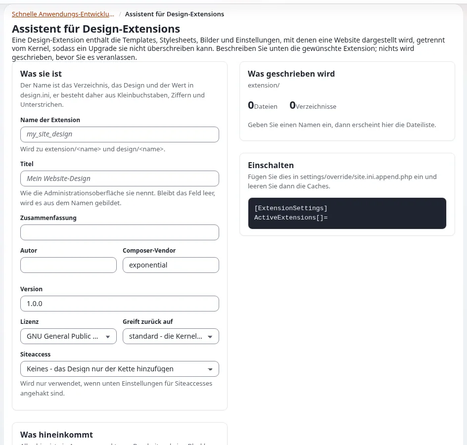

# Lektion 2.1: Ihre eigene Design-Erweiterung

Die Teilnehmenden hören auf zu lesen und beginnen zu bauen. Jede Änderung geschieht ab jetzt in einer eigenen
Design-Erweiterung, nie in `design/standard/` oder in einem mitgelieferten Theme. Der Assistent für
Design-Erweiterungen schreibt in einer Minute ein vollständiges, funktionierendes Gerüst; diese Lektion geht es durch,
schaltet es für einen Siteaccess ein und belegt, dass die Website nun damit gezeichnet wird.

> **Hinweis** Der Assistent schreibt in `extension/`. Verwenden Sie ihn auf der eigenen Schulungsinstallation jeder
> Person, nie auf einer gemeinsamen oder einer Live-Website.

## Auf einen Blick

| | |
|---|---|
| Kurs | [Theme-Design](../README.md) |
| Modul | [Modul 2: Templates, Overrides und das Pagelayout](README.md) |
| Dauer | 60 Minuten (20 Präsentation, 40 Übung) |
| Niveau | Einsteiger |
| Zielgruppe | Designer und Frontend-Entwickler |
| Voraussetzungen | [Modul 1](../modul-01-designs-und-die-fallback-kette/README.md); ein Administratorkonto mit `setup/setup` auf der eigenen Installation |

## Lernziele

Nach dieser Lektion können die Teilnehmenden:

- eine Theme-Erweiterung mit dem **Assistenten für Design-Extensions** anlegen und jede Datei lesen, bevor sie
  geschrieben wird;
- die Dateien nennen, die der Assistent schreibt, und wozu jede dient;
- die Erweiterung aktivieren und `SiteDesign` nur für einen Siteaccess setzen;
- mit Template-Pfadkommentaren zeigen, dass ihr eigenes `pagelayout.tpl` die Website zeichnet.

## Hinweise für Trainer

### So präsentieren Sie es

Quellen: [Der Assistent für Design-Erweiterungen](../../../designer/erweiterungen/der-design-erweiterungs-assistent.md),
[Die Ordnerstruktur einer Theme-Erweiterung](../../../designer/erweiterungen/ordnerstruktur-einer-theme-erweiterung.md) und
[Ein Theme aktivieren](../../../designer/erweiterungen/eine-theme-erweiterung-aktivieren.md).

1. **Warum eine Erweiterung** (3 Minuten). Ein Theme in einer eigenen Erweiterung lässt sich ein- und ausschalten, mit
   git versionieren, ohne Eingriff in den Kernel aktualisieren und an andere weitergeben (Modul 7). Der Name der
   Erweiterung wird sowohl zu `extension/<name>` als auch zum Design `design/<name>`.
2. **Der Assistent** (7 Minuten). Öffnen Sie **Setup > RAD** und das Werkzeug für Design-Erweiterungen
   (`/setup/designextension`). Gehen Sie **Was es ist** durch (**Name der Extension**, **Titel**, **Zusammenfassung**,
   **Autor**, **Composer-Vendor**, **Version**, **Lizenz**, **Greift zurück auf**, **Siteaccess**) sowie **Was
   hineinkommt** (ein Kontrollkästchen pro Teil, mit **Alle auswählen** und **Keine auswählen**). Klicken Sie auf
   **Vorschau aktualisieren** und öffnen Sie zwei Dateien unter **Was geschrieben wird**. Weisen Sie darauf hin, dass
   vor **In extension/ anlegen** nichts geschrieben wird und dass der Assistent nie eine vorhandene Erweiterung
   überschreibt.
3. **Was er geschrieben hat** (5 Minuten). Zeigen Sie den Baum einer erzeugten Erweiterung:

   | Datei | Zweck |
   |---|---|
   | `settings/design.ini.append.php` | `DesignExtensions[]=<name>`, dazu `CSSFileList[]=site.css` und `JavaScriptList[]=site.js` |
   | `design/<name>/templates/pagelayout.tpl` | der Rahmen, mit `$module_result.content` innerhalb von `<main>` |
   | `design/<name>/templates/page_head.tpl`, `page_header.tpl`, `page_footer.tpl` | die Teile, die das Pagelayout einbindet |
   | `design/<name>/stylesheets/site.css`, `javascript/site.js` | die eigenen Dateien der Website |
   | `settings/override.ini.append.php`, `design/<name>/override/templates/full/article.tpl` | ein Beispiel-Override |
   | `ezinfo.php`, `extension.xml`, `README.md`, `LICENSE` | Metadaten und Dokumentation (Modul 7) |

4. **Einschalten** (5 Minuten). Zwei Schritte: die Erweiterung aktivieren, dann einem Siteaccess das Design geben.
   Zeigen Sie beide Befehle der Übung. Betonen Sie, dass `SiteDesign` für einen Siteaccess gesetzt wird, nie global
   (Lektion 1.2).

### Häufige Fragen

**Auf welches Design soll mein Theme zurückgreifen?** `standard` liefert Ihnen die Kernel-Templates und sonst nichts;
alles Sichtbare schreiben Sie selbst. Der Rückgriff auf ein anderes Design (zum Beispiel `base`) verwendet dessen
Templates mit. Wählen Sie für diesen Kurs `standard`: Dann ist jedes sichtbare Teil das eigene Werk der Teilnehmenden.

**Die erzeugte `page_head.tpl` hat `implode_key` im Titel.** Ihre Installation hat einen älteren Assistenten. Nehmen
Sie die drei Änderungen aus [Die Teile des Design-Assistenten](../../../designer/erweiterungen/die-teile-des-design-assistenten.md#drei-änderungen-die-der-erzeugte-kopf-und-das-layout-brauchen)
vor.

**Geht das auch ohne den Assistenten?** Ja:
[Legen Sie das Gerüst von Hand an](../../../designer/erweiterungen/ordnerstruktur-einer-theme-erweiterung.md#schritt-für-schritt-das-gerüst-von-hand-anlegen).
Der Assistent ist schneller und macht in der Schulung weniger Fehler.

### Stolperfallen

- **Ein vergebener oder ungültiger Name.** Der Name muss aus Kleinbuchstaben, Ziffern und Unterstrichen bestehen und
  mit einem Buchstaben beginnen. Geben Sie jeder Person einen Namen vor, zum Beispiel `training_theme`, oder
  `training_<initials>` auf einem gemeinsamen Server.
- **`SiteDesign` in `settings/override/` setzen.** Dann zeichnet auch die Administration mit dem Theme der
  Teilnehmenden. Machen Sie es mit `exp:ini rem ... global` rückgängig und setzen Sie es pro Siteaccess.
- **Nach dem Einschalten ändert sich nichts.** Der INI-Cache enthält noch die alten Einstellungen. Leeren Sie ihn wie
  in Schritt 9.
- **Eine Übungsumgebung mit Velocity.** Wenn Velocity die Übungsumgebung bereitstellt, behalten seine Worker die
  Einstellungen, mit denen sie gestartet sind; führen Sie nach dem Aktivieren der Erweiterung
  `php bin/php/console exp:velocity restart` aus.

## Praktische Übung

Auf Ihrer eigenen Schulungsinstallation, in der Administration angemeldet mit Ihrem Schulungs-Administratorkonto, und
in einer Shell im Stammverzeichnis der Installation. `<site>` ist Ihr öffentlicher Siteaccess aus Modul 1.

1. Öffnen Sie **Setup > RAD**, dann den Assistenten für Design-Erweiterungen (oder rufen Sie `/setup/designextension`
   auf).
2. Geben Sie unter **Was es ist** als **Name der Extension** `training_theme` ein, dazu einen **Titel** und eine
   **Zusammenfassung** in einem Satz. Lassen Sie **Greift zurück auf** auf `standard` und **Siteaccess** auf „Keines -
   das Design nur der Kette hinzufügen“.
3. Klicken Sie unter **Was hineinkommt** auf **Alle auswählen** und entfernen Sie dann die Haken bei **Einstellungen
   für Siteaccesses**, **Template-Operatoren** und **composer.json**.
4. Klicken Sie auf **Vorschau aktualisieren**. Öffnen Sie in der Liste `settings/design.ini.append.php` und
   `templates/pagelayout.tpl` und lesen Sie beide.
5. Klicken Sie auf **In extension/ anlegen**. Lesen Sie die Meldung und die Aktivierungszeilen, die die Seite anzeigt.
6. Listen Sie in der Shell auf, was geschrieben wurde: `find extension/training_theme -type f | sort`.
7. Aktivieren Sie die Erweiterung für die ganze Installation, zuerst als Probelauf, dann wirklich:

   ```bash
   php bin/php/console exp:ini add 'site.ini/ExtensionSettings/ActiveExtensions[]' training_theme global --dry-run
   php bin/php/console exp:ini add 'site.ini/ExtensionSettings/ActiveExtensions[]' training_theme global
   ```

8. Geben Sie Ihrem öffentlichen Siteaccess das neue Design, ohne etwas dazwischen:

   ```bash
   php bin/php/console exp:ini set site.ini/DesignSettings/SiteDesign training_theme siteaccess:<site>
   php bin/php/console exp:ini clear site.ini/DesignSettings/AdditionalSiteDesignList siteaccess:<site>
   ```

9. Leeren Sie die Caches: `php bin/php/ezcache.php --clear-tag=ini`, dann
   `php bin/php/ezcache.php --clear-id=template,template-override`. Führen Sie in einer Übungsumgebung mit Velocity
   zusätzlich `php bin/php/console exp:velocity restart` aus.
10. Prüfen Sie die Kette: `php bin/php/console exp:ini where site/DesignSettings/SiteDesign <site>`.
11. Schalten Sie Template-Pfadkommentare für `<site>` ein (Lektion 1.3), öffnen Sie die Startseite und lesen Sie das
    erste `START` im Seitenquelltext.
12. Öffnen Sie die Administration in einem anderen Tab und prüfen Sie, dass sie noch wie vorher aussieht.

## Erwartetes Ergebnis

- Schritt 6 listet die Dateien aus der Tabelle oben unterhalb von `extension/training_theme/` auf.
- Schritt 10 endet mit `SiteDesign=training_theme` als wirksamem Wert für `<site>`.
- Schritt 11: Die Website sieht schlicht aus (eine Kopfzeile mit dem Namen der Website und einem Menü der Elemente
  der obersten Ebene, der Inhalt, eine Fußzeile mit der Jahreszahl), und der erste Kommentar ist
  `<!-- START extension/training_theme/design/training_theme/templates/pagelayout.tpl -->`.
- Schritt 12: Die Administration ist unverändert.
- Der Trainer prüft den Seitenquelltext einer Person am Projektor.



## Quiz

1. Zu welchen zwei Namen wird der **Name der Extension** im Assistenten?
2. Welche Datei macht den Ordner `design/` der Erweiterung zum Teil der Kette, und mit welcher Zeile?
3. Warum wird `SiteDesign` mit dem Bereich `siteaccess:<site>` gesetzt und nicht mit `global`?
4. Die Website zeigt nach Schritt 8 noch das alte Design. Nennen Sie den Cache, den Sie zuerst leeren.
   A. content B. ini C. image D. user info
5. Was schreibt **Vorschau aktualisieren** auf die Festplatte?

<details>
<summary>Antworten</summary>

1. Den Ordner `extension/<name>` und das Design `design/<name>`
   ([Der Assistent für Design-Erweiterungen](../../../designer/erweiterungen/der-design-erweiterungs-assistent.md)).
2. `settings/design.ini.append.php` mit `DesignExtensions[]=training_theme`.
3. Ein globaler Wert gilt für jeden Siteaccess, auch für die Administration.
4. **B.** Der INI-Cache enthält das alte `SiteDesign`; danach die Template-Caches.
5. Nichts. Sie listet die Dateien nur auf; **In extension/ anlegen** schreibt sie.

</details>

## Weiterführende Literatur

- [Der Assistent für Design-Erweiterungen (Setup > RAD)](../../../designer/erweiterungen/der-design-erweiterungs-assistent.md):
  jedes Feld.
- [Die Teile des Design-Assistenten](../../../designer/erweiterungen/die-teile-des-design-assistenten.md): was jedes
  Kontrollkästchen schreibt.
- [Das Design registrieren: DesignExtensions[]](../../../designer/erweiterungen/das-design-registrieren.md): Symptome,
  wenn es fehlt.
- [Die Design-Einstellungen, die ein Theme mitliefert](../../../designer/erweiterungen/design-einstellungen-eines-themes.md):
  welche Einstellungen ins Theme gehören und welche in die Installation.
- [RAD-Werkzeuge](../../../../funktionen/6.0/rad-werkzeuge.md): die anderen Assistenten unter **Setup > RAD**.

## Verwandte Seiten

- [Modul 2: Templates, Overrides und das Pagelayout](README.md)
- [Theme-Design: Kursüberblick](../README.md)
- [Trainer: hier beginnen](../../trainer-hier-beginnen.md)
- [Freie Dokumentation](../../../freie-dokumentation.md): Diese Seite darf unter der GNU FDL 1.3 frei kopiert, übersetzt und verbessert werden.

<!-- exp-partner-block:start -->
**Werden Sie Exponential-Partner.** Partner teilen ihre Informationen, stellen Mittel bereit, geben Beiträge zurück
und entwickeln die Produkte mit uns, und so wächst Exponential. Eine Partner-Website und ein Dashboard sind für Mitte
2027 geplant: Werden Sie noch heute Partner, damit wir schneller wachsen und neue Funktionen früher liefern. Beginnen
Sie mit [Partner: hier beginnen](../../../partner/partner-hier-beginnen.md) und
[Wie Sie sich bewerben](../../../partner/wie-sie-sich-bewerben.md).
<!-- exp-partner-block:end -->
