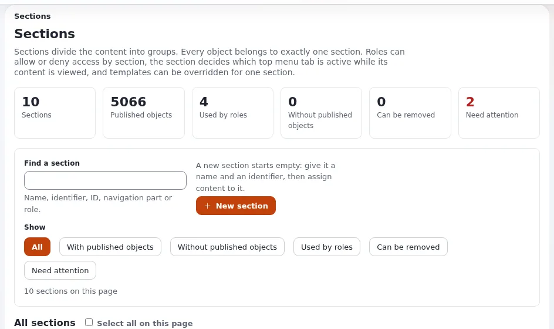
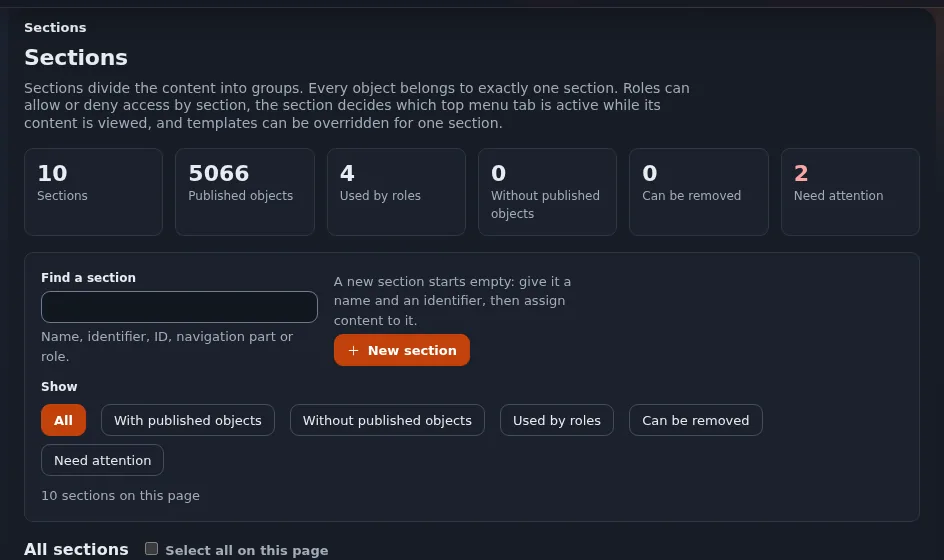

# Lektion 4.3: Tokens und Dunkelmodus

admin4 hat einen hellen und einen dunklen Modus. Das erreicht es nicht mit zwei Sätzen von Regeln: Jede Farbe, jeder
Radius, jeder Abstand und jede Schrift kommt aus einer Custom Property, einem **Token**, und der Dunkelmodus ändert nur
die Werte der Tokens. Eine mit Tokens geschriebene Regel funktioniert von selbst in beiden Modi; eine Regel mit `#fff`
malt einen weißen Kasten auf die dunkle Seite. Die Teilnehmenden sehen in dieser Lektion beides.

## Auf einen Blick

| | |
|---|---|
| Kurs | [Theme-Design](../README.md) |
| Modul | [Modul 4: Die Administration gestalten](README.md) |
| Dauer | 60 Minuten (20 Präsentation, 40 Übung) |
| Niveau | Fortgeschrittene |
| Zielgruppe | Designer und Entwickler, die Administrationsseiten gestalten |
| Voraussetzungen | [Lektion 4.2](gemeinsame-komponenten.md): der Dashboard-Block `training_notes` |

## Lernziele

Nach dieser Lektion können die Teilnehmenden:

- die Gruppen der Tokens nennen (Akzent, Neutral, Zustände, Abstände, Radius, Schrift) und den Wert eines Tokens im
  Browser lesen;
- erklären, wie `html[data-a4-theme="dark"]` die Tokens umschaltet und warum eine Komponente keine dunkle Regel
  braucht;
- der Administration mit `BackendCSSFileList[]` ein Erweiterungs-Stylesheet hinzufügen;
- Literalfarben, Radien und Längen durch Tokens ersetzen und dabei die nächstgelegene Abstandsstufe wählen.

## Hinweise für Trainer

### So präsentieren Sie es

Quellen: [Die Administration gestalten, Tokens und Dunkelmodus](../../../../bc/6.0/admin4-gestaltung.md#tokens) und
[Das Design admin4](../../../../../eng-us/features/6.0/admin4-design.md).

1. **Die Gruppen** (6 Minuten). Aus der Token-Tabelle: Akzent (`--a4-accent`, `--a4-accent-strong` für gefüllte
   Bedienelemente mit weißem Text, `--a4-accent-text` für Text in Akzentfarbe, `--a4-accent-soft` für Tönungen);
   Neutral (`--a4-ink`, `--a4-muted`, `--a4-line`, `--a4-card`, `--a4-surface`, `--a4-soft`); Zustände (`--a4-ok`,
   `--a4-warn`, `--a4-bad`, `--a4-info` mit `-bg` und `-line`); Abstände `--a4-space-1` bis `--a4-space-7` (4, 8, 12,
   16, 24, 32, 48 px); der eine Komponentenradius `--a4-radius-s`; Schrift `--a4-text-xs` bis `--a4-text-3xl` und
   `--a4-font`.
2. **Ein Akzent, ein Radius** (2 Minuten). Es gibt einen Akzent und einen Komponentenradius; niemand fügt einen zweiten
   hinzu.
3. **Wie der Dunkelmodus funktioniert** (5 Minuten). Der Modus ist `html[data-a4-theme="light"|"dark"]` und wird vor
   dem Zeichnen der Seite aus der Wahl des Benutzers gesetzt (der eZPreference `admin_color_mode`). `components.css`
   gibt jedem Farb-Token einen zweiten Wert für den Dunkelmodus und setzt `color-scheme`, sodass Scrollleisten und
   Formularelemente folgen. Eine Komponenten- oder Modulregel braucht nie eine eigene Regel
   `html[data-a4-theme="dark"]`: Die Tokens schalten um.
4. **Erweiterungs-Stylesheets** (4 Minuten). Eine Erweiterung hält ihr Stylesheet in ihrem eigenen Design-Ordner und
   führt es in `BackendCSSFileList[]` auf; admin4 lädt diese Liste nach seinen eigenen Stylesheets, sodass eine
   Erweiterung bei ihrem eigenen Markup das letzte Wort hat. Ihre Klassen tragen das eigene Präfix der Erweiterung,
   ihre Werte kommen aus den Tokens `--a4-*`.
5. **Nächste Stufe** (3 Minuten). Eine Länge zwischen zwei Abstandsstufen nimmt die nähere: 3 und 5 werden zu 4, 6 bis
   9 zu 8, 10 bis 14 zu 12, 15 bis 20 zu 16, 22 bis 28 zu 24.

### Häufige Fragen

**Darf meine Erweiterung eigene Tokens definieren?** Nicht als Aliasse der Kern-Tokens (`--my-ink: var(--a4-ink)` ist
genau das, was die Regeln verbieten). Ein wirklich neuer Wert, den die ganze Administration braucht, wird für
`components.css` vorgeschlagen, mit einem hellen und einem dunklen Wert.

**Warum gibt es `--a4-accent-strong` neben `--a4-accent`?** Weißer Text auf dem Orange der Marke erreicht nur 3:1;
gefüllte Bedienelemente mit weißem Text verwenden den dunkleren Ton für 5,2:1.

**Was passiert ohne JavaScript?** Die Administration ist hell, ihr dokumentierter Standard.

### Stolperfallen

- **Nur im hellen Modus testen.** Machen Sie die Prüfung im Dunkelmodus zur Gewohnheit: Jede Übung endet ab jetzt
  damit.
- **Tokens außerhalb von admin4.** Die Tokens `--a4-*` gibt es dort, wo `components.css` geladen wird (in den
  Administrationsdesigns). Ein öffentliches Theme definiert eigene Custom Properties.
- **Den Packer vergessen.** Ein neues Stylesheet in `BackendCSSFileList[]` verlangt den INI-Cache und die Routine aus
  Lektion 3.3.

## Praktische Übung

Auf Ihrer Schulungsinstallation, Administration in `admin4` oder `admin4l`, mit dem Block `training_notes` aus
Lektion 4.2.

1. Öffnen Sie auf dem Dashboard den Inspektor, wählen Sie das Element `<html>` und lesen Sie sein Attribut
   `data-a4-theme`. Wählen Sie dann eine beliebige Karte und lesen Sie die berechneten Werte von `--a4-card` und
   `--a4-ink`.
2. Wechseln Sie mit der Farbmodus-Schaltfläche der Kopfzeile in den Dunkelmodus und lesen Sie dieselben zwei Werte
   erneut.
3. Fügen Sie in `training_notes.tpl` direkt unter der Überschrift einen Hinweisabsatz ein:

   ```
   <p class="training-note">{'Items are listed by last modification.'|i18n( 'design/admin/dashboard/training_notes' )}</p>
   ```

4. Legen Sie `extension/training_theme/design/admin4/stylesheets/training_admin.css` mit einer ersten Fassung an, die
   absichtlich falsch geschrieben ist:

   ```css
   .training-note { background: #fff; color: #333; padding: 10px; border: 1px solid #ddd; border-radius: 6px; }
   ```

5. Führen Sie sie in `extension/training_theme/settings/design.ini.append.php` unter `[StylesheetSettings]` auf:

   ```ini
   BackendCSSFileList[]=training_admin.css
   ```

6. Leeren Sie den INI-Cache und führen Sie die Routine aus Lektion 3.3 aus (`ezjscore-packer`, `template`,
   `template-block`), dann laden Sie das Dashboard im Dunkelmodus hart neu. Notieren Sie, wie der Hinweis aussieht.
7. Schreiben Sie die Regel mit Tokens neu:

   ```css
   .training-note {
       background: var(--a4-soft);
       color: var(--a4-ink);
       padding: var(--a4-space-3);
       border: 1px solid var(--a4-line);
       border-radius: var(--a4-radius-s);
   }
   ```

8. Führen Sie die Routine erneut aus und laden Sie hart neu. Prüfen Sie den Hinweis im Dunkelmodus, dann im hellen
   Modus.
9. Erklären Sie Ihrem Sitznachbarn, warum aus `10px` `var(--a4-space-3)` wurde.

## Erwartetes Ergebnis

- Schritte 1 und 2: `data-a4-theme` wechselt von `light` zu `dark`, und mit ihm die Werte von `--a4-card` und
  `--a4-ink`.
- Schritt 6: Im Dunkelmodus ist der Hinweis ein weißer Kasten mit grauem Text auf der dunklen Karte, der Fehler, den
  die Regeln verhindern.
- Schritt 8: Der Hinweis sitzt in beiden Modi auf einer leicht abgesetzten Fläche, mit lesbarem Text, gerundet wie die
  anderen Komponenten, und das Stylesheet enthält keine Literalfarbe.
- Der Trainer prüft die endgültige `training_admin.css` von zwei Teilnehmenden: nur Tokens, keine Regel
  `html[data-a4-theme]`.





## Quiz

1. Welches Attribut an `<html>` schaltet admin4 in den Dunkelmodus?
2. Warum braucht eine mit Tokens geschriebene Regel keine eigene dunkle Regel?
3. Über welche Liste fügt eine Erweiterung der Administration ihr Stylesheet hinzu?
   A. `FrontendCSSFileList[]` B. `AdminComponentCSSFileList[]` C. `BackendCSSFileList[]` D. `CSSFileList[]`
4. Ein Entwurf verlangt 18 px Innenabstand. Welches Abstands-Token verwenden Sie?
5. Welches Token färbt Text in der Akzentfarbe, und welches füllt eine Schaltfläche mit weißem Text?

<details>
<summary>Antworten</summary>

1. `data-a4-theme`, mit dem Wert `dark` (`html[data-a4-theme="dark"]`).
2. Die Werte der Tokens ändern sich mit dem Modus; jedes Farb-Token hat einen dunklen Wert
   ([Die Administration gestalten, Dunkelmodus](../../../../bc/6.0/admin4-gestaltung.md#dunkler-modus)).
3. **C.** `AdminComponentCSSFileList[]` ist für die eigenen Komponenten- und Moduldateien des Kerns.
4. `var(--a4-space-4)` (16 px): 15 bis 20 nehmen 16.
5. `--a4-accent-text` für Text; `--a4-accent-strong` für die Füllung eines Bedienelements mit weißem Text.

</details>

## Weiterführende Literatur

- [Die Administration gestalten](../../../../bc/6.0/admin4-gestaltung.md#tokens): jedes Token mit seinem Zweck.
- [Das Design admin4](../../../../../eng-us/features/6.0/admin4-design.md): heller, dunkler und System-Modus und die gemerkte
  Auswahl.
- [Standards zur Barrierefreiheit](../../../../../eng-us/standards/accessibility.md): der Kontrasttest, der die Tokens prüft.

## Verwandte Seiten

- [Modul 4: Die Administration gestalten](README.md)
- [Theme-Design: Kursüberblick](../README.md)
- [Trainer: hier beginnen](../../trainer-hier-beginnen.md)
- [Freie Dokumentation](../../../freie-dokumentation.md): Diese Seite darf unter der GNU FDL 1.3 frei kopiert, übersetzt und verbessert werden.

<!-- exp-partner-block:start -->
**Werden Sie Exponential-Partner.** Partner teilen ihre Informationen, stellen Mittel bereit, geben Beiträge zurück
und entwickeln die Produkte mit uns, und so wächst Exponential. Eine Partner-Website und ein Dashboard sind für Mitte
2027 geplant: Werden Sie noch heute Partner, damit wir schneller wachsen und neue Funktionen früher liefern. Beginnen
Sie mit [Partner: hier beginnen](../../../partner/partner-hier-beginnen.md) und
[Wie Sie sich bewerben](../../../partner/wie-sie-sich-bewerben.md).
<!-- exp-partner-block:end -->
