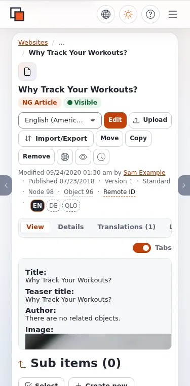

# Lektion 5.3: Die Barrierefreiheit eines Themes testen

Ein barrierefreies Theme ist eines, das getestet wurde. Die Tests sind günstig und brauchen meist keine besonderen
Werkzeuge: die Tastatur, den Zoom, die Entwicklerwerkzeuge des Browsers und einen Screenreader, den das Betriebssystem
schon mitbringt. Diese Lektion gibt den Teilnehmenden eine Routine, die sie bei jedem Release ihres Themes durchlaufen
können.

## Auf einen Blick

| | |
|---|---|
| Kurs | [Theme-Design](../README.md) |
| Modul | [Modul 5: Barrierefreiheit und Rechts-nach-links](README.md) |
| Dauer | 45 Minuten (10 Präsentation, 35 Übung) |
| Niveau | Fortgeschrittene |
| Zielgruppe | Designer, Frontend-Entwickler und Tester |
| Voraussetzungen | [Lektion 5.2](ein-barrierefreies-website-design.md) |

## Lernziele

Nach dieser Lektion können die Teilnehmenden:

- eine Seite pro Template zum Testen auswählen statt jeder einzelnen Seite;
- einen automatischen Prüfer laufen lassen und seine Fehler von seinen Warnungen unterscheiden;
- mit einer Checkliste einen Durchgang mit der Tastatur sowie einen mit Zoom und Farbe machen;
- Befunde mit Seite, Problem, WCAG-Erfolgskriterium, Schweregrad, Korrektur und Zuständigkeit festhalten.

## Hinweise für Trainer

### So präsentieren Sie es

Quelle: [Die Barrierefreiheit Ihrer Website testen](../../../ersteller/website-ersteller/barrierefreiheit-testen.md).

1. **Welche Seiten** (2 Minuten). Eine Seite pro Template: die Startseite, eine Vollansicht pro Klasse, eine
   Ordnerliste mit Seitenumschaltung, Suchergebnisse mit und ohne Treffer, jedes Formular, die Fehlerseiten, jeder
   Sprach-Siteaccess.
2. **Vier Durchgänge** (5 Minuten). Automatische Prüfungen (eine Browsererweiterung oder ein Kommandozeilenwerkzeug auf
   Basis von axe; sie finden fehlende Alternativtexte, Beschriftungen, Kontrast und falsches ARIA, aber nicht, ob die
   Reihenfolge sinnvoll ist); Tastatur (Tab, Shift+Tab, Enter, Leertaste, Escape, die Pfeiltasten); Zoom, Farbe und
   Bewegung (200 % und 320 CSS-Pixel Breite, Kontrast, keine Information allein über Farbe, reduzierte Bewegung);
   Screenreader (Seitentitel, Landmarks und Überschriften, Bilder, Formularfelder).
3. **Festhalten** (3 Minuten). Zeigen Sie die Befundtabelle und die Trennung in Template-Arbeit (einmal für alle Seiten
   behoben) und Inhaltsarbeit (Redakteure, Seite für Seite).

### Häufige Fragen

**Welchen automatischen Prüfer sollen wir verwenden?** Jede axe-basierte Browsererweiterung und jedes axe-basierte
Kommandozeilenwerkzeug funktioniert; der Kurs schreibt keines vor. Installieren Sie ihn vor dem Kurs auf den Computern
der Übungsumgebung.

**Ist jedes Mal ein Durchgang mit dem Screenreader nötig?** Ein kurzer pro Release: Seitentitel, Überschriften,
Landmarks, ein Formular.

**Wo kommen die eigenen Tests der Administration ins Spiel?** Die Tests des Designs admin4 laufen in der CI; diese
Routine ist für das öffentliche Theme, das kein Test für Sie prüft.

### Stolperfallen

- **Nur die Startseite testen.** Templates unterscheiden sich; der Artikel und die Formularseiten scheitern auf andere
  Weise.
- **Warnungen als bestanden werten.** Lesen Sie jede Warnung; manche verlangen eine menschliche Entscheidung.
- **Inhalte im Template korrigieren.** Ein fehlender Alternativtext ist Inhaltsarbeit; halten Sie ihn für die
  Redakteure fest.

## Praktische Übung

Auf Ihrer Schulungsinstallation, `<site>` gezeichnet von `training_theme`, mit einem automatischen
Barrierefreiheitsprüfer im Browser. Arbeiten Sie in Paaren und testen Sie die Website Ihrer Partnerin oder Ihres
Partners.

1. Wählen Sie vier Seiten: die Startseite, eine Ordnerliste, einen Artikel und die Suchergebnisseite für ein Wort, das
   nichts findet (`/content/search?SearchText=zzzz`).
2. Lassen Sie den automatischen Prüfer auf jeder Seite laufen. Notieren Sie jeden Fehler.
3. Tastaturdurchgang auf der Artikelseite, die Maus beiseite: der Sprunglink beim ersten Tab, jeder Link erreichbar,
   der Fokus immer sichtbar, nichts hält den Fokus gefangen.
4. Zoomdurchgang: Stellen Sie 200 % Zoom ein und verkleinern Sie dann das Fenster auf etwa 320 CSS-Pixel Breite (die
   Gerätesymbolleiste der Entwicklerwerkzeuge). Achten Sie auf horizontales Scrollen und abgeschnittenen Text.
5. Farbdurchgang: Prüfen Sie den Kontrast von Fließtext, Links und Fokusring; prüfen Sie, dass nichts allein über Farbe
   ausgedrückt wird (der aktuelle Menüeintrag aus Lektion 5.2 ist zusätzlich fett und unterstrichen).
6. Bewegungsdurchgang: Emulieren Sie im Bereich „Rendering“ der Entwicklerwerkzeuge
   `prefers-reduced-motion: reduce` und laden Sie neu.
7. Kurzer Durchgang mit dem Screenreader Ihres Betriebssystems: der Seitentitel, die Liste der Überschriften und die
   Liste der Landmarks der Artikelseite.
8. Tragen Sie jeden Befund in die Tabelle ein:

   | Seite | Problem | Erfolgskriterium | Schweregrad | Korrektur | Zuständig |
   |---|---|---|---|---|---|

9. Markieren Sie jeden Befund mit „Template“ oder „Inhalt“. Geben Sie die Tabelle Ihrer Partnerin oder Ihrem Partner.

## Erwartetes Ergebnis

- Jedes Paar hat eine Befundtabelle für die Website des anderen mit mindestens den vier getesteten Seiten.
- Template-Befunde nennen die zu ändernde Datei von `training_theme`; Inhaltsbefunde nennen das Element und was die
  Redakteure tun sollen.
- Die Seiten aus Lektion 5.2 bestehen den Tastaturdurchgang: Sprunglink, sichtbarer Fokus, aktueller Eintrag nicht nur
  über Farbe gekennzeichnet.
- Der Trainer sammelt die Tabellen ein und schreibt die drei häufigsten Template-Befunde an die Tafel.

## Quiz

1. Warum testen Sie eine Seite pro Template statt jeder Seite?
2. Was kann Ihnen ein automatischer Prüfer nicht sagen?
   A. Ein fehlendes `alt` B. Eine fehlende Beschriftung C. Ob die Lesereihenfolge sinnvoll ist D. Zu geringen Kontrast
3. Bei welcher Zoomstufe und welcher Breite prüfen Sie den Umbruch?
4. Ein Befund lautet „ein Bild ohne Alternativtext in einem Artikel“. Template oder Inhalt?
5. Nennen Sie drei Dinge, die der Durchgang mit dem Screenreader prüft.

Antworten

1. Seiten, die dasselbe Template zeichnet, haben dasselbe Markup; eine Seite testet sie alle
   ([Die Barrierefreiheit Ihrer Website testen](../../../ersteller/website-ersteller/barrierefreiheit-testen.md#die-seiten-auswählen)).
2. **C.**
3. 200 % Zoom und 320 CSS-Pixel Breite, ohne horizontales Scrollen.
4. Inhalt: Die Redakteurin oder der Redakteur ergänzt den Alternativtext.
5. Drei beliebige: der Seitentitel, Landmarks und Überschriften, Bilder beschrieben oder übersprungen, Formularfelder
   mit Beschriftung, Pflichtangabe und Fehlermeldungen, Sprachwechsel.

## Weiterführende Literatur

- [Die Barrierefreiheit Ihrer Website testen](../../../ersteller/website-ersteller/barrierefreiheit-testen.md): die
  vollständige Routine und was nach dem Start zu tun ist.
- [Prüfung der Barrierefreiheit bei jedem Release](../../../designer/lebenszyklus/barrierefreiheitspruefung-pro-release.md): dieselbe
  Routine als Teil jedes Theme-Releases.
- [Barrierefreie Kursmaterialien](../../train-the-trainer/modul-05-barrierefreiheit-und-inklusion/barrierefreie-kursmaterialien.md):
  das eigene Material des Trainers.

## Verwandte Seiten

- [Modul 5: Barrierefreiheit und Rechts-nach-links](README.md)
- [Theme-Design: Kursüberblick](../README.md)
- [Trainer: hier beginnen](../../trainer-hier-beginnen.md)
- [Freie Dokumentation](../../../freie-dokumentation.md): Diese Seite darf unter der GNU FDL 1.3 frei kopiert, übersetzt und verbessert werden.

<!-- exp-partner-block:start -->
**Werden Sie Exponential-Partner.** Partner teilen ihre Informationen, stellen Mittel bereit, geben Beiträge zurück
und entwickeln die Produkte mit uns, und so wächst Exponential. Eine Partner-Website und ein Dashboard sind für Mitte
2027 geplant: Werden Sie noch heute Partner, damit wir schneller wachsen und neue Funktionen früher liefern. Beginnen
Sie mit [Partner: hier beginnen](../../../partner/partner-hier-beginnen.md) und
[Wie Sie sich bewerben](../../../partner/wie-sie-sich-bewerben.md).
<!-- exp-partner-block:end -->
