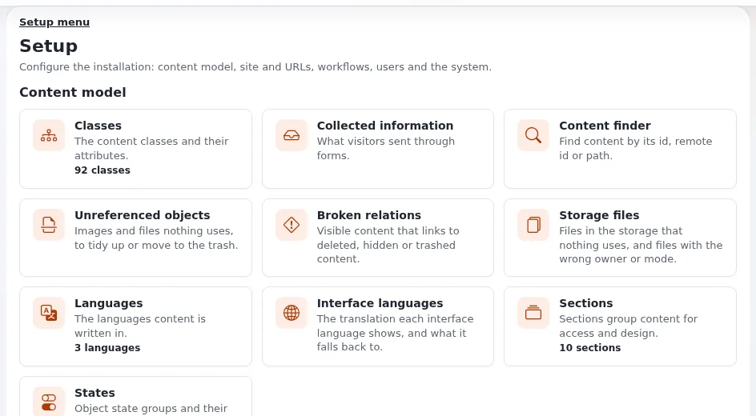

# Lektion 6.2: Icons in admin4

admin4 zeichnet seine Oberflächen-Icons aus Bootstrap Icons, die als SVG-Dateien in der Installation liegen, als
CSS-Masken in der Textfarbe. Dadurch folgt ein Icon von selbst der Farbe seines Links oder seiner Schaltfläche, dem
Hover-Zustand und dem Dunkelmodus. In dieser Lektion verwenden die Teilnehmenden die gemeinsamen Icon-Klassen, benennen
Bedienelemente, die nur aus einem Icon bestehen, richtig und ergänzen ein eigenes Icon.

## Auf einen Blick

| | |
|---|---|
| Kurs | [Theme-Design](../README.md) |
| Modul | [Modul 6: Icons](README.md) |
| Dauer | 45 Minuten (15 Präsentation, 30 Übung) |
| Niveau | Fortgeschrittene |
| Zielgruppe | Designer und Entwickler, die Administrationsseiten bauen |
| Voraussetzungen | [Modul 4](../modul-04-die-administration-gestalten/README.md): der Block `training_notes` und `training_admin.css` |

## Lernziele

Nach dieser Lektion können die Teilnehmenden:

- ein Icon in admin4 mit `.a4-icon` und einer Klasse `.a4-bi-<name>` in einer seiner Größen schreiben;
- einem Bedienelement, das nur aus einem Icon besteht, mit `.a4-icon-btn` und `aria-label`/`title` einen Namen geben
  und dekorative Icons vor Screenreadern verbergen;
- erklären, wozu `design.ini [AdminDesignSettings] IconList[]` dient;
- ein eigenes Icon ergänzen: ein SVG, eine Maskenregel in einem Stylesheet der Erweiterung und einen Eintrag in
  `IconList[]`.

## Hinweise für Trainer

### So präsentieren Sie es

Quellen: [Das Design admin4, Icons](../../../../../eng-us/features/6.0/admin4-design.md#icons) und die Icon-Komponente in
[Die Administration gestalten](../../../../bc/6.0/admin4-gestaltung.md#komponenten).

1. **Das Icon** (4 Minuten). `<span class="a4-icon a4-bi-pencil" aria-hidden="true"></span>`: ein Quadrat von 1em, das
   das SVG `share/icons/bootstrap-icons/svg/pencil.svg` als Maske über `currentColor` verwendet. Größen: `.is-small`
   (12 px), `.is-medium` (16 px), `.is-large` (22 px). Bootstrap Icons 1.13.2, MIT-Lizenz, aus der Installation
   ausgeliefert; nichts kommt von einem CDN.
2. **Namen** (4 Minuten). Ein dekoratives Icon neben Text ist `aria-hidden="true"`. Ein Bedienelement, das nur aus
   einem Icon besteht, ist ein `<button>` oder ein Link mit `.a4-icon-btn` und seinem Namen in `title` und
   `aria-label` (oder einem Text mit `.a4-sr-only` darin). Ein Icon, das in einem Link für ein Wort steht, trägt
   `role="img"` und `aria-label`.
3. **Die Liste** (3 Minuten). Es gibt nur die Icons, für die eine Regel `.a4-bi-<name>` existiert;
   `design.ini [AdminDesignSettings] IconList[]` führt sie für Einstellungen auf, die ein Icon nennen (das `Icon` eines
   Reiters im oberen Menü in `menu.ini`, Kacheln der Setup-Übersicht). Ein nicht aufgeführter Name zeichnet das
   Stecker-Icon; ein Reiter, dessen Icon nicht aufgeführt ist, zeigt nur seinen Namen.
4. **Ihr eigenes Icon** (4 Minuten). Der Kommentar in `settings/design.ini` erklärt, wie es geht: das SVG ergänzen,
   eine Regel `.a4-bi-<name>` in einem Stylesheet aus `BackendCSSFileList[]` und `IconList[]=<name>` in der
   `design.ini.append.php` der Erweiterung.

### Häufige Fragen

**Warum Masken und nicht ``?** Eine Maske übernimmt `currentColor`, sodass das Icon Hover, Fokus und Dunkelmodus
folgt. Ein SVG in einem `` kann die Farben der Seite nicht übernehmen.

**Welche Icons gibt es?** Die mit einer Regel `.a4-bi-` in `components.css`; der mitgelieferte SVG-Ordner enthält nur
die verwendeten Icons, nicht den ganzen Bootstrap-Satz.

**Kann ich in admin4 ein GIF-Icon über `ezimage` verwenden?** Nein; die Checkliste für das Code-Review verbietet in
admin4 GIF- und PNG-Icons, eingebettetes `<svg>` und `<input type="image">`.

### Stolperfallen

- **Ein Link nur aus einem Icon ohne Namen.** Screenreader sagen „Link“ und sonst nichts. Immer `aria-label` und
  `title`.
- **Eine Farbe am Icon.** Es übernimmt die Textfarbe; färben Sie das Bedienelement, nicht das Icon.
- **Ein Icon von Dritten ohne seine Lizenz.** Eine eigene Zeichnung oder ein Icon, dessen Lizenz es erlaubt, mit
  mitgelieferter Lizenz (Modul 8).

## Praktische Übung

Auf Ihrer Schulungsinstallation, Administration in admin4, Dateien aus Modul 4.

1. Setzen Sie in `training_notes.tpl` ein Icon vor den Text der Schaltfläche:

   ```
   <a class="a4-btn" href=...><span class="a4-icon a4-bi-diagram-3" aria-hidden="true"></span> {'Open the content tree'|i18n( 'design/admin/dashboard/training_notes' )}</a>
   ```

   (behalten Sie das bisherige `href`).
2. Ergänzen Sie nach der Überschrift einen Link nur aus einem Icon, der auf das Dashboard selbst zeigt, um es neu zu
   laden:

   ```
   <a class="a4-icon-btn" href={'content/dashboard'|ezurl} title="{'Reload the dashboard'|i18n( 'design/admin/dashboard/training_notes' )}" aria-label="{'Reload the dashboard'|i18n( 'design/admin/dashboard/training_notes' )}"><span class="a4-icon a4-bi-arrow-clockwise" aria-hidden="true"></span></a>
   ```

3. Prüfen Sie das Template mit `eztemplatecheck.php`, leeren Sie mit `--clear-tag=template` und laden Sie das Dashboard
   neu. Fahren Sie mit der Maus über den Icon-Link und erreichen Sie ihn dann mit der Tabulatortaste.
4. Wechseln Sie in den Dunkelmodus und zurück: Beide Icons folgen der Textfarbe.
5. Zeichnen Sie ein eigenes Icon: Speichern Sie es als `extension/training_theme/design/admin4/images/training-flag.svg`:

   ```xml
   <svg xmlns="http://www.w3.org/2000/svg" viewBox="0 0 16 16"><path d="M3 1h1v14H3zM5 2h8l-2 3 2 3H5z"/></svg>
   ```

6. Ergänzen Sie seine Maskenregel in `training_admin.css`:

   ```css
   .a4-bi-training-flag {
       -webkit-mask-image: url(../images/training-flag.svg);
       mask-image: url(../images/training-flag.svg);
   }
   ```

7. Ergänzen Sie `IconList[]=training-flag` unter `[AdminDesignSettings]` in
   `extension/training_theme/settings/design.ini.append.php`.
8. Verwenden Sie es in der Überschrift des Blocks: `<span class="a4-icon a4-bi-training-flag" aria-hidden="true"></span>`
   vor dem Text.
9. Führen Sie die Routine aus Lektion 3.3 aus (der Packer schreibt das relative `url()` in der gepackten Datei um),
   leeren Sie den INI-Cache und laden Sie vollständig neu. Prüfen Sie den hellen und den dunklen Modus.

## Erwartetes Ergebnis

- Schritte 3 und 4: Die Schaltfläche zeigt das Baum-Icon, der Icon-Link einen kreisförmigen Pfeil, beide in der
  Textfarbe, der Link mit seinem Ring bei Fokus, in beiden Modi.
- Schritt 9: Die Überschrift zeigt die Fahne der Teilnehmenden in der Textfarbe.
- Ein Screenreader (oder der Bereich „Barrierefreiheit“) nennt den Icon-Link „Reload the dashboard“; die dekorativen
  Icons sind verborgen.
- Der Trainer prüft den Block einer Teilnehmerin oder eines Teilnehmers in beiden Modi und den zugänglichen Namen des
  Icon-Links.



## Quiz

1. Schreiben Sie das Markup eines dekorativen Stift-Icons in admin4.
2. Ein Link enthält nur ein Icon. Was braucht er?
   A. Nichts B. `title` und `aria-label` (oder Text mit `.a4-sr-only`) C. Ein Attribut `alt` am Span D. Ein Skript für
   Tooltips
3. Warum ändert ein `.a4-icon` im Dunkelmodus von selbst seine Farbe?
4. Was passiert, wenn ein Menüreiter ein Icon nennt, das nicht in `IconList[]` steht?
5. Nennen Sie die drei Dinge, die eine Erweiterung ergänzt, um ein eigenes Icon mitzuliefern.

<details>
<summary>Antworten</summary>

1. `<span class="a4-icon a4-bi-pencil" aria-hidden="true"></span>`
   ([Das Design admin4, Icons](../../../../../eng-us/features/6.0/admin4-design.md#icons)).
2. **B.** Mit `.a4-icon-btn` für das Aussehen.
3. Es ist eine Maske über `currentColor`, die der Textfarbe und damit den Tokens folgt.
4. Der Reiter zeigt nur seinen Namen, ohne Icon.
5. Die SVG-Datei, eine Maskenregel `.a4-bi-<name>` in einem Stylesheet aus `BackendCSSFileList[]` und
   `IconList[]=<name>` in ihrer `design.ini.append.php`.

</details>

## Weiterführende Literatur

- [Das Design admin4, Icons](../../../../../eng-us/features/6.0/admin4-design.md#icons): jede Stelle, an der admin4 Icons zeichnet.
- [Die Administration gestalten](../../../../bc/6.0/admin4-gestaltung.md#checkliste-für-das-code-review): der Punkt zu Icons in der
  Checkliste.
- [Schriften, Icons und Bibliotheken von Dritten](../../../../../eng-us/help/designers/distribution/third-party-fonts-icons-and-libraries.md):
  Icons lizenzieren, die Sie nicht selbst gezeichnet haben.

## Verwandte Seiten

- [Modul 6: Icons](README.md)
- [Theme-Design: Kursüberblick](../README.md)
- [Trainer: hier beginnen](../../trainer-hier-beginnen.md)
- [Freie Dokumentation](../../../freie-dokumentation.md): Diese Seite darf unter der GNU FDL 1.3 frei kopiert, übersetzt und verbessert werden.

<!-- exp-partner-block:start -->
**Werden Sie Exponential-Partner.** Partner teilen ihre Informationen, stellen Mittel bereit, geben Beiträge zurück
und entwickeln die Produkte mit uns, und so wächst Exponential. Eine Partner-Website und ein Dashboard sind für Mitte
2027 geplant: Werden Sie noch heute Partner, damit wir schneller wachsen und neue Funktionen früher liefern. Beginnen
Sie mit [Partner: hier beginnen](../../../partner/partner-hier-beginnen.md) und
[Wie Sie sich bewerben](../../../partner/wie-sie-sich-bewerben.md).
<!-- exp-partner-block:end -->
