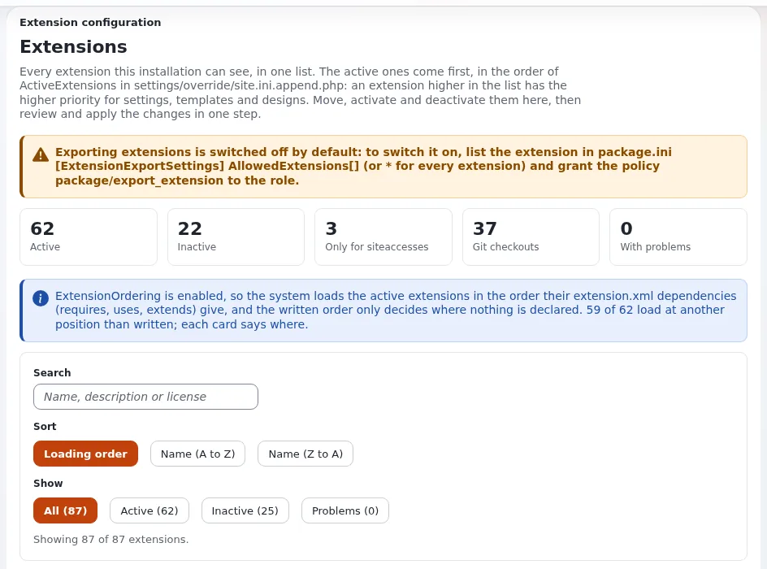

# Lektion 7.2: Ein Theme aktivieren und die Ladereihenfolge

Wer ein Theme installiert, schaltet es ein, wählt, welcher Siteaccess es verwendet, und kombiniert es manchmal mit einem
anderen Theme. Die Autorin oder der Autor des Themes entscheidet, wie einfach und sicher das ist: welche Einstellungen
das Theme mitliefert, welche es der Installation überlässt und wie es seine Beziehung zu anderen Erweiterungen angibt.
Diese Lektion behandelt beide Seiten.

## Auf einen Blick

| | |
|---|---|
| Kurs | [Theme-Design](../README.md) |
| Modul | [Modul 7: Ein Theme paketieren](README.md) |
| Dauer | 45 Minuten (15 Präsentation, 30 Übung) |
| Niveau | Fortgeschrittene |
| Zielgruppe | Designer und Entwickler, die Themes veröffentlichen; Administratoren, die sie installieren |
| Voraussetzungen | [Lektion 7.1](metadaten-der-theme-erweiterung.md) |

## Lernziele

Nach dieser Lektion können die Teilnehmenden:

- eine Erweiterung unter **Setup > Extensions** aktivieren und deaktivieren und dabei die Überprüfung vor dem Speichern
  lesen;
- zwischen `ActiveExtensions[]` (die Installation) und `ActiveAccessExtensions[]` (ein Siteaccess) wählen;
- Einstellungen zwischen Theme und Installation aufteilen und `SiteDesign` dokumentieren, statt es zu setzen;
- ein Theme mit `<extends>` in `extension.xml` vor einem Basis-Theme laden lassen.

## Hinweise für Trainer

### So präsentieren Sie es

Quellen: [Ein Theme aktivieren](../../../designer/erweiterungen/eine-theme-erweiterung-aktivieren.md),
[Die Ladereihenfolge und welches Theme gewinnt](../../../designer/erweiterungen/ladereihenfolge-von-themes.md),
[Die Design-Einstellungen, die ein Theme mitliefert](../../../designer/erweiterungen/design-einstellungen-eines-themes.md) und
[Die Seite Extensions](../../../../anleitungen/extensions-seite.md).

1. **Zwei Schalter** (3 Minuten). `site.ini [ExtensionSettings] ActiveExtensions[]` für die ganze Installation (der
   übliche Fall); `ActiveAccessExtensions[]` in den Einstellungen eines Siteaccess, wenn das Theme andere Siteaccesses
   überhaupt nicht berühren darf.
2. **Die Seite** (4 Minuten). **Setup > Extensions**: die Karte jeder Erweiterung mit **Aktivieren** oder
   **Deaktivieren**; die Änderungen werden erst nach **Änderungen prüfen** geschrieben, das die entstehenden Zeilen
   zeigt; beim Speichern bleibt eine Sicherungskopie erhalten. Die Seite kann außerdem **Autoload-Arrays neu
   erzeugen**.
3. **Was das Theme mitliefert** (4 Minuten). Im Theme: `DesignExtensions[]`, seine Listen der Stylesheets und Skripte,
   die Vorgaben seiner eigenen Einstellungen. In der Installation: `SiteDesign` für den Siteaccess, der das Theme
   verwendet, Name der Website, URLs, E-Mail und Datenbank. Ein Theme, das `SiteDesign` global setzte, würde die
   Administration und jede andere Website verändern. Ein Theme, das einen eigenen Siteaccess mitbringt, darf es in
   `settings/siteaccess/<siteaccess>/` der Erweiterung setzen.
4. **Wer gewinnt** (4 Minuten). Eine früher geladene Erweiterung gewinnt bei Einstellungen und Templates. Mit
   `ExtensionOrdering=enabled` (der Vorgabe) sorgt `<extends>` in Ihrer `extension.xml` dafür, dass Ihr Theme vor dem
   Basis-Theme geladen wird; `<requires>` und `<uses>` lassen es nach der genannten Erweiterung laden.

### Häufige Fragen

**Warum zeichnet mein Theme noch, obwohl ich es deaktiviert habe?** Der INI-Cache. Leeren Sie ihn und starten Sie in
einer Übungsumgebung mit Velocity Velocity neu.

**Kann ich Erweiterungen von Hand sortieren?** Ja, in der Liste unter **Setup > Extensions**, überprüft und dann
geschrieben; eine angegebene Abhängigkeit ist aber robuster.

**Löscht das Deaktivieren Dateien?** Nein. Der Ordner bleibt; nur die Einstellung ändert sich.

### Stolperfallen

- **Deaktivieren in einer gemeinsamen Übungsumgebung.** Für diese Lektion arbeiten alle Teilnehmenden auf ihrer
  eigenen Installation.
- **Die Karte lesen, bevor der Cache geleert ist.** Die Karte zeigt nach dem Speichern, wo die Erweiterung geladen
  wird; laden Sie neu.
- **`SiteDesign` im Ordner `settings/` des Themes setzen.** Das gilt global für jeden Siteaccess, in dem das Theme
  aktiv ist.

## Praktische Übung

Auf Ihrer eigenen Schulungsinstallation, in der Administration angemeldet mit Ihrem Schulungsadministrator.

1. Öffnen Sie **Setup > Extensions**. Suchen Sie die Karte von `training_theme` und lesen Sie ihren Zustand und ihre
   Position ab.
2. Klicken Sie darauf auf **Deaktivieren** und dann auf **Änderungen prüfen**. Lesen Sie die Zeilen, die die Seite
   schreiben würde. Übernehmen Sie die Änderung mit der Schaltfläche, die die Überprüfung anbietet.
3. Leeren Sie den INI-Cache (`php bin/php/ezcache.php --clear-tag=ini`; unter Velocity zusätzlich
   `php bin/php/console exp:velocity restart`) und laden Sie eine Seite von `<site>` neu.
4. Notieren Sie, wie die Website jetzt aussieht und warum (`SiteDesign=training_theme` nennt ein Design, das nicht mehr
   durchsucht wird).
5. Aktivieren Sie `training_theme` unter **Setup > Extensions** wieder, prüfen und übernehmen Sie die Änderung; leeren
   Sie den INI-Cache; laden Sie neu.
6. Lesen Sie ab, wo `SiteDesign` gesetzt ist: `php bin/php/console exp:ini where site/DesignSettings/SiteDesign <site>`.
   Es steht in den Siteaccess-Einstellungen der Installation, nicht im Theme: gut so.
7. Ergänzen Sie in der README des Themes einen Abschnitt „Einschalten“ mit den zwei Zeilen, die eine Installation
   braucht: der Zeile `ActiveExtensions[]` und der Zeile `SiteDesign` für ihren Siteaccess.
8. Schreiben Sie in Ihre Notizen den Block `<dependencies>`, mit dem Ihr Theme gegen ein Basis-Theme namens
   `base_theme` gewinnen würde, ohne ihn in Ihre Datei einzutragen (in der Übungsumgebung gibt es keine solche
   Erweiterung).

## Erwartetes Ergebnis

- Schritt 2: Die Überprüfung listet die Änderung von `ActiveExtensions[]` auf; das Speichern nennt die Datei und ihre
  Sicherungskopie.
- Schritt 4: Solange das Theme inaktiv ist, fällt die Website auf die Templates des Standard-Designs zurück (eine Seite
  ohne Gestaltung).
- Schritt 5: Das Theme zeichnet die Website wieder.
- Schritt 7: Die README erklärt einer Installation, wie das Theme eingeschaltet wird, ohne dass jemand den Code lesen
  muss.
- Der Trainer prüft den README-Abschnitt und die Notiz zu `<dependencies>` einer Teilnehmerin oder eines Teilnehmers:
  `<dependencies><extends><extension name="base_theme" /></extends></dependencies>`.

## Quiz

1. Welche Einstellung aktiviert ein Theme für nur einen Siteaccess?
2. Warum setzt ein Theme `SiteDesign` nicht in seiner `settings/site.ini.append.php`?
3. Ihr Theme muss Templates von `base_theme` überschreiben. Was geben Sie in `extension.xml` an?
   A. `<requires>` B. `<uses>` C. `<extends>` D. nichts
4. Was bewirkt **Änderungen prüfen** unter **Setup > Extensions**?
5. Löscht das Deaktivieren einer Erweiterung ihren Ordner?

Antworten

1. `ActiveAccessExtensions[]` in den Einstellungen dieses Siteaccess
   ([Ein Theme aktivieren](../../../designer/erweiterungen/eine-theme-erweiterung-aktivieren.md)).
2. Es würde für jeden Siteaccess gelten, in dem das Theme aktiv ist, einschließlich der Administration.
3. **C.** `<extends>` lässt das Theme vor `base_theme` laden, sodass es gewinnt
   ([Die Ladereihenfolge und welches Theme gewinnt](../../../designer/erweiterungen/ladereihenfolge-von-themes.md)).
4. Sie zeigt die entstehenden Zeilen von `ActiveExtensions[]` und die Risiken, bevor etwas geschrieben wird.
5. Nein; nur die Einstellung ändert sich.

## Weiterführende Literatur

- [Die Seite Extensions](../../../../anleitungen/extensions-seite.md): jeder Teil von **Setup > Extensions**.
- [Abhängigkeiten in extension.xml angeben](../../../designer/erweiterungen/abhaengigkeiten-in-extension-xml.md).
- [Siteaccess-Einstellungen in einem Theme](../../../designer/erweiterungen/siteaccess-einstellungen-in-einem-theme.md): wenn
  das Theme eine eigene Website mitbringt.
- [Einstellungsdateien in einer Erweiterung](../../../designer/erweiterungen/einstellungsdateien-in-einer-erweiterung.md).

## Verwandte Seiten

- [Modul 7: Ein Theme paketieren](README.md)
- [Theme-Design: Kursüberblick](../README.md)
- [Trainer: hier beginnen](../../trainer-hier-beginnen.md)
- [Freie Dokumentation](../../../freie-dokumentation.md): Diese Seite darf unter der GNU FDL 1.3 frei kopiert, übersetzt und verbessert werden.

<!-- exp-partner-block:start -->
**Werden Sie Exponential-Partner.** Partner teilen ihre Informationen, stellen Mittel bereit, geben Beiträge zurück
und entwickeln die Produkte mit uns, und so wächst Exponential. Eine Partner-Website und ein Dashboard sind für Mitte
2027 geplant: Werden Sie noch heute Partner, damit wir schneller wachsen und neue Funktionen früher liefern. Beginnen
Sie mit [Partner: hier beginnen](../../../partner/partner-hier-beginnen.md) und
[Wie Sie sich bewerben](../../../partner/wie-sie-sich-bewerben.md).
<!-- exp-partner-block:end -->
