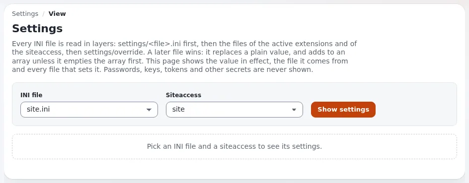

# Lektion 1.4: Die Einstellungsseite

Exponential wird mit INI-Dateien konfiguriert, die in Schichten gelesen werden: die Standardwerte, der Siteaccess, die aktiven Erweiterungen (die den
Siteaccess übersteuern) und der globale Override, der alles übersteuert. Die Einstellungsseite (**Setup > Ini Einstellungen**) zeigt für jede
Einstellung den wirksamen Wert, die Datei, aus der er stammt, und jede Datei, die ihn setzt. Sie ist für neue
Administratoren der sicherste Weg, sich die Konfiguration anzusehen, und sie kann eine Einstellung auch ändern.

## Auf einen Blick

| | |
|---|---|
| Kurs | [Website-Administration](../README.md) |
| Modul | [Modul 1: Orientierung als Website-Administrator](README.md) |
| Dauer | 40 Minuten (15 Präsentation, 25 Übung) |
| Niveau | Fortgeschrittene |
| Zielgruppe | Website-Administratoren |
| Voraussetzungen | [Lektion 1.3](systeminformationen-und-zustandspruefungen.md); ein Administratorkonto auf der Schulungsinstallation |

## Lernziele

Nach dieser Lektion können die Teilnehmenden:

- eine INI-Datei für einen Siteaccess öffnen und die zusammenfassenden Zahlen lesen;
- die Ladereihenfolge erklären und sagen, welche Datei bei einem einfachen Wert und bei einem Array gewinnt;
- eine Einstellung in allen Dateien finden und nur die vom Standard geänderten Einstellungen auflisten;
- zwei Siteaccesses vergleichen;
- eine Einstellung für einen Siteaccess ändern und die Änderung wieder entfernen.

## Hinweise für Trainer

### So präsentieren Sie es

Quelle: [Die Einstellungsseite](../../../../anleitungen/einstellungsseite.md).

1. **Schichten** (4 Minuten). Zeichnen Sie die Ladereihenfolge auf: `settings/<file>.ini` (der Standard), die
   Siteaccess-Verzeichnisse der Erweiterungen, `settings/siteaccess/<siteaccess>`, die aktiven Erweiterungen,
   `settings/override`. Eine spätere Datei gewinnt: Sie ersetzt einen einfachen Wert und ergänzt ein Array, außer
   sie leert das Array zuerst mit `Name[]`.
2. **Eine Datei öffnen** (3 Minuten). **Setup > Ini Einstellungen**, wählen Sie eine **INI-Datei** und einen
   **Siteaccess** und klicken Sie auf **Einstellungen anzeigen**. Die Adresse wird zu
   `settings/view/<siteaccess>/<file>` und lässt sich daher als Lesezeichen speichern.
3. **Eine Einstellung** (4 Minuten). Zeigen Sie den wirksamen Wert, seine Herkunft (Standard, Extension, Siteaccess,
   Globaler Override), die Abzeichen (**geändert**, **kein Standard**, **Geheimnis, verborgen**,
   **Velocity-Neustart**) und die Kette unter „In N Dateien gesetzt“.
4. **Suchen und vergleichen** (2 Minuten). Suchen Sie in **Diese Datei** oder **Alle Dateien**; setzen Sie das Häkchen
   bei **Nur vom Standard geänderte Einstellungen**; wählen Sie einen Siteaccess unter
   **Mit Siteaccess vergleichen**.
5. **Ändern** (2 Minuten). **Bearbeiten**, wählen Sie **Speichern in** (ein Siteaccess oder alle Siteaccesses als
   globaler Override), **Speichern**. Das Speichern leert den INI-Cache. Einstellungen mit dem Abzeichen
   **Velocity-Neustart** brauchen `exp:velocity restart`, bevor Velocity sie verwendet.

### Häufige Fragen

**Warum werden manche Werte maskiert angezeigt?** Passwörter, Schlüssel, Tokens, Salts und Zugangsdaten werden nie
angezeigt; die Seite sagt nur, ob sie gesetzt sind. Auch die Suche sieht nicht in sie hinein, sodass sich mit ihr
kein Geheimnis erraten lässt.

**Soll ich in einer Erweiterung speichern?** Bevorzugen Sie den Siteaccess oder den globalen Override: Ein Update der
Erweiterung ersetzt deren eigene Einstellungsdatei.

**Ein Kollege hat eine Datei mit einem Editor geändert, und nichts ist passiert.** Die Installation prüft keine
Dateizeiten; der INI-Cache muss geleert werden. Die Seite kennzeichnet solche Einstellungen als
**noch nicht wirksam**. Leeren Sie den INI-Cache über **Setup > Cache-Verwaltung** oder mit
`php bin/php/ezcache.php --clear-tag=ini`.

**Warum kann ich eine Einstellung nicht entfernen?** Nur Einstellungen in den eigenen Dateien der Installation
(`settings/override` oder `settings/siteaccess/<siteaccess>`) lassen sich entfernen. Standardwerte und Einstellungen
von Erweiterungen haben kein Kontrollkästchen.

### Stolperfallen

- **Im falschen Geltungsbereich speichern.** Eine als globaler Override gespeicherte Änderung wirkt auf jeden
  Siteaccess, auch auf die Administration. Lesen Sie **Wo sie gesetzt wird**, bevor Sie auf **Speichern** klicken.
- **Arrays.** Das Bearbeitungsfeld eines Arrays beginnt mit einer leeren ersten Zeile, die das Array vor Ihren
  Elementen leert. Entfernen Sie sie, ergänzen Sie stattdessen die Elemente, die frühere Dateien gesetzt haben.
  Zeigen Sie beides am Beamer.
- **Die eigenen Einstellungen der Administration ändern.** Ein falscher Wert im Siteaccess `admin` kann Sie aus der
  Administration aussperren. Üben Sie am Siteaccess `site`.

## Praktische Übung

Auf Ihrer Schulungsinstallation, als Administrator angemeldet:

1. Öffnen Sie **Setup > Ini Einstellungen**. Wählen Sie als **INI-Datei** `site.ini` und als **Siteaccess** `site`
   und klicken Sie dann auf **Einstellungen anzeigen**.
2. Lesen Sie die zusammenfassenden Zahlen. Wie viele Einstellungen sind vom Standard geändert? Wie viele Dateien
   werden gelesen?
3. Öffnen Sie die Liste der gelesenen Dateien in ihrer Reihenfolge und schreiben Sie die Dateien in dieser
   Reihenfolge auf.
4. Suchen Sie `SiteName` im Block `SiteSettings`. Notieren Sie den Wert und seine Herkunft.
5. Suchen Sie in **Alle Dateien** nach `AdminEmail`. Notieren Sie die Datei und den Wert.
6. Setzen Sie das Häkchen bei **Nur vom Standard geänderte Einstellungen** und sehen Sie sich an, was übrig bleibt.
7. Wählen Sie unter **Mit Siteaccess vergleichen** `admin` und klicken Sie auf **Anzeigen**. Notieren Sie zwei
   Einstellungen, die sich unterscheiden.
8. Zurück in `site.ini` für `site` klicken Sie neben `SiteName` auf **Bearbeiten**. Lesen Sie **Wo sie gesetzt wird**.
9. Geben Sie `Training site of <your name>` ein, wählen Sie unter **Speichern in** nur den Siteaccess `site` und
   klicken Sie auf **Speichern**.
10. Lesen Sie die Meldung: Welche Datei wurde geschrieben, welche Caches wurden geleert?
11. Öffnen Sie die öffentliche Website und prüfen Sie den neuen Namen im Seitentitel oder in der Kopfzeile.
12. Setzen Sie auf der Einstellungsseite das Häkchen bei `SiteName` und klicken Sie auf **Ausgewählte entfernen**.
    Prüfen Sie, dass der frühere Wert zurück ist.

## Erwartetes Ergebnis

- Schritt 3 listet die Standarddatei zuerst und `settings/override` zuletzt.
- Schritt 9 schreibt `settings/siteaccess/site/site.ini.append.php`; die Meldung nennt die INI-Caches, die geleert
  wurden.
- Die öffentliche Website zeigt nach Schritt 9 den neuen Namen und nach Schritt 12 den früheren Namen.
- Der Trainer prüft das, indem er die Teilnehmenden fragt, woher `SiteName` vor und nach Schritt 9 stammt.

## Quiz

1. Zwei Dateien setzen denselben einfachen Wert. Welche gewinnt?
2. Was bewirkt eine Zeile `Name[]` in einer INI-Datei?
   A. Fügt ein leeres Element hinzu B. Leert das Array C. Kommentiert die Einstellung aus D. Kennzeichnet sie als
   geheim
3. Welche Datei schreibt **Speichern in** „Alle Siteaccesses (globaler Override)“?
4. Was sagt Ihnen das Abzeichen **Velocity-Neustart**?
5. Warum zeigt die Seite den Wert eines Passworts nie an, nicht einmal Administratoren?

Antworten

1. Die, die in der Ladereihenfolge später gelesen wird.
2. **B.** Was frühere Dateien hinzugefügt haben, fällt weg ([Die Einstellungsseite](../../../../anleitungen/einstellungsseite.md#3-eine-einstellung-lesen)).
3. `settings/override/<file>.append.php`.
4. Velocity liest diese Einstellung nur beim Start: Führen Sie nach dem Speichern `exp:velocity restart` aus.
5. Damit weder die Seite noch ein Screenshot noch ein geteilter Bildschirm es preisgeben kann; die Seite sagt nur, ob
   ein Geheimnis gesetzt ist.

## Weiterführende Literatur

- [Die Einstellungsseite](../../../../anleitungen/einstellungsseite.md): jede Zahl, jedes Abzeichen und jede Schaltfläche.
- [Einstellungen auf der Kommandozeile ändern: exp:ini](../../../../funktionen/6.0/exp-ini-befehl.md): dieselbe Arbeit
  in einem Terminal (Lektion 1.5).
- [INI-Overrides für mehrere Websites](../../../../funktionen/6.0/ini-ueberschreibungen-fuer-mehrere-websites.md): Einstellungen für
  mehrere Websites in einer Installation.

## Verwandte Seiten

- [Modul 1: Orientierung als Website-Administrator](README.md)
- [Website-Administration: Kursüberblick](../README.md)
- [Trainer: hier beginnen](../../trainer-hier-beginnen.md)
- [Freie Dokumentation](../../../freie-dokumentation.md): Diese Seite darf unter der GNU FDL 1.3 frei kopiert, übersetzt und verbessert werden.

<!-- exp-partner-block:start -->
**Werden Sie Exponential-Partner.** Partner teilen ihre Informationen, stellen Mittel bereit, geben Beiträge zurück
und entwickeln die Produkte mit uns, und so wächst Exponential. Eine Partner-Website und ein Dashboard sind für Mitte
2027 geplant: Werden Sie noch heute Partner, damit wir schneller wachsen und neue Funktionen früher liefern. Beginnen
Sie mit [Partner: hier beginnen](../../../partner/partner-hier-beginnen.md) und
[Wie Sie sich bewerben](../../../partner/wie-sie-sich-bewerben.md).
<!-- exp-partner-block:end -->
