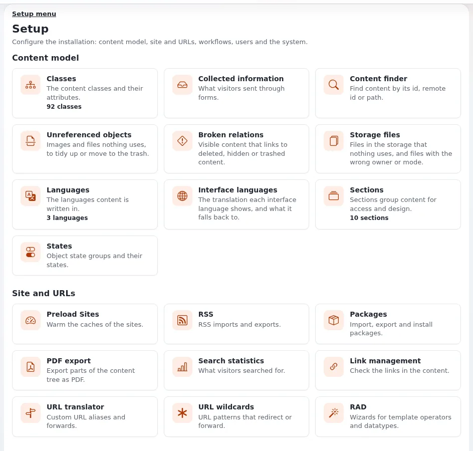

# Lektion 1.2: Ein Rundgang durch den Setup-Bereich

Fast alles, was ein Website-Administrator im Browser tut, beginnt bei **Setup** im oberen Menü. Die Setup-Seite fasst
etwa vierzig Seiten nach ihrem Zweck zusammen und gibt jeder eine einzeilige Beschreibung. Diese Lektion geht die
Gruppen durch, damit die Teilnehmenden wissen, wo sie suchen müssen, bevor spätere Module die Seiten eine nach der
anderen öffnen.

## Auf einen Blick

| | |
|---|---|
| Kurs | [Website-Administration](../README.md) |
| Modul | [Modul 1: Orientierung als Website-Administrator](README.md) |
| Dauer | 35 Minuten (15 Präsentation, 20 Übung) |
| Niveau | Fortgeschrittene |
| Zielgruppe | Neue Website-Administratoren |
| Voraussetzungen | [Lektion 1.1](was-ein-website-administrator-tut.md): eine laufende Schulungsinstallation und ein Administratorkonto |

## Lernziele

Nach dieser Lektion können die Teilnehmenden:

- die Setup-Seite öffnen und ihre Gruppen benennen;
- eine Setup-Seite über das linke Menü oder über die Beschreibungen der Setup-Seite finden;
- unterscheiden, welche Seiten nur lesen und welche die Website verändern können;
- eine Setup-Seite, die sie oft brauchen werden, als Lesezeichen speichern.

## Hinweise für Trainer

### So präsentieren Sie es

Quelle: [Ein Rundgang durch die Administration](../../../rundgang-durch-die-administration.md). Diese Lektion beschreibt das Design admin4;
andere Designs der Administration zeigen dieselben Seiten in einem anderen Rahmen.

1. **Die Setup-Seite** (4 Minuten). Klicken Sie im oberen Menü auf **Setup**. Die Seite **Setup** öffnet sich mit der
   Zeile „Die Installation einrichten: Inhaltsmodell, Site und URLs, Workflows, Benutzer und das System.“ Jede Gruppe
   listet ihre Seiten mit einer kurzen Beschreibung auf; manche zeigen eine Anzahl (zum Beispiel die Zahl der Klassen,
   Sprachen oder Sektionen).
2. **Die Gruppen** (8 Minuten). Gehen Sie sie am Beamer durch:

   | Gruppe | Seiten (Beispiele) | Verwendet in diesem Kurs |
   |---|---|---|
   | **Inhaltsmodell** | **Klassen**, **Sprachen**, **Oberflächensprachen**, **Sektionen**, **Zustände**, **Inhaltsfinder**, **Ungültige Relationen** | Modul 4 |
   | **Website und URLs** | **Seiten vorladen**, **RSS**, **Pakete**, **Suchstatistiken**, **URL-Verwaltung**, **URL-Übersetzer**, **URL Platzhalter** | Module 5 und später |
   | **Workflows** | **Trigger**, **Workflows**, **Workflow-Prozesse** | Modul 6 |
   | **Benutzer und Nachrichten** | **Audit**, **E-Mail-Einstellungen**, **Benachrichtigungen**, **Sitzungen**, **Benutzerkonten prüfen** | Modul 2 und später |
   | **System** | **Cache-Verwaltung**, **Wartung**, **Cronjobs**, **Logdateien**, **Extensions**, **Ini Einstellungen**, **Site-Daten**, **Systeminformationen**, **Upgrade-Prüfung** | die meisten Module |

   Installationen mit mehr Erweiterungen zeigen weitere Gruppen, zum Beispiel **KI** und **Updates**.
3. **Das linke Menü** (2 Minuten). Auf jeder Setup-Seite wiederholt die linke Spalte dieselben Gruppen als Menü, mit
   **Übersicht** ganz oben. Die aktuelle Seite ist hervorgehoben.
4. **Ansehen oder ändern** (1 Minute). Seiten wie **Systeminformationen**, **Site-Daten** und **Logdateien** lesen
   nur. **Cache-Verwaltung**, **Wartung**, **Ini Einstellungen** und **Cronjobs** können das Verhalten der Website für
   alle verändern. Sehen Sie sich auf einer Live-Website erst alles an, bevor Sie irgendetwas anklicken.

### Häufige Fragen

**Warum sehe ich Setup überhaupt nicht?** Dem Konto fehlen die Richtlinien für das Modul `setup`. Setup-Seiten
brauchen eigene Richtlinien, zum Beispiel `setup/system_info` für **Systeminformationen**. Modul 3 erklärt
Richtlinien.

**Warum zeigt meine Setup-Seite andere Gruppen als die des Trainers?** Gruppen und Seiten stammen von den
installierten Erweiterungen. Eine Seite, die eine Erweiterung hinzufügt, erscheint nur, wenn diese Erweiterung aktiv
ist.

**Wo ist die Benutzerliste?** Unter **Benutzer** im oberen Menü, nicht unter Setup. Nur **Benutzerkonten prüfen** und
**Sitzungen** liegen in Setup.

### Stolperfallen

- **Sich durch die Cache-Verwaltung klicken.** Teilnehmende, die neugierig jede Schaltfläche ausprobieren, leeren
  womöglich Caches; auf einer Schulungsinstallation ist das harmlos, auf einer Live-Website verlangsamt es die
  Website. Sagen Sie das vor der Übung.
- **Verloren ohne linke Spalte.** Ist die linke Spalte ausgeblendet, holt die Schaltfläche **Linke Spalte** in der
  Kopfzeile sie zurück.

## Praktische Übung

Auf Ihrer Schulungsinstallation, als Administrator angemeldet:

1. Klicken Sie im oberen Menü auf **Setup** und lesen Sie die Beschreibungen der Gruppe **System**.
2. Öffnen Sie **Systeminformationen** über das linke Menü. Notieren Sie die Version von Exponential, die dort steht.
3. Kehren Sie mit **Übersicht** ganz oben im linken Menü zurück.
4. Suchen Sie ohne Hilfe des Trainers die Seite, die auflistet, **wer angemeldet ist**, und öffnen Sie sie.
5. Suchen Sie die Seite, die die **Sektionen** auflistet, und notieren Sie, wie viele es gibt.
6. Suchen Sie die Seite, die zeigt, **wonach Besucher gesucht haben**.
7. Suchen Sie die Seite, auf der **INI-Einstellungen** gelesen werden. Ändern Sie nichts.
8. Öffnen Sie **Logdateien** und notieren Sie, welche Logdateien es gibt.
9. Speichern Sie **Systeminformationen** mit **Lesezeichen setzen** in der rechten Spalte als Lesezeichen.
10. Schreiben Sie für jede Seite aus den Schritten 2 bis 8 auf: Liest sie nur, oder kann sie die Website verändern?

## Erwartetes Ergebnis

- Schritt 4 führt zu **Sitzungen**, Schritt 5 zu **Sektionen**, Schritt 6 zu **Suchstatistiken**, Schritt 7 zu
  **Ini Einstellungen**.
- Das Lesezeichen erscheint in der rechten Spalte unter **Lesezeichen**.
- Die Liste aus Schritt 10 kennzeichnet **Systeminformationen**, **Suchstatistiken** und **Logdateien** als lesend
  und **Sitzungen**, **Sektionen** und **Ini Einstellungen** als Seiten, die etwas verändern können (Sitzungen
  beenden, Sektionen bearbeiten, Einstellungen speichern).
- Der Trainer prüft das, indem er eine Aufgabe ausruft („Wo sehe ich die Cronjobs?“) und die Zeit bis zur Antwort
  misst.

## Quiz

1. Welche Setup-Gruppe enthält **Cache-Verwaltung** und **Cronjobs**?
   A. **Inhaltsmodell** B. **Website und URLs** C. **Benutzer und Nachrichten** D. **System**
2. In welcher Gruppe liegen **Sektionen** und **Zustände**?
3. Nennen Sie zwei Setup-Seiten, die nur lesen.
4. Warum können zwei Administratoren auf ihrer Setup-Seite unterschiedliche Gruppen sehen?
5. Wo ist die Benutzerliste, wenn nicht in Setup?

Antworten

1. **D.** Die Gruppe **System** (Design admin4).
2. **Inhaltsmodell.**
3. Zum Beispiel **Systeminformationen**, **Site-Daten**, **Suchstatistiken**
   ([Systeminformationen](../../../../anleitungen/systeminformationen.md)).
4. Erweiterungen fügen Seiten und Gruppen hinzu, und Richtlinien entscheiden, welche Seiten ein Konto öffnen darf.
5. Unter **Benutzer** im oberen Menü.

## Weiterführende Literatur

- [Ein Rundgang durch die Administration](../../../rundgang-durch-die-administration.md): die Kopfzeile, die linke und die rechte Spalte,
  das Dashboard.
- [Eine Website betreiben](../../../../anleitungen/betrieb-einer-website.md): wofür die System-Seiten im Alltag verwendet
  werden.
- [Das Design admin4](../../../../../eng-us/features/6.0/admin4-design.md): das Design, das dieser Kurs beschreibt.

## Verwandte Seiten

- [Modul 1: Orientierung als Website-Administrator](README.md)
- [Website-Administration: Kursüberblick](../README.md)
- [Trainer: hier beginnen](../../trainer-hier-beginnen.md)
- [Freie Dokumentation](../../../freie-dokumentation.md): Diese Seite darf unter der GNU FDL 1.3 frei kopiert, übersetzt und verbessert werden.

<!-- exp-partner-block:start -->
**Werden Sie Exponential-Partner.** Partner teilen ihre Informationen, stellen Mittel bereit, geben Beiträge zurück
und entwickeln die Produkte mit uns, und so wächst Exponential. Eine Partner-Website und ein Dashboard sind für Mitte
2027 geplant: Werden Sie noch heute Partner, damit wir schneller wachsen und neue Funktionen früher liefern. Beginnen
Sie mit [Partner: hier beginnen](../../../partner/partner-hier-beginnen.md) und
[Wie Sie sich bewerben](../../../partner/wie-sie-sich-bewerben.md).
<!-- exp-partner-block:end -->
