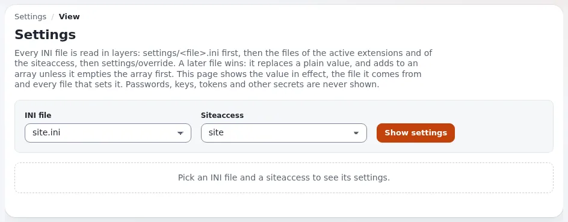

# Lektion 1.5: INI-Dateien und exp:ini auf der Kommandozeile

Die Einstellungsseite ist bequem, aber Administratoren, die im Terminal arbeiten, ein Deployment per Skript erledigen
oder viele Websites betreuen, brauchen dieselbe Arbeit auf der Kommandozeile. `exp:ini` liest und ändert
Einstellungen in jedem Geltungsbereich, erhält Kommentare und Reihenfolge in den Dateien, zeigt jede Änderung mit
`--dry-run` vorab an und sichert jede Datei, die es ändert.

## Auf einen Blick

| | |
|---|---|
| Kurs | [Website-Administration](../README.md) |
| Modul | [Modul 1: Orientierung als Website-Administrator](README.md) |
| Dauer | 35 Minuten (10 Präsentation, 25 Übung) |
| Niveau | Fortgeschrittene |
| Zielgruppe | Website-Administratoren, die mit einem Terminal vertraut sind |
| Voraussetzungen | [Lektion 1.4](die-einstellungsseite.md); ein Terminal im Wurzelverzeichnis der Schulungsinstallation |

## Lernziele

Nach dieser Lektion können die Teilnehmenden:

- die Verzeichnisse mit INI-Dateien und die Reihenfolge, in der sie gelesen werden, benennen;
- einen Wert und seine Herkunft mit `exp:ini get` und `exp:ini where` lesen;
- einen Wert in den Geltungsbereichen `global` und `siteaccess:<name>` schreiben und entfernen und ihn vorher mit
  `--dry-run` prüfen;
- die Sicherung einer Datei finden, die `exp:ini` geändert hat;
- erklären, wann eine INI-Änderung beim Webserver ankommt.

## Hinweise für Trainer

### So präsentieren Sie es

Quelle: [Einstellungen auf der Kommandozeile ändern: exp:ini](../../../../../eng-us/features/6.0/exp-ini-command.md) und die
vollständige Referenz [console exp:ini](../../../../bc/6.0/console-exp-ini.md).

1. **Wo INI-Dateien liegen** (3 Minuten). Zeigen Sie den Baum in einem Terminal: `settings/` (die Standardwerte,
   werden nie bearbeitet), `settings/siteaccess/<siteaccess>/`, `settings/override/` und `extension/<ext>/settings/`.
   Dateien, die keine Standardwerte sind, enden auf `.ini.append.php`; der PHP-Kommentar am Anfang verhindert, dass
   sie als Text ausgeliefert werden.
2. **Die Geltungsbereiche** (3 Minuten). Zeigen Sie die Tabelle der Geltungsbereiche am Beamer:

   | Geltungsbereich | Geschriebene Datei |
   |---|---|
   | `global` | `settings/override/<file>.ini.append.php` |
   | `siteaccess:<sa>` | `settings/siteaccess/<sa>/<file>.ini.append.php` |
   | `extension:<ext>` | `extension/<ext>/settings/<file>.ini.append.php` |
   | `default` | `settings/<file>.ini`, abgelehnt ohne `--allow-default` |

3. **Die Aktionen** (2 Minuten): `get`, `set`, `add`, `rem`, `clear`, `toggle`, `where`, `list`. `exp:ini --help`
   listet sie auf; `exp:ini help <action>` erklärt eine davon.
4. **Sicherheit** (2 Minuten). Eine Sicherung jeder geänderten Datei landet in `var/backup/ini/<timestamp>/`;
   Schreibvorgänge werden im Audit-Protokoll als `system.setting.write` festgehalten, Geheimnisse als `[secret]`.

### Häufige Fragen

**Ist `exp:ini` dasselbe wie das Bearbeiten der Datei?** Es bearbeitet die Datei Zeile für Zeile, sodass Kommentare,
Leerzeilen und Reihenfolge so bleiben, wie Sie sie geschrieben haben. Ein Texteditor tut dasselbe, liefert aber keine
Sicherung, keine Vorschau und keinen Eintrag im Audit-Protokoll.

**Wann verwendet die Website meine Änderung?** Nachdem der INI-Cache geleert wurde:
`php bin/php/ezcache.php --clear-tag=ini`. `exp:ini` gibt einen Hinweis aus, wo die Änderung wirksam wird.
Einstellungen, die Velocity nur beim Start liest, brauchen `exp:velocity restart`.

**Kann ich es als root ausführen?** Fügen Sie `--allow-root-user` hinzu. Besser: Führen Sie es als der Benutzer aus,
dem die Dateien gehören, damit der Webserver sie weiterhin lesen kann.

### Stolperfallen

- **Anführungszeichen.** Werte mit Leerzeichen brauchen Anführungszeichen: `"Training site"`. Zeigen Sie einmal ein
  fehlerhaftes Beispiel.
- **Den Geltungsbereich vergessen.** Ohne Geltungsbereich weiß `set` nicht, wohin es schreiben soll; mit dem falschen
  schreibt es dorthin, wo die Teilnehmenden es nicht erwartet haben. Führen Sie den Befehl immer zuerst mit
  `--dry-run` aus und lesen Sie den Diff.
- **`settings/*.ini` bearbeiten.** Die Standarddateien werden bei jedem Upgrade ersetzt. Deshalb wird `default`
  abgelehnt.

## Praktische Übung

In einem Terminal, im Wurzelverzeichnis Ihrer Schulungsinstallation:

1. Lassen Sie sich die Aktionen auflisten:

   ```bash
   php bin/php/console exp:ini --help
   ```

2. Lesen Sie den wirksamen Namen der Website und seine Herkunft:

   ```bash
   php bin/php/console exp:ini get site.ini/SiteSettings/SiteName
   php bin/php/console exp:ini where site.ini/SiteSettings/SiteName
   ```

3. Sehen Sie sich eine Änderung nur für den öffentlichen Siteaccess vorab an und lesen Sie den Diff:

   ```bash
   php bin/php/console exp:ini set site.ini/SiteSettings/SiteName "CLI training site" siteaccess:site --dry-run
   ```

4. Führen Sie denselben Befehl ohne `--dry-run` aus.
5. Führen Sie `where` erneut aus (Schritt 2) und suchen Sie die neue Datei in der Liste.
6. Lassen Sie sich das Sicherungsverzeichnis anzeigen und suchen Sie die Kopie der Datei vor der Änderung:

   ```bash
   ls var/backup/ini/
   ```

7. Leeren Sie den INI-Cache, damit die Website die Änderung verwendet, und laden Sie dann die öffentliche Website
   neu:

   ```bash
   php bin/php/ezcache.php --clear-tag=ini
   ```

8. Öffnen Sie **Setup > Ini Einstellungen** für `site.ini` und `site` und prüfen Sie, dass die Seite dieselbe Herkunft
   zeigt.
9. Entfernen Sie die Änderung und leeren Sie den INI-Cache erneut:

   ```bash
   php bin/php/console exp:ini rem site.ini/SiteSettings/SiteName siteaccess:site
   php bin/php/ezcache.php --clear-tag=ini
   ```

10. Führen Sie ein letztes Mal `where` aus und prüfen Sie, dass die Datei des Siteaccess den Wert nicht mehr setzt.

## Erwartetes Ergebnis

- Schritt 3 gibt einen Diff aus und schreibt nichts.
- Nach Schritt 4 listet `where` die Datei `settings/siteaccess/site/site.ini.append.php` als wirksame Datei.
- Unter `var/backup/ini/` gibt es ein Verzeichnis mit Zeitstempel.
- Nach Schritt 7 zeigt die öffentliche Website „CLI training site“; nach Schritt 9 ist der frühere Name zurück.
- Der Trainer prüft das, indem er eine Teilnehmerin oder einen Teilnehmer bittet, die Ausgabe von `where` laut
  vorzulesen.



## Quiz

1. Welcher Geltungsbereich schreibt `settings/override/site.ini.append.php`?
   A. `default` B. `global` C. `siteaccess:admin` D. `extension:site`
2. Was bewirkt `--dry-run`?
3. Wo legt `exp:ini` eine Sicherung einer Datei ab, die es ändert?
4. Sie haben eine Einstellung mit `exp:ini` geändert, aber die Website zeigt sie nicht. Was führen Sie aus?
5. Warum wird der Geltungsbereich `default` abgelehnt, solange Sie nicht `--allow-default` angeben?

<details>
<summary>Antworten</summary>

1. **B.** ([Geltungsbereiche von exp:ini](../../../../../eng-us/features/6.0/exp-ini-command.md#scopes)).
2. Es gibt als Diff aus, was sich ändern würde, und schreibt nichts.
3. In `var/backup/ini/<timestamp>/`.
4. `php bin/php/ezcache.php --clear-tag=ini`, und `exp:velocity restart` für eine Einstellung, die Velocity nur beim
   Start liest.
5. Die Standarddateien werden bei jedem Upgrade ersetzt, eine Änderung dort ginge also verloren.

</details>

## Weiterführende Literatur

- [Einstellungen auf der Kommandozeile ändern: exp:ini](../../../../../eng-us/features/6.0/exp-ini-command.md): die Aktionen und
  Geltungsbereiche.
- [console exp:ini](../../../../bc/6.0/console-exp-ini.md): die vollständige Referenz mit der Ausgabe jeder Aktion.
- [Die Einstellungsseite](../../../../anleitungen/einstellungsseite.md): dieselben Einstellungen im Browser.
- [Caches](../../../../anleitungen/caches.md): der INI-Cache und die anderen (Modul 5).

## Verwandte Seiten

- [Modul 1: Orientierung als Website-Administrator](README.md)
- [Website-Administration: Kursüberblick](../README.md)
- [Trainer: hier beginnen](../../trainer-hier-beginnen.md)
- [Freie Dokumentation](../../../freie-dokumentation.md): Diese Seite darf unter der GNU FDL 1.3 frei kopiert, übersetzt und verbessert werden.

<!-- exp-partner-block:start -->
**Werden Sie Exponential-Partner.** Partner teilen ihre Informationen, stellen Mittel bereit, geben Beiträge zurück
und entwickeln die Produkte mit uns, und so wächst Exponential. Eine Partner-Website und ein Dashboard sind für Mitte
2027 geplant: Werden Sie noch heute Partner, damit wir schneller wachsen und neue Funktionen früher liefern. Beginnen
Sie mit [Partner: hier beginnen](../../../partner/partner-hier-beginnen.md) und
[Wie Sie sich bewerben](../../../partner/wie-sie-sich-bewerben.md).
<!-- exp-partner-block:end -->
