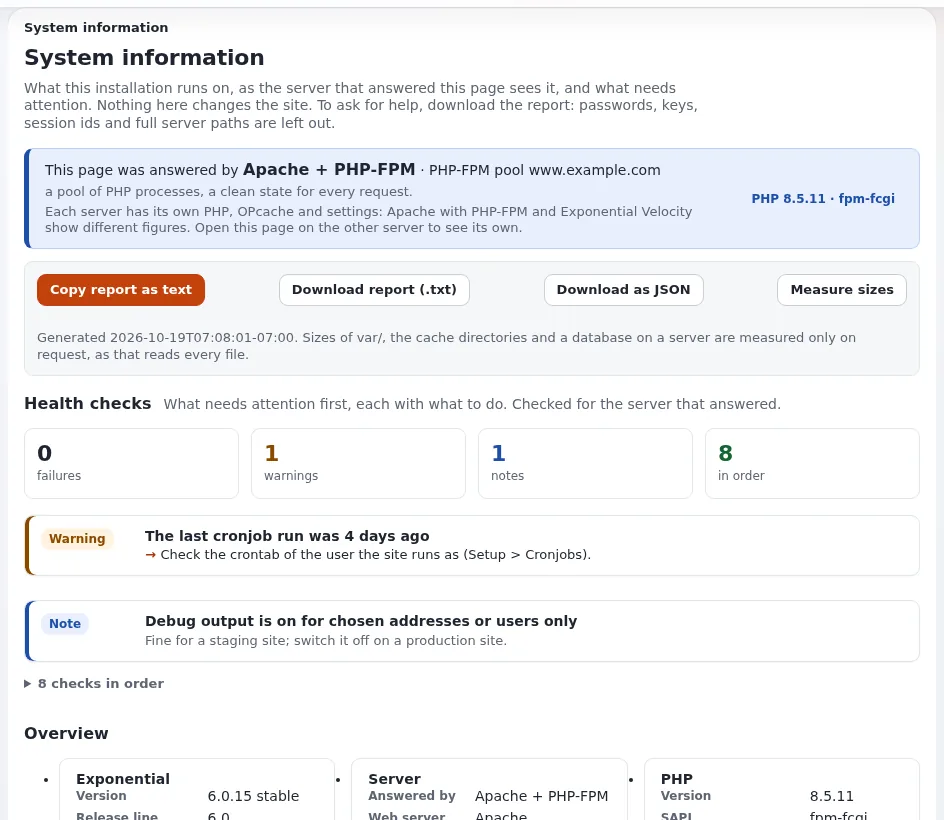

# Lektion 1.3: Systeminformationen und Zustandsprüfungen

Wenn sich eine Website seltsam verhält, lautet die erste Frage immer: „Worauf läuft sie?“
**Setup > Systeminformationen** beantwortet das auf einer Seite: welcher Server geantwortet hat, welches PHP, welche
Datenbank, was die Caches tun, wann die Cronjobs zuletzt liefen, und eine Liste von Zustandsprüfungen mit dem, was
jeweils zu tun ist. Die Seite liest nur und kann daher jederzeit gefahrlos geöffnet werden.

## Auf einen Blick

| | |
|---|---|
| Kurs | [Website-Administration](../README.md) |
| Modul | [Modul 1: Orientierung als Website-Administrator](README.md) |
| Dauer | 35 Minuten (15 Präsentation, 20 Übung) |
| Niveau | Fortgeschrittene |
| Zielgruppe | Website-Administratoren und Support-Mitarbeiter |
| Voraussetzungen | [Lektion 1.2](ein-rundgang-durch-den-setup-bereich.md); ein Administratorkonto auf der Schulungsinstallation |

## Lernziele

Nach dieser Lektion können die Teilnehmenden:

- das Banner lesen, das angibt, welcher Server geantwortet hat, und erklären, warum sich die Werte zwischen Servern
  unterscheiden;
- die **Zustandsprüfungen** lesen und sagen, was bei einer Warnung zu tun ist;
- die Siteaccesses der Installation finden und sehen, wie eine Anfrage jeden davon erreicht;
- einen Support-Bericht herunterladen und sagen, was er nie enthält;
- denselben Bericht mit `exp:system:info` in einem Terminal ausgeben.

## Hinweise für Trainer

### So präsentieren Sie es

Quelle: [Systeminformationen](../../../../anleitungen/systeminformationen.md).

1. **Die Seite öffnen** (2 Minuten): **Setup > Systeminformationen**. Die Überschriften sind **Zustandsprüfungen**,
   **Übersicht**, dann eingeklappte Teile wie **Aktive Extensions**, **PHP-Erweiterungen und -Einstellungen**,
   **Adressen der Website**, **Siteaccesses**, **OPcache und APCu**, **Datenbankverbindung** und
   **Bericht für den Support**.
2. **Wer geantwortet hat** (3 Minuten). Das Banner nennt den Server: Apache mit PHP-FPM, Exponential Velocity,
   FrankenPHP oder den eingebauten Server von PHP. Jeder hat sein eigenes PHP und OPcache, deshalb zeigt dieselbe
   Seite auf einem anderen Server andere Werte. Die Schulungsinstallation läuft auf Velocity.
3. **Zustandsprüfungen** (4 Minuten). Jede Prüfung ist **Fehler**, **Warnung**, **Hinweis** oder **OK**, die Fehler
   zuerst, jede mit dem, was zu tun ist. Typische Befunde auf einer Schulungsinstallation: E-Mail mit
   `Transport=file` (ein Hinweis: Es wird nichts versendet, genau das, was eine Übungsumgebung will) und noch kein
   Lauf der Cronjobs.
4. **Die Karten der Übersicht** (3 Minuten): **Exponential**, **Server**, **PHP**, **OPcache und APCu**,
   **Datenbank**, **Speicher**, **Caches**, **Cronjobs**, **E-Mail**, **Gebietsschema und Zeit**, **Maschine**.
5. **Siteaccesses** (2 Minuten). Klappen Sie den Teil auf: diese Anfrage, die Zuordnungstabelle (welche Regel welchen
   Siteaccess erreicht) und eine Karte pro Siteaccess. Modul 4 kommt darauf zurück.
6. **Der Bericht** (1 Minute). **Bericht herunterladen (.txt)**, **Als JSON herunterladen** und
   **Bericht als Text kopieren** liefern einen Bericht für eine Support-Anfrage ohne Passwörter, Schlüssel, Tokens,
   Sitzungs-IDs oder vollständige Serverpfade.

### Häufige Fragen

**Die Werte unterscheiden sich zwischen der Administration auf Port 443 und der auf Velocity.** Das sollen sie: zwei
Server, zwei PHP-Prozesse, zwei OPcaches. Prüfen Sie das Banner, bevor Sie vergleichen.

**Die Cronjob-Prüfung warnt, aber cron läuft.** Die Prüfung sieht sich den Laufverlauf unter **Setup > Cronjobs** und
`var/log/cronjob*.log` an. Läufe, die in keines von beiden schreiben, werden nicht gesehen.

**Wer darf diese Seite öffnen?** Jeder mit der Richtlinie `setup/system_info`. Geben Sie sie nur Administratoren:
Selbst maskiert verrät die Seite viel über die Installation.

**Was ist Site-Daten?** **Setup > Site-Daten** listet die Zeilen der Tabelle `ezsite_data` auf, etwa die Version des
Datenbankschemas. Die Seite ist schreibgeschützt und braucht dieselbe Richtlinie.

### Stolperfallen

- **Die Kommandozeile meldet ein anderes PHP.** `exp:system:info` berichtet über das PHP der Kommandozeile: Dort ist
  OPcache meist ausgeschaltet, und `max_execution_time` steht auf „kein Limit“. Das ist kein Fehler.
- **Größen messen ist auf großen Websites langsam.** Es liest jede Datei in `var/` einmal, innerhalb von zehn
  Sekunden. In einer Übungsumgebung geht das schnell; auf einer Live-Website mit Millionen von Dateien sagen Sie es
  vorher, bevor Sie darauf klicken.
- **Den Bericht in ein öffentliches Forum einfügen.** Er ist maskiert, beschreibt aber trotzdem die Installation.
  Schicken Sie ihn an den Support, nicht an die ganze Welt.

## Praktische Übung

Auf Ihrer Schulungsinstallation, als Administrator angemeldet:

1. Öffnen Sie **Setup > Systeminformationen**.
2. Lesen Sie das Banner: Welcher Server hat geantwortet, und welche PHP-Version und welche SAPI zeigt das Abzeichen?
3. Notieren Sie unter **Zustandsprüfungen** jede Prüfung, die nicht **OK** ist, mit ihrem Rat.
4. Lesen Sie in der **Übersicht** die Karte **Datenbank**: welches Datenbanksystem und wie viele Tabellen?
5. Lesen Sie die Karte **Cronjobs**: Wann liefen die Cronjobs zuletzt?
6. Klappen Sie den Teil **Siteaccesses** auf. Suchen Sie den Standard-Siteaccess und die Regel, die den Siteaccess
   dieser Seite gewählt hat.
7. Öffnen Sie **Aktive Extensions** und zählen Sie die Erweiterungen.
8. Klicken Sie auf **Bericht herunterladen (.txt)** und öffnen Sie die Datei. Durchsuchen Sie sie nach dem Wort
   `password`: Was finden Sie?
9. Führen Sie in einem Terminal im Wurzelverzeichnis der Installation aus:

   ```bash
   php bin/php/console exp:system:info
   ```

10. Vergleichen Sie die Zeilen zu PHP und OPcache im Terminalbericht mit der Seite. Erklären Sie den Unterschied
    Ihrer Nachbarin oder Ihrem Nachbarn.
11. Öffnen Sie **Setup > Site-Daten** und suchen Sie die Zeile mit der installierten Schemaversion.

## Erwartetes Ergebnis

- Die Teilnehmenden nennen den Server (Velocity in der Übungsumgebung) und die PHP-Version.
- Die Liste aus Schritt 3 enthält auf einer neuen Installation typischerweise einen Hinweis zur E-Mail und eine
  Warnung zu den Cronjobs.
- Schritt 6 zeigt `admin` als Siteaccess dieser Seite, erreicht über sein URI-Element; der Standard-Siteaccess ist
  `site`.
- Schritt 8: Geheimnisse erscheinen nur als „(gesetzt, verborgen)“ oder „(nicht gesetzt)“, nie als Wert.
- Schritt 10: Der Terminalbericht zeigt die Kommandozeilen-SAPI `cli`, oft mit ausgeschaltetem OPcache.
- Der Trainer prüft das, indem er alle Teilnehmenden nach einer Zustandsprüfung und ihrem Rat fragt.



## Quiz

1. Welche Richtlinie braucht ein Benutzer, um **Systeminformationen** zu öffnen?
2. Warum kann die Seite für dieselbe Installation unterschiedliche PHP-Einstellungen zeigen?
   A. Die Seite speichert alte Werte im Cache B. Jeder Server hat seinen eigenen PHP-Prozess und seine eigenen
   Einstellungen C. Die Datenbank speichert sie D. Nur Administratoren sehen die echten Werte
3. Was bedeutet ein **Hinweis** zu `Transport=file`?
4. Nennen Sie zwei Arten von Werten, die der Support-Bericht nie enthält.
5. Was gibt `exp:system:info` zurück, wenn eine Prüfung fehlschlägt, und warum ist das nützlich?

<details>
<summary>Antworten</summary>

1. `setup/system_info` ([Systeminformationen](../../../../anleitungen/systeminformationen.md#1-die-seite-öffnen)).
2. **B.** Apache mit PHP-FPM, Velocity und die Kommandozeile betreiben jeweils ihr eigenes PHP.
3. E-Mails werden in Dateien geschrieben, und nichts wird versendet; setzen Sie auf einer Live-Website
   `[MailSettings]`.
4. Zum Beispiel Passwörter, Schlüssel, Tokens, Sitzungs-IDs, Zugangsdaten in Adressen, vollständige Serverpfade
   ([Was nie angezeigt wird](../../../../anleitungen/systeminformationen.md#7-was-niemals-angezeigt-wird)).
5. Es endet mit dem Code 1, sodass ein Deploy-Skript anhalten kann, wenn die Installation nicht gesund ist.

</details>

## Weiterführende Literatur

- [Systeminformationen](../../../../anleitungen/systeminformationen.md): jede Prüfung, jede Karte und jedes Feld des
  Berichts.
- [Unterstützte Datenbanken](../../../datenbankunterstuetzung.md): was Datenbanksystem und Version auf der Karte Datenbank
  bedeuten.
- [Unterstützte Betriebssysteme](../../../betriebssystemunterstuetzung.md): die Server und PHP-SAPIs, die die Seite zeigen kann.

## Verwandte Seiten

- [Modul 1: Orientierung als Website-Administrator](README.md)
- [Website-Administration: Kursüberblick](../README.md)
- [Trainer: hier beginnen](../../trainer-hier-beginnen.md)
- [Freie Dokumentation](../../../freie-dokumentation.md): Diese Seite darf unter der GNU FDL 1.3 frei kopiert, übersetzt und verbessert werden.

<!-- exp-partner-block:start -->
**Werden Sie Exponential-Partner.** Partner teilen ihre Informationen, stellen Mittel bereit, geben Beiträge
zurück und entwickeln die Produkte gemeinsam mit uns weiter, und so wächst Exponential. Eine Partner-Website und
ein Partner-Dashboard sind für Mitte 2027 geplant: Werden Sie noch heute Partner, damit wir schneller wachsen und
neue Funktionen früher bereitstellen können. Beginnen Sie mit [Partner: hier beginnen](../../../partner/partner-hier-beginnen.md) und
[Wie Sie sich bewerben](../../../partner/wie-sie-sich-bewerben.md).
<!-- exp-partner-block:end -->
