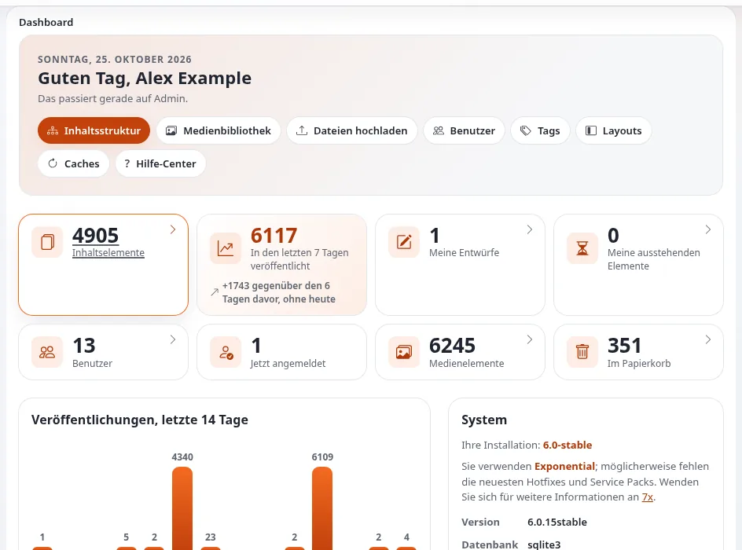

# Lektion 1.1: Was ein Website-Administrator tut

Redakteure schreiben Inhalte; ein Website-Administrator hält die Website, die diese Inhalte trägt, gesund, sicher und
benutzbar. Diese erste Lektion zieht die Grenze zwischen den beiden Aufgaben, nennt die Bereiche, die der Kurs
behandelt, und stellt sicher, dass alle Teilnehmenden eine funktionierende Schulungsinstallation mit einem
Administratorkonto haben, bevor irgendetwas anderes geschieht.

> **Hinweis**
> Jede Übung dieses Kurses läuft auf der eigenen Schulungsinstallation der Teilnehmenden. Üben Sie Administration nie
> auf einer Live-Website: Die meisten Seiten dieses Kurses können das Verhalten der gesamten Website verändern.

## Auf einen Blick

| | |
|---|---|
| Kurs | [Website-Administration](../README.md) |
| Modul | [Modul 1: Orientierung als Website-Administrator](README.md) |
| Dauer | 30 Minuten (10 Präsentation, 20 Übung) |
| Niveau | Fortgeschrittene |
| Zielgruppe | Neue Website-Administratoren, Intranet-Administratoren, Support-Mitarbeiter |
| Voraussetzungen | Redakteure 101 oder vergleichbare Erfahrung in der Redaktion; ein Terminal auf einem Rechner mit PHP 7.4 oder neuer |

## Lernziele

Nach dieser Lektion können die Teilnehmenden:

- die wichtigsten Aufgaben eines Website-Administrators und das Kursmodul, das jede davon behandelt, aufzählen;
- die Siteaccesses einer Installation für die öffentliche Website, die Administration und die Redaktion
  unterscheiden;
- eine Schulungsinstallation mit `exp:install` und `exp:velocity start` installieren und starten;
- sich als Administrator in der Administration ihrer Schulungsinstallation anmelden.

## Hinweise für Trainer

### So präsentieren Sie es

Quelle: [Eine Website betreiben](../../../../anleitungen/betrieb-einer-website.md) und
[Die Installation über die Konsole](../../../../installation/07-installation-ueber-die-konsole.md).

1. **Zwei Aufgaben** (3 Minuten). Ein Redakteur erstellt, ändert und veröffentlicht Inhalte. Ein Administrator
   entscheidet, wer das tun darf (Benutzer, Rollen), wie sich die Website verhält (Einstellungen, Siteaccesses,
   Sektionen), und hält sie am Laufen (Caches, Cronjobs, Logs, Sicherungen, Upgrades, Sicherheit). In kleinen
   Organisationen macht eine Person beides; der Kurs hält die beiden Aufgaben trotzdem auseinander, weil die
   Berechtigungen verschieden sind.
2. **Die Aufgaben und die Module** (4 Minuten). Zeigen Sie die folgende Tabelle am Beamer und lassen Sie sie stehen,
   während die Teilnehmenden installieren.

   | Aufgabe | Modul dieses Kurses |
   |---|---|
   | Sich zurechtfinden, Einstellungen | 1 |
   | Benutzer und Gruppen | 2 |
   | Rollen und Richtlinien | 3 |
   | Sektionen, Siteaccesses, Objektzustände, Sprachen | 4 |
   | Caches | 5 |
   | Cronjobs, Workflows, Benachrichtigungen | 6 |
   | Logs und das Audit-Protokoll | 7 |
   | Sicherheit | 8 |
   | Sicherungen und Wartung | 9 |
   | Upgrades, Erweiterungen und Pakete | 10 |

3. **Drei Zugänge** (3 Minuten). Eine mit `exp:install` erstellte Installation hat drei Siteaccesses: die öffentliche
   Website (`site`), die Administration (`admin`) und die Redaktion (`editor`), eine Administration nur für die
   Bearbeitung von Inhalten. Mit URL-Matching, der Voreinstellung, erreichen Sie sie über die Pfade `/`, `/admin` und
   `/editor`. Setup-Seiten gibt es nur in der Administration.

### Häufige Fragen

**Muss ich auf dem Server root sein, um eine Website zu administrieren?** Nein. Der größte Teil dieses Kurses findet
im Browser statt. Einige Aufgaben (Caches leeren, Cronjobs, `exp:ini`) erledigen Sie in einem Terminal im
Wurzelverzeichnis der Installation, als der Benutzer, dem die Dateien gehören. Arbeiten Sie als `root`, brauchen die
PHP-Skripte `--allow-root-user`.

**Welches Passwort hat der Administrator auf einer neuen Installation?** `exp:install` verwendet `--password=`, wenn
es lang genug und kein bekanntes Wort ist; andernfalls erzeugt es eines, gibt es am Ende aus und schreibt es nach
`var/log/initial-admin-password`. Siehe [Das Standardpasswort des Administrators](../../../standard-administratorpasswort.md).

**Kann ich für diesen Kurs den Siteaccess der Redaktion verwenden?** Nein. Der Siteaccess `editor` ist für die
Bearbeitung von Inhalten gemacht und hat keinen Setup-Bereich.

### Stolperfallen

- **Falscher Port oder falsche URL.** Eine Website, die mit einer `--url` installiert und unter einer anderen Adresse
  geöffnet wird, liefert fehlerhafte Links. Installieren Sie mit der Adresse, die Sie öffnen werden, zum Beispiel
  `--url=http://localhost:8088`.
- **Die Installation läuft als root.** Die Dateien gehören dann root, und der Webserver kann nicht nach `var/`
  schreiben. Installieren Sie als der Benutzer, der die Website betreiben wird.
- **Die Teilnehmenden haben das erzeugte Passwort nur auf dem Bildschirm.** Bitten Sie sie, es sofort in ihrem
  Passwortmanager zu speichern.

## Praktische Übung

Alle Teilnehmenden bauen eine Schulungsinstallation auf ihrem eigenen Rechner auf (siehe
[Die Installation über die Konsole](../../../../installation/07-installation-ueber-die-konsole.md)) oder verwenden die, die der Trainer
vorbereitet hat.

1. Wechseln Sie in einem Terminal in das Wurzelverzeichnis des Exponential-Codes (das Verzeichnis mit `index.php`).
2. Sehen Sie sich an, was das Installationsprogramm tun würde, ohne etwas zu ändern:

   ```bash
   php bin/php/console exp:install --url=http://localhost:8088 --dry-run
   ```

3. Lesen Sie die Zusammenfassung: die Datenbank (SQLite, wenn Sie keine andere gewählt haben), das Seitenpaket und die
   Siteaccesses `site`, `admin` und `editor`.
4. Führen Sie denselben Befehl ohne `--dry-run` aus. Speichern Sie das Administratorpasswort, das er am Ende ausgibt,
   in Ihrem Passwortmanager.
5. Starten Sie die Website mit Velocity:

   ```bash
   php bin/php/console exp:velocity start
   ```

6. Öffnen Sie `http://localhost:8088/` (die öffentliche Website), dann `http://localhost:8088/admin` (die
   Administration).
7. Melden Sie sich als `admin` mit dem Passwort aus Schritt 4 an.
8. Notieren Sie die Einträge des oberen Menüs, öffnen Sie dann **Setup** und lesen Sie die Überschriften der
   Setup-Seite.
9. Öffnen Sie `http://localhost:8088/editor`, melden Sie sich mit demselben Konto an und vergleichen Sie das obere
   Menü.
10. Schreiben Sie auf Papier drei Aufgaben auf, die Sie im nächsten Monat als Administrator erwarten, und neben jede
    das Modul dieses Kurses, das sie behandelt.

## Erwartetes Ergebnis

- Die Installation antwortet unter `http://localhost:8088/` und die Administration unter `/admin`.
- Als `admin` angemeldet, zeigt die Administration den Eintrag **Setup** im oberen Menü; die Setup-Seite hat die
  Gruppen **Inhaltsmodell**, **Website und URLs**, **Workflows**, **Benutzer und Nachrichten** und **System** (das
  Design admin4; Installationen mit erweiterten Funktionen zeigen weitere Gruppen).
- Der Siteaccess `editor` zeigt keinen Setup-Bereich.
- Der Trainer prüft das, indem er zwei Teilnehmende bittet, ihre Setup-Seite und ihre Aufgabenliste zu zeigen.



## Quiz

1. Nennen Sie drei Aufgaben eines Website-Administrators, die nicht zur Arbeit eines Redakteurs gehören.
2. Welche drei Siteaccesses erstellt `exp:install` standardmäßig?
   A. `site`, `admin`, `editor` B. `public`, `admin`, `setup` C. `site`, `setup`, `editor` D. `www`, `admin`, `edit`
3. Was bewirkt `--dry-run` bei `exp:install`?
4. Wohin schreibt `exp:install` ein erzeugtes Administratorpasswort?
5. Richtig oder falsch: Der Setup-Bereich ist im Siteaccess `editor` verfügbar.

<details>
<summary>Antworten</summary>

1. Zum Beispiel: Benutzer und Rollen verwalten, Einstellungen ändern, Caches leeren, Cronjobs ausführen, Logs lesen,
   Sicherungen erstellen, Upgrades durchführen ([Eine Website betreiben](../../../../anleitungen/betrieb-einer-website.md)).
2. **A.** Die Pfade lassen sich mit `--site-access`, `--admin-access` und `--editor-access` ändern
   ([Die Installation über die Konsole](../../../../installation/07-installation-ueber-die-konsole.md)).
3. Es zeigt, was installiert würde, und prüft die Optionen, ohne etwas zu schreiben.
4. Nach `var/log/initial-admin-password`, nur für den Eigentümer lesbar; löschen Sie die Datei, sobald das Passwort
   sicher gespeichert ist ([Das Standardpasswort des Administrators](../../../standard-administratorpasswort.md)).
5. **Falsch.** Der Siteaccess `editor` ist eine Administration nur für die Bearbeitung von Inhalten.

</details>

## Weiterführende Literatur

- [Eine Website betreiben](../../../../anleitungen/betrieb-einer-website.md): die tägliche Routine, die dieser Kurs vermittelt.
- [Die Installation über die Konsole](../../../../installation/07-installation-ueber-die-konsole.md): jede Option von `exp:install`.
- [Die Website ausliefern](../../../../installation/08-die-website-ausliefern.md): Velocity und die anderen Webserver.
- [Ein Rundgang durch die Administration](../../../rundgang-durch-die-administration.md): die Kopfzeile, die Spalten und das Dashboard.

## Verwandte Seiten

- [Modul 1: Orientierung als Website-Administrator](README.md)
- [Website-Administration: Kursüberblick](../README.md)
- [Kurzübersicht zur Übungsumgebung](../../kurzkarte-fuer-die-uebungsumgebung.md)
- [Trainer: hier beginnen](../../trainer-hier-beginnen.md)
- [Freie Dokumentation](../../../freie-dokumentation.md): Diese Seite darf unter der GNU FDL 1.3 frei kopiert, übersetzt und verbessert werden.

<!-- exp-partner-block:start -->
**Werden Sie Exponential-Partner.** Partner teilen ihre Informationen, stellen Mittel bereit, geben Beiträge zurück
und entwickeln die Produkte mit uns, und so wächst Exponential. Eine Partner-Website und ein Dashboard sind für Mitte
2027 geplant: Werden Sie noch heute Partner, damit wir schneller wachsen und neue Funktionen früher liefern. Beginnen
Sie mit [Partner: hier beginnen](../../../partner/partner-hier-beginnen.md) und
[Wie Sie sich bewerben](../../../partner/wie-sie-sich-bewerben.md).
<!-- exp-partner-block:end -->
